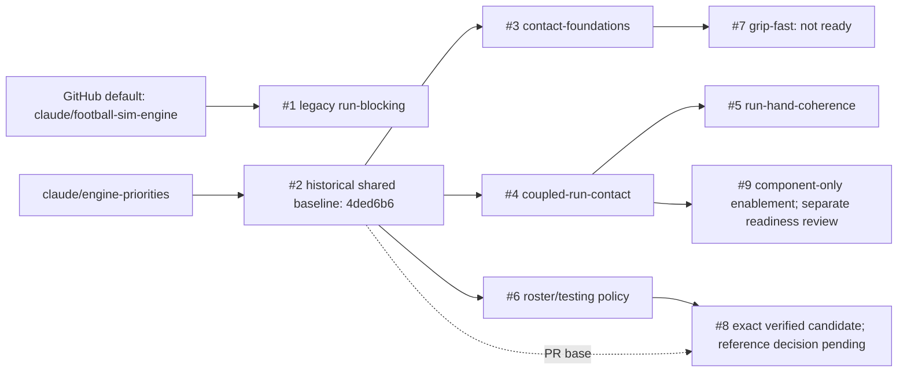

# GitHub branch audit and cleanup plan

Snapshot: 2026-10-13 (America/Phoenix), UTC 2026-10-14T00:19:29.131324+00:00.
Repository: [tannerthardy/football-simulation-](https://github.com/tannerthardy/football-simulation-).
[Pinned inventory and proposed retirement tips](../data/reviews/current/github-branch-audit.json).

## What is making the repository hard to navigate

- **31 remote branches, nine open PRs, all nine drafts; no merged PRs in the returned history.** Most older work was consolidated locally while its original branch/PR remained visible.
- GitHub defaults to `claude/football-sim-engine` at `3b5bf9b`, **250 commits behind** the historical shared baseline and 259 behind the audited #8 tip. The historical comparison is `4ded6b6`; #8 is the proposed development reference. These are three different entry points.
- **14 tips are already contained in 4ded6b6.** That includes structural refs such as the default, primary branch and PR #1; containment alone does not authorize deleting them.
- **Ten old milestones** have no open PR dependency and are fully contained in the historical baseline. Eight Codex milestones form the first retirement batch; the other two are controller-owner coordination items.
- Rejected trials, inactive research and current diagnostic work share the same branch list. `codex/stretch-helper-check-trial` is a rejected history point, while the arrival branch has **26 unique diagnostic commits** and the same production source tree as the baseline.
- The branch API reports `protected=false` for all 31 heads; automatic branch deletion after merge is off. Repository-wide rulesets were not audited. These observations do not authorize changing protection or repository settings.
- Completed workboard rows still sit under “Active item”; older rows are historical stages, not a reliable live branch directory. Use this map for branch disposition and the workboard for bounded ownership.

## Current review graph

Arrows below describe PR bases/stacks, not permission to merge. #8 contains #6; #3/#4/#5/#7 remain separate as requested; the new #9 is also a separate candidate.

Keep the parent refs for the #3 → #7 and #4 → #5/#9 stacks. A parent can have zero commits exclusive of its child and still be a required PR base.

## First retirement batch: eight fully preserved milestones

**Proposed, not executed.** These exact tips are ancestors of `4ded6b6`; no open PR uses them as head/base, and no branch-dependent citation was found in the inspected docs/PR descriptions. Production code does not need to be merged or tested again to preserve this history.

| Branch | Exact tip | Preservation |
| --- | --- | --- |
| `codex/defensive-flow` | `b143f1ba63460f0de0de82b8eecefcd563e052c1` | Entire history reachable from `4ded6b6`; proposed tag `archive/2026-10-13/codex/defensive-flow`. |
| `codex/reach-contact-closure` | `d4ec81c5e8738e118dfce5cac3b3324975509a45` | Entire history reachable from `4ded6b6`; proposed tag `archive/2026-10-13/codex/reach-contact-closure`. |
| `codex/reach-contact-physics` | `fda39f724b8abc957e080eda7b8a4fcace668077` | Entire history reachable from `4ded6b6`; proposed tag `archive/2026-10-13/codex/reach-contact-physics`. |
| `codex/reach-wrap-transition` | `182f01c2640618de67b565d9e0a2a8a0dae074a3` | Entire history reachable from `4ded6b6`; proposed tag `archive/2026-10-13/codex/reach-wrap-transition`. |
| `codex/run-game-contact` | `e4788263eaf4d187a08ba4c3eea1689d154b2629` | Entire history reachable from `4ded6b6`; proposed tag `archive/2026-10-13/codex/run-game-contact`. |
| `codex/slow-rear-contact` | `23de24f4fd1c624dec207d11301185778ce6ac44` | Entire history reachable from `4ded6b6`; proposed tag `archive/2026-10-13/codex/slow-rear-contact`. |
| `codex/wrap-binding-physics` | `11298d3d0bff97af1baf6cb9f3bb997645e4e520` | Entire history reachable from `4ded6b6`; proposed tag `archive/2026-10-13/codex/wrap-binding-physics`. |
| `codex/wrap-force-point` | `67301d24ef56a72b4a205185fb6c76b6dd845c7b` | Entire history reachable from `4ded6b6`; proposed tag `archive/2026-10-13/codex/wrap-force-point`. |

This batch reduces the branch list **31 → 23**, without removing any commit from the preserved baseline history. Tags are proposed restore points; the snapshot also records every original SHA. No tags or branch deletions have been issued.

Before executing: confirm no owner is continuing on the old name, recheck each remote tip against the manifest, preserve and verify its archive tag on GitHub, then delete only those eight refs. Stop if a tip moved, a new PR depends on it or a citation/owner dependency appears. Keep the baseline/reference refs and every other branch. Do not bulk-delete every “merged” branch.

## All 31 branches

Ahead/behind counts are commit-set differences versus **historical 4ded6b6**. “Exclusive” counts commits reachable from that tip and no other current remote head; zero does not mean disposable. Exact source equality and citation locations are in the JSON receipt.

| Branch / tip | Ahead / behind | Exclusive | PR head / base | Disposition |
| --- | --- | --- | --- | --- |
| `claude/contact-stability` / `916f3c6` | 5 / 0 | 0 | — / — | Keep research / owner disposition: Five commits past historical base, also contained in ground-finish. HOLD_BALANCE/TACKLE_DROP research; no PR. |
| `claude/easy-gains` / `10f00a5` | 0 / 112 | 0 | — / — | Coordinate retirement: Fully in 4ded6b6, no PR/branch-link dependency found. Confirm controller owner has moved on. |
| `claude/engine-priorities` / `862258c` | 0 / 74 | 0 | — / #2 | Structural / primary owner: PR #2 base; primary physics ownership. Keep pending owner/reference disposition. |
| `claude/football-sim-engine` / `3b5bf9b` | 0 / 250 | 0 | — / #1 | Structural / legacy default: GitHub default; PR #1 base. Keep until reference/default and legacy-PR decisions. |
| `claude/ground-finish` / `6c87169` | 6 / 0 | 1 | — / — | Keep research / owner disposition: Child of contact-stability, six commits past base; GROUND_HOLD experiment remains off; no PR. |
| `claude/in-stride-catch` / `83e514a` | 2 / 144 | 1 | — / — | Parked / archive original: Unique original commit; controller rescue exists behind IN_STRIDE_CATCH in shared history. Preserve original tip before retiring. |
| `claude/live-gaps` / `448313e` | 0 / 24 | 0 | — / — | Coordinate retirement: Fully in 4ded6b6, no PR/branch-link dependency found. Old workboard still reads as live work; confirm owner. |
| `claude/pass-rush-hands` / `724a94c` | 4 / 140 | 1 | — / — | Parked / evidence-link hold: Unique HANDS2 research, not accepted. Branch-name links in hands-plan across 13 heads; preserve ref until citation solution. |
| `claude/physics-world-wip` / `e8d6b02` | 1 / 229 | 1 | — / — | Parked / archive original: Unique WIP backup commit, explicitly not for merge. Preserve the exact tip before retiring. |
| `claude/pursuit-coverage` / `576581b` | 1 / 144 | 0 | — / — | Parked / superseded original: Tip retained in in-stride-catch; current workboard marks pursuit superseded. Commit ancestry differs from shared rescue; archive original. |
| `claude/run-blocking` / `88bfc45` | 3 / 140 | 0 | — / — | Parked / archive original: Tip retained in pass-rush-hands; pad-line package remains parked. Preserve original rather than merge it. |
| `claude/trench-investigation` / `b6a48f1` | 1 / 156 | 1 | — / — | Parked / archive original: Unique historical experiment/doc commit; existing baseline guidance says retain for evidence. Preserve/reconcile that guidance before retiring. |
| `codex/catch-pursuit-diagnosis` / `4782057` | 26 / 0 | 26 | — / — | Keep research / owner disposition: 26 unique diagnostic commits; exact historical src tree. Latest near-hip/P4 evidence; no PR. |
| `codex/contact-foundations` / `8e36cce` | 7 / 0 | 0 | #3 / #7 | Structural / active PR stack: PR #3 head / #7 base. Preserve separately; do not merge to tidy refs. |
| `codex/coupled-run-contact` / `b64910e` | 3 / 0 | 0 | #4 / #9,#5 | Structural / active PR stack: PR #4 head / #5 and #9 base. Preserve separately. |
| `codex/defensive-flow` / `b143f1b` | 0 / 68 | 0 | — / — | First retirement batch: Whole tip retained in 4ded6b6; no open PR head/base or branch-name citation found. Tag/preserve, then delete only after cleanup approval. |
| `codex/grip-fast-integration` / `504c749` | 12 / 0 | 5 | #7 / — | Structural / not-ready PR: PR #7; explicitly not ready. Keep separate. |
| `codex/reach-contact-closure` / `d4ec81c` | 0 / 44 | 0 | — / — | First retirement batch: Whole tip retained in 4ded6b6; no open PR head/base or branch-name citation found. Tag/preserve, then delete only after cleanup approval. |
| `codex/reach-contact-physics` / `fda39f7` | 0 / 45 | 0 | — / — | First retirement batch: Whole tip retained in 4ded6b6; no open PR head/base or branch-name citation found. Tag/preserve, then delete only after cleanup approval. |
| `codex/reach-wrap-transition` / `182f01c` | 0 / 42 | 0 | — / — | First retirement batch: Whole tip retained in 4ded6b6; no open PR head/base or branch-name citation found. Tag/preserve, then delete only after cleanup approval. |
| `codex/roster-capability-audit` / `f9617dd` | 4 / 0 | 0 | #6 / — | Structural / incorporated policy PR: PR #6 included in #8. Retire only after #8 disposition and citation update. |
| `codex/run-blocking-decision-dynamics` / `9e64fc6` | 0 / 244 | 0 | #1 / — | Structural / legacy PR: PR #1 head wholly reachable from 4ded6b6. Owner may close as superseded; do not merge it again. |
| `codex/run-contact-components-candidate` / `7a04ad6` | 5 / 0 | 2 | #9 / — | Structural / separately ready candidate: PR #9, component-only enablement inherited from #4. Owner reports focused readiness; assess dependencies/settings separately, not part of #8 or this cleanup. |
| `codex/run-game-contact` / `e478826` | 0 / 66 | 0 | — / — | First retirement batch: Whole tip retained in 4ded6b6; no open PR head/base or branch-name citation found. Tag/preserve, then delete only after cleanup approval. |
| `codex/run-game-integration` / `4ded6b6` | 0 / 0 | 0 | #2 / #8,#6,#4,#3 | Structural / historical comparison: 4ded6b6; PR #2 head and base of #3/#4/#6/#8. Keep this historical pin. |
| `codex/run-hand-coherence` / `7eec40c` | 10 / 0 | 3 | #5 / — | Structural / active PR stack: PR #5; diagnostics and withdrawn-policy history. Preserve focused evidence. |
| `codex/shared-candidate-verification` / `c98c2fa` | 9 / 0 | 5 | #8 / — | Structural / proposed development reference: PR #8; verified #6-only candidate. Adoption remains a decision. |
| `codex/slow-rear-contact` / `23de24f` | 0 / 40 | 0 | — / — | First retirement batch: Whole tip retained in 4ded6b6; no open PR head/base or branch-name citation found. Tag/preserve, then delete only after cleanup approval. |
| `codex/stretch-helper-check-trial` / `4074038` | 7 / 0 | 0 | — / — | Coordinate retirement: Rejected 4074038 retained in PR #5 ancestry. Archive as rejected; never merge the trial for cleanup. |
| `codex/wrap-binding-physics` / `11298d3` | 0 / 49 | 0 | — / — | First retirement batch: Whole tip retained in 4ded6b6; no open PR head/base or branch-name citation found. Tag/preserve, then delete only after cleanup approval. |
| `codex/wrap-force-point` / `67301d2` | 0 / 39 | 0 | — / — | First retirement batch: Whole tip retained in 4ded6b6; no open PR head/base or branch-name citation found. Tag/preserve, then delete only after cleanup approval. |

## Cleanup after the first batch

The live audit caught #5 advancing to `7eec40c` and a new #9 component-only candidate at `7a04ad6`. Their entries were refreshed before publication. #9 reports 32 focused assertions and declares component enablement only; it is a separate readiness/dependency decision, not an automatic addition to #8. No new shared-suite run was requested from that contributor.

| Group | Proposed next step | Constraint |
| --- | --- | --- |
| `claude/easy-gains`, `claude/live-gaps` | Retire the two incorporated milestones once the controller owner confirms the current work location. | Both tips are wholly in 4ded6b6, but ownership rows can still read as live. Do not infer inactivity from no PR. |
| `codex/stretch-helper-check-trial` | Archive the withdrawn 4074038 trial and retire its ref. | Its entire commit history remains in #5. Do not import the rejected implementation into shared development. |
| `claude/physics-world-wip`, `claude/trench-investigation`, `claude/in-stride-catch` | Preserve exact original tips under archive tags, then retire only after owner/evidence disposition. | Each has a commit not reachable from another current head. Old source snapshots matter even where code/docs were rescued separately. Existing trench retention guidance needs reconciliation. |
| `claude/pursuit-coverage`, `claude/run-blocking` | Preserve original tips and retire the old refs as superseded/parked history. | Covered respectively by original in-stride-catch/pass-rush-hands histories, not wholly by the current shared baseline. Keep archived parent chains reachable. |
| `claude/pass-rush-hands` | Keep as an evidence anchor until the citation dependency is solved; research remains parked. | Branch-name links in hands-plan occur across 13 heads. Tags preserve commits but do not redirect old `/blob/branch/...` URLs. |
| #1 / `codex/run-blocking-decision-dynamics` | Ask the owner to close the legacy PR as superseded, link the retained historical/current reference, then archive the ref. | Tip is wholly in 4ded6b6. Current CLAUDE.md says not to touch #1 without its owner; no #1 change was made. |
| #6 / `codex/roster-capability-audit` | Once #8 is accepted as reference, mark #6 incorporated, close the duplicate draft and retire the policy source branch. | #8 includes its exact tip. A branch-dependent citation remains in #5’s workboard; point it at an immutable commit/accepted reference before deletion. |
| #2 and its legacy default/primary refs | Resolve after choosing the development reference and with the primary owner. | #2 stays draft under current instructions. Do not delete a PR base or silently move the historical comparison. |

Aim for roughly **8–12 meaningful branch refs**, depending on how many research lines owners keep active, with old milestones under tags instead of an `archive/*` branch namespace. This is a target organization, not authorization to delete unique work.

## One obvious entry point

Recommended decision: **adopt #8 as the shared development reference**, supported by the existing exact receipt, and give ongoing work one stable branch such as `develop`. Make that stable branch GitHub’s default only after adoption/owner coordination. Preserve `4ded6b6` under an immutable historical baseline tag and retain its exact comparison configuration/receipt. Do not rewrite it as a result for today’s code.

The current entry point remains historical `codex/run-game-integration` until that decision. Adopting a reference, changing GitHub’s default, closing legacy PRs and deleting refs are separate actions; none happened during this audit. A default-name switch does not require another simulation campaign. Any independently ready runtime correction still needs its own dependencies/settings/focused evidence assessment.

After reference adoption, target new PRs at that reference, use stacked bases only for real dependencies, and have one integration owner verify the exact combined candidate. Stop using the repo default, the primary physics research branch and a historical benchmark as interchangeable starting points.

## Avoid rebuilding the same clutter

- One named current development reference, one immutable historical comparison, and bounded feature/research branches with an owner and next decision.
- At handoff mark work **active, incorporated, rejected or archived**. Do not leave completed milestones under an unqualified active label.
- Preserve original commits, focused receipts and adverse witnesses. Prefer immutable commit links for evidence. Never merge an experiment simply to get rid of its branch.
- Close incorporated PRs when the accepted reference contains their work; retain necessary stacked parents until children are retargeted/finished. Auto-delete after merge can be considered later for eligible feature branches, with explicit exclusions for shared references and live stacked bases.
- Treat tags as archive restore points; renaming old branches to `archive/*` keeps the same branch-count problem.
- Reuse compatible receipts. A branch audit/rename/ref deletion needs Git/evidence checks, not games or another code suite. Deleting already preserved refs also does not shrink reachable repository history.

## Evidence and limits

Final Git analysis took 3.884 s (7.460 s including the earlier snapshot refreshed after live branch activity); zero code suites, audits of simulated rosters or games were run. All remote tips were fetched and checked against the GitHub snapshot. Tests/production code, flags and the existing #8 verification receipt are unchanged. Snapshot revisions are fixed at audit collection; later publication-only documentation is not a newly tested candidate.

The audit used PR metadata, ancestry between all 31 heads, exact src-tree identities, unique commit reachability, branch workboards and branch-name links in documentation JSON/Markdown/text across all fetched heads plus all nine PR descriptions. It inspected the three worktrees in this workspace. It cannot establish other agents’ unpushed work, external citations, CI-secret dependencies or repository-wide ruleset policy. Recheck mutable refs and owner intent before cleanup. Branch API protection booleans are observations, not a complete permissions audit.

No branches, tags, PR states, default-branch settings or protections were changed. The ready first-batch manifest contains eight explicit names, expected tips and preservation targets; the rest remain disposition decisions.
