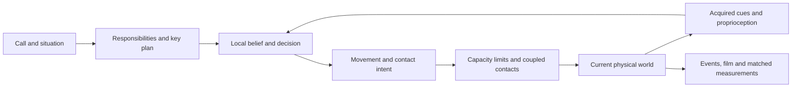

# Fundamentals: contact, intent, and a compact body model

The newer [universal interaction audit](universal-interaction-readiness.md)
reproduces remaining solver-transition/support/sampling gaps and defines the
next physical delivery gates. This file records the preceding implementation.

Follow-up to `f331202` on `claude/engine-priorities`. The owner wants a sound
11-on-11 foundation that supports more techniques and schemes without
continually retuning physics. This change repairs reproduced contact defects
and starts an explicit protection-intent contract. It does **not** establish
NFL realism: the paired game panel regresses in passing yards, YAC and
interceptions. PR #1 remains separate; `src/sim/tackle.ts` is unchanged.

Evidence, commands and source/script hashes are in
[`data/reviews/contact-foundation/`](../../../data/reviews/contact-foundation)
and the [data guide](../../../data/archive/catalog-2026-10-11.md). Read the
[previous coverage/pocket review](coverage-judgment-and-pocket-mechanics.md)
for definitions and the [visual-key design](visual-keys-and-attention.md)
for the proposed acquisition model.

## The broad architecture we should build toward

Football depth belongs in taught responsibilities, observations, risk and
technique choices. Physics supplies what a body can actually accomplish.
A scheme should supply keys, aiming points, leverage goals, exchanges and
permitted techniques through stable interfaces. It should not need a special
collision rule or a bonus to yards gained.

The important contracts are:

1. **Capability:** measurable size, mass, reach and movement capacity, plus
   technique, energy and support state. Combine performance constrains
   capabilities; it does not directly measure every in-game force curve.
2. **Observation:** what this player acquired, its age and quality, plus
   contact feedback. Hidden opposing jobs and future outcomes stay out of
   decision inputs. This is not yet consistently enforced by existing code.
3. **Intent:** desired movement, gaze, leverage and contact action. An intent
   is a goal, not permission to teleport or win a block.
4. **Contact:** physical normal, relative motion, reach, control, support
   and finite force/slip limits. Blocking and tackling can use distinct
   techniques while sharing momentum and contact bookkeeping.
5. **Measurement:** identical definitions for simulation and tracking;
   causal diagnostics separate acquisition, decision, movement, contact and
   outcome errors. Keep the budget and full-game guards.

This separation matters more than adding many new named plays. A tackle
setting against a speed rush, a guard reaching a shade and a DB carrying a
seam should express different goals on top of compatible movement/contact
rules. The existing system only partially follows these contracts.

## What changed in this implementation

### Physical load and football leverage have different axes

Pass contact used the defender-to-QB vector as the force axis. That can pull
an angled pair inward even when the bodies are touching along another line.
`engagement.ts` now uses the actual defender-to-blocker normal for drive and
resistance. The QB-relative axis still defines leverage and the taught
problem. Changing the protected point cannot remotely rotate contact force.

Physical leverage is remeasured before the next technique decision, rather
than carrying an old angular goal around a moving QB. Foot/hand repositioning
remains finite. Facing also turns at the player's rotation limit.

The backward pass set is projected onto **both** normal and tangent. The
first implementation included only the normal component; that made an
angled set drift inward instead of retaining its field-relative intent.
The final measurements below include the tangent correction.

### Outside collisions respect existing constraint ownership

Previously, a neighbor could shift just the blocker or tackler. The block's
cached pair velocity then ignored that bump on the next solve. Positions,
velocity and constraint geometry could disagree.

`physics/contact.ts` provides mass-weighted group motion, dissipative bump
impulses and center-preserving pair repositioning. `sim/collisions.ts`
propagates outside bumps through existing blocks/helpers and tackle groups.
It uses the live bond and up to three local overlap passes for crowded
contacts. Coincident centers now separate using a deterministic normal.

Block common velocity is read from the actual bodies each solve. There is
no separate common-motion cache to discard an intervening collision impulse.
Run-block repositioning now changes both bodies around their center of mass;
it no longer pins the defender while moving the blocker around him and
thereby creates unrequested common motion.

The collision group is a translational approximation, not a rigid articulated
body. It has no torque/inertia solver, and outside bump coupling does not yet
scale with a weak grip. Internal helper geometry and active footwork retain
simplifications. Collision bump conservation does not imply that every active
technique/ground-force calculation is a validated biomechanics model.

### Protection supplies a small explicit intent

`PassProtector` continues to publish a `PassSetIntent` while engaged: set
depth, lateral lane and outside direction. An engaged player no longer stops
supplying a protection goal merely because the contact solver owns motion.

The contact solver can use that intent to steer an outside rush with finite
mirror speed, hand control, base and remaining lateral acceleration. A
crossing inside counter removes that steering opportunity. There is no
position clamp, guaranteed lane or automatic rush loss.

The 0.8-yard lane extension comes from the existing free set technique; the
steering gain and physical capacity mappings are model choices, not NFL
force measurements. Protection still uses shared QB geometry and some hidden
rusher identification. This intent contract is groundwork for more complete
local keys, slide exchanges and edge ride techniques, not their completion.

## Mechanical evidence

`contact-fundamentals-lab.ts` runs 20 synthetic reps across four fixed
rosters/seeds. The unchanged script also runs against the archived baseline.
These are mechanical invariants, not NFL outcome targets.

| Controlled quantity | Before | After |
|---|---:|---:|
| Mean unintended center drift in one zero-drive run-contact tick | 0.081 yd | approximately zero |
| Mean block-separation distortion after an outside bump | 0.130 yd | zero |
| Mean common lateral velocity immediately after a neighbor bump | -1.076 yd/s | -1.410 yd/s |
| Mean common lateral velocity after the next block solve | approximately zero | -1.410 yd/s |
| Largest sideways translation from a shifted QB in a normal-force-only rep | 0.020 yd | zero |

The bump transfers a different amount because the group has a different
effective mass and is corrected together. Tests separately verify total
two-axis momentum, center of mass and non-increasing kinetic energy for
outside bumps. They verify finite internal repositioning, separating contact,
coincident centers, live tackle-group coupling, outside/inside protection
choices, the set tangent and mirrored motion. The full suite has **200
passing tests**; typecheck and build pass.

The refreshed six-game film has **808 clips across 27 concepts**. All
**18 browser checks** pass, including grouping, exact play IDs, playback,
clipboard references, offline operation and mobile layout. The verified ZIP
contains the same populated HTML; the replay template has no embedded plays.

## Pocket anatomy: gains and remaining errors

Paired **16 games, seed 7, two leagues**; traditional dropbacks exclude
boots and scrambles. There are 1,191 before and 1,302 after. At two seconds
850 / 980 plays survive; at 2.5 seconds 452 / 564 survive. These selected
survivors are not a constant set of plays.

| Traditional-dropback quantity | Before | After | NFL two-week sample |
|---|---:|---:|---:|
| Any defender within 2 yd of QB | 39.38% | 31.11% | 27.3% |
| Proximity strictly before outcome | 35.35% | 27.73% | 21.6% |
| Ever-attached proximity / dropbacks | 22.59% | 20.43% | 21.7% |
| Ever-free proximity / dropbacks | 20.82% | 13.29% | 12.0% |
| First proximity attached | 52.67% | 64.44% | 76.1% |
| Median first proximity | 2.40 s | 2.70 s | 2.60 s |
| Mean OL depth, 2.0 s | 3.47 yd | 3.33 yd | 3.67 yd |
| Mean OL depth, 2.5 s | 4.47 yd | 4.26 yd | 4.48 yd |
| Mean tackle width, 2.0 s | 5.51 yd | 5.97 yd | 6.80 yd |
| Mean tackle width, 2.5 s | 4.20 yd | 4.98 yd | 6.04 yd |

First attached proximity accounts for 20.74% -> 20.05% of dropbacks, close
to the NFL's approximately 20.7%. First free proximity falls from 18.64% to
11.06%, but still exceeds the NFL's approximately 6.5%. All first proximity
defenders in this simulation panel are initial rushers. Of 144 first free
proximities after the change, nine have no listed proxy blocker. Most remaining
free cases are detached/previously assigned, not unidentified new blitzers.

The panel's sacks fall from 110 to 89; median snap-to-sack rises from 2.65
to 3.30 seconds. This is later but still earlier than the older, broader NFL
reference of approximately 4.25 seconds. End samples are capped at 4.5 seconds;
that cap is above these medians.

Attachment means a declared/observed proxy blocker within 1.5 yards. It is
not an NFL PFF pressure label or proof of force. The NFL uses PFF-listed
blockers; simulation uses assignments/contacts observed so far. NFL LOS is
the tracked football center; simulation LOS is its line coordinate. These
limits and the late-survivor selection remain material.

The 288 forced holds across Over, Under and Wide-9 are retained separately.
They hold a QB until five seconds and isolate protection development; do not
compare their sack percentage with ordinary NFL dropbacks. Consult their
sample counts and timing rather than treating them as game-rate targets.

## Full games do not yet improve overall

Paired **32 games, seed 7, four leagues**. Calls and subsequent RNG consumption
can diverge after outcomes change, so this is a guard panel, not an isolated
causal estimate or confidence interval.

| Quantity | Before | After |
|---|---:|---:|
| Points / team-game | 31.94 | 34.75 |
| Passing yards / attempt | 8.95 | 9.81 |
| Completion rate | 63.18% | 64.38% |
| YAC / reception | 6.58 yd | 7.06 yd |
| Catch-contest separation | 3.51 yd | 3.52 yd |
| Sack rate | 8.27% | 5.60% |
| Interception rate | 5.39% | 6.31% |
| Time to throw | 2.44 s | 2.51 s |
| Run yards / carry | 5.35 | 3.95 |
| Run stuff rate | 16.60% | 23.64% |
| Run yards before contact | 1.13 yd | 0.53 yd |

The run average crosses below the reference range; too many early contacts
and stuffs remain despite a less explosive average. Do not call run blocking
fixed or increase ball-carrier power to compensate. Passing yards and YAC
rise as the protection/contact changes alter throw opportunities. Do not
restore excess free rush wins to suppress offensive efficiency. Interceptions
already exceeded the NFL range and regress further.

The paired drive logs and 20,000-drive-per-variant error budget are saved
alongside the outcome tables. Assess the completed-yard, interception, run
and sack components separately; matching overall points per drive can hide
opposing errors. Drives/team-game rise from 14.67 to 15.25 and plays/drive
fall from 4.62 to 4.53; the NFL references are about 10.5 and 5.7. The fixed
own-25 model's total gap grows from +0.05 to +0.09 points/drive. Its
completed-yard Shapley share grows from +0.478 to +0.707, while run outcomes
move from +0.052 to -0.226 and interceptions from -0.190 to -0.234. The sack
share crosses from -0.132 to +0.021. Thus a small total gap still masks large
opposing errors. The baseline budget/outcome/drive artifacts reuse the prior
review's final run, whose engine source hash exactly matches `f331202`.
The baseline calibration and pocket/contact labs were rerun here.

The mechanical corrections are retained because they remove reproduced
force-frame and contact-ownership defects without editing outcome multipliers
or probability coefficients to force a target statistic.
That is a narrower claim than overall football realism. More realistic
underlying contact must be followed by better technique, coverage/pursuit
and decision anatomy; these regressions are part of the next work package.

## Where to simplify, and where to add detail

The current engine is **2D player movement with 3D ball flight**. It uses
body size, orientation, an optional shoulder-turned footprint, pad level,
reach, balance and scalar hand control. It has no articulated limbs,
independent feet, exact gaze, torso-height collision bands or continuous
rigid-body rotation/torque model. Traction is approximated by capacity limits
and a friction ellipse, not a measured foot/turf coefficient at every contact.

Keep a compact representation, but make the important football state explicit:

| Component | Useful compact representation | Depth it must preserve |
|---|---|---|
| Torso | Oriented footprint, height bands and limited posture/lean | Shoulder leverage, getting skinny, pad height, upright versus falling |
| Support | Small foot/support state with finite steps and a traction budget | A plant cannot supply full braking, lateral mirroring and drive simultaneously |
| Arms/contact | A few reachable contact anchors with control, grip and load limits | Inside hands, extension, steering, slipping, arm tackle versus wrap |
| Vertical motion | Jump/fall/reach state where the action requires it | Catch/bat height, low contact, legs taken away and legal down status |
| Cognition | Acquired key, uncertain memory, belief and bounded commitment | Anticipation, fakes, missed exchanges, help, recovery and communication |
| Scheme | Declarative responsibility and technique goals | Zone/gap rules, protection answers, fit exchanges, pattern-match coverage |

These are proposed extensions, not a claim that this pass built them. A full
ragdoll with many joints would add many parameters without directly solving
the current football errors. Add articulated detail only when a controlled
failure cannot be represented by the smaller model. Cosmetic limb animation
can be richer than the decision/physics representation.

## Next work, with delivery gates

1. **Finish contact/rush anatomy, preserving the repaired invariants.** The
   pocket is wider but still too narrow; first free proximity remains high.
   Trace outside wins, inside counters, ride-past-launch attempts and hands
   lost versus leverage actually won. Expand contact intent toward explicit
   contact/tangent load limits and slip/steering. Do not hard-pin tackles or
   force a global NFL pressure percentage.
2. **Trace early run contacts and stuffs.** Separate torso bumps, reachable
   arm tackles, first-level penetration, failed combos and pursuit. Verify
   the contact corridor against actual blocker bodies. Compare whole gain
   distributions by concept/front, not only YPC. Retain mass-preserving
   geometry; improve the taught leverage/contact goal when it fails.
3. **Fix completed-yard and interception anatomy.** Preserve direct route
   jumps versus drops/deflections, decision error versus placement, catch
   transitions and pursuit. Use the existing controlled coverage panel,
   especially Buzz. A realistic pressure opportunity can coexist with an
   unrealistic throw/catch response. Full QB feet/base/pressure memory remains
   the owner's later work; diagnostics can be added now.
4. **Implement visual acquisition in small coordinated pilots.** Follow
   `visual-keys-and-attention.md`: Palms and guard-to-back reads first, then
   local protection identification/exchanges and offensive block reads.
   Repeated requests cannot acquire additional fresh information. A hidden
   call change with identical visible cues cannot change the player's read.
5. **Extend the physical body only where evidence demands it.** Add support,
   lean/height and bounded contact anchors before detailed skeletons. Couple
   lateral/axial/contact workload, grip slip and base loss. Test isolated
   conservation, reach, effort, symmetry and loss-of-support cases before
   using NFL outcomes to calibrate numerical assumptions.
6. **Strengthen temporal/crowding invariants.** Current collision projection
   is discrete at 20 Hz with bounded local iterations, not continuous swept
   collision. Test fast crossing bodies, dense piles, constraint release and
   timestep sensitivity. Use collision substeps/sweeps where needed while
   retaining finite sensor/decision updates. Avoid rebuilding the whole
   engine at once.

For every increment, require a reproduced failure, mechanical/behavioral
regression cases, fixed-call/front/roster anatomy, then paired game guards
and the error budget. A new scheme should be installable through its key,
responsibility and intent data while preserving those invariants. That is
the practical gate for the solid foundation the owner is asking for.
