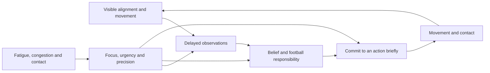

# Run blocking and decisions: review of 2c825eb and implementation

Prepared 2026-10-08. Base: `2c825ebc2c2bc65195b4b4df90e8702fb1ee98c8`.

This change fixes concrete assignment and observation defects, adds dynamic
execution state, and makes carrier shoulder turning affect collision geometry.
It is shared as a **draft for review and calibration**. Scenario correctness
improved; aggregate realism is mixed. Outside zone and power still need work,
counter remains too vulnerable to early penetration, and inside-zone explosive
gains are excessive. Passing and scoring also remain outside the intended range.

## What the latest push already improved

The preceding commits repaired reproduced rule/statistical accounting problems
and strengthened determinism and game tests. `2c825eb` added run/pass recognition
from formation/situation/scouting priors and post-snap cues, with belief
hysteresis and run fits. Those are useful foundations to retain. The baseline
passed 49 tests.

Four weaknesses remained in the reviewed paths:

1. Zone ownership could omit a shaded defender or let an outside blocker claim
   an interior man, leaving an edge unaccounted for. Trap could leave multiple
   playside down linemen for one puller. Gap assignments could expose the
   interior vacated by a pulling guard.
2. Double-team helpers released on a mesh-related timer, independent of control
   or the actual filling linebacker. They could leave a bad block or release
   before the remaining blocker had leverage.
3. Some mental effects were once-per-snap route-knowledge or match-bust rolls;
   others repeatedly rerolled during option evaluation. These produced permanent
   mistakes or jitter rather than commitment, overload and recovery. A few reads
   used live stance/facing or the actual offensive call alongside delayed motion.
4. The carrier had a circular footprint. There was no shoulder-turn posture;
   lane evaluation did not reliably treat teammates as bodies occupying a path.

## A compact model of immediate decisions

Model the sequence and its visible consequences, rather than inventing every
player's thoughts:



[`SnapMind`](../../../src/sim/mind.ts) adds small, interpretable state to each agent:

| State | Causes and consequences |
|---|---|
| Readiness | Snap-to-snap variation tied to consistency; influences focus and initial get-off delay for run blockers. |
| Alignment/placement error | A coherent lateral lean, scaled by discipline/consistency and current workload; defensive alignment stays legal. |
| Focus/stress | Respond to fatigue, nearby observed opponents and contact; recover as load falls. Lower focus increases latency and decision intervals. |
| Urgency | A coherent bias moderated by discipline and composure; changes fit aggressiveness and evidence needed for commitment. |
| Attention lapse | An optional short early window weakens guard/puller keys. The player can recover during the same play. |
| Held action | Reassess a fit or pursuit of a blocking target on a finite cadence, instead of changing aim every frame. |
| Capability-estimate error | A stable estimate per opponent, reused across throw options; evaluating the same window again cannot reroll its risk. |

All variation uses named agent-local RNG streams. A new mental draw does not
consume the shared gameplay stream. There is **no forced quota of one or two
mistakes per snap**: errors arise from state, job difficulty and geometry. A
player can react late on one cue and still execute another part of his job well.

The numbers governing lapse probability, alignment scatter, shoulder width,
focus loss and urgency are engineering hypotheses, **not fitted NFL estimates**.
Traits moderate behavior; they are not a diagnosis of real players. This first
version has one optional early lapse, not a full attention process, and does not
yet model communication, learning a playbook, confidence across snaps or every
position's decision policy.

### Integration with football jobs

- Recognition filters observed pad level/motion with focus-dependent latency
  and retains belief hysteresis. `read` events record commitments and changes.
- Run fits retain the assigned gap, but urgency changes flow and speed, placement
  error changes the fit, and the target is held between reads.
- Man coverage observes a stable receiver stem before reducing latency. An
  observed break resets that benefit. The defender receives no route-knowledge
  coin flip or zero-latency route revelation.
- Pattern-match coverage can hesitate under competing threats, use its spot
  positioning briefly, and recover. Its called technique stays match throughout.
- QB focus affects field of view and read dwell. Defender orientation comes
  from perception/memory, and the same capability-estimate error applies to
  catch-point and flight-path assessments.

The perception buffer now snapshots stance and facing as well as motion and is
primed before any read. Looking into the backfield delays recognition of skill
players regardless of the actual hidden run/pass call. Existing ball-event
shortcuts, true engagement state and some movement/assignment access still
remain. A restricted observation API is still needed before claiming every
decision uses only available information.

## Run blocking and carrier changes

[`blocking.ts`](../../../src/sim/behaviors/blocking.ts) now accounts for primary
down threats before forming zone combinations. A small assignment search
maximizes feasible coverage, then minimizes lateral travel; a slight defensive
shade change cannot greedily steal the only owner of a wide end. Gap schemes
resolve inside threats first, account for a vacated pulling guard, and reserve
one intended trap or kick target. Pull paths approach the target shoulder and
clear adjacent linemen before turning up.

Combinations share one state between both blockers. They remain together while
the block is insecure, then read control, base, angular leverage, the filling
linebacker and runner arrival. Either member can climb if the other is positioned
to keep the block. The exchange removes exactly one helper and preserves the
engagement's ownership. `block_climb` records the release and keeper.

Run strikes can start within functional arm extension, before torsos collide.
Placement uses delayed target motion with coherent error. Unattached blockers
find work inside their responsibility instead of selecting a defender anywhere
on the field by true assignment. The underlying hand/force/shed model remains;
helpers' force contribution and hip-to-hip geometry need further validation.

[`carrier.ts`](../../../src/sim/behaviors/carrier.ts) evaluates teammates as lane
obstacles, retains a designed aiming point and can leave it when a visibly
closed lane has a meaningfully better alternative. It paces a nearby lead/pull
blocker entering ahead, while continuing toward its own run side. Patience ends
if the blocker falls behind or an unblocked defender can close within two reads.
This prevents a late puller from imposing a mandatory wait in a closing hole.

### Getting skinny

The old physics did not model this. The new
[`bodyshape.ts`](../../../src/physics/bodyshape.ts) detects a narrow opening bounded
by bodies on both sides and requests a shoulder-turn posture. It takes time to
enter and recover. At full demand, the collision footprint narrows laterally
32% and lengthens longitudinally 12%; speed/drive and cutting control incur
costs. Its orientation turns at a finite rate.

It cannot make an opening narrower than the minimum footprint passable, and
arms/tackle reach remain unchanged. This is a torso approximation, not a
biomechanical model of hips, pads, ball protection or arm tackles. The replay
records posture and renders the carrier as an oriented ellipse; older replay
data remains supported. A `squeeze` event means posture was requested, not that
the player successfully threaded the gap.

## Verification and calibration

`npm test`: **74 tests pass in eight files**, including 25 new checks for mental
state, delayed stance/facing, same-window QB judgments, recoverable match
hesitation, mirrored run ownership, a moving under-front shade, trap targeting,
combination security/exchange, arm extension, dynamic lead pacing and posture.
`npm run typecheck` and `npm run build` pass.

The recorded-game export was generated and its JavaScript and packed frame
lengths checked, including nonzero posture frames. Browser interaction was not
tested in this environment.

### Controlled run matrix

[`run-blocking-lab.ts`](../../../scripts/run-blocking-lab.ts) runs three formations ×
five concepts × two fronts × both flips × 30 repetitions. Seeds 7 and 19 each
generate a separate fixed roster pair: **3,600 plays per revision**, compared
with the same roster and named play seeds at the baseline. Both use Cover 3,
midfield alignment and fixed strength 0.55; fouls stay in physical outcomes.
These are controlled diagnostics, not official league statistics or NFL samples.

Cell-level results and source hashes are committed in
[`paired-run-matrix.json`](https://github.com/tannerthardy/football-simulation-/blob/663193dfe7fe362d4f59072ef136437f881f1086/data/reviews/run-blocking-update/paired-run-matrix.json).
The following combines the two equally sized roster samples (720 plays per
concept per revision):

| Concept | YPC before → after | Stuff % before → after | 10+ yard % before → after |
|---|---:|---:|---:|
| Inside zone | 8.77 → 11.40 | 12.08 → 15.28 | 14.31 → 18.19 |
| Outside zone | 6.07 → 3.58 | 21.81 → 29.31 | 11.81 → 7.22 |
| Power | 2.14 → 2.05 | 43.19 → 58.19 | 4.44 → 6.11 |
| Counter | 1.50 → 1.97 | 61.94 → 67.64 | 5.14 → 4.86 |
| Trap | 4.43 → 6.04 | 46.39 → 26.53 | 10.00 → 10.56 |

Zone plays' initially unassigned DE/DT targets fell from 1.00 to 0.00 per snap in
this panel. This measures assignment ownership at the snap, not successful
contact or run-block wins. Trap stuff rates fell for both roster pairs. Outside
zone got worse overall, power's stuff rate rose, counter remained poor, and
inside-zone mean/tail gains stayed excessive. Completing an assignment graph
does not establish realistic execution of that graph.

Baseline `block_climb` and posture counts are zero because that revision lacks
these events, not because its helpers never released. Yards-before-contact
averages apply only to plays with a recorded contact and are weighted by that
contact count. Do not treat contact-censored means as a complete run distribution.

### Full games

Eight games at seed 7 provide a regression smoke check, not a stable calibration
sample. Official plays are filtered by the existing harness. Full logs are in
[`before-games.log`](https://github.com/tannerthardy/football-simulation-/blob/663193dfe7fe362d4f59072ef136437f881f1086/data/reviews/run-blocking-update/before-games.log) and
[`after-games.log`](https://github.com/tannerthardy/football-simulation-/blob/663193dfe7fe362d4f59072ef136437f881f1086/data/reviews/run-blocking-update/after-games.log).

| Metric | Baseline | This change |
|---|---:|---:|
| Points / team-game | 30.69 | 39.19 |
| Completion % | 67.82% | 66.24% |
| Yards / attempt | 8.57 | 8.49 |
| Sack rate (per dropback) | 12.08% | 13.19% |
| INT rate | 2.87% | 3.36% |
| Rush yards / carry | 4.74 | 6.20 |
| Run stuff rate (<=0) | 40.32% | 34.81% |
| 10+ yd runs | 12.90% | 14.75% |
| Yards before contact (runs) | 0.75 | 1.57 |

The lower stuff rate accompanies higher rushing efficiency and scoring, so this
does not demonstrate an overall realism improvement. Sack rate also remains
high. Run this over multiple independent leagues and review conditional
distributions before merging. Some timing measurements ran concurrently with
other checks; they are not a performance benchmark. Generic target ranges
printed by the harness are not a substitute for matched dataset definitions.

## What to improve next, and how NFL data can help

1. **Pull/lead timing and gap ownership.** Measure guard/tackle departure,
   handoff, first contact and time to LOS together. Trace when a filling LB
   reaches the carrier before an assigned lead or climber can fit him. Add
   communication/exchange rules for changing threats rather than allowing a
   perfect global reassignment. Reproduce penetration by front, shade and flip.
2. **Outside-zone reach and cutback.** Compare blocker/defender relative hips,
   first steps, lateral displacement and which shoulder stays free. Carrier
   decisions should read the near down lineman and linebacker, with path
   curvature and burst measured after the cut. A closed path must produce a
   realistic bend/cutback, not repeated lateral collision or an artificial stop.
3. **Explosive containment.** Trace the first missed tackle, blocked pursuit
   lane, safety entry angle and acceleration on long runs. Check the line, RB
   and pursuit together. Match touchdown censoring, first-contact coverage,
   tackle opportunity and 2–5/10+/20+ yard bins; do not tune only mean YPC.
4. **Observable mental-error calibration.** Use conditional first-step direction,
   cue-to-redirection delay, overshoot distance and recovery after traffic. Fit
   distributions by role, fatigue proxy, motion and threat complexity. Tracking
   cannot uniquely identify an internal belief or count every mental mistake;
   validate multiple mechanisms against held-out players/games and keep that
   uncertainty explicit.
5. **Information and communication.** Restrict behavior input to observations,
   self state and known teammate responsibilities. Extend finite commitment and
   recoverable errors to protection exchanges, receiver conversions and run-fit
   handoffs. Keep physical contact truth in the resolver, with a distinct player
   interpretation of that contact.

Big Data Bowl 2025's 2022 all-player tracking is the strongest supplied base
for run timing and geometry. The 2019 all-player release supplies another
season for generalization. BDB 2023's 2021 protection roles/opponents and
hit/hurry/sack labels support assignment/pressure validation, chiefly for pass
protection. BDB 2026's selected pass trajectories and 2027's selected-player
game/combine tracking cannot reconstruct every blocking corridor, ball path or
coverage exchange; use them for the motion and role cohorts they actually cover.
See the [data guide](../../../data/archive/catalog-2026-10-11.md) and reviews for exact source scope.

Tracking can test latency and geometry hypotheses. It cannot directly establish
eye gaze, hand control, thoughts or the precise shoulder-width reduction here.
Keep those as exposed modeling assumptions until validation supports them.

### Reproduce the comparison

```sh
node --import tsx scripts/run-blocking-lab.ts 30 7 out/runs-seed7.json
node --import tsx scripts/run-blocking-lab.ts 30 19 out/runs-seed19.json
node --import tsx scripts/calibrate.ts 8 7
node --import tsx scripts/export-replay.ts 7 --doc
```

To rerun the baseline, use an isolated checkout/archive of `2c825eb`, copy the
same lab script into its `scripts/` directory and resolve imports against that
checkout's `src/`. Do not run a baseline-labeled harness against current sources.
Raw NFL files and credentials are not needed for these controlled comparisons.
