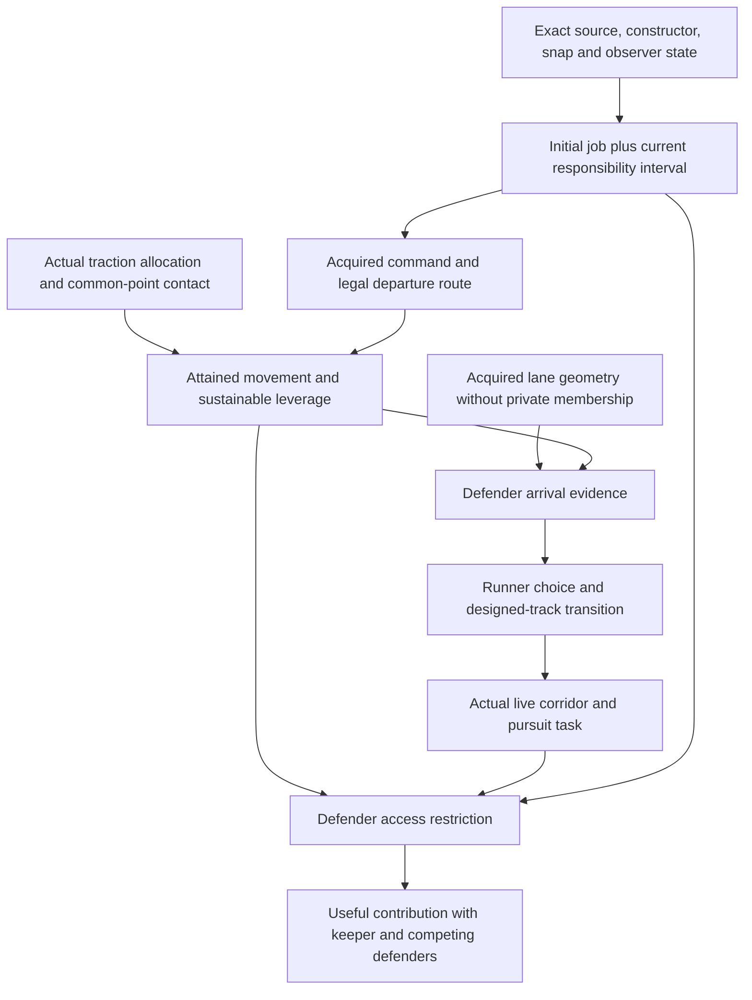

> Publication note: this is the frozen Phase II research report. Source pins, local paths, commands and numerical results describe the retained evidence package. See the [publication index](README.md) for remote evidence access and the next-work plan.

# Gridiron Engine — Deep Research Phase II

Research completed against historical `58e0f5ee13e1c29e9e6ab91cc22cccc576cfe3d7` and accepted `a5b024b9fbf8c51fc31401eefb79737be586814a`, Node22.23.3. The complete216-file Phase I manifest was independently verified before use. The original package, saved constructors, supporting experiments and negative findings are preserved alongside this package. This was a research mission; accepted engine files, defaults and remote branches were not changed.

## A. Executive verdict

**Do not substantially rebuild the blocking architecture on this evidence. Fix its measurable contracts first.** Two force-budget defects are now isolated and have a minimal correction. A supposed runner-protection failure is instead exactly explained by a downstream mode-transition trigger in one native play. Initial-job connection counts conceal responsibility changes and do not establish useful blocking failures. These are stronger conclusions than the original inventory, but they do not justify a percentage attribution of all bad football to five causes.

The central question—how many of the original53 jobs were genuine useful missed opportunities that a better lineman could convert—**is not numerically identified**. The tested legal candidates demonstrate zero complete useful conversions; that is not a finding of zero actual opportunities. The factual partition is:

| Historical initial-job stratum | Jobs |
|---|---:|
| Member loads its original target at some point |16|
| No member load on original target; that target contacts the carrier |10|
| Neither event recorded |27|
| Total |53|

Only14 of the16 loaded jobs have a loaded endpoint by first carrier contact. This remains a contact fact, not a26% success rate. Among the ten actual-target-contact cases, four have no/late release, four fail a sampled unloaded pursuit from actual release, and two pass that relaxation. Independent scrutiny then separates those two: S7-P070 has a retained-target command stall but marginal, rearward hypothetical reach to a later assist; S9-P062 deliberately retargets to a more urgent acquired threat and blocks him. Neither is a proven useful missed block. All53 rows and uncertainties are retained in [JOB_LEDGER.md](README.md#evidence-access), CSV and JSON.

### What survives, changes or fails

| Phase I proposition | Phase II verdict |
|---|---|
| The system can assign the right first-level and second-level players yet fail to execute the transfer | Survives as a mechanism, not a prevalence claim. S10-P015 acquires new LB contact with only an acquired route-menu change. S7-P070 releases into ten zero-command ticks. Useful conversion is still unproved. |
| A force–velocity correction explains excessive resisted carry | Incomplete. Competing laws change carry, but two independent ground-budget defects and center-hand angular geometry contaminate interpretation. No specific human FV law is identified. |
| Private runner engagement-win leakage is current | Superseded by merged #292. Current208 development and304 heldout evaluator packets are invariant to the tested private-win changes. A separate live-gap membership leak remains. |
| Nearby acquired teammate credit is a plausible replacement for private wins | Rejected as an established physical forecast. It can reward the wrong teammate and trigger a different runner mode. Acquired-only information is necessary, not sufficient. |
| Historical Duo losses prove the runner needs richer protection forecasting | Disproved for S12-P011: zero-credit geometry plus one diagnostic transition intervention reproduces accepted events and commands exactly. S11-P029 remains adverse and unresolved. |
|14/53 connections identify how much blocking is bad | Rejected. Initial responsibility can change; physical reach, contact and usefulness are different. The first-level and competing-target costs were missing from that interpretation. |
| Current architecture is promising | Qualified support. Existing bodies, acquired pictures, commands and contacts can express important positives. Essential contracts are inconsistent, and a complete useful-combo control policy remains unproved. No evidence here requires articulated feet, full limbs or a new coordinator. |

### Five consequential verified problems

These are priorities based on causal reach and strength of evidence, **not a measured ranking of population shares**.

1. **Ground-force accounting disagrees with itself.** Yaw spends standing-load traction while translation uses actual normal load; opposed gait/lean clipping can leave force with zero traction. Exact frozen native replay and12/24/48-substep controls eliminate timestep coarseness and controller choice as explanations for these violations. The minimal two-bound repair removes witnessed violations from44/44 retained run inputs to0/44.
2. **Unsupported protection credit also controls leaving the designed running track.** The accepted .25/.7-second allowance changes utility scale, and that scale feeds the designed-mode exit gate. Bidirectional one-boundary interventions explain S12-P011 exactly and much of heldout Counter S14-P054. Universal early exit fails S11-P029. This coupling makes apparently physical protection tests partly tests of an unrelated mode transition.
3. **Live-gap access still depends on private engagement membership.** On current source,88 subject-level geometry changes correspond to74 unique packets, not88 bad decisions. Two of18 exact actual-consumer command probes change behind a fixed acquired picture. The seam survives #292 and contaminates whole-run inference; no corrected policy is promoted here.
4. **Center-only tangential hands omit a yaw relationship.** A minimal common force-point/angular effective-mass intervention restores redirect with the unchanged draft FV law. Centered transport closes angular momentum to≤5.7e−14 in declared passive controls. This eliminates “redirect failure must be fixed by FV tuning” for that scene, but retained P019 remains adverse.
5. **The existing blocking verdict conflates initial job, ongoing responsibility and useful access.** Native rereads, a retarget-and-block witness, loaded-but-weak restriction, and a new-contact-without-usefulness witness directly disprove that shortcut. The historical common tracking operator also postselects players differently and bypasses a common quantization step. These are measurement/causal-identification problems, not evidence of a missing universal blocking brain.

The strongest implementation candidate is the minimal ground-budget repair, reviewed as an internal mechanical invariant. It is not an approved football upgrade: a retained edge-protection loss needs interpretation. The strongest behavioral direction is to separate acquired defender-arrival estimation from the runner's designed-track exit condition. None of the three tested protection replacements is ready unchanged. The immediate tools work is to make responsibility intervals and contribution evidence first-class diagnostic outputs.

## The surprising findings and the explanations eliminated

**Loaded hands can be a poor indicator of useful protection.** In S12-P011, Y→DE_W and C→DT_W both load all14 following native ticks, but conditional active-versus-passive access differences are about1.208 and.054–.056 yd. The weak C/DT_W allowance, not the stronger Y restraint, controls the accepted runner decision. Restoring only the accepted mode-exit instant with no protection bonus restores the entire accepted event list and RB command trace. This rejects both “the useful Y block needed more credit” and “history memory lifetime explains this Duo” for that witness.

**A free-body oracle can make every job look possible.** All53 early-start unloaded hindsight islands produce a relaxed positive. That result does not reveal53 missed opportunities; it shows how easy it is to overstate feasibility after deleting the actual constraints. Restricting to actual release improves specificity, but the two most relevant positives still fail legal/useful certification for different reasons.

**A lost pursuit fixture can be a throw-randomness consequence.** The budget repair changes an ordinary pass from completion to incompletion before the pursuit test's4-second clock. Eight fixed acquired/free-body pursuit responses remain identical. Restoring only baseline RNG at the QB update while retaining repaired physics restores completion; the cached normal draw, launch and downstream opportunity changed. This eliminates a claimed pursuit-law regression for this fixture. It does not remove the separate genuine P019 protection adverse.

**More successful contact need not mean better football.** Wider arcs get S10-P015 RG onto LB_W at2.30 with the existing keeper still loaded, but the target is not demonstrated to threaten the relevant corridor. The two-bound physics repair likewise increases original-target load counts16→17 without establishing a useful-block improvement. Neither count earns integration.

## G. Candidate tournament

| Problem / candidate | Controlled evidence | Native result / adverse | Decision |
|---|---|---|---|
| Ground yaw uses actual traction only | Removes yaw overspend in declared pad/turn scenes |44-input budget violations44→13; gait/lean defect survives | Insufficient alone |
| Ground yaw plus attained-vector projection | Exact native frozen step; bounded at12/24/48 subdivisions; coherent work/accounting |44→0 violations; clean patch reproduces all40 zone frames/results; P019 loses LT contact | Strong mechanical candidate, football qualification pending |
| PR297 signed force–velocity | Reduced resisted drive; plausible directional saturation | Center redirect and P019 adverse; carry persists in other pairs | Keep draft; do not promote or tune to yards |
| Raw muscle, actual-normal cap, load-axis FV, shared reserve, alternate eccentric cap |73 valid declared surface scenes per arm plus corrected traction probes distinguish assumptions | Free locomotion preserved; no arm resolves all pass/redirect cases | Competing physical hypotheses, no calibrated winner |
| Centered common-point hands | Angular closure and mirrored redirect under unchanged FV | P019 still adverse; broad native counts belong to earlier uncentered branch | Continue bounded hand-geometry research; no default change |
| Runner A: acquired geometry without automatic bonus | Hidden-state invariant; simplest removal of unsupported forecast | Fresh24-input heldout retained; large Counter/Trap/Draw adverse outcomes; mode coupling isolated | Direction supported; unchanged patch on hold |
| Runner C: geometric detour forecast | Distinguishes geometric obstruction, very small delay | Same native outcomes and RB traces as A on24 development inputs | Reject current proposal as added complexity without native benefit |
| Runner B: acquired contact-history inference | Constructed cue separation; actual acquisition continuity tested | Neither adverse Duo rescued; decisive bonus belongs elsewhere | Reject as current fix; real protection forecasting remains open |
| One-time mode exit/suppression | Bidirectional intervention; S12 exact event/command restoration | Counter partly restored; S11 forced exit worsens | Diagnostic only; timestamps must never become policy |
| Radial-unload departure | Acquired geometry, same physical constraints | Four-pilot failure to add connection | Reject current proposal |
| Wider-arc departure | New native LB load at unchanged release/ratings | Historical/current40-input transfer, no verified useful conversion | Mechanism witness only; stop angle sweeps |
| Remove selected hand transmission |16 conditional native trials, observer-neutral | Null access result with engagement beliefs/body contacts retained | Inadequate as full block-value counterfactual |

The detailed mathematical assumptions, parameters, numerical controls, failed instrumentation and native adverse cases are in [physics/REPORT.md](physics/REPORT.md). Runner models, frozen packets, fresh heldout definition and six transition interventions are in [information/RUNNER_INFORMATION_REPORT.md](information/RUNNER_INFORMATION_REPORT.md). Departure chronology and all10 relevance cases are in [COMBINATION_INVESTIGATION.md](COMBINATION_INVESTIGATION.md).

## H. Dependency map

The diagram is a dependency model, not a fitted causal graph or percentage decomposition. Correct lifecycle/identity and current responsibility are needed before counting failures. Coherent force budgets are needed before attributing attained motion to a player's decisions. Acquired live-gap/protection inputs and a separately justified mode transition are needed before interpreting the runner's use of a block. A changed runner route changes the defender's task; hybrid corridor geometry cannot isolate block contribution after that divergence.

The minimal foundational program is therefore diagnostic responsibility/access instrumentation, shared budget accounting, and the runner information/transition contract. Full hand geometry and FV calibration remain conditional; rebuilding combination coordination before these contracts is not justified. Shared physical and information corrections could benefit inside/outside/wide zone, gap runs and pass protection, but cross-concept useful-block benefit is not yet demonstrated.

## I. Implementation handoff

The three concrete briefs are in [IMPLEMENTATION_ROADMAP.md](IMPLEMENTATION_ROADMAP.md). They route work to the existing tools, physics and run/shared-information owners rather than opening duplicate competing tasks. Each includes adverse scenarios, competing approaches, dependencies and explicit stop/revert conditions. No PR, merge, coordinator reassignment or default promotion was performed.

## J. Negative findings worth preserving

- Earlier/later global release thresholds, large distance thresholds and blanket acceleration are not justified by heterogeneous departures. The original negative treatments remain in the complete Phase I package; this phase adds two materially different failed useful-conversion proposals.
- A free route to a hindsight target does not establish a legal, useful block. All53 relaxed positives and the rearward S7 endpoint make another unconstrained-reach percentage redundant.
- Neither hand-load count nor hand removal with engagement-owned commands held in place identifies block value. A stronger conditional operator needs defensive agency and a matched task.
- More acquired memory does not solve S12-P011. Preserving pre-handoff observations assigns Y an inferred allowance but leaves the adverse unchanged; the decisive mode trigger is elsewhere.
- A detour around a static observed body is not a sustained protection forecast. It adds no native benefit over A in the development panel.
- Forcing all runners to exit early is contradicted by S11-P029. Retuning the bonus or utility threshold to restore heldout yards would confound the newly isolated contracts again.
- The tested FV-coordinate and eccentric-ceiling variants did not resolve center-hand redirect. A common-point angular intervention does, so further FV tuning for that fixture is redundant.
- More substeps do not fix the two traction-budget violations. Native12/24/48 controls preserve the failures and the repair.
- The first attempted turf perturbation edited a cache refreshed every tick and did not implement its intended treatment. Those six rows are excluded and replaced by42 qualified sensitivity runs.
- Broadening full-game samples cannot rescue an invalid opportunity denominator. No league performance estimate, NFL success-rate target or scorecard qualification is claimed.

## K. Evidence package

Start with [README.md](README.md) and [REPRODUCE.md](REPRODUCE.md). The deliverables map is below. Machine definitions, patches, source hashes, saved initial states, per-job classifications, command/perception/contact traces, failed probes, figures, runtime records and independent reviews are preserved. The archive includes the entire original Phase I ZIP and an accepted-source snapshot; dependencies are reconstructed from its lockfile, not vendored.

| Deliverable | Primary artifact |
|---|---|
| A, G, H, J, L | This report |
| B | `BLOCKING_FRAMEWORK.md` |
| C | `NATIVE_FRAMEWORK.md`, `observer.mts`, `TRACKING_COMPARABILITY.md` |
| D | `physics/REPORT.md`, raw physical surfaces/frozen/native/adverse experiments |
| E | `information/RUNNER_INFORMATION_REPORT.md`, frozen packets/native/heldout/transition evidence |
| F | `COMBINATION_INVESTIGATION.md`, `JOB_LEDGER.md`, JSON/CSV and native film |
| I | `IMPLEMENTATION_ROADMAP.md` |
| K | `REPRODUCE.md`, `EXPERIMENT_LEDGER.json`, `MANIFEST.json`, `VERIFY_PACKAGE.py` |
| L | Independent opportunity review, physics peer review, and challenge below |

## L. Adversarial review

**A coach should object:** a loaded keeper is not necessarily secure; a linebacker reaching a gang tackle does not mean his block was decisive; current assignments may correctly change. Those objections prevented the two free-reach positives from becoming a claimed missed-opportunity count. A legal acquired-only alternative that restricts both relevant linebacker access and preserves first-level duty would change that conclusion. A coaching review of these exact films can nominate such alternatives; it cannot retroactively validate a contact-only score.

**A physicist should object:** closing an internal budget does not validate the engine's human muscle curve, pad normal-load model, turf coefficient or corrective-step capacity. That is correct. The repair is justified by consistency with the engine's own bound, not fitted biomechanics. P019 remains an adverse requiring physical/football interpretation. Observed legitimate leverage that cannot be represented without new contact state would justify a minimal geometry extension; nominal complexity alone would not.

**A simulation engineer should object:** final reachable-state equality is bounded; private inaccessible state, correlated inputs and a conditional island do not prove universal non-invasiveness or generalization. Correct. All collector limitations, source versions, failed oracle attempts and repeated-input counts are retained. Fresh heldout runner evidence is kept adverse. No root route candidate earned a fresh useful-block heldout claim.

**An independent reviewer did object:** the fixed-baseline corridor comparison uses candidate defenders following a changed candidate runner. The report now calls it hybrid geometry and withdraws the S7-P025 causal success interpretation. Another review caught target reassignment and the distinction between any-nonzero keeper load in the relaxation and >1 in the census. Both disagreements changed the final claim, not just the wording of a footnote.

The research has eliminated several attractive explanations and isolated a small mechanical correction. It has **not** established which mechanisms explain a majority of bad run plays, a useful-miss total for the53 jobs, or a cross-concept behavioral repair ready to merge. Those limits are part of the result. They argue for the bounded next work in the roadmap, not for a larger architecture built on unverified success metrics.
