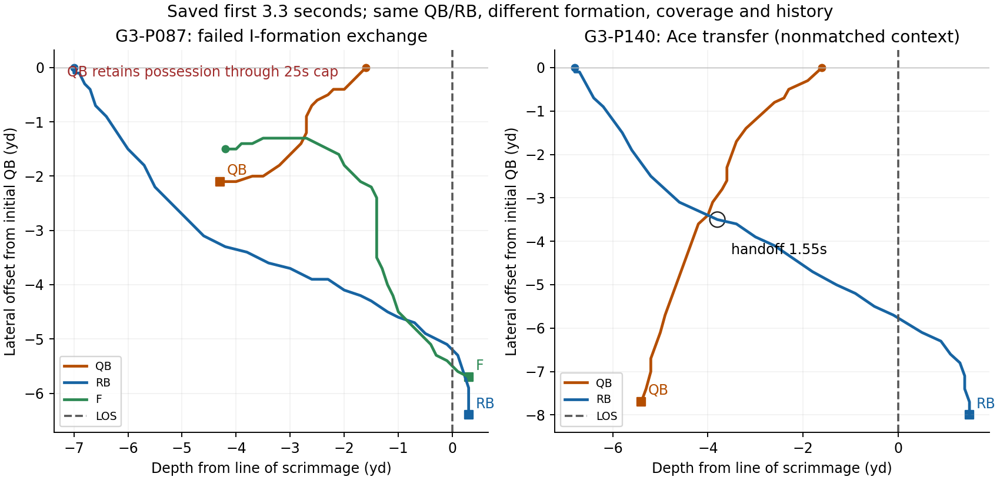
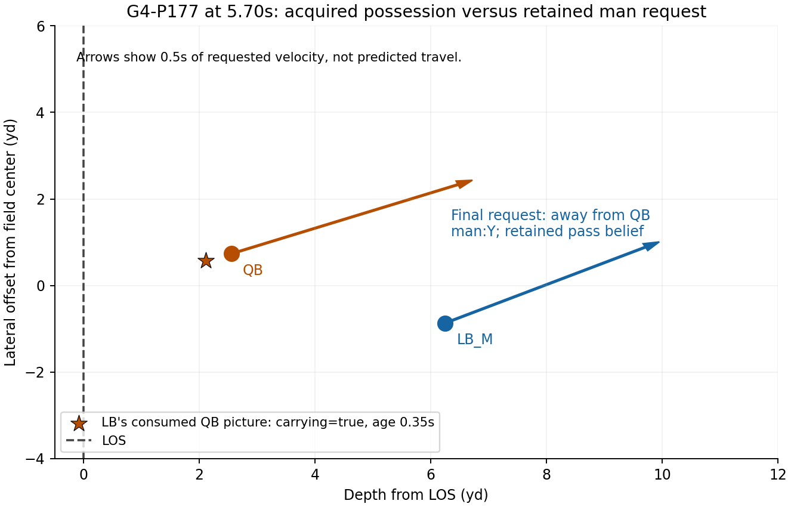
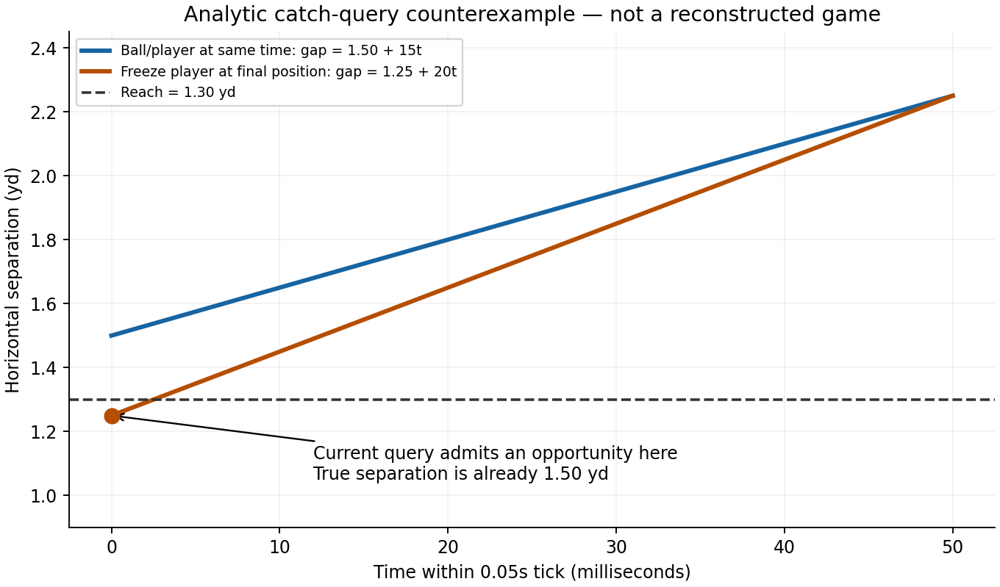

# Accepted-game deep audit: make the snap continue coherently

**The next improvements should repair specific responsibility and information boundaries, plus a local catch-geometry error. This cohort does not justify a new physics engine, stronger defenders or tuning toward lower scores.** Six parallel reviewers screened the complete saved dataset, reviewed the same ordinary/tail panels and followed consequential mechanisms into the accepted source. No new games, engine execution or tests were used in this audit.

The most important football pattern is that an installed expectation can outlive the evidence that should retire it. A missed exchange leaves both sides following the expected mesh; a man defender can observe a committed QB run but reject the pursuit request. The opposite information problem also exists: the QB's receiver forecast starts from private live state rather than his acquired picture. These are distinct local contracts, not evidence that we need a universal coordinator.

## What was reviewed

| Boundary | Exact scope |
| --- | --- |
| Accepted engine | `70b4db6a3ef53acc1a0e90cd055f1087205daa30` |
| Accepted queue checked | `c933dbc3c2ee3a2d230b70ee1032b9ac4ea49d0b`; checkout queue/status paragraphs can be premerge snapshots |
| Runtime source digest | `9513511efacc10721f8ed2cc8553ef96d7b95a5b51217b8f4c6339533b504941` |
| Immutable original evidence | [`b9b9c175`](https://github.com/tannerthardy/football-simulation-/tree/b9b9c17597970ddc87aa4a4e271fc4cfeef71909) |
| Inputs | Four frozen games, seeds 701–704, 424 players; accepted 44 settings, components enabled, CF_FLOW unset |
| Complete inventory | 740 native logs, 561 physical observations, 559 filmed scrimmages, 27,784 paired frames / 611,248 actor-frame samples |
| Physical screen | 193 called runs + 366 called dropbacks = 559; all 28 nullified snaps retained separately |
| Official exposure | 531 nonnullified scrimmages = 191 called runs + 340 called dropbacks |
| Shared detailed review | Fixed 48 ordinary plays (24 runs / 24 dropbacks) and 12 separately selected tails; additional exact mechanism controls in appendices |
| Unobserved physical detail | Two two-point tries have observations but no film; 179 other logs lack scrimmage trajectories |
| Audit cost | Saved-file analysis only; zero new engine executions or suites. The original four games ran once in 185.123 seconds. |

“All data” means complete inventory, integrity checks and domain screens, with detailed numeric event/request/body review on the declared panels and selected mechanisms. It does **not** mean every frame was visually watched or every screen flag causally diagnosed. [Measurement](measurement.md) records definitions and subgroup tables; each appendix lists its actual coverage and exclusions.

Four native snap caps—**G3-P003/P087/P141 and G4-P142**—retain unknown football endings. The report does not turn their administrative losses into successful terminal runs. G4-P142 remains in the outcome-independent ordinary panel. The 12 tails never enter ordinary-panel frequency claims.

| Game | Home–away | Films | Official dropbacks | Official runs |
| --- | --- | ---: | ---: | ---: |
| G1, zone-reference | 71–38 |147|85|50|
| G2, spread-air | 34–27 |145|92|48|
| G3, power-zone | 31–19 |123|64|53|
| G4, west-spread | 73–49 |144|99|40|

Scores and distributions describe these four generated-roster games. They are neither population defect rates nor NFL calibration targets. The 301 official attempts include 298 targeted throws and three throwaways; there are 173 completions, 34 interceptions, 19 credited sacks, 19 scrambles and one additional QB safety. Nullified physical execution remains useful evidence without entering official denominators.

The 531 denominator is nonnullified **filmed physical scrimmages**. It excludes 13 abstract, unfilmed kneels that still affect native down/clock state, as well as special teams and tries; it is not every official action in the game logs.

## The three active football priorities

### 1. Let a broken play become a different live football problem

**Observed:** all four failed exchanges leave the QB with the ball through 25 seconds, without carrier contact. QB requests settle to zero while the back departs. On defense, the unkeyed run-fit path continues selecting a premesh RB picture while the QB retains possession. At 10.0 and 24.9 seconds every defender in those four cases has consumed a positive QB-possession picture. A separate man-coverage gate rejects pursuit in six stronger scramble witnesses despite an acquired QB picture beyond LOS+2.

**Source-qualified cause:** `RunnerToMesh`/`QBHandoff` have no useful failed-exchange continuation; `executeRunFit` keeps its authoritative no-handoff premesh condition; `ManCoverage.coverMan` can compute pursuit and then reject it while retaining pass belief. These are separate functions with a common responsibility-lifecycle problem. QB possession alone at 1.10 seconds is also present in a successful mesh and cannot be the new defensive trigger.

**Owner and next action:** Run owns the offensive exchange/recovery decision; Pass/Awareness owns acquired-QB defensive continuation, consulting Flex on the observed-picture contract. Implement and review separately, using Run's four prefixes and the six scramble witnesses. Before claiming a better broken-exchange outcome, evaluate the composed offensive and defensive behavior: repairing only one side can conceal the other error. Neither implementation requires waiting for the other.

The unresolved decision is **which personally available cue retires the installed expectation**, and what feasible responsibility follows. Preserve real reach, normal riding, ordinary behind-line coverage and play-action uncertainty. Do not guarantee a handoff, chase every snap-holding QB, add a universal timeout or use private `sim.scrambled` as the awareness fix.

G3-P140 has the same QB/RB but different formation, coverage and prior history. It is a useful success context, **not a paired counterfactual**. RB aiming-track motion at 1.10 seconds is not itself proven wrong; the successful case also starts aiming before transfer.

G4-P177's LB_M consumes QB carrying=true, age .35 seconds, beyond the line, while continuing receiver-directed work. The missed responsibility is demonstrated; an alternative tackle or prevented yardage is not.

### 2. Make the QB anticipate from what he knows

**Confirmed existing information debt:** the receiver forecast used by QB evaluation/release clones the receiver's actual current position, velocity, facing, energy, sprint load, private route index and settled/delay state. Installed route knowledge justifies anticipation; it does not justify refreshed knowledge of unseen execution. Protection and scramble consumers have additional named private-state reads, but their migration is not a prerequisite to one useful correction.

**Owner and next action:** Flex owns the narrow QB receiver-forecast boundary, with Awareness reviewing acquisition and the Pass owner reviewing football expectations. There is an actual missing input boundary: current QBMind stores defender memory, while ordinary teammate `see()` refreshes every .05 seconds without establishing QB acquisition. Feeding that same teammate picture into a renamed predictor would not close the leak. Establish a QB-consumed receiver estimate through legitimate acquisition plus an immutable installed expectation; do not copy a live converted route/path as the prior. Freeze these inputs and vary unseen live receiver state: the forecast consumer must remain invariant until a legitimate observation changes. Then preserve an anticipatory throw and a genuinely observed route change. Full QB-decision invariance remains limited by separately recorded eligibility/range/protection reads; do not claim those are repaired by the forecast patch.

The simplest design is to pass an explicit observer-owned estimate plus installed expectation into the existing forecast, deriving unknown progress from those inputs. Do not seed a new predictor with the same hidden body state under a different name. Cache validity must follow the observing QB and estimate, not only the live receiver tick. This does not require a general observation transport, universal uncertainty model or simultaneous migration of all controllers.

No saved interception has been attributed causally to this shortcut. **27/34 interceptions occur after an altered flight**: ten explicit PBUs/deflections, six explicit drops and eleven target-clearing transitions without a named touch event. Seven remain direct or unsampled. Preserve actual defensive wins; do not treat 34 interceptions as 34 bad initial QB choices or evidence of per-tick tip rerolls.

### 3. Put the ball and player at the same time when granting a catch chance

**Confirmed structural error; native consequence unresolved:** bodies advance before ball update, but the catch query projects the final player position onto the entire previous-to-current ball chord. This can create an opportunity using positions from different instants. Physics independently challenged QB/Ball's finding and supplied an exact analytic counterexample.

In a .05-second interval, let the ball move `0→1.00 yd`, the player `−1.50→−1.25 yd`, with legal height and 1.30-yard reach. The current construction admits 1.25-yard proximity using the player's final position and the ball's initial position. Actual simultaneous separation is always at least 1.50 yards. This is a proof about the operator, **not a reconstructed game**.

**Owner and next action:** Physics supplies a local relative-motion query; Catching owns eligibility, height, opportunity order and execution semantics. First settle the pure query contract with the counterexample, static/zero-relative-motion and wide-clearance moving/height controls. Exact G1-P020, G2-P107 and ordinary moving completion G2-P143 query inputs are the smallest native evidence if needed to assess changed opportunities. Rounded saved sensitivity leads do not prove that any of the three nominated interceptions was impossible.

Use both body endpoints and the ball endpoints on the same legal time interval. This remains a linear within-tick approximation, not a reconstruction of curved World substep paths. Height and reach must be jointly satisfiable; merely finding a horizontal minimum and checking height there can miss another legal instant. Preserve retry gates, incidental readiness, reach/capabilities, catch difficulty and ordering. Choosing earliest reach rather than the existing closest opportunity is a separate semantic change. **No World integration rewrite is needed to test this correction.**

## Other useful findings, without another feature wave

| Finding | Verdict and opposing football evidence | Owner / smallest useful continuation |
| --- | --- | --- |
| Shallow cut admits planar distance <9 yd but continuation requires lateral distance <8 | Confirmed predicate mismatch at the outer boundary. G3-P008 alternates adjacent cut/man and zone decisions; G3-P104 has the same pattern with tight coverage and a short gain. Not all 28 job-change flags share this cause. | Pass: make admission/retention coherent in the existing rule; one boundary control and a valid carried crosser. Batch normally. |
| Trips fast #3 flat can lack a takeover after wall/roof duties | Observed responsibility question, not a proved missing universal defender. G2-P180 is strongest; G4-P184 has a different actual check/duty budget. Existing wall/roof and #2 flat/wheel duties are legitimate. | Pass: establish the installed owner and feasible acquired handover in one prefix; preserve G4-P092 and G2-P067. No global flat expansion. |
| Second-level blocking forecast can promise access without timely collection | RUN-007 remains open. G2-P099 C misses Mike before runner contact; G1-P164 achieves real loaded collection. The approaching body generally follows its emitted request; no capacity defect established. | Run after exchange: attribute forecast → request/modifier → achieved path in the existing witnesses. Do not globally advance releases or weaken the keeper. |
| Counter wrappers have no sampled engagement before first runner contact in 25 calls | Conditional lead. Upstream kick/edge access often ends opportunity first; 0/25 is not 25 wrong wrapper decisions. A long TD can also contain a missed kick. | Run: only pursue after one specific reachable wrapper job or upstream wrong kick request is established. |
| Rapid loaded lower-wrap falls | 227/439 contacted snaps have a carrier fall within .40 s. Real impacts and large loads remain credible explanations; G3-P069 stays up through a slower rear wrap. No newly proved support law defect. | Physics follow-up: one short complete moment/support ledger versus collision-only and slower-wrap controls; no LEG_BRACE activation or capacity retune. |
| Long contact-to-stop tails | G3-P146/G2-P063 contain early slipped holds, free movement and later new tackles. They are not continuous powerful holds. | Measurement labels elapsed contact-to-stop separately from bonded duration; Physics preserves weak escapes and upright progress-stop controls. |
| Defender traffic / oblique reaches | Sampled impulses and passbys occur in both bad-looking escapes and useful finishes. No common avoidable request or need for a global coordinator established. | Flex/Catching: identify one earliest feasible acquired-cue alternative before changing approach. Preserve earned cuts, falls and finite turning. |
| Defensive TD loses team takeaway; safety bypasses sack/tackle; pressured scrambles lose player pressure | Three source-qualified result/accounting defects: G1-P156, G2-P140 and eight pressure scrambles. The safety's native −7.50 versus zero box yardage is a discrepancy; the proper goal-line credit convention still needs a contract. | Measurement + Integration: narrow independent result-branch repairs using saved result fixtures and opposing ordinary credits. No new games. |
| Six TD catches have negative credited YAC because the catch is already inside the end zone | Measurement convention, not six backwards runners. Raw catch position and credited goal-plane endpoint differ. | Measurement: distinguish physical postcatch advancement and credited statistical YAC; do not silently rewrite historical data. |

## Architecture verdict

The highest-value shared rule is **an installed assignment is a prior, and each controller must have a local way to replace it when acquired evidence contradicts it**. Apply that rule at the failing gates above. No new universal phase manager is warranted: it would duplicate existing job/belief/pursuit state and risk giving every player the same information. Reconsider shared machinery only if independently repaired consumers need the same concrete observation/history contract and local implementations actually diverge.

Physics already produces useful pushing, loaded blocking, escapes, braking, sustained wraps, falls and upright stopped-progress endings. This does not certify universal football physics. The known center-hand angular law and experimental support-history/timing questions remain open, and vertical/airborne/roll/sit detail remains reduced. This dataset has not demonstrated that these limitations caused the priority controller failures. Event-aware/contact-local integration remains a candidate to evaluate for a named force/history error, not a committed rewrite.

## Integration and the next checkpoint

At this review, **#126** is the separate zone-combo surface correction and **#128** the separate acquired quarter-flat force-duty correction. They are not present in the measured 70b4 cohort. Their existing focused evidence and independent reviews should proceed through the current queue; neither needs this audit to become another prerequisite. #128 does not fix the legacy man-QB/premesh gates or install a fast-#3 takeover. **#127 stays held.** Do not duplicate ready patches or import experimental parents.

Keep independently reviewable fixes small. Integration batches compatible approved work at natural checkpoints, reuses compatible focused evidence, and owns one exact combined verification. A blocked item holds itself. A shared-interface correction that genuinely unblocks active work may integrate separately. Audit/document publication needs documentation/data checks, not a repeated 1980-test engine verification or another four-game campaign.

The next broad checkpoint becomes useful after a coherent group of these repairs is accepted and focused witnesses show the intended information, request and achieved action, with opposing football controls preserved. Start with varied individual snaps and fixed condition/calls. A future full-game run needs a named transfer or overall-experience question; score reduction is not that question. No full-game rerun is authorized by this report.

Deliberately defer: new rosters/seeds or BDB sweeps, population rate tuning, macro strategy/season/practice systems, detailed fatigue calibration, generalized observation infrastructure, richer anatomy, solver rewrites and promotion of unrelated physics flags. Basic accounting fixes remain worthwhile. Do not add agents merely to create more parallel candidates; the existing owners have independent bounded work.

## Read, reproduce and assign

- **[Paste-ready owner instructions](agent-handoffs.md)** — Run, Pass/Awareness, Physics, Flex, Measurement, Integration and CEO.
- Domain appendices: [Run](run.md), [Pass/Awareness](pass-awareness.md), [QB/Ball](qb-ball.md), [Physics](physics.md), [cross-system continuity](cross-system.md), [Measurement](measurement.md).
- [Compact audit/coverage receipt](../../../data/reviews/current/accepted-game-deep-audit-2026-10-16.json) and the existing [master issue register](../../ISSUES.md).
- **[Deep-audit evidence and 16 witness clips](https://github.com/tannerthardy/football-simulation-/tree/23d5f6d4f7e88fdd3225a49cc74ae5582a52522e)**. Download `accepted-games-deep-audit-v1.tar.gz`, extract locally and open `out/accepted-game-deep-audit-2026-10-16/ceo/witness-film/index.html`. The HTML files are standalone; GitHub displays source rather than playing them.
- [Original complete games/downloads](https://github.com/tannerthardy/football-simulation-/tree/b9b9c17597970ddc87aa4a4e271fc4cfeef71909) remain unchanged. The additional audit is retained by an evidence-only tag, outside development ancestry; never merge either evidence history into `develop`.

The audit bundle contains all six lanes' screen rows, detailed ledgers, scripts and selected traces, the shared index/helpers and the 16 saved-data films. It excludes the redundant 1.3 GB split-native directory: reconstruct it from the verified original `plays.jsonl` files using `prepare-inputs.py`. Exact extraction/reproduction instructions and hashes accompany the evidence. No engine is needed for Python analyses; optional film rendering uses existing replay packing, not simulation.

Independent reviews reproduced the census/denominators, challenged the owner split and catch proof, and corrected unit labels and the unresolved safety yardage convention before publication. Their receipts are included in the audit bundle. All raw force/impulse values use the engine's kg/yards/seconds units, not unconverted SI labels.

Cadence is .10 s, positions .10 yd, numeric telemetry mostly .01; last-step contacts are not a full impulse/work ledger. Facing is not gaze; positive possession is a modeled observation proxy; final intents omit some producing stages. Generated rosters and whole-game RNG/history preclude causal historical comparisons. No direct NFL/BDB comparison was made here. Missing exact query/force states stay explicit gaps.
