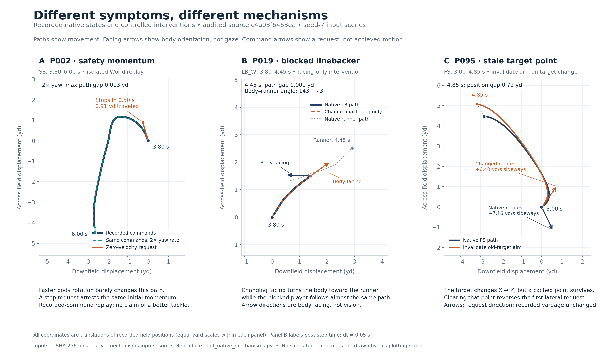

# Gridiron Engine: what the deeper investigation changed

**For Tanner · October 23, 2026 · forensic review and architectural challenge**
Experimental source: `c4a03f6463eacb23ce63d01bd32b4f8b547b9bc0`, through PR #245. Final freshness check found develop at `ccdb69cba81e07c578f607ff1bf8ce0efe2edc68` (PR #246): documentation-only VIEW-1 addition, reviewed below; simulation source is identical. Production code and approved plans are unchanged by this audit. The [revised roadmap](ROADMAP.md), seven technical appendices and [reproduction guide](REPRODUCE.md) form part of this report.

## 1. The revised judgment

**Current evidence does not justify replacing the role-specific player brains. It does justify stronger agreements between the intelligent pieces already present.** My first review correctly suspected problems at subsystem boundaries, but put too much weight on a common responsibility-and-opportunity chooser before establishing what was actually failing. The deeper experiments make a smaller architectural investment more compelling: coherent information sources, target/action lifetimes, prediction/execution semantics, and contact geometry.

Your reaction to the film is useful. There are real examples where players respond incoherently. However, several superficially similar “dumb player” episodes have different causes. One safety chooses a new receiver while executing an aim cached for the old receiver. Another safety executes a changing interception forecast through a motor that is doing what it was asked to do. A linebacker turns away because the contact controller tells him to face his blocker. A corner recognizes run but remains bound by an explicit pass-first policy. A quarterback falls because a dive acquired a long hold before the diving body reached him. Putting all of these under “insufficient intelligence” would produce the wrong engineering program.

The strongest newly established generalization is **incoherence across time and interfaces**, not absence of football reasoning. A locally sensible target selector, reaction cache and steering routine can compose into a command that represents no coherent choice. A locally consistent solver can apply forces through a contact that should not yet exist. A useful delayed perception model can be bypassed by two independent routes to true possession. A sophisticated motor can faithfully realize a poor or unstable pursuit request.

This is encouraging in one respect: substantial existing work is reusable. The engine has recognition, delayed pictures, coverage judgment, installed fits, movement previews, gathering approaches, contact techniques and trait-dependent timing. It is inaccurate to describe it as players simply following drawn paths. It is also premature to claim these pieces jointly support reliable tactical experiments. That requires causal correctness and stable experimental identity, not merely believable averages.

My recommendation is to preserve the role-specific systems, repair the demonstrated shared contracts, and then test whether a common decision policy is still needed. A limited run-support option and a limited pursuit forecast are justified experiments. A universal utility system, wholesale scheduler rewrite, learned policy program or expanded anatomy model is not justified by the current evidence.

## 2. What was actually investigated

Experiments were frozen at the source reviewed above. Develop advanced during final packaging to PR #246, whose only change is 32 added lines in `docs/KNOWN_PROBLEMS.md` introducing VIEW-1; no engine, test or configuration code changed. This is a deeper investigation of the same simulation source, not a claim that later work regressed. It protects the recent motion, first-threat, puller, coverage-turn and tight-end work instead of substituting an older baseline. Historical clips are explicitly distinguished from current plays; current G1-P002 is Pistol Twin TE Comebacks, not an old TKL-4 clip with the same display number.

The central evidence is a passively instrumented ordinary seed-7 game. Its **entire packed replay JSON equals the existing current film**, with the same 36–29 result. It captured 130 constructor inputs, including three pre-snap rejections; 127 simulations reached live execution. The viewer has 125 filmed play records, a different denominator. Detailed stage traces cover ten selected plays; the full live census covers 11,500 ticks and 253,000 actor-ticks. These counts describe this game, not a representative football population.

Native plays were restored from complete pre-constructor inputs: players, calls, seeds, styles, energy Maps, scouting class state and audibles. Baselines were checked against native states/events/results before intervention. A seed and play name alone were insufficient. Controlled tests then changed one mechanism, or used a factorial comparison when two paths could bypass one another. Some interventions intentionally create nonphysical conditions to isolate a cause; they are not proposals to ship.

Additional evidence includes isolated motor and reach panels; native pursuit and run-fit alternatives with opposing cases; contact-law and acquisition tests; a complete target-cache consumption census; input-order experiments; actual preview workload counts; and inspection of the NFL measurement operators with synthetic discontinuities and known motion. Thirty-four focused decision tests and ten measurement tests passed. The earlier broad checks—3,197 core tests, nine integration tests, 215 Python tests, typecheck and build—remain evidence for the same unchanged source. They were not rerun merely to increase a test count. They establish implementation health, not football validity.

The labels used below matter:

| Evidence class | Meaning in this review |
|---|---|
| Reproduced defect | A specific internal contract fails, with an executable witness. This need not establish population impact. |
| Strong diagnosis | A controlled native intervention isolates the mechanism behind an observed symptom. Football correctness may remain unresolved. |
| Architectural risk | A source path can violate an intended boundary, but its practical consequence is not yet established. |
| Hypothesis | A plausible explanation requiring a discriminating experiment. |
| Design alternative | An intervention or proposed interface; improvement on one case is insufficient for adoption. |
| Unknown | Missing data or evidence prevents a responsible conclusion. |

## 3. Reconstructing the real execution architecture

The installed call creates responsibilities and behavior objects. Their lifetimes are not managed by one central policy: recognizers, behavior branches, shared blocker exchanges and ball events can revise them. Within a live tick, the engine does approximately this:

1. Record authoritative bodies and possession into perception history at the start of the interval.
2. Update minds, catch readiness, defensive recognition and coordinated run-block planning.
3. Update behaviors sequentially in actor-array order. These updates can change shared plans, behaviors and ball state.
4. Apply coverage containment and `openToBall`; copy requests into physical intents.
5. Apply engagement technique, tackle-bond technique, teammate spacing and snap readiness.
6. Advance World; resolve ball/contact/whistle consequences; record endpoint state; advance the clock.

The relevant production chain is `playsim.ts:943–1047`. [Architecture](architecture.md) records each stage and its source anchors. The ordinary census observes 1,287 containment changes, 72 open-to-ball changes, 48,301 engagement changes, 1,912 tackle-bond changes, 18,872 spacing changes and 50 snap-guard changes. **These are not error counts.** Most layers have legitimate reasons to own part of an action. Eliminating downstream overrides would eliminate useful football.

The weakness is that ownership and timing are not consistently explicit. At P002's catch, the command was generated by the old coverage/play-ball behavior; the subsequent catch replaces the behavior with Pursuit before the endpoint record. An ordinary replay can therefore label the old command “Pursuit.” A researcher reading only that label can blame the wrong controller. Likewise, a retained cache can look stale even when no executed branch uses it.

Sequential shared mutation also has real semantics. In native P064, C changes an earlier-updated RT's block plan after RT has already issued his request. Moving that same exchange before the decision pass changes RT's position by about .129 yard; final gain and duration stay unchanged. A contrasting exchange to a later-updated recipient takes effect within the tick. This warrants an explicit effective tick for shared plan exchanges. It does not establish a need to replace the entire simulation with an entity-component system or synchronous decision engine.

The architecture should make five facts inspectable: **what was observed; which responsibility was active at decision time; what target/action was committed; which stage owned the final command; and what physically happened during the interval.** A shared record can carry those facts without selecting every player's football action.

## 4. Root-cause map

The table deliberately separates a demonstrated connection from a plausible extension. Similar film is insufficient evidence of a shared cause.

| Observed issue | Demonstrated mechanism | Reach of the finding; unproven extension |
|---|---|---|
| P095 safety selects Z but initially moves toward X's point | Target changes while `SnapMind.aim` retains a different target's goal; invalidation reverses the first lateral request | Native command/body effects in coverage and blocking justify a small shared action-lifetime contract. Not all stale memory is consumed. |
| P002 safety's broad pursuit sweep | Recorded requests plus ordinary free motor reproduce the path exactly; interception forecast changes sharply | Forecast/control composition is implicated. Global yaw weakness and hidden contact are rejected for this interval; real-world cut capacity remains unknown. |
| P019 blocked LB faces away | Engagement rewrites runnerward facing to face the blocker | Strong native attribution. Whether this is bad technique needs body/contact validation; facing-only improvement is mostly cosmetic here. |
| P029 corner stays with receiver despite run cues | Explicit pass-first policy suppresses support before the runner crosses the line | Native policy tradeoff, not failed recognition. Early alley support helps one play; deception costs remain untested. |
| P002 pursuit begins before personally observed possession | Both event-driven replacement and legacy helper use true holder identity | Fixing either alone is a no-op; fixing both changes commands and the play. Anticipation still needs legitimate flight/cue support. |
| P048 QB leg fall | A newly acquired dive hold transmits force before the diver physically closes the distance | Removing only that hold prevents the fall. Final outcome changes through another defender; yardage is not a correctness test. |
| Inconsistent reach claims | Center-to-hand reach gains an extra own-body radius in tackle admission, plus technique extensions | Multiple consumers share incompatible geometric meanings. All long contacts are not proven humanly impossible. |
| Hand-contact angular bookkeeping defect | Internal center impulses omit required angular channels | Law defect and broad ordinary exposure established. Contribution to football outcomes or back-turns remains unmeasured. |
| Same nominal matchup changes when lineup object order changes | Actor construction and shared RNG consumption depend on insertion order | All 18 reordered short comparisons diverge. Distributional bias is not established. |

The figure uses saved traces only. Panel A is an open-loop motor replay, not a counterfactual tackle. Panel B labels the physical endpoint at 4.45 seconds, corresponding to the recorded step starting at 4.40. Panel C shows a real action-cache intervention with unchanged final yardage. [Inputs, script and source hashes](https://github.com/tannerthardy/football-simulation-/blob/73a800464a7b2a057a2f4df59d772c89bbd87b21/artifacts/audit-2026-10-25/Football-Sim-Deep-Audit.zip) accompany it.

## 5. A genuine shared defect: actions outlive their targets

`SnapMind.aim(job, desired, t)` holds an aim until its reaction deadline. This is a reasonable abstraction for commitment and delayed updating. The investigated `block-fit` and `zone-drive` callers can nevertheless change target without changing the cache's identity. The resulting action can combine B's identity and velocity with A's held location.

A controlled coverage example needs only a .02-yard change across a depth-ranking tie. The selected receiver changes; the lateral request still points toward the old receiver. A blocker experiment independently reproduces the same contract failure. Same-target controls are unchanged. A target-key-only repair also has a trap: an A→B→A transition can revive A's old value before its old deadline. Action generation or explicit transition invalidation is safer than assuming target identity alone is always enough.

The ordinary census is more informative than either synthetic witness. Across all 130 captured setups there were 2,915 `block-fit` calls and 65 `zone-drive` calls. Thirteen calls returned an unexpired point created for another target, covering seven switches in six plays. **Only two continuations changed the emitted command and physical motion.**

In P095, FS selects Z at 3.00 but receives X's old point, 23.60 yards from the new desired point. Invalidating it changes raw and final velocity from `(3.423, −7.165)` to `(4.698, +6.401)` yd/s. The first body difference occurs at 3.05 and the maximum paired displacement is .719 yard. In P093, F's request changes more modestly; spacing modifies both arms, and maximum displacement is .030 yard. Both plays retain their final outcomes, yards and durations.

The four other exposed plays return a stale point but then use a later `CLIMB_PLAN` approach instead. Their complete results remain equal. P029 is an even stronger negative control: a target changes while the old cache remains in memory, but the new branch never calls that cache at all. Invalidating it does nothing.

This is precisely the kind of small shared correction the evidence earns. Target selection and action commitment must move together: either keep both committed until the read expires, or allow retargeting and invalidate the old action together. This preserves realistic hesitation and mistakes while eliminating an accidental hybrid. It requires no new universal opportunity chooser. It also teaches the evaluation system an important discipline: **retained state → returned value → executed command → physical consequence** are four different evidentiary stages.

## 6. Pursuit and “skating”: separate the forecast, request and motor

### The motor executes the inspected sweep

In current P002, SS pursues an RB reception. From 3.8 to 6.0 seconds he is upright, unengaged, and his raw and final movement requests agree. Restoring his exact body in a one-body World and replaying those final requests reproduces his position and velocity exactly. Hidden blocking, teammate spacing and another physical contact do not explain that interval.

Doubling yaw changes the open-loop path by only .013 yard; instant requested facing changes it by .016. Doubling mass changes it by .00057. Doubling braking changes it by .415; doubling lateral capacity changes it by 3.603. These are sensitivity experiments, not externally validated capacities. The motor can stop: a zero-velocity request at 3.8 stops him by 4.3 after .913 yard. But he then remains farther from the recorded runner. A tighter-looking turn is not necessarily a useful pursuit.

A fresh safety moving at 9 yd/s stops in approximately 1.3 seconds and 5.86 yards, consistent with its declared brake capacity. Asking for a perpendicular 9 yd/s instead produces a broad curve: about 1.9 seconds to rotate travel through 80 degrees. The controller allocates limited acceleration between shedding old velocity and building new velocity. Body rotation and travel rotation are distinct. This explains why changing yaw barely matters, but does **not** certify the lateral capacity as realistic for an NFL hard plant.

### The interception point changes discontinuously

The pursuit forecast uses a recent acquired carrier picture and one .2 seconds older. It predicts speed changes while holding heading constant, then selects the first estimated reachable interception. At 4.25→4.30, the observed runner moves roughly .37 yard while the chosen point moves **8.26 yards**. The selected interception horizon changes from 1.8 to 2.8 seconds. At the next tick the planner finds no feasible candidate and returns its least-late fallback.

This is not automatically an incorrect decision. A short interception becoming unreachable can rationally require a later one. It does expose a sensitive planning boundary: a large change in requested direction follows a small change in a scalar feasibility test. The existing .6-second local movement preview does not inspect this early distant turn because its distance gate excludes it. Its presence cannot be cited as proof the long-range path was validated.

### Simple remedies fail; one alternative earns further testing

Native closed-loop comparisons change only this SS:

| Change | Result relative to native 32.30-yard out-of-bounds play | What it establishes |
|---|---|---|
| Double yaw | 32.09 yards; almost identical closest approach | No meaningful rescue of the symptom |
| Reduce prediction horizon to .8 seconds | 72.93-yard touchdown | Shorter anticipation can be much worse |
| Stop when request opposes current motion | 35.18-yard tackle | “Brake first” is not a general remedy |
| Remove acceleration forecast | 21.83 yards after a fumble, but SS's early closest approach worsens | Lower gain can be caused by another player's contact, not better pursuit |
| Pictures .15 seconds fresher, retaining historical spacing | 23.59-yard SS tackle | Information age matters; this does not authorize removing realistic delay |
| Predict observed turning, only after acquired carrying=true | 23.47-yard SS tackle; SS wrap at 5.95 rather than 8.20 | A specific unused cue can improve this native case |

The last arm estimates turning from the two velocity headings the player already consumes, decays it with the existing anticipation time constant, and changes neither physical capacities nor future knowledge. It is a promising **design alternative**, not an approved fix. Without retuning, active transfer to P117 leaves yards unchanged but worsens closest approach slightly; P038 worsens gain from 5.76 to 5.83 yards. P017 is exactly unchanged because gathering bypasses the interception branch: an inactive control, not a generalization win.

The correct next step is a frozen independent set of cut, reversal, straight-acceleration, sideline and deceptive-cue situations, scoring useful contact, missed leverage and path stability. The current prototype must be allowed to fail. [Film cases](film-cases.md) and [locomotion](locomotion.md) preserve the full comparisons, including discarded confounded arms.

### Reach prediction has a real defect, but it is not this clip's proven cause

The shared `timeToReach` estimate uses longitudinal sprint travel plus an approximate sideways-momentum delay. Downstream code can accept its predicted arrival even when that arrival violates a generous necessary bound allowing instantaneous full traction in any direction. Six of 48 controlled cells violate that bound. In one, a body moving `(9,0)` toward `(3,3)` with a .5-yard capture radius is predicted to arrive in .984 seconds, although even the generous bound requires roughly 1.076 seconds.

The selected *feasible* interception points examined in native P002 and P117 produce **zero violations of that same loose bound**. Passing it does not prove executable arrival, but the isolated defect cannot honestly be promoted to the native sweep's root cause. Return feasibility/fallback status and uncertainty explicitly, validate estimators against executed motion, and repair the approximation where necessary. Do not change all motors to make a convenient estimator true.

## 7. Turning away and run support are different questions

### A blocked linebacker's facing is owned by contact technique

In P019, LB_W is actor 16, not the corner at index 18. His raw request is runnerward. Engagement then requests facing toward C, the blocker. At the endpoint of the step starting 4.40, his body is about 143° away from the runner.

Removing hand forces while retaining the engagement/request leaves him about 136° away. Replacing only final facing with the raw pursuit facing changes the angle to about 2.5°, while his position changes only .001 yard at that instant and the contact-control estimate is nearly unchanged. All arms finish at 8.78 yards.

This isolates the visual cause. It also rejects a tempting conclusion: making the torso point toward the ball has not demonstrated better football. A defender may need to face and control a blocker; body orientation is not gaze. The present contact admission and force model may allow an unrealistic chest rotation at little cost. Before changing this technique, test whether the rotated body can maintain believable hand availability, leverage and shedding. A facing-away detector should nominate a clip, not dictate its answer.

### A corner can know it is a run and still be instructed to stay out

P029 is Toss with Z motion against Bear/Cover 0/Zero Blitz. CB_S has man responsibility on Z and an installed **alley**, not force, fit. He recognizes run at .65. At 1.20 his consumed RB picture says carrying=true; the acquired receiver picture also matches the existing shallow blocking cue. Yet his raw request continues tracking Z. He only enters live pursuit after the acquired runner crosses the line at 2.70.

This is not a perception failure. `PASS_FIRST` deliberately prevents a non-force perimeter marker from using the blocking cue for earlier support. The policy serves a real football purpose: early abandonment can expose halfback passes, stalk-and-release routes or other deception. The question is whether this absolute priority needs a conditional, cost-aware option.

A diagnostic alternative uses the same acquired possession, run belief and observed blocking evidence to invoke the **existing capped alley fit**, not unrestricted ball chasing. Its first request changes at 1.20 and body at 1.25. Gain falls from 4.56 to .82 yards, but a defensive end makes the alternative tackle. The corner gets closer without becoming the primary tackler. This establishes a team consequence, not an isolated tackling improvement or a universally correct abandonment rule.

Ordinary pass controls remain unchanged because the cue combination never activates. They do not establish safety against an active deception. The missing opposing experiment is a similar-looking stalk-to-release or halfback-pass situation where support is attractive but costly. This is the best concrete candidate for the original adaptation idea, provided it compares “stay in man,” “execute capped alley support,” and “chase,” with explicit retained threats and costs. There is no reason to begin by replacing every role's decision system.

## 8. Player knowledge and reaction timing: two bypasses defeat one repair

At an offensive catch, `onBallCaught` replaces defenders with Pursuit, which reads the authoritative carrier. Separately, an old coverage helper can chase the same true holder even if the defender's acquired picture has not yet registered possession. Delayed positions alone do not make this a fully acquired decision.

In native P002, the catch is at 3.30. SS is already in Pursuit at 3.35, 3.40 and 3.45, while every queried holder picture in each update reports carrying=false. His first positive carrying picture arrives at 3.50. The ten selected traces contain 367 defender updates querying the true non-QB holder with no positive carrying sample that update; 103 are already Pursuit. These are exposures, not counts of wrong choices. Ball flight or previously recognized run can legitimately support anticipation.

A four-arm native test is decisive about composition. Delaying the global switch alone changes nothing: the legacy coverage path still selects the true holder. Gating that helper alone changes nothing: Pursuit bypasses it. Changing **both**, for this SS only, changes the first raw command at 3.35, before any RNG divergence, and eventually changes the play from 32.30-yard out of bounds to a 27.16-yard tackle.

The result does not prove that waiting for possession is always better. Players can anticipate a catch from ball flight; suppressing all anticipation would be another error. It proves that the information policy must be enforced at **every actual decision consumer**, with legitimate anticipation represented as a belief rather than a shortcut through authoritative identity.

For timing, record cue availability → consumed picture time → belief transition → action commitment → first changed request → first useful motion/contact. The existing coverage-judgment tests already show trait-dependent help/recovery timing after an acquired cue. That is useful existing intelligence. But a decision latency is not an end-to-end response time, and adding another generic cadence can stack delay on top of perception, recognition, action cache and physical response. A common decision layer must earn any extra waiting it introduces.

## 9. Contact: acquisition correctness precedes solver sophistication

`PhysicalProfile.reach` is defined from body center to hand. Arm strike and handoff use that reach plus the target radius. Free tackle admission also adds the actor's own radius; lunge and dive add further extensions. Pose-specific reach can differ legitimately, but extra movement needs an explicit origin, landmark and finite time. The dive currently creates a hold before the planned dive has displaced the body.

Of 122 ordinary newly acquired standing form/reach grasps in the neutral game, 56 exceed the arm-strike/handoff envelope. These are **56 model-envelope disagreements**, not 56 certified impossible human tackles. The interface inconsistency is nevertheless widespread enough to matter. A narrow dive cutoff alone can simply transfer the defect into reach/lunge or eliminate the entire dive band.

Native P048 provides the causal witness. DE_W's acquired hold on the QB is present at the 3.05 state boundary, with centers 2.179 yards apart. The QB becomes falling/legs at the 3.25 body-state boundary and throws at 3.40. Removing **only the newly acquired hold and bond membership**, after the success draw and with the original dive preserved, keeps the QB upright through the original release time. Bodies, requests, RNG and events match at the intervention boundary. The acquired hold causes this fall.

The alternative play ends in a **−6.17-yard sack**, whereas native completes for **23.10 yards**. Another defender now secures the QB before release. Thus an apparently improved defensive statistic could accompany removal of an invalid defensive contact. Yardage does not tell you which mechanism is right. A later long SS→Y hold in the same play slips without causing a fall in either arm; remote holds do not invariably trip runners. The controlled 27-cell panel likewise contains held falls, slips and no-fall controls.

The angular-momentum issue remains a genuine law defect. A passive census finds nonzero internal hand-channel angular defects in all 127 live simulations. That establishes exposure, not game-value loss. The existing `patch` contact mode changes angular transport, gait/yaw estimation, torso timing and grasp behavior together. Its large redirect changes cannot be attributed to one corrected law. A small single-channel surrogate changes facing by about 3.6° under grounded control; removing hand forces does not explain the P019 back-turn. Keep a bounded conservation repair, separate from the pursuit diagnosis and from anatomy expansion.

A further body/ball interface gap appears in the same native play: `throwBall` creates release height `z=2.2 yd` regardless of current posture, height or fall progress. Throwing while falling is not automatically illegal, and this simplified model has no knee trajectory to prove otherwise. But a fixed release height undermines claims that all ball execution follows body state. A modest support/release contract is a better first response than building an articulated skeleton. [Contact appendix](contact.md) contains source locations and exact interventions.

## 10. What the NFL evidence can and cannot tell us

The repository's TKL-4 diagnosis cites the p90 of player-play maximum deceleration—sim around 6.6 versus NFL around 5.6 yd/s²—to rule out inadequate braking. That inference is not supported by the measurement. The comparison uses a maximum **scalar speed-loss** operator, with smoothing and contact mixed in. It does not measure lateral redirection, whether braking starts at the right time, or maximum voluntary hard-plant capability. Updating the old source snapshot changes the numbers but does not repair this inferential problem.

NFL tracking orientation `o` and motion direction `dir` are distinct documented fields. Neither is direct gaze, hip orientation, foot plant or available torque. Running the actual yaw collector on a synthetic isolated 180° orientation glitch produces enormous yaw/extreme-turn values despite unchanged travel direction. Conversely, a smooth 174° change over six seconds can yield zero counted large turns under the collector's deadband. Those demonstrate operator sensitivity, not the prevalence of such errors in the real NFL files.

Current simulated body-versus-travel examples also show why yaw is insufficient: one SS rotates about 112° over a .2-second window while travel turns only about 4°; one corner rotates about 108° while travel turns about .5°. These require contact and command context before judgment. The terminal-window denominator bug changes one reported proportion by only about .02 percentage points; it exists, but is not the explanation for the broader discrepancy.

Raw NFL tracking was unavailable in this environment, so no new NFL distribution was extracted. The [measurement appendix](measurements.md) identifies the data dictionary, source snapshots, cohort/filter differences, operator tests and relevant change-of-direction research. Existing orientation/movement tools contain useful careful work and pass focused tests. The correction is to use them for the question they can answer.

The unresolved physical question is task-conditional capacity: at a given entry speed and desired angle, with a specified plant/technique and contact state, what speed loss, lateral acceleration, path radius and response time are plausible? Observed game maxima are an incomplete mixture of demand, decision and capacity. Parameters such as `GAME_CUT` and `GAME_BURST` may confound those factors when calibrated from activity alone. That is a risk requiring matched evidence, not proof their current numerical values are wrong.

## 11. Independent blind spots: experiment identity and computational cost

An experiment should not change unrelated player errors merely because a lineup object was serialized in a different property order. Current construction uses `Object.entries`, and several initialization/behavior mechanisms consume shared RNG in actor order. Other mechanisms already use stable identity forks, so this is inconsistent discipline rather than no RNG architecture.

Across two concepts, three seeds and four orderings, all 18 reordered comparisons develop different physical trajectories within .10–.60 seconds. Comparisons are by football slot, not numerical actor index. In a first-cause trace, reversing offense order alone changes RG's first overset draw and lateral request at .05. Two inputs normalized to one declared slot order produce exactly equal output.

Exact replay of an identical serialized input remains deterministic. No distributional bias is proven. The concern is truthful matchup experimentation and restoration: semantically equivalent inputs should preserve experimental identity. Canonical construction order and stable keys for persistent per-rep errors are a relatively cheap priority. A full event-keyed RNG migration can wait; even that would not make all divergent whole plays paired causal estimates.

Computational limits also constrain architectural choice. Passive counting on three restored native plays finds roughly 9,000–13,000 one-body prediction steps per play, alongside about 180–190 native World steps including pre-snap. Complete results remain identical. One-body steps are much cheaper than 22-body steps, and these are not counts of decisions or a throughput benchmark. They show that “give each option a small rollout” compounds existing work. Preserve the current scratch-world preview, bound candidate budgets, and benchmark a successful real workload before adding general decision search. See [experiment integrity](experiment-integrity.md).

## 12. Adversarial verdict on the first audit

| Earlier conclusion | Revised disposition |
|---|---|
| Shared responsibility/opportunity envelope should organize the next major architectural phase | **Weakened and demoted.** It can improve inspection, but no common chooser has been shown necessary. Local repairs and a shared action-lifetime contract address stronger current evidence. |
| Hidden authoritative state is a serious knowledge-boundary risk | **Strengthened.** A native two-path factorial experiment shows why either individual repair can appear ineffective. Keep anticipation through acquired cues. |
| Downstream controllers can undermine decisions | **Strengthened but narrowed.** P019 isolates facing ownership; most overrides are legitimate. Trace who owns each command rather than banning overrides. |
| Coverage turning needs diagnosis without globally slowing yaw | **Retain and sharpen.** Free sweep is almost yaw-insensitive; blocked back-turn is explicitly requested. The first roadmap already cautioned against inferring capability from provider orientation. |
| Tackle reach is an important correctness problem | **Strengthened and broadened.** Native hold removal prevents a fall; shared center/landmark semantics extend beyond the dive branch. |
| Angular-law defect matters | **Law and exposure strengthened; football consequence unresolved.** Bundled patch-mode benefits do not isolate it. It does not explain the selected back-turn. |
| Traits can fail to affect their advertised mechanisms | **Retain narrowly.** The earlier fixed-lineup `leadBlock` 1-versus-99 four-play witness remains valid. Do not generalize to all traits; timing traits demonstrably matter elsewhere. |
| Evaluation can certify invalid evidence | **Retain narrowly.** The earlier empty mechanics input passing 12/12 remains a fail-open defect. It is not evidence all tools are useless. Add owner/clock/consumption precision. |
| Passing/YAC/explosive distributions expose unresolved realism | **Retain as symptoms.** Earlier same-source scorecards remain relevant, but these selected causal tests do not attribute their population shifts to one defect. |
| Architecture should precede further useful concept/protection work | **Reject a blanket dependency.** Installation and ownership contracts can progress independently; broad matchup claims still need credible execution and measurements. |

The separate braking/capability inference challenged in section 10 comes from the repository's TKL-4 diagnosis, not the first audit. The first audit was too ready to turn a useful conceptual vocabulary into the central development program. This investigation found a better falsification test: repair the actual information/action/execution boundaries, then ask whether the remaining failures share a choice problem. If role-local policies now handle opportunities with bounded understandable logic, a universal chooser is unnecessary.

## 13. Credible architectural alternatives

| Alternative | Benefit | Principal risk | Recommendation |
|---|---|---|---|
| Role-specific cognition with thin shared contracts | Preserves football detail; directly fixes target lifetime, acquired information and execution meaning | Local policies may still duplicate genuinely common choices | **Use now.** Require contracts where multiple roles demonstrate the same semantic failure. |
| Shared decision record/envelope, without mandatory chooser | Makes responsibility, alternatives, commitment and reasons inspectable | Ceremony and false precision; a record can describe a bad action beautifully | Introduce incrementally in the actual causal trace, not as a prerequisite migration. |
| Small explicit transactions for shared plans/events | Makes exchange effective time and ownership clear | Adds delay or changes valid same-tick coordination | Use on reproduced exchanges; preserve tactile/technique responsiveness. |
| Shared responsibility/opportunity chooser | Could regularize team-cost and option comparisons | Duplicate latency, incompatible utilities, oscillation, excessive rollouts, flattening role distinctions | Defer. Require cross-role policy failures that local repairs cannot adequately express. |
| Learned policies or larger physical/anatomical model | May eventually cover complex uncertainty or contact technique | Training data confounds intent; harder diagnosis; cost and new calibration burden | Park until a bounded missing mechanism survives simpler experiments. |

The shared abstractions most clearly earned are observation provenance, stable actor/action identity, coordinate/landmark definitions, feasible-versus-fallback prediction status and command ownership. Responsibilities and commitment are useful common language, but their decision economics differ: a corner preserving a pass threat, a blocker exchanging work and a runner choosing a cut do not automatically share one utility function. Revisit the broader choice question after one or two bounded repair cycles on independent active cases across roles. Contract cleanup must not become an indefinite reason to postpone your question about adaptation.

The [alternatives appendix](alternatives.md) tests local corrections, an existing successful help/recovery policy and an envelope comparator. Equivalent behavior by construction establishes no advantage for the envelope; it does not falsify every possible framework. Existing adaptive behavior and same-target controls must survive any new abstraction. A framework that merely relocates conditionals or hides forecast/contact errors has not earned its complexity.

## 14. A development process that helps agents see the obvious

The costly pattern is not simply “too many rules.” It is **repairing the visible endpoint without tracing the first consequential divergence**. This encourages alternating parameter changes, policy exceptions and detector targets that compensate for one another. The native tests show how easily a rule can be blamed when unused, a bad pursuit can look better because someone else fumbles the ball, or a contact correction can improve a defensive statistic for an unrelated reason.

Make a compact causal packet the default handoff for a film bug:

1. Exact source/settings and restorable pre-constructor setup; neutral replay equality.
2. Player by stable identity and slot, event clock and interval endpoints.
3. Consumed observations with age/provenance; active responsibility and target at decision time.
4. Cache/action creator, generation, deadline and actual consumption; prediction status/slack.
5. Raw command, each material rewrite, final command, body/contact/support consequences.
6. Competing explanations; smallest discriminating intervention; first request/body divergence.
7. An active opposing case, an unchanged control, and downstream result with causal limitations.

This is a debugging primitive, not another Git-tracked receipt bureaucracy. Use the repository's ignored output and existing PR summary conventions. The audit's prototypes already show the packet can be generated without perturbing a native replay. Promote only the minimal useful hooks. The stage record must distinguish command owner from endpoint behavior and interval start from endpoint time.

Film scouts should find likely problems: unconsumed target changes, large forecast jumps, body/travel disagreement under free versus engaged motion, unexplained stopping, abandoned responsibilities, and contact acquisition beyond a declared envelope. Their output is a shortlist with causal context, not a grade. Track false alarms using ordinary valid examples. P029's unused cache and P019's blocked torso are permanent controls against naïve detectors.

Your eyes remain particularly valuable for choosing which behavior deserves investigation and judging whether an intervention preserves football tradeoffs. Agents should arrive with a localized claim and a paired replay, not ask you to inspect dozens of whole games. A useful review question is: “Did this player use a believable cue to do a useful job while preserving the threat he still owned?” Your approval of a prettier clip should not silently certify the contact or information model beneath it.

The newly merged VIEW-1 correctly treats film review as a longer-term goal and recognizes existing film-room notes, viewer layers and detectors. Its proposed structured play/player/moment flag is a cheap first delivery; pair it with the truthful command/contact overlays above. Preserve the distinction between a misleading drawing and invalid mechanics: P048 establishes a physical acquisition consequence, while P019 demonstrates how a visually improved torso can leave almost the same football. A separate application for moving players, installing calls and rerunning scenarios should follow demonstrated use of these smaller controls, not become a prerequisite for them.

Protect the October 22 plan's limited active implementation lanes. Put action-lifetime/coverage ownership into the existing coverage work; possession/pursuit/contact-admission work into the defense work as bounded tasks; evidence and native replay support into tools. Sequence shared-file changes through the owning lane. The full [A01–A21 revision](ROADMAP.md) identifies focused effort, dependencies, acceptance and stop conditions. This report proposes changes; it does not amend the approved plan or create new implementation assignments.

## 15. The unresolved questions that should decide the next larger investment

| Question | Exact next experiment | Decision it changes |
|---|---|---|
| Are free cutting/braking capacities physiologically wrong? | Match entry speed, turn angle, body/contact condition and measurement operator; compare speed loss, curvature, lateral acceleration and response timing against task-specific data with uncertainty | Whether to change capacity profiles, technique requests, or only prediction; no blanket yaw/cut retune before this |
| Does the angular pursuit forecast generalize? | Freeze independent straight, stop-cut, reversal, sideline and false-turn cues; compare acquired-information policies and useful contact, retaining P038/P117 adverse transfers | Adopt, revise or discard the prototype |
| When should an alley corner leave man responsibility? | Matched run and stalk-to-release/HB-pass scenes with the same early acquired cues; measure support benefit and retained pass-threat cost | Local conditional option versus need for a broader team-cost model |
| Does action-lifetime repair solve a broader family? | Replay both native affected roles, same-target/A→B→A controls, then selected unfamiliar calls/rosters; count consumed-and-propagated mismatches | Scope of shared primitive; do not infer prevalence from this one game |
| What is the football effect of the angular-law correction alone? | Separate angular Jacobian/transport from gait, yaw, torso timing and grasp changes; fixed-request loaded prefixes followed by live controllers | Law repair and calibration scope, independent of “skating” |
| Can contact and release geometry agree cheaply? | One landmark/finite-motion contract; reachable and unreachable standing/lunge/dive panels; falling/up release-height and timing controls | Whether a reduced body representation suffices before anatomy expansion |
| Do traits support meaningful player comparisons? | Fixed installed jobs and canonical lineup identity; intervene on one advertised trait with active and inactive mechanism controls across unfamiliar situations | Truthful supported player-type claims; prioritize real missing channels |
| Is a common chooser necessary after repairs? | Independent opportunity/discipline scenarios across at least two roles, with information, action and execution contracts already sound; compare simplest local policy to common policy under the same timing/cost budget | Whether A08/A09 should expand or shrink further |

Several months of difficult football engineering can represent reasonable progress without every visible failure being acceptable. Recent work has built useful machinery. The development risk is allowing each new piece to redefine knowledge, action lifetime or geometry locally, then calibrating the aggregate until the statistics look plausible. The way forward is to make those shared meanings testable, preserve opposing evidence, and demand that every broader architectural investment solve a failure a smaller one could not.

The evidence supports confidence in a **bounded next phase**, not confidence that the simulator is already validated or that one conceptual rewrite will finish it.

## Technical appendices and evidence

- [Architecture and ordinary-game instrumentation](architecture.md): tick order, target/action cache, possession factorial, plan exchange, code anchors.
- [Locomotion and steering](locomotion.md): motor panels, exact native one-body replay, reach bounds and conditional approaches.
- [Native football cases](film-cases.md): pursuit forecasts, run support, failed remedies and active transfer.
- [Contact forensics](contact.md): native hold removal, geometric conventions, angular law and blocked facing.
- [Measurement audit](measurements.md): NFL definitions, operator probes, source/cohort limitations and research references.
- [Architectural alternatives](alternatives.md): adversarial framework comparison, existing adaptation and falsification criteria.
- [Experiment integrity](experiment-integrity.md): semantic input identity and real preview workload.
- [Revised implementation roadmap](ROADMAP.md) and [reproduction guide](REPRODUCE.md).
