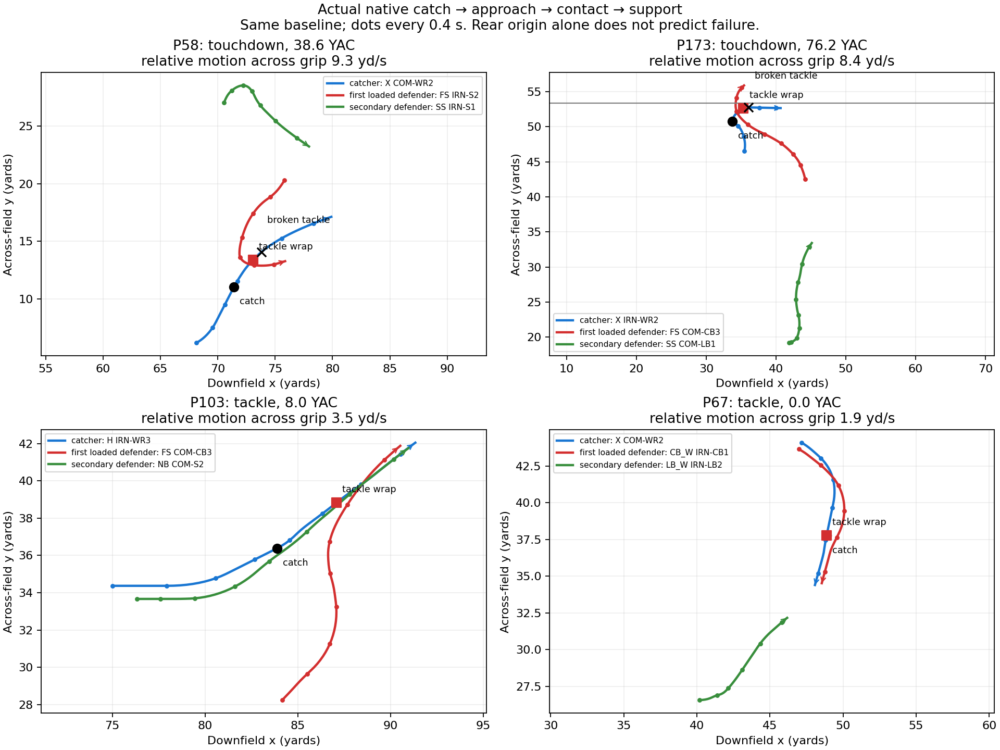

# Coverage, first contact and remaining containment

**Follow-up:** the authorized [moving-arrival and support-sensitivity experiment](moving-arrival-diagnosis.md)
is complete. It repairs P58 and fresh escapes, but two versions fail protected
fresh controls. No candidate is promoted; that report now defines the next
diagnostic and retains this study as its unchanged source evidence.

The most useful diagnosis is **a moving receiver meets an out-of-phase first
tackler, the short-lived hold fails, and the remaining defense lacks an earned
second angle**. The two main witnesses are not evidence that rear grips should
universally be stronger. P58 acquires a strong grip and still loses; the same
COM-CB3 athlete who loses P173 succeeds on P103 with a much weaker rear reach.

There is a concrete coordination gap: ordinary pursuit solves each defender's
intercept separately, with field/run-fit leverage, rather than dividing escape
lanes using acquired teammate motion. A full-native diagnostic helper rule
reduces P156 from **48.02 to 18.31 YAC**, while P58 and P173 still score and P19
gains another **0.52 yard**. This isolates a useful controller opportunity but
does not establish that one cooperation rule explains all explosive YAC.
**No production change is ready for integration.**

Catch awareness remains noted and parked. No speed/braking/grip capability,
forced catch delay, prolonged-hold experiment or ground-hold experiment changed.
The uploaded handbook and quoted suggestions are advisory research material;
the user's current diagnostic request controls this work.

## Sources and comparison boundaries

- Integration branch still advertises `4ded6b600fd3785e65034aa5623d7a9f8f3c5db1`.
- Every simulation uses runtime SHA-256
  `8433e88d7deb31e5c1c031e2f0cb83d1cf0e805609820c0559f6b8f25747340c` and
  `run-game-2026-10-13`, all 43 explicit profile flags. Physics is adaptive,
  center hands, mean support, bounded attachments, per-solve work; no API
  refinement or disabled contact/recovery feature was enabled.
- Work remains on `codex/catch-pursuit-diagnosis`. No `src/`, tests, package
  manifest, launcher or baseline configuration changed.
- [Exact native input packet](../../data/reviews/current/catch-chain-inputs.json)
  preserves source calls, audibles, rosters, fatigue, scouts, preferences and
  original state/RNG signatures. The operative installed roles come from the
  restored play, including disguise, automatic checks and audibles.
- [Machine-readable evidence](../../data/reviews/current/catch-chain-diagnosis.json)
  retains per-comparison commits, collector/input/artifact hashes, complete flags,
  launcher command/exit receipts, identities, entry geometry, requests versus
  achieved movement, loaded recovery, all 324 lab endings and nine native forks.
  The original [32-catch study](catch-pursuit-diagnosis.md) remains separate;
  these selected witnesses are not nine new random population observations.

| Comparison | Exact collector commit | Inputs |
| --- | --- | --- |
| Full native recordings | `f42f301cf26fbdd1b330e1bbb087484fb02fdd00` | Nine original plays; all nine original signatures reproduced |
| Selected-joint mechanical contrast | `970c83689409219dcb975dc4b6c1e8eefe53d534` | Nine identical native World boundaries, joint present versus removed |
| Final field/helper encounters | `0c28ae4c2ce0142025ad54e7dc7adc20bf58f5b9` | 252 primary + 72 successful-reach adverse inputs; 324 neutral observed/plain pairs |
| Full-native helper controller probe | `cabd8ac860d0a15389363cdae4f533d06daf454b` | Nine unchanged plays versus one-helper request override; nine neutral probe recordings |
| Type/build/focused checks | `0c28ae4c2ce0142025ad54e7dc7adc20bf58f5b9` | Typecheck, build, 128 tests in ten relevant files |

The October 11 NFL review is historical evidence. Its rates are not measurements
of this runtime. The existing installed/custom route panels and ordinary adverse
playcalls remain documented in the earlier report; their prototype route errors
remain excluded. This pass concentrates on the actual native encounters.

## Approach: the hand arrives after the useful body angle is lost

P58 is Stick against a disguised Cover 9 call, operating with Cover 3 roles.
IRN-S2 occupies **FS but owns weak curl-flat**, with IRN-S1/SS in deep-middle
support. At throw-start, the first tackler is at approximately `(75.1,19.3)`
moving `(-3.4,-3.6)` while actual catcher COM-WR2/X is `(69.1,6.9)` moving
`(3.5,3.7)`. The corner is initially close to the receiver. Through flight, the
curl-flat defender drives toward the observed catch window; by first load his
motion is `(0.2,-3.5)` against runner `(4.9,4.7)`. This is a crossing interception
which becomes an extended trailing hold, not simply a defender lacking top speed.

P173 is Quick Outs against Cover 6. COM-CB3/FS owns the weak deep half. He is
already driving from the roof toward IRN-WR2/X before the catch. The receiver
slows near the boundary, then turns upfield; delayed pictures legitimately lag
that turn. At first load the defender is moving `(-3.9,4.7)` against runner
`(4.0,1.7)`. His controller requests `(9.7,1.4)`, bond refinement requests about
`(4.4,2.7)`, and physics preserves much of the original crossing momentum.
A changed command is not an instant achieved redirect.

The earlier audit preserves the actual consumed pictures and reconstructed
intercepts. The new recording adds all raw carrier/defender commands and complete
support states. Catch-start snapshots precede that tick's catch; first-loaded
snapshots precede its solved 0.05-s interval. Neither is sub-tick acquisition film.

| Play | Native ending/YAC | First hold | Distance at load entry | Motion across grip, yd/s | Acquired grip quality | Capacity, model kg·yd/s² | Leg share |
| --- | --- | --- | ---: | ---: | ---: | ---: | ---: |
| P173 | TD / 76.2 | reach, rear | 1.30 | 8.41 | .48 | 490 | .39 |
| P58 | TD / 38.6 | reach, rear | 1.26 | 9.28 | .87 | 1345 | .37 |
| P156 | tackle / 48.0 | lunge, rear | 1.98 | 6.50 | .18 | 334 | .76 |
| P103 | tackle / 8.0 | reach, rear | 1.47 | 3.47 | .23 | 245 | .50 |
| P23 | tackle / 7.8 | reach, rear | 1.22 | 5.79 | .79 | 1785 | .49 |
| P19 | tackle / 7.4 | form, rear | 1.08 | 2.17 | .66 | 838 | .61 |
| P95 | tackle / 3.6 | form, rear | .77 | .60 | 1.00 | 2207 | 1.00 |
| P67 | tackle / 0 | form, rear | .82 | 1.91 | 1.00 | 1835 | .75 |
| P143 | tackle / 22.4 | reach, rear | 1.23 | .44 | .23 | 267 | .65 |

"Motion across grip" is relative COM velocity transverse to the defender-runner
axis, measured immediately before first loaded World step. These are **not**
perfectly matched player/grip controls: P103 shares P173's defender, while runner,
speed, leg share and assistance differ. P143 is retained specifically because
explosive gain can occur with a sustained weak rear grip and no recorded break.

Pre-throw positioning matters, but no universal coverage-rule defect has been
proved. A defender trailing at catch is not alone evidence of a wrong assignment.
The repeated harmful condition is extreme crossing motion at the last reach.
The first incorrect steering decision still needs a controlled moving-arrival
contrast; replacing legal delayed information with future route/cut knowledge
would conceal the problem.



## Contact: load is present and affects the next recovery interval

Each contrast independently replays the original prefix through controllers,
bond refinement and spacing, stopping at the actual World input boundary.
One arm preserves the exact selected joint; the other removes only that joint.
The first held step reproduces native positions/velocities within `1e-10` yd.
Full indexed bodies, joints, queued strikes and support checkpoints remain in
`out/catch-chain/contact-expanded.json`; the tracked inputs and collector rebuild
private solver history rather than trusting a fresh-World reconstruction.

At the first loaded step, P58's selected joint changes runner velocity by
**0.558 yd/s** versus removal, and capture deviation rises to **.247 yd** versus
approximately zero. P173 changes velocity by **.262 yd/s**, deviation **.092 yd**.
Both continue to disturb balance and the averaged corrective support motor
before slipping. P58's slice reaches about .435 yd deviation before losing its
grip; P173 reaches about .179 yd. The runner remains upright and recovers.
The full native physical holds survive only about .05/.10 s after their first
positive-load boundary, respectively.

The six-step mechanical continuation holds the saved commands fixed. Later
football decisions, new joint acquisitions, bond updates and queued strikes are
excluded from both arms. All these **0.30-s slices are censored**, even when a
support state starts falling; they are not completed tackle results. P67's held
slice starts falling while its selected-joint-removal control remains upright.
P103's full native success includes COM-S2/NB joining at 4.00 s, 0.05 s after the
first wrap. That later assist is not fabricated into the isolated first-grip slice.

This establishes force-to-motion/balance coupling, not realistic NFL calibration
or numerical convergence. The virtual support motor is not an anatomical recovery
foot. Physics owns the remaining adequacy question: same acquisition state, actual
load, support placement and slip, with native-history/refinement controls. The
83% post-load displacement split from the earlier study is not a physics fault share.

## Containment: viable help and effective help are different

P58's actual deep-middle defender retains longitudinal leverage just after the
first break, but carries a large lateral separation. He later becomes another
trailing pursuer. P173's nearby corner converges on the same boundary, and the
remaining SS is roughly 26 yards across the field at first load. Calling that
far defender "available safety help" would overstate what he can physically do.
P156 is a third case: a nearby corner has a useful second angle, but loses it;
the later tackle is made far downfield.

The reduced encounters preserve each actual runner/first loaded tackler's native
prefix, support, velocity, capability and delayed histories. They fork 0.45 s
before native first load, or the first post-catch tick for immediate-wrap controls.
Bodies, histories, support anchors **and forward-progress/stat coordinates** move
together to x=45 and y=6, center, or width−6. Bystanders are parked. The helper is
the explicitly named actual athlete, deliberately placed five yards ahead and
two yards opposite the first defender; his original velocity/support remain.
This supplies potential help and does not claim to reproduce original coverage.

Nine fixtures × three field positions × solo/helper × native runner/left bend/right
bend × original/fresh post-prefix execution stream = **324 finished encounters**.
The fresh stream is `9001` after an unchanged native prefix, not a new random game.
Requested bends occur after .6 s; ordinary tackle controls can end before a bend.

| Ending/measurement | Solo, 162 | Helper, 162 |
| --- | ---: | ---: |
| Offensive touchdown | 19 | 11 |
| Offensive tackle | 114 | 131 |
| Offensive out of bounds | 29 | 15 |
| Defensive-return touchdown | 0 | 4 |
| Defensive-return out of bounds | 0 | 1 |
| Unfinished at 10-s endpoint | 0 | 0 |
| Median original-catcher gain from fork | 7.56 yd | 6.66 yd |
| Requested bends reached before possession ended | 108 | 106 |
| Bends conceding ≥5 downfield + ≥2 lateral yards | 31 | 15 |
| Achieved lateral velocity reversals | 13 | 6 |

Seven offensive TDs become tackles and one becomes out of bounds. Fifteen
offensive OOB endings become tackles. Five ordinary tackles become defensive
takeaways/returns, not offensive explosive gains. A catcher’s post-fumble movement
is never counted as YAC. Help can still concede more gain: two left-side P143
native-runner arms gain about 3.6/3.9 more yards, and one P173 bend gains 2.9 more.
All still retain their ending category. Primary contact/roll draws can change
when a helper changes the runner's path or attempt order; these are not identical
acquired-grip comparisons.

Left/middle/right each have 108 inputs. Offensive TDs are 9/9/12, offensive OOB
endings 11/13/20. A runner starting in midfield can reach a boundary later.
Near a sideline does not automatically yield containment, and handedness/field
position effects remain conditional on these fixed encounters, not population rates.

## A bounded controller hypothesis tested on the full native plays

The diagnostic override changes only one helper's request after the same native
catch prefix. It uses actual delayed runner and primary-defender pictures. While
upright, unconstrained, upfield and outside contact, the helper tracks a moving
point .65 s ahead and 1.5 yd opposite the visible closer teammate. It immediately
exits that gate when those acquired conditions cease. No omniscient teammate
outcome, future cut, catch timer or physical boost is used. Extra cue reads belong
to the diagnostic policy, and are not silently added by the observer.

| Native input | Baseline YAC | Probe YAC | Football effect |
| --- | ---: | ---: | --- |
| P156 | 48.02 | 18.31 | Receiver changes path; NB joins the first hold and finishes earlier |
| P19 | 7.45 | 7.97 | Slightly later support, changed initial tackler, .52 yd worse |
| P58 | 38.60 | 38.60 | Still TD; changing ten helper requests does not repair first approach |
| P173 | 76.25 | 76.25 | Still TD; far support cannot manufacture a second angle |
| P143, P95, P67, P103, P23 | unchanged | unchanged | Successful/control ending and YAC retained |

All nine baseline outcomes reproduce the original native results. All nine probe
recordings match their unobserved counterparts and have natural complete endings.
P156 is a **team trajectory intervention**: the improved assist is by NB, not a
claim that the overridden corner personally made the tackle or that the same
grip was acquired in both arms. This probe is not installed in a shared controller.

## Smallest useful next experiment and fix plan

1. **First approach, one request owner.** At the existing observed catch-window
   decision, compare the unchanged stationary-window drive with a short moving
   arrival that retains an achievable exit/near-hip angle. Use only that defender's
   consumed receiver picture and visible ball window. Gate out an earlier reachable
   ball opportunity; preserve legal pass contests. Evaluate achieved crossing motion
   and grip-entry geometry, not just a nicer waypoint. Existing pursuit/gather and
   movement-preview repairs remain baseline controls, not new discoveries.
2. **Secondary support, one helper.** Improve the diagnostic reserve rule only if
   the first approach comparison leaves a viable helper. Score complementary escape
   lanes and physically reachable movement over a short horizon, instead of simply
   offsetting every helper toward the opposite side. Retain P156's useful opportunity,
   and reject P19 assistance delay and P143 boundary-gain regressions. P58/P173
   unchanged touchdowns are mandatory failures to resolve, not filtered inputs.
3. **Independent contact handoff.** Physics should inspect the exact P58/P173
   loaded prefixes and successful P103/P23 controls, distinguish transverse slip
   geometry from grip force and recovery response, and own any law/resolution change.

For a controller trial, first coordinate the exact `common.ts`, `defense.ts` or
`approach-control.ts` boundary with run-game ownership through the workboard.
Hold assignments/physics fixed while changing one stage. Then add independent
native seeds/rosters and opposed coverage/playcall controls before integration.
The present diagnostic does not justify a global grip boost, universal leg-touch
fall, global braking reduction or promotion of an experimental recovery law.

## Validation and reproduction

Typecheck/build and **128 focused tests in ten files pass**. The prior complete
baseline validation remains 1,652 TS/145 Python; it was not rerun or re-labelled
as validation of this uninstalled controller hypothesis. Nine native original
signatures, nine mechanical first-step reproductions, 324 observed/plain encounter
pairs and nine observed/plain full-native probes pass. Every retained launcher
receipt reports exit 0 and unchanged inputs.

The incorrect CB alternative for P103 and untranslated-progress labs remain in
ignored `out/catch-chain/*prototype*` and are excluded from all final tables.
Their discovery required correcting the harness, not changing football laws.

```sh
export PATH=/workspace/.football-tools/node-v22.23.3-linux-x64/bin:$PATH
npm run baseline:run -- --receipt out/catch-chain/repeat-native-receipt.json -- node --import tsx scripts/diag/catch-chain.ts native out/catch-chain/native-expanded.json.gz
npm run baseline:run -- --receipt out/catch-chain/repeat-contact-receipt.json -- node --import tsx scripts/diag/catch-chain.ts contact out/catch-chain/native-expanded.json.gz out/catch-chain/contact-expanded.json
npm run baseline:run -- --receipt out/catch-chain/repeat-lab-receipt.json -- node --import tsx scripts/diag/catch-chain.ts lab out/catch-chain/lab.json.gz
npm run baseline:run -- --receipt out/catch-chain/repeat-extra-receipt.json -- node --import tsx scripts/diag/catch-chain.ts lab-extra out/catch-chain/lab-extra.json.gz
npm run baseline:run -- --receipt out/catch-chain/repeat-helper-receipt.json -- node --import tsx scripts/diag/catch-helper-probe.ts out/catch-chain/helper-probe.json
python3 scripts/diag/catch-chain-report.py
MPLCONFIGDIR=/tmp/catch-chain-matplotlib python3 scripts/diag/catch-chain-figures.py
```

Use new destinations/receipt names to preserve a previous measurement. Full
recordings, checkpoints and receipts are retained locally under `out/catch-chain/`;
the input packet, compact results and film are committed for review.
