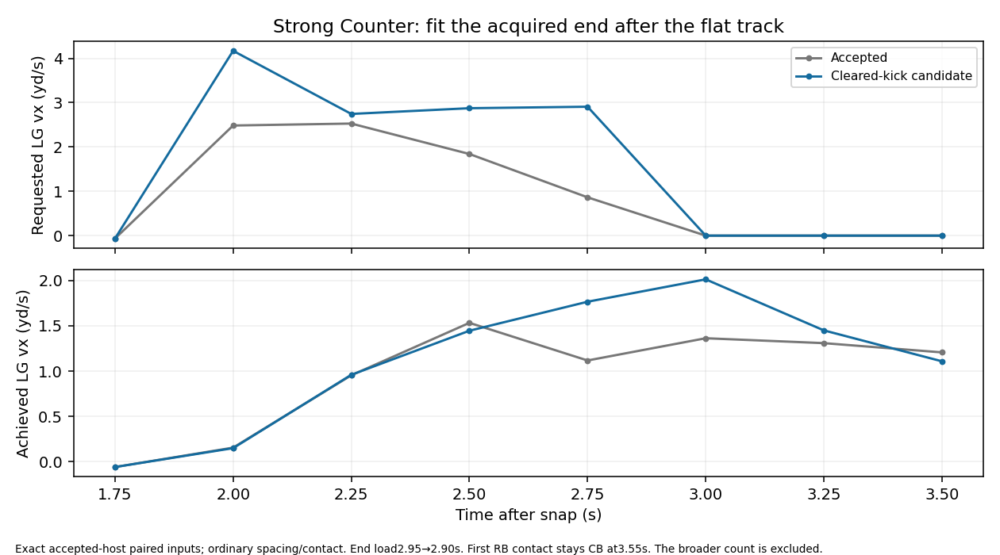

# Fit the acquired end after a cleared flat pull

**Recommend independent review of the cleared-kick correction only.** Code commit `0e52b95`, directly on accepted develop `0000e560e0dbe31905151465152d412ba838803d`; fetched queue `aa9ed35272cc334ce0a7c79eec709970e5c628fc`. Protected source: `5734bb3f2f8d702e1e8a93ff0d1f1c19eca1cdba3a2406e72de7ae9c5197ccee`. Integration owns final combined verification and adoption.

The guard can finish his flat pull with real rear-wall clearance while the end remains upfield. Previously he kept arriving at a fixed LOS-depth waypoint until the end penetrated, came within 1.2 yd, or the whole route happened to finish. That can request braking behind the intended work. The correction lets an achieved, cleared flat step transition to the ordinary acquired-end approach. It changes one runtime condition. Early penetration response, uncleared routes, traps, assignments, RB reads, movement, spacing, capacities, contact and flags remain as accepted.

The two production-hook tests stage legitimate snap route memory, reflect geometry, verify the upfield-end request and retain the uncleared opening. Existing fit and acquired-kick correctness contracts remain. No block, force or yardage is awarded.

| Exact saved input | Accepted → candidate first loaded kick | First RB contact | Positive teammate-impulse samples, before → after |
| --- | --- | --- | --- |
| K01 Counter weak Over | RG/end: 1.90 →1.90 s | same CB at 3.70s |11 →0 |
| K02 Counter weak Under | RG/end: 2.30 →2.30 s | CB 4.05 →4.00s |0 →9, beginning4.45s |
| K03 Counter strong Over | LG/end: 2.95 →2.90 s | same CB and position at 3.55s |40 →43, same existing RT/RG pair |
| G01 Power strong Over, predeclared opposing control | LG/end: 3.15 →3.20 s | same DT and position at 3.35s |1 →1, same RG/RB impact |

A sample is one native 0.05s interval with positive solver impulse, not a distinct collision episode. Power's0.05s later strike still precedes its runner's DT contact; preserving the former timing is not a football contract. Terminal gains are recorded in the evidence but are not the selection criterion. K02's accepted prefix remains live at 5s, so its terminal gain is unknown.



The first changed raw request is the kick guard, at 1.55/2.05/2.00/2.00s respectively. The first recorded RNG difference is later, at 3.10/4.05/2.90/3.15 s. This establishes a controller/geometry cause before changed execution draws; it does not require a matched-draw trial. No locomotion/solver defect was demonstrated.

**Known cost:** K02 gains late RT/RG impacts while the guard still carries the end. They begin after CB contact and the runner has cleared that block. [Portable all22 witness](../../../data/reviews/current/cleared-kick/K02-late-traffic.json.gz) retains exact inputs, source, commands, bodies, loads and RNG around4.45s. This needs lifecycle/traffic-owner review; it is not hidden by the cleaner K01 opening. Existing K03 and Power traffic also remains. This patch does not repair wrapper collection or certify contact-retention realism.

The joint Counter count is **withdrawn from this candidate**. Its accepted-host strong control changes the helper at 0.90s, delays the kick to3.40s and adds LG/RB impact at 3.10s. Code/tests at`05da690` and the separate research branch preserve it. The successful weak cases are insufficient to promote that broader change. #140's information repair and held #99 perimeter installations are not dependencies of this production patch.

Validation: **34 focused tests and typecheck pass**, exact source above. Four candidate native plays, two new exact baselines (strong Counter/Power), and two compatible cached accepted baselines. The additional four combined-count plays are retained adverse investigation. New native collectors total **5.320s**; final focused checks 1.422s, typecheck 9.457s. No full suite or games; Integration runs the exact combined suite once. Earlier failed/rejected receipts remain visible.

Reproduce on this branch with Node 22.23.3:

```sh
node scripts/baseline.mjs --candidate --receipt out/kick-check.json -- node node_modules/vitest/vitest.mjs run test/puller-kick-transition.test.ts test/puller-target-read.test.ts test/run-block-fit.test.ts
node scripts/baseline.mjs --candidate --receipt out/kick-native.json -- node --import tsx scripts/diag/puller-access.mjs run out/kick-native K01,K02,K03,G01 5
```

The launcher resolves every accepted flag; `PULL_STEP`, active hands and other experiments remain off. [Full settings, selected-input hashes, source receipts and retained comparisons](../../../data/reviews/current/cleared-kick/index.json), [cached accepted evidence](../../../data/reviews/current/cleared-kick/cached-accepted.json.gz), [first changed behavior](../../../data/reviews/current/cleared-kick/earliest-differences.json). The diagnostic collector defaults to zero snaps and refuses missing prototype installations before running.
