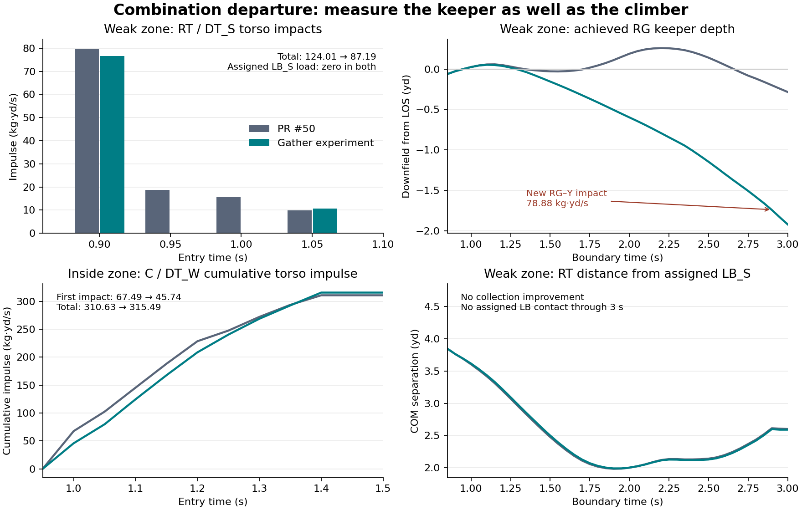

# Combination departure: finite feet and continued protection

**Keep PR #50. Reject the hard release veto and the post-release gather as
production changes.** The gather passes its focused contracts and reduces the
departing RT's collision, but it does not collect his assigned linebacker. It
also changes the keeper's depth substantially and introduces an RG–Y impact.
The successful moving-fit, contact-circle, acquired DL-key and mesh corrections
remain intact. The final diagnostic branch restores PR #50's exact `src` tree.

[Comparison chart](departure-comparison.png) · [measurements](summary.json) ·
[per-tick requests and execution](timeline.csv) · [exact settings](settings.json) ·
[costs](costs.json) · [first-action witnesses](first-actions.json.gz)



## What this teaches about general line technique

A departure is a transition between two contested jobs. A geometrically clear
line to a backer does not establish an attainable first step: current momentum,
base, turning and acceleration still execute. Equally, contact with the old DL
is not inherently wasted work. It can still affect the keeper's leverage and the
DL's movement. Neither contact duration nor minimum contact is the objective.
The useful contract is compatible position and actual control of access during
the runner's arrival, followed by attainable collection of the next threat.

PR #50 already demonstrates the first-level counterpart: maintain moving feet
through a combination instead of fitting a static landmark, with role-specific
responses to acquired penetration. This pass does **not** justify copying a
wide-zone lateral target into inside zone, making every OL move sideways, or
giving a free DL the offensive call. The DL's acquired-key response remains
unchanged. No new independent DL error was established here.

## One question and two bounded alternatives

The saved weak-H RT witness releases at **0.90s**. RT's initial velocity is
`(-0.0302, +1.2540)` yd/s while his requested target velocity becomes
`(+4.7342, -0.6863)` yd/s. These are an entry velocity and a new request, not two
executed velocities to compare as if acceleration had already occurred. An
ordinary World preview through the next existing read predicts intrusion into
his already acquired DT_S picture despite the clear geometric route.

1. **Hard release veto, rejected at `c61dd8c`.** Require the selected member's
   actual free forecast to clear before ending first-level work. This rejects
   eight existing valid release controls: private newer fill, fresh confirmation
   after regaining feet, a recovering helper that may climb while the other
   member stays, and a delayed fill picture (both sides). Six reject small
   predicted grazes; two reject a contact-assisted recovery because its free
   forecast falls. No old contract was weakened. No native run was spent on it.
   The initial run also contained a new-test setup error assigning a getter-only
   property; that test error was corrected before the focused diagnostic.
2. **Finite post-release gather, tested at `d22f083` / `b42b5a5`, rejected after
   native replay.** Keep original eligibility, member selection and release
   timing. For only the remaining lifetime of the existing departure read,
   compare the existing command with ordinary zero-target-velocity braking.
   Use the same acquired DL/keeper pictures; choose braking only if its free
   forecast remains upright, strictly reduces an intrusion and does not worsen
   an intrusion at another acquired peer. No new observation, release timer,
   force, attachment, body edit, capacity or RNG draw. A zero target velocity
   brakes finitely; it never zeroes actual momentum. This is the experiment
   discussed below, not a new production policy.

The corresponding candidate implementation and seven focused physical tests
remain available at [`b42b5a5`](https://github.com/tannerthardy/football-simulation-/commit/b42b5a5a0dc206cfff908ad797eacfaf354a6b29).
The [small saved witness](../../../test/fixtures/joined-departure-momentum.json)
includes the complete own body/support state and the consumed pictures.

## Native evidence, including the adverse result

All runs use the same roster and all 22 normally reacting players from snap.
Nothing freezes the runner's future route. The three Ace placements are not
geometric mirrors. Original PR #50 parents were decoded and reused; only the
predeclared inside-zone transfer required a new parent run.

| Input | Result through 3s / earlier whistle |
| --- | --- |
| Strong Y, Over | All 60 executed body states and final commands identical to #50. No teammate impact. LG's repeated escape arcs and absent LB_M collection remain. |
| Strong H, Over | All 57 executed states/commands identical, whistle at2.85s. No teammate impact. |
| Weak H, Over | Same RT release0.90s and handoff1.45s. RT/DT_S impacts4→2, total124.014→87.192 kg·yd/s. No assigned LB_S hand load; nearest COM1.984→1.990yd. **New RG/Y impact78.885 at2.85s.** |
| Tite, strong | All 60 executed states/commands identical. #50's loaded RT work preserved; no teammate impact. This is an existing control, not a fresh holdout. |
| Inside zone, Over, predeclared | Same C release0.85s, handoff1.50s. First C/DT_W impact67.485→45.741; cumulative310.629→315.488 (+1.56%). No assigned LB_W load. No teammate impact. |

The weak and inside-zone first changed actions occur from equal all-player
physical entry states at0.90 and1.00s. Inside-zone observer state and RNG before
that first changed action are also exactly equal. Old core packets retain full
state/information/RNG hashes, not per-tick raw observer queues; do not describe
them as body-only native restarts. New private candidate read bookkeeping can
change serialized hashes even in a control whose executed bodies/commands are
identical. The identity claim above concerns actual execution.

### Why the smaller RT impact is insufficient

The weak native trace first changes RT's command at0.90. DT_S's achieved movement
and spin change in that solve; RG's final request first changes at0.95. By the
2.00s entry's executed boundary, RG's position differs by0.901yd. At the2.85s
entry's boundary RG is **1.544yd farther backward** (x39.800→38.257). The first
Y request difference is2.20s, following the changed nearby DT_S/keeper surface.
Y and RG then converge; at2.85 their entry COM separation is0.6375yd and the
ordinary solver delivers the78.885 impact. Both remain upright.

RG/DT_S normal hand impulse across the prefix is very similar:
1251.743→1262.025 kg·yd/s. That did **not** preserve useful position. This is why
checking only RT's pair, hand load or the unchanged runner trajectory missed a
material coupled cost. An early progress update's zero-teammate-impact statement
was wrong; the complete all-player contact audit found and retained this impact.

This does not prove either defender's win is unlawful, that the old RT impacts
were good technique, or that the weak run must retain its ending. The departing
RT's residual contact changes a loaded mechanical system; reducing it can remove
real assistance. The experiment provides no collection or demonstrated route
protection gain that warrants adopting that tradeoff. We reject the proposed
general rule rather than tune toward the former gain.

The runner differs by at most0.00354yd through this weak prefix and is already
far playside of the later collision. This is not evidence that the first-level
cost is harmless across other runs. No second full-game campaign was launched.

### Inside-zone transfer is mixed, not a rescue

The one gather is at1.00s, after the existing0.85s release. Both arms retain nine
C/DT_W contact ticks. Less first impact is followed by somewhat larger later
impulses. LG/DT_W normal hand impulse falls1279.850→1249.347 (−2.38%); both remain
loaded through3s. The C later carries real **LB_M** load920.399→919.909, whereas
his nominal **LB_W** assignment stays uncollected in both. Those are different
opponents and must not be conflated.

The RB's first different raw request is1.75s. His consumed center and LG pictures
have moved0.0169/0.0409yd; DT_W/LB_M pictures differ0.0791/0.0042yd. The unchanged
crease reader makes a slightly different heading. Later spacing responds at
different ticks (for example, parent brakes at2.15; candidate at2.20). Maximum RB
position difference is0.272yd by3s. Neither arm has runner contact in the saved
window; their nearest defender at3s is LB_M,1.520→1.392yd. This is an explicit
censoring limit, not a better-ending claim or proof of a bad RB read. No runner
policy was changed or invented to complete a four-arm matrix.

## Pins, settings and reproduction

| Role | Pin / runtime |
| --- | --- |
| Historical law comparison, preserved | `4ded6b600fd3785e65034aa5623d7a9f8f3c5db1` |
| Accepted develop reference, separate | `a1b16e666a9ee7d1bc1d2aecba141fc535863b24` |
| Immediate parent, PR #50 publication | `da6cbce827806d80af5e7fbbdcc41c57f6f8ba84`; tested0336414; runtime`afb8a307e7607c26d87e1d5f52b51a43deda2ea4712126ee3826077a994102d2` |
| Rejected gather tested code | `d22f0835d6b1cbeb6effb76ffd7687e5a51bd57b`; collector/transfer pin`b42b5a5a0dc206cfff908ad797eacfaf354a6b29`; runtime`ccb0a466d060060086f0704bd5fa4176c393d49ea61748718c124bcaa0f20b86` |
| Inside-zone parent collector | `024502dd994b40564c12b035b075dca260266473`, exact parent runtime`afb8a307…` |

Node22.23.3, original44 baseline flags and all World defaults are recorded in
[settings.json](settings.json) and every native receipt. Active hands, reach-track
and experimental gait/contact policies remain off. The transfer manifest was
committed at`b42b5a5` **before** observing transfer results. Its inherited
`parentCode` field names the earlier #47 lineage; use the explicit
`parentPublication`, `parentSource` and native receipt for the actual comparator.
Roster O31/D32, seed3, strength.55, ace_12, Cover3/base43, LOS40, ballY26⅔,
firstDown50. Installed owned expectations begin copied from snap; seen/pending/
touch maps are empty, sensing advances once per native tick. No observer memory
is reconstructed from body coordinates.

For an exact native candidate replay, check out`b42b5a5`, use Node22.23.3 and:

```sh
npm run baseline:run -- --candidate --receipt out/replay-weak.json -- node --import tsx scripts/diag/combination-departure.ts --arm gather --expected-source ccb0a466d060060086f0704bd5fa4176c393d49ea61748718c124bcaa0f20b86 --cases uc12-wz-weak-s3 --out out/replay-weak.json.gz
npm run baseline:run -- --candidate --receipt out/replay-inside.json -- node --import tsx scripts/diag/combination-departure.ts --arm gather --expected-source ccb0a466d060060086f0704bd5fa4176c393d49ea61748718c124bcaa0f20b86 --manifest config/combination-departure-transfer.json --out out/replay-inside.json.gz
```

The original weak/Y candidate capture uses the unchanged #50 collector; the new
collector additionally captures gather input/output. Their code/runtime pins are
separate in the receipts. All portable packets use the existing digest-verified
reference-table codec. Decode requires only Python and performs **zero** new
simulation steps:

```sh
python3 scripts/diag/wz-flow-evidence.py decode docs/reviews/combination-departure/candidate.jsonrefs.gz --out out/combination-departure/candidate.json.gz
```

Other packets: [H](candidate-h.jsonrefs.gz), [Tite](candidate-tite.jsonrefs.gz),
[inside parent](transfer-parent.jsonrefs.gz), [inside candidate](transfer-candidate.jsonrefs.gz).
The #50 original and Tite parents are reused from its `final.jsonrefs.gz` and
`fresh-final.jsonrefs.gz`. Core packets retain all22 before/after bodies, raw/
final requests, contacts, joints, consumed cues and hashes. They omit duplicate
method/write/phase logs and per-tick observer/RNG snapshots. Native restarts must
use the from-snap recipe above. The first-action witnesses additionally retain
raw candidate entry observer state; they are diagnostic states, not replay code.

## Validation and cost

The gather's **59 focused checks and typecheck pass** on the recorded candidate
pins: seven new physical witnesses plus combo-transfer22, combo-attention20 and
combination-ownership10. The hard veto's eight old failures are retained in the
[diagnostic log](receipts/veto-diagnosis.log), alongside its failed receipts.
Passing contracts did not override the adverse football evidence.

Six new short native instances (four #50 controls, one inside-zone parent and
one candidate),357 outer ticks, cost **15.072s** of instrumented collector time.
No new games; no broad roster panel; no original baseline native rerun. Reduced
tests cost4.59s including launch; candidate typecheck10.24s. Failed hard-veto
checks/diagnosis cost4.77+2.86s. Packet encoding and reporting are offline, with
their own receipts and zero new World ticks.

All captured support integration failure counts are zero; maximum represented
work residual is7.31×10⁻¹², arm impulse limits hold to floating-point tolerance,
and recorded arm work stays within budget. This does not certify the known
contact-law limitations away. No solver or physical capacity changed.

After rejection, `src` is byte-for-byte PR #50 again, verified by empty source
diff and the original runtime digest ([restoration receipt](receipts/restoration.json)).
Its compatible existing validation is reused; no full integration suite was
spent on the restored diagnostic branch. The integration owner should **not
merge this as a new production controller feature** or designate a new baseline.

## Recommendation

Preserve #50. Do not promote a general collision-minimizing departure policy.
The next bounded controller question is the already demonstrated repeated
escape-arc station keeping in strong Y: can an attainable transit improve
collection **without changing selected release membership or first-level work**?
The hard veto and complete-route replacement have already shown why those
separate changes must not be bundled. This pass resolves the momentum proposal;
it does not claim that all joining, collection or DL technique is repaired.
