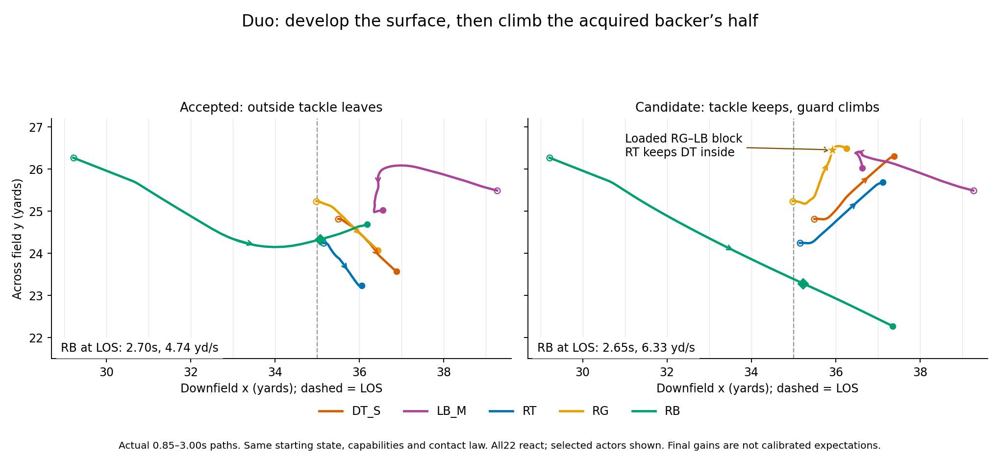

# Duo combination leverage before climbing

**Recommend this narrow correction for independent review and integration.**
A secure keeper is permission to leave a double, not sufficient reason for
that member to climb. The acquired linebacker can belong to the other half
of the developing surface. Releasing across it can abandon the useful keeper
leverage, require a long detour and consume the runner's path. This is a
football coordination problem before it is a faster-feet problem.

The correction retains near-level work for an obstructed Duo climber while
his personally observed backer stays across the down defender on the partner's
half through the next read. Either member can still earn his own original
release; a clear route or backer crossing onto the climber's half stays eligible.
There is no new release timer, extra sensing, hand strength, assignment,
movement capacity or runner/spacing change. The prior RT escape and orbit
experiments remain parked.

## Exact candidate and current comparison

Accepted **`7eb2554f5dbb497cff169f386704a5b0f4cf43fe`** (#82 included), source
`78183dc79c6285939b80875b131584c18c4f0eda020c17bcfde6191823ace965`.
Historical `4ded6b600fd3785e65034aa5623d7a9f8f3c5db1` stays separate; this is
not a new shared baseline. #69 is already accepted and is not repeated.

Clean code/tests **`aebb0abb3a9e96ec6561274b9fdd4e8e76ce7173`** on
`codex/duo-surface-release`, byte-identical protected source/tests/settings to
tested **`8d4b868b6125270a407a2b9b1b6238508616c365`**. Source
`dcebbee42fbe4cd64f603740d9b20bdf521ae424ad94e084eb46b30478b297e3`.
Production is **17 added lines in `readJoinedCombination`**; one existing test
file adds seven controls and a concept parameter to its existing fixture.
[Portable runtime/test patch](../../data/reviews/current/combo-football-surface/runtime-and-tests.patch).
The evidence branch includes research tooling/data and must not be merged as
the production feature. Integration receives the separate minimal code PR.

The old90edc525 packet is not assumed current: #82 changes the saved full22
sequences, including A018/A027 endings. Replayed only the necessary current
inputs, then paired the candidate to those exact current baselines.
[Frozen original inputs](../../data/reviews/current/second-level-access/inputs.json),
[predeclared question/budget](../../data/reviews/current/combo-football-surface/plan.json),
[preselected Under front](../../data/reviews/current/combo-football-surface/transfer-input.json),
[measurements,44 exact settings and cost](../../data/reviews/current/combo-football-surface/summary.json).
Node22.23.3; accepted44 flags/components1 with no overrides. Native observer
history initialization, all22 reactions, rosters, seeds, contact laws and
experimental hand policies are unchanged. No hidden engagement or partner
proposal is used to infer the linebacker side.

## What improves in actual protection

| Pair | Football result and retained adverse evidence |
| --- | --- |
| A030 ordinary Duo / Wide9 | RT's obstructed opposite-half departure.85 is held. RG earns his own release1.05, RT keeps actual DT hands. RG loads LB_M2.60 **before** RB crosses LOS2.65; RT/DT normal load about740 then, RG/LB normal819/lateral490kg·yd/s². Runner LOS speed4.74→6.33yd/s with no offensive impact. First carrier contact moves from LB_M2.75 to SS3.30, after the runner clears the surface. |
| A018 technique-elusive Duo / Wide9 | RG also earns release1.05 and RT keeps useful first-level work. Runner crosses2.65 at5.47yd/s, no offensive impact. **RG never loads LB_M**; the backer recovers and wraps3.30. Improved near-level protection is not a solved collection or a removed defender. |
| A027 existing useful WZ block/recovery | **Entire current-source full22 physical/request/RNG history and PlayResult exact**, including Y/LB contact2.70, later LB win and.80yd ending. No WZ behavior is changed by this Duo-only correction. |
| Fresh Duo / Under, fixed ordinary roster | Preselected before results, changing only the front from A030. **Entire physical/request/RNG/result exact**: useful RT/LB contact1.80, legitimate LB wrap2.75,4.70yd. The correction retains this real same-half climb and earned recovery. |



[PNG download/view](../../data/reviews/current/combo-football-surface/protection-paths.png).
These are actual0.85–3.00s paths from an identical starting state, not prescribed
future tracks. All22 react; only the relevant actors are shown. No film/ZIP.

A030 now combines a useful first-level surface and a timely second-level fit,
without slowing the runner to manufacture the block. RT's outboard keeper
position carries the DT inward; RG approaches the backer from the inside
surface, leaving the runner's outside answer available. This uses actual loaded
hands and attained bodies, not an assigned-job count or nominal engagement.
At2.65 both contacts still carry force while the runner clears at speed.

Final gains **2.01→12.66yd** and **1.53→6.59yd** are observations, not target
values or expected averages. A030's first SS contact is about4.66yd past the
line; a later broken tackle contributes to the much longer ending. A018 still
ends in LB_M's tackle. The adoption argument is the improved surface/access
relationship plus preserved opposing controls, not those gains.

## Causal difference and information

In A030 the first changed decision is.85. All22 entering bodies and the
pre-change physical/request/RNG prefix match current accepted exactly. RT sees
DT_S y24.877, keeper RG y25.239 and LB_M y25.392 while he is y24.244. The LB
remains on RG's half in the ordinary next-read projection. These are the same
consumed pictures native release already acquired: DL/LB age.30, teammate.05.
The existing route needs a detour; the new admission retains RT's down work.
No current hidden LB position, keeper intent or future runner path is read.

RG becomes eligible through his own existing security history and releases
at1.05. Acquired contact is promoted without assigning force, support or a new
control value. The **same rule also delays C's.85 departure to1.05**; this is
a line-unit interaction, not an isolated RT effect. The original LB interceptor,
all post-release departure movement and RB controller are unchanged.

Retaining the extra contact changes execution draws from the first changed
World tick. The exact final gain is therefore not isolated from changed draws.
No matched-draw simulation was spent to rescue a required ending: the source
of the first decision is deterministic acquired geometry, physical protection
is measured directly, two roster contrasts preserve legitimate defensive wins,
and mirrored/opposing information controls independently establish the contract.
This does not certify an optimal choice for every front.

## Correctness, limitations and review

**66 directly affected checks and typecheck pass** at8d4b868. Seven new native
`readCombination` controls cover both mirrors, retained real double contact,
legitimate near-half detours, an observed backer crossing onto the climber's
half, and private live backer changes that must not affect admission before a
new observation. These use the production release hook, actual acquired joints
and existing World budgets. They do not test a detached replacement helper.
On old accepted source with the exact new tests: **three expected failures,
four passes**; mirrored other-half holds and the hidden-state hold expose the
old admission behavior. Existing unsecured/stale/unreachable keeper, physical
hand ownership, attention, retarget and proposal controls remain passing.

Remaining risks are explicit:

- Duo only. This is a general observed-surface rule within vertical combinations,
  not a claim that zone, gap/pull and all football concepts should use it.
- Two changed Wide9 Duo roster contrasts, one unchanged fresh Under and one
  unchanged WZ control do not constitute league/formation certification. Some
  doubles can now remain longer. Broader fit coverage belongs to a named
  review risk, not an automatic game campaign.
- A018's guard misses the backer, and heavily rotated loaded keeper contact
  remains under the existing shared contact-law limitations. No physical
  realism, stronger-grip or force-law claim is made; Physics retains ownership.
- The rule's choice requires independent football/controller review. It avoids
  one demonstrated incompatible proposal; it does not guarantee the other
  member becomes eligible or every late defensive access is an error.

[Ownership boundary](https://github.com/tannerthardy/football-simulation-/pull/76#issuecomment-6204084989):
Run changed joined Duo proposal admission only. Do-It-All retains carrier,
spacing and local-approach research; sole solver ownership is untouched.
Integration owns independent review and final combined verification/adoption.
No unchanged full suite or full game was run/requested here.

## Reproduction and marginal cost

On the recorded source, using the pinned runtime/accepted flags:

```sh
node scripts/baseline.mjs --candidate -- node --import tsx scripts/diag/second-level-access.mjs run out/duo-surface A018,A030,A027
node scripts/baseline.mjs --candidate -- node --import tsx scripts/diag/second-level-access.mjs run out/duo-under DuoUnder 5 data/reviews/current/combo-football-surface/transfer-input.json
node scripts/baseline.mjs --candidate -- node node_modules/vitest/vitest.mjs run --project core test/combo-transfer.test.ts test/combo-attention.test.ts test/run-combo-retarget.test.ts
```

`python scripts/diag/combo-football-surface-report.py` asserts and plots saved
packets with zero new simulation steps. The
[portable A030 protection witness](../../data/reviews/current/combo-football-surface/A030-protection-witness.json.gz)
contains the exact full setup, acquired first-decision cues, both all22 causal
frames, real takeover and loaded arrival. Reproduce the native prefix for
observer history; these frames are not a complete hydration format.

**Eight short native executions8.115282 launcher seconds**: four matched cases
per source, all native endings. **23.393741 all launcher seconds**, including
focused/typecheck, the initial five checks and expected old-source red. Offline
analysis/plotting additional. Zero full games, new rosters or full suites.
Exact source/test/input/measurement pins, receipts and
[SHA inventory](../../data/reviews/current/combo-football-surface/artifacts.json)
are retained. No claimed compatibility substitutes for Integration's exact
combined check. Recommend the minimal candidate for that independent review.
