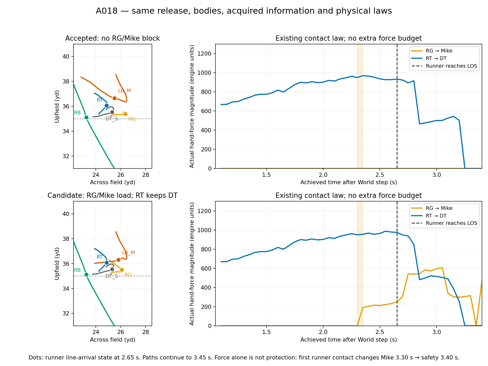

# Earned collection: clear the usable strike, not the defender's center

**Recommend this narrow controller correction for independent review.** It
turns a demonstrated, reachable A018 opportunity into actual linebacker
protection while the original keeper retains the down lineman. It also advances
collection on several other saved Duo surfaces. It does not solve every climb,
seal or first-level loss, and it does not certify league-wide run performance.

## Football issue and the specific barrier

The double team has two connected jobs: retain useful first-level protection
and put the appropriate member in position to control the linebacker through
runner arrival. An installed job, release event or nearby body is insufficient.

Accepted #84 supplies the better member on the A018 surface: RT keeps DT_S,
RG releases toward Mike at1.05. But RG stays in departure navigation past Mike's
runner contact3.30. His ordinary strike is available at2.30. The controller
continues asking whether his *body* can clear a corridor toward Mike's center,
including space beyond the first usable strike. That test can reject useful
contact which does not require walking the body through the entire corridor.

The correction passes the existing attack reach to **post-release**
`climbRoute`. Its direct clearance endpoint is the near strike surface. The
obstacle checks at the current picture and next decision remain; both old DL
and keeper remain obstacles. Pre-release callers retain the original contract.
The existing attack/interceptor, movement execution and all-player spacing
then decide what happens. No new release timer, detour policy, extra reach,
grip force, capacity, sensing, assignment or physical law is introduced.

This is also why merely strengthening blocks or moving every release earlier
would miss the cause. The runner reaches the line at essentially the same
speed; the useful change is denying Mike access without abandoning DT_S.

## Pins, ownership and compatible reuse

- Accepted base: `86250bb4f0c6f421878c204161864d523c3e30b6`; fetched remote and
  queue `ef214373f9dd101a044b5246879c7e5007c8fb55` agree. #84 only is adopted;
  #81's cost successor and #87 remain independent. Historical
  `4ded6b600fd3785e65034aa5623d7a9f8f3c5db1` is preserved, not relabeled current.
- Reference source SHA: `dcebbee42fbe4cd64f603740d9b20bdf521ae424ad94e084eb46b30478b297e3`.
  Reuse #86's published `ed30b821c3aa621b129ce861e5c5a66b5d5cf23c`
  and #84 evidence `70ed238a2246cd89d3c4108d647245baf5ff70bb`.
- Executed candidate freezes: `18f71d4d99f65edb63f6e76d918f2ee9338d822b`
  and `61fde14a1bc5582b579a37d98eb8a98851a89d11`; identical source SHA
  `bed54d7389957f713c4a8a61e899fff1ea707f2545bd275e1fb8ff814e65bf37`.
- Run owns only `blocking.ts`'s `leaveCombination` / `climbRoute` and focused
  collection evidence. [Boundary notified to Do-It-All](https://github.com/tannerthardy/football-simulation-/pull/76#issuecomment-6205753088).
  Do-It-All retains spacing/carrier/forecast cost; Physics retains the solver.
  Integration owns independent acceptance and final combined verification.
- Node22.23.3, Linux/x64, the exact [44 resolved flags and World defaults](../../data/reviews/current/combo-strike-access/inputs.json)
  apply: `RUN_CONTACT_COMPONENTS=1`, hands/research activation unchanged,
  center/centered/legacy/per-solve/speculative/mean physical settings. No new
  roster or game. Native observers call original production functions and add
  no sensing or RNG draws.

The [pre-execution plan](../../data/reviews/current/combo-strike-access/plan.json)
names A018/A030 first, conditional useful/adverse/obstructed controls next.
Power adds one small shared-function transfer check. D05 adds one targeted
observer pair to explain its apparent adverse earlier contact. No broad census.
Candidate manifest `42c00a9db6f57869387228f235e01eec2996f850d0832d2cb1a7a027e05bf476`
differs from #86's manifest encoding (`\u00b7` versus UTF-8); parsed setups,
per-case input hashes and all initial physical/job states are identical.

## First causal difference, not a yardage attribution

[Portable A018 state and consumed cues](../../data/reviews/current/combo-strike-access/a018-first-difference.json)
preserve all22 bodies and raw/final requests on both sides. The real production
prefix is exact through2.25. At2.30 the entering bodies and RG controller state
are identical. RG consumes the same acquired Mike/DT pictures, age.30s, and RT
picture age.05s. No private engagement flag or new observation selects the path.

Actual RG/Mike center distance is1.100yd, within the **existing**1.164yd strike
range. A thin center segment clears DT_S's torso by.271yd and RT's by.979yd;
this rules out an obvious intervening torso, not a new anatomical proof. The
unchanged attack creates a real acquired hand connection. RG's and Mike's raw
commands first differ here; Mike's tactile response and execution draws then
change normally. `beforeReps` is recorded **after controller execution**, so
it already includes the new joint and changed random execution. It is not an
identical pre-decision representation or a matched-execution counterfactual.

RG's actual load starts in World[2.30,2.35], native `block_contact`2.35. Initial
normal force is zero and lateral force191.13; this is permitted by the accepted
retained-contact contract and is not fabricated compression. Load rises through
runner arrival, with RT/DT still carrying approximately975 force units at2.65.
The native production-hook check retains RT's original hand joint through that
arrival. No offensive teammate impact occurs before the line or first contact.
Mike no longer makes the first runner contact: SS does at3.40 instead of
Mike3.30. Native gain6.59→9.99 is retained, **not an isolated expected-value
estimate**. A later C/LG impact49.97 at3.75 follows first SS contact and remains
visible; the whole play is not collision-free.



## Useful controls, adverse results and limits

| Saved input | Actual change | Decision |
| --- | --- | --- |
| A030, ordinary Ace/Wide-9 | Same RG release1.05; Mike block2.60→2.10. RT keeps DT. SS first contact3.30 at the same recorded position; no teammate impact. Ending12.66→11.61yd. | More timely collection; no claim that the shorter ending improves football. No tuning to restore the old gain. |
| Under right | RT/Mike block1.80 retained; C now loads Will2.25. Mike still recovers to contact runner2.75 at the same recorded position. Gain4.70 unchanged; ending3.70→3.85. | Useful existing departure and legitimate defensive recovery survive. Whole history is not identical. |
| D05, ordinary Ace/Over right | Same LG1.00/RG1.05 releases; LG/Will2.00 retained, RG/Mike2.10→1.95. First successful contact FS3.80→SS3.25. No teammate impact. Gain12.17→12.29. | Targeted diagnosis below: same safety opportunity changes from a miss to a wrap. Not demonstrated degradation of lane protection. |
| D07, Trips/Wide-9 | RG now loads Mike2.15, previously unachieved. SS first3.30, near-identical contact position; no teammate impact. | Useful route survives. Candidate remains live at5.00, RBx52.321; explicitly censored, **no final gain**. Timeout result's0yd placeholder is not a football outcome. |
| D06, ordinary Ace/Over left | Full recorded frames, commands, contacts, RNG and result identical; Mike first2.75, gain3.50. Existing low-closing LT/LG load contacts retained. | Known upstream admission/timing limitation remains. Not repaired or hidden. |
| A027 WZ | Full recorded frames and result identical, including useful Y/Mike contact and Mike's recovery. | Loaded contact still does not guarantee route denial. Three primary `ace_12` controls remain preserved and are not replaced by this 11-personnel case. |
| Power/Over | Full recorded frames and result identical. End still reaches the runner2.80 despite LG load. | Separate first-level seal failure remains; no new Power improvement claim. |

The [D05 observed-response pair](../../data/reviews/current/combo-strike-access/d05-response.json)
is exactly neutral against both original recordings (all frames and result).
Both SS attempts occur at3.25: reference emits `missed_tackle`; candidate emits
initial `tackle_wrap`, then slips3.55. Pre-attempt runner/SS position deltas are
.000572/.000132yd. SS's first materially different command is3.30, after the
changed attempt; RB's is3.50. The apparent earlier safety arrival is therefore
the same already available tackle opportunity resolving differently. Earlier
contact changes draw alignment. Exact probability/draw decomposition was not
recorded and is not claimed; another physical comparison is unnecessary for
this attribution. Both retain FS wrap3.80 and native ending4.50.

**Keep the old negative.** The older first-strike-only trial
`0d3ff9183af171403aa06faeddc6034d14dcacac` on90ed source did not get the old RT
to useful protection in time. Interception first ran2.40, free arrival2.85
after runner contact2.75, and spacing modified its request. This result is
preserved in [second-level-access](https://github.com/tannerthardy/football-simulation-/blob/c56200d00078bec4e7e5138cc07d3807b52cf2b8/docs/reviews/second-level-access.md)
and its subsequent evidence history. It is not retrospective adoption evidence.
Accepted #84 changes which member has the viable opportunity; this comparison
tests that current surface, without claiming that every old RT route is fixed.

## Focused verification and reproduction

**71 focused checks and typecheck pass.** Five new checks exercise the real
production hook: clear near strike and genuinely obstructed departure, each
with a reflected acquired decision picture; then a full22 native prefix with
real RG/Mike load and RT's original loaded hands retained through runner
arrival. Decision mirrors are stopped before physical execution; they are not
claimed as mirrored whole plays or mirrored physical joints. Three tests are
expected-red on accepted old source, and the two obstructions already pass.

Compatible existing checks: `combo-transfer`29, `combo-attention`20,
`run-combo-retarget`17. Initial typecheck failed on two optional force values
in the new test; only test-side `??0` guards corrected it. Initial failures,
expected-red receipts and final passes are all retained. Source did not change.
[Native accounting](../../data/reviews/current/combo-strike-access/native-integrity.json)
is finite; max represented-work residual1.16e-11, arm impulse excess4.27e-14
(roundoff). These are bounded current-law checks, not physical realism certification.

Ten new short executions cost **10.616 launcher-command seconds**; all launcher
commands including tests, initial typing failure and expected-red runs total
**57.207s**. Offline reduction/chart authoring are outside that recorded command
bill. Some checks overlap, so these are costs, not a speed comparison. No full
suite, new roster panel or game was run. Seven candidate cases end naturally;
D07 is explicitly censored at5.00. No assertion or supported outcome was removed.

The [summary and individual receipts](../../data/reviews/current/combo-strike-access/summary.json)
record exact code, input/operator hashes, flags and costs. [Compact paired tapes](../../data/reviews/current/combo-strike-access/paired-tapes.json.gz)
retain all22 achieved position/velocity/facing, raw/final requests, loads,
contact events and RNG. Full raw recordings stay in ignored `out/`; their hashes
and regeneration commands are retained. Fixture SHA
`54d29ddea501d3c65e32f0b4ce389ec20ba078fdce1154c7d5411072ccc66fee`.

On the research evidence branch, Node22.23.3:

```sh
npm run baseline:run -- --candidate --flag RUN_CONTACT_COMPONENTS=1 -- npx vitest run --project core test/combo-strike-access.test.ts
npm run baseline:run -- --candidate --flag RUN_CONTACT_COMPONENTS=1 -- node --import tsx scripts/diag/combo-strike-capture.mjs run out/combo-strike/reproduce A018,A030 5 data/reviews/current/combo-strike-access/inputs.json
```

These are reproduction options, not a request for an unchanged rerun. Promote
only the minimal `blocking.ts` hunk, focused test and fixture after independent
acceptance; diagnostic ancestry is not a production dependency. Integration
owns the exact combined verification. Next football question after disposition
is the unchanged leftward surface's earlier access opportunity, not a sweep of
exit angles, stronger hands or forced positive yardage.
