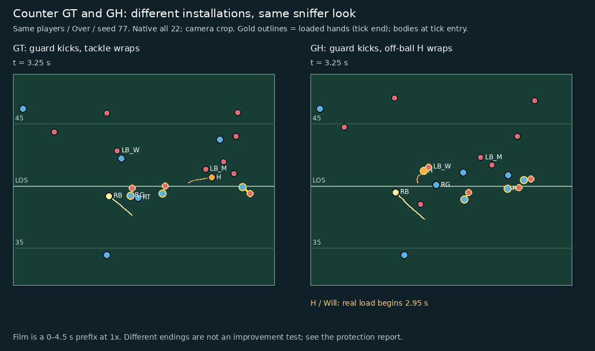

# Counter: usable second-level work, with distinct GT and GH installations

**Recommend independent review of explicit GH support after #140. Keep it out of automatic calling. No general GT collection repair is ready.** Two Over looks produce actual H/Will protection through the runner's approach. The Under and strong-side qualifications remain below. Nothing here promotes the held Counter ledger, extra entry rules, #143, physical policies or new capacities.

Tested runtime **`edff961edfa79972aa3d7286d8de3d456c0b47af`**, source **`73c69771e61a0eac975bb17ec630e0fd40bac95b5ad16f291b29b15c3120521b`**. Runtime comparison host: **`0000e560e0dbe31905151465152d412ba838803d`**. Current accepted reference is **`develop@914f4d56a3b7ef2845ff0208f55d626c0ff5f880`**, canonical queue **`e8d806b940a84c7cff7e5ee066022079723c78ef`**. Its runtime/tests/settings/tooling are byte-identical to the comparison host. The accepted documentation changes were merged at `2ed6147`; source and verification receipts remain compatible. This checkout had a narrow fetch refspec; explicit refspecs resolved its stale remote-tracking references without changing Git settings. Historical `4ded6b6` is unchanged. The exact published #140 runtime is a prerequisite, reused rather than reimplemented; [#143](https://github.com/tannerthardy/football-simulation-/pull/143) remains separate.

## The football problem

The new [moving-run-footwork handbook](../../football-handbook/moving-run-footwork.md#42-gt-counter--counter-trey), especially §1.3, §2.4–2.5, §3.2–3.5 and §4.2–4.3, was checked against this pass. Its separate GT/GH installations, actual starting depth, acquired first-block result and meaningful body-contact contracts apply. GY/attached-Y, Tite/Bear, read-option and detailed anatomical foot-sequence checks are unvalidated here; the book's diagnostic packs are options under TESTING_COSTS, not an additional required campaign.

The [handbook's gap account and pull teaching](../../football-handbook/trenches.md#5-gap-concepts-account-for-the-vacated-surface-before-pulling) separates three responsibilities: retain the down wall, fit the edge, and insert on the next fitter. A log is evidence about a first-level surface; it does not establish a usable lane or relieve the wrapper of his backer job. The [RB contract](../../football-handbook/offensive-skill-and-playcalling.md#42-track-key-entry-and-escape-are-different-decisions) also distinguishes the initial track from the eventual entry. Nobody knows the runner's future cut.

The accepted Ace GT cases expose a count/access mismatch. In weak Over, RT gets distant Sam after the other jobs claim Will and Mike. In weak Under, the wrapper initially gets no backer. In strong Over the existing helper already supplies useful Mike work; assigning Mike to the wrapper changes that helper's release and the first-level surface. These are **different situations**, not proof that all helpers should leave sooner or that every unachieved job is a defect.

The first drop's waypoint tolerance does permit lateral translation before most nominal drop depth is achieved. Completing more of that drop was tested and rejected: neither second puller loaded his backer, and the gun Under case took earlier interior contact. A clear-entry alternative with original jobs produced real RT/Sam load on the wrong side of the runner; it was not useful protection. Reusing the held count, an earlier ordinary approach and their combination did not establish a general GT improvement. The old strong-side count failure remains at #143's report; none of this work removes or retunes it.

## What the GH installation changes

`COUNTER_VARIANTS.gh` explicitly uses `pullers: ['BSG', 'H']`; GT retains `['BSG', 'BST']`. GH is exported separately from `RUN_CONCEPTS`, so **automatic play selection is unchanged**. Use a real off-ball H in a wing/sniffer look; an attached/on-line H, missing pulling guard, extra tackle pull or non-Counter H tag is rejected.

The guard keeps the kick job. The H receives an immediate backer before conditional combo jobs. The tackle stays in the first-level account. An H who starts deeper than the OL pull track retains that achieved depth across the wall rather than stepping toward the line first. These are installed responsibilities, not extra speed, force, reaction or a guaranteed block.

The current explicit install rejects an all-walked-up picture with no eligible second-level backer instead of silently searching private defender state.

The H receives the installed guard/end identities at the snap. On his ordinary decision cadence he consumes their delayed body pictures. A nearby achieved inside surface can select the outside wrap corner; an unreachable pair or the guard's private `block-log` flag cannot. His last acquired corner is legitimate route memory, not a claim that a connection remains secure. Existing contact eligibility, runner reactions, teammate spacing, information delays and physical budgets still apply. The original GT log-tag behavior is not silently repaired or generalized by this feature.

## Native results: actual protection, not a yardage score

All use frozen ordinary 12-personnel profiles, seed 77, Cover 3 and full 22-player reactions. Strong/weak placements are not exact mirrors. Tests cover reflected read/obstruction contracts separately.

| Look | Achieved second-level work | Ending / cost |
| --- | --- | --- |
| GH01: weak, gun sniffer, Over | H loads Will from tick 2.95 through 4.90; first-level C/LG/RT work remains. H lies between Will and RB at 3.25. | CB reaches RB at 3.80; native ending 4.45 yd. **Zero teammate impacts.** |
| GH04: weak, shallow gun wing, Over; chosen to challenge entry depth | H loads Will from 3.55 through 4.75, before the runner's first contact. | CB reaches RB at 3.90; native ending 5.55 yd. **Zero teammate impacts.** |
| GH02: weak, sniffer, Under | No H/Will load before the interior failure. This is not isolated evidence of an H collection error. | DT_S reaches RB at 3.05, just after C's loaded contact ends. Native ending 1.41 yd; no teammate impacts. |
| GH03: strong, opposite-side sniffer, Under; selected before results | H has no hand block, **but RT physically intercepts Mike**: first body impulse at 1.80, falling at 2.20, down at 2.65, not fully up until 4.20. Lack of H hands is not lack of second-level protection. | RT/RB impact at 3.70 remains a traffic cost. FS first contact 3.85. **Live at 5s; terminal gain is null.** |
| GT01: GT in the same weak sniffer geometry | LT/Will hand load is brief, 2.50–2.65, **but real LT contact knocks Will down at 3.05; he is not fully up until 4.35**. This is useful second-level work. RT has neither Mike hands nor a Mike body impact, but Mike also flows away from the runner. H/Sam load starts at 3.95, after first RB contact. | CB first contact 3.75; ending 3.18 yd; twelve RT/RG impact samples. **A different installed call, not a rollback pair.** |
| K03: existing strong Ace GT opposing control | All 22 state, raw/final request, RNG, work/contact-report and event histories **exactly equal** the saved accepted run. | Existing first CB contact 3.55, ending 3.11 and existing RT/RG traffic retained. |

Loaded intervals are recorded end-of-tick forces labeled by tick start; a 0.05s sample is not an exact force integral. At GH01 tick 3.25, H is approximately `(41.19,28.89)`, Will `(41.52,28.48)` and RB `(39.48,31.15)`. The H actually occupies Will's direct path to the runner, transmits about 720N normal load, and restricts his achieved motion. This is substantially stronger evidence than a job label or nearer approach. It does not prove that every alternative defensive escape is impossible.

GH01's LT/Mike load is only 1.95–2.15 in the final acquired-cue version. The earlier private-tag prototype retained it longer; **do not carry that prototype claim into the final candidate**. No later yardage or prolonged grip is credited as extra successful protection. The shared retained-block/work-off lifecycle concern remains with its owner; the 4.90 last load is not a certification of realistic retention after the runner has passed.

## The information correction inside this candidate

During the GH implementation, replacing inherited live teammate coordinates with a **position-only cache introduced a regression**; this was not a pre-existing accepted-engine defect. In GH04 at 1.40s, the held guard picture from 1.25s put RG at `(38.637,26.537)` and triggered a backstep. The same acquired picture already carried velocity `(-1.237,+1.782)`. Advancing only the 0.15s held time predicts RG at about `(38.452,26.804)`, behind H rather than in his path. The controller had compared current self position with a frozen teammate position.

The final candidate carries the acquired velocity between ordinary reads. It does **not** add observation age twice or consume private current position. H's unnecessary longitudinal request changes from about `−0.670` to `+0.0004 yd/s` at the first divergence. The production-hook regression test replays the saved 1.40s prefix. [Small witness with the consumed picture, raw/final requests and source pins](../../../data/reviews/current/counter-second-level/held-traffic-witness.json).

Position-only GH04 lost the edge at 2.85s and produced no H/Will load. That adverse arm remains `candidate`; the corrected final arm is **`memory`**, with real H/Will work from 3.55s. Earlier arm names such as `final` are historical prototypes, not the final recommendation. This teaches reference-time consistency; it does not establish the same bug throughout the global awareness or movement system.

## One rejected follow-up, and why it matters

GH03 initially looked like another missed H block: the guard's outside surface diverted the H while Mike remained inside. We tried one conservative post-flat entry, using only acquired bodies and the existing backer approach. The paired Over control was retained.

The instrumented replay shows LG obstructing that direct strike corridor at the 1.35 projected read and 1.60/1.85 current reads. The approach becomes selectable at **2.05**, but it adds no H load or useful protection before arrival. The native trace then explains why demanding H contact would be wrong: **RT's real body block already knocks Mike down**, without H hands. The extra entry rule is parked; it has not been promoted because it moved the H closer or shifted Over's strike by a tenth of a second. [Acquired pictures, request phase and obstruction witness](../../../data/reviews/current/counter-second-level/gh-entry-obstruction.json.gz).

This is also a limit on our interpretation: a bounded failed approach does not prove that every route was impossible. It rejects this proposed correction. GH03's remaining RT/RB traffic is separate from a missing second-level hand block; it needs the existing movement/traffic owner, not increased grip or a release timer.

## Film



[Download the 1× GT/GH comparison GIF](counter-gt-gh.gif). Left GT, right GH, same sniffer formation/roster/front/seed, **different installations**. Bodies are at tick entry; gold outlines indicate sampled loaded hands during that tick. Camera crop only; all 22 simulated normally. Film stops at 4.5s; it is not an uncensored ending comparison.

## Checks, settings and reproducibility

**54 focused tests and typecheck pass**, on the final runtime source above. Thirteen GH installation/acquired-surface tests include mirrored private-tag invariance through production `RunBlocker.update`, a tagged but unreachable connection, valid counts/depth and rejected invalid calls. Reuse #140's nine wrapper read/true-obstruction checks, ten pull-target checks and 22 near-fit checks. Focused wall cost **1.906s**; typecheck **9.232s**. These are bounded contributor checks, not the full integration suite.

**41 new native continuations across nine distinct saved inputs**, including rejected variants and one 2.6s trace inspection: **19.365s collector time**. Final six native runs **2.695s**. All recorded native/test/typecheck command wall time, including rejected versions and launcher overhead, totals **69.720s**. One 1.40s native-prefix regression probe also runs inside the focused tests. Three compatible accepted Ace baselines reused; zero games, NFL scans or roster sweeps. K04/K07 remain unrun GT manifest options, not favorable missing results. GH04 uses K07's geometry as its declared shallow-wing challenge. No simulations ran for film, reductions or source/patch checks.

[Exact arm/source/input/flag index](../../../data/reviews/current/counter-second-level/index.json), [compact summaries, adverse results, raw/final/achieved timelines and full-history digests](../../../data/reviews/current/counter-second-level/summary.json.gz), [validation receipts](../../../data/reviews/current/counter-second-level/receipts/) and [portable runtime sources](../../../data/reviews/current/counter-second-level/sources/). Each source patch was reconstructed and content-hashed against its original receipt, then checked against accepted develop without changing a checkout. The GH promotion patch applies to published #140. Original full tapes remain in ignored `out/counter-second-level`; hashes identify them. Reproduce from the frozen snap inputs, preserving ordinary observer initialization, rather than from bodies alone.

Node **22.23.3**, **44 recorded settings**, `RUN_CONTACT_COMPONENTS=1`, experimental flags/defaults unchanged. The launcher clears ambient experiments. Native source, selected-input hashes, collector versions, platform, dependencies and World defaults remain in their receipts.

```sh
# Default executes zero snaps.
node scripts/diag/puller-access.mjs
# Explicit bounded final-candidate reproduction.
node scripts/baseline.mjs --candidate --receipt out/counter-check.json -- \
  node --import tsx scripts/diag/puller-access.mjs run \
  out/counter-check/memory GH01,GH02,GH03,GH04,K03,GT01 5 \
  test/fixtures/counter-second-level-inputs.json.gz
# Offline reporting/film only.
python -m pip install --target out/report-tools ijson==3.6.0
PYTHONPATH=out/report-tools python scripts/diag/counter-second-level-report.py --root out/counter-check --out out/counter-check/report --film-arm memory
python scripts/diag/counter-second-level-film.py out/counter-check/report/film-frames.json.gz out/counter-check/film
```

For a rejected arm, start from the accepted pin in a clean isolated branch and apply its archived source patch. Use the recorded collector version (early is an explicit 1.4s diagnostic command override, never a production timing policy) and its original selected case hashes/settings. Frozen rows remain compatible across manifest revisions; manifest byte hashes and collector hashes are retained rather than relabeled as identical.

## Recommendation and next decision

Review the **explicit GH installation**, with its #140 prerequisite, independently. [Minimal promotion patch](promotion.patch) changes three runtime files plus its thirteen tests/frozen fixture; no diagnostic ancestry or #143 is required. Keep automatic calling off, and keep the GT count/depth/entry proposals parked. Integration owns final combined verification; no author self-approval or new baseline is designated.

GT01 already has useful LT/Will body protection; GH is an alternative installation, **not proof that GT is broken or a universal yardage improvement**. For the remaining GT access question, the next question remains the earlier **installed count and attainable insertion through the first-level surface**, rather than another late arc or stronger hands. The saved same-geometry GT/GH contrast now gives a useful alternative installation and a concrete protection reference. Under's C/DT_S access and strong GH's RT/RB traffic are separate questions, not a reason to force all backers to receive hand contact or make every Counter call win.
