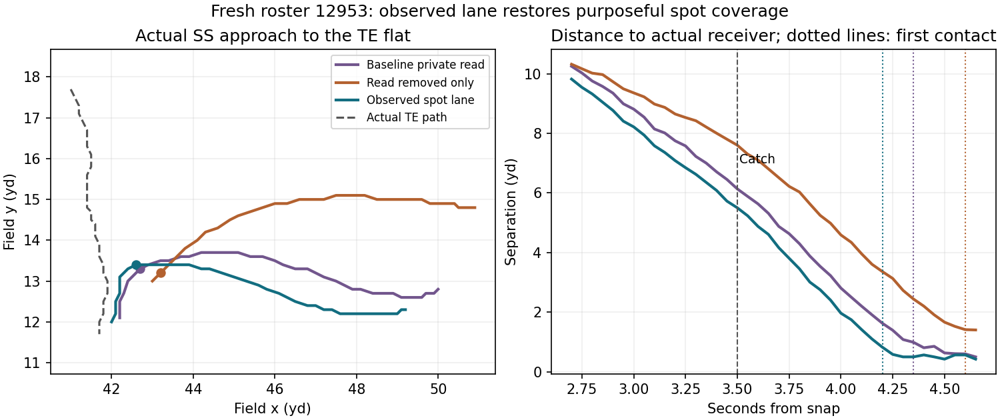

# Coverage without the quarterback's private read

A small controller candidate now chooses zone threats from observed routes
instead of `sim.qbEyes`, the quarterback's private selected-receiver identity.
Deep players preserve installed vertical ownership and split other observed
verticals; a defender without a relevant observed threat holds his landmark.
A settled spot defender squeezes the nearest observed route's lane inside his
existing depth/radius. No body-direction replacement, faster reaction, strength
change or new coverage family is added.

Removing the private cue alone was insufficient: it made settled spot players
ignore a visible route. The separate spot correction restores useful football
and transfers to two fresh rosters. Existing curl/flat expansion also required
its entry condition to accept a generic choice of either #1 or #2. Otherwise
removing the private bonus could select #2 directly and bypass the taught
outside expansion. This contract repair preserves all its observation,
recognition, seam, trips/Fast-3 and run guards.

**Ready for integration-owner review as an isolated candidate, not promoted.**
Both fresh match defensive losses remain. The designated run-game lead runs
the full suite on the exact combined candidate; the separate YAC candidate
has not been merged or retested as a combined source here.

## Pins, scope and comparison policy

Baseline is integration `4ded6b600fd3785e65034aa5623d7a9f8f3c5db1`, runtime
SHA-256 `8433e88d7deb31e5c1c031e2f0cb83d1cf0e805609820c0559f6b8f25747340c`.
Branch: `codex/coverage-threat-selection`, isolated in its own worktree from
that baseline. Workboard coordination precedes the shared controller edit.
Publication recheck of `origin/codex/run-game-integration` still resolves to
that exact `4ded6b6` pin; the historical repository-selected branch is not
the comparison baseline.

The initial source candidate `660a236` failed the affected flat contracts;
the completed controller was installed at `00cc48e`. Final focused checks ran
at `2f421b0`, and typecheck/build plus actual-source film at
`3775fa4e812d65b1b829e8068f94fb0f76652ebd`. Candidate runtime SHA-256:
`601749e54c395b6180b182bd49cb137f28f9a1642151fd6b81b51b2d326391b1`.
Later caller-identity/docs/evidence additions leave these source/test bytes
unchanged. The compact [receipt](../../data/reviews/current/coverage-cue-repair.json)
pins every stage's full commit, source/collector/input/harness hashes, commands,
Node 22.23.3, all **43 flags**, World defaults, costs and failures.

All runs use the unchanged `run-game-2026-10-13` profile without overrides.
Center hands, legacy support, mean integration, bounded attachments and
adaptive contact stepping remain fixed. World, capabilities, kinematics,
route/QB controllers, match rules, helper judgment, run fits and pursuit are
byte-identical to baseline. Only the ZoneCoverage section in
[`defense.ts`](../../src/sim/behaviors/defense.ts) changes. Information contracts
are added; existing flat tests retain all assertions with four staged
preconditions corrected to avoid the removed oracle.

The shared [testing policy](https://github.com/tannerthardy/football-simulation-/blob/f9617dde9456c0ead2d66b46d4b42608adcd3585/docs/TESTING_COSTS.md)
guides the bounded expansion. Older QB-cue experiments supply adverse input
recipes and a warning against treating body facing as a confident read cue.
Their historical outcomes and October 11 NFL measurements are not pooled
into current results.

## Repeated error and smallest experiments

Private read identity entered five zone decisions: empty deep-zone lean,
splitting verticals, underneath threat score, empty underneath drift and spot
lane choice. It could move a defender toward an unobserved target or switch
between equally observed receivers without any changed public evidence.

Seven staged encounters compare unchanged and cue-removed requests with
identical bodies/pictures: empty deep half, two verticals, two underneath
threats, a single ordinary threat, owned quarter #2, single-threat spot and
empty spot. Flipping private read identity and unseen live receiver positions
no longer changes the request. Own quarter #2 and ordinary single-threat
controls retain their requests. Empty-zone drift disappears. These direct
decisions are staged evidence, not completed football outcomes.

Initial native collection regenerates four old adverse/control recipes at
the current source: roster seeds 7/19, strength .55, gun doubles, seed 3,
FourVerts/Cover4, FourVerts/3-Match, Dagger/3-Match and CurlFlat/Cover3. P16's
interception and P95's ordinary successful rear tackle reuse compatible exact
baseline inputs/results. Four newly declared inputs use generated roster
seeds **12953/13964**, strength .55, LOS 40, ball at field center, first down
50, audibles off: **CurlFlat/Cover3 spot, seed 61001**, and **FourVerts/3-Match,
seed 61002**. Each new roster uses one seeded generator for offense then defense.
The [portable packet](../../data/reviews/current/coverage-cue-inputs.json)
retains every actual player/call and original baseline/prototype signatures.

The same temporary diagnostic suppression (`qbEyes=null` only during a zone
update, immediately restored) adds no observation/draw. It isolates removal
from any replacement. Spot lane geometry is then compared separately to that
removal and the unchanged baseline, within existing budgets. No input is
filtered after outcomes.

## What visibly improves

Both fresh spot plays catch the same actual TE at the same throw/catch time
under baseline and the completed candidate. Actual primary is the same SS,
index 21: **CD12953-S1** or **CD13964-S1**. The receiver is index 7/Y:
**CO12953-TE2** or **CO13964-TE1**.

| Fresh CurlFlat spot | Baseline | Cue removal only | Completed candidate |
| --- | --- | --- | --- |
| R12953 SS distance at catch | 6.429 yd | 7.762 yd | **5.747 yd** |
| R12953 first physical contact | 4.35, grasp | 4.60, grasp; later breaks | **4.20, grasp** |
| R12953 YAC / ending | 1.029, tackle | 9.359, tackle by later helpers | **.495, tackle by SS** |
| R13964 SS distance at catch | 6.183 yd | No catch; recorded drop | **5.386 yd** |
| R13964 first physical contact | 4.20, body collision; wrap 4.60 | No catch/contact | **3.90, grasp** |
| R13964 YAC / ending | −.464, tackle | Incomplete | **−.062, tackle** |

For R12953, candidate SS velocity before the catch is (−4.631, +1.786) yd/s
versus baseline (−4.623, +1.644); removal alone is (−4.276, +.360). It closes
from a better position rather than gaining an athletic speed bonus. Candidate
first load is 4.30, runner fall label 4.35 and tackle 4.75. R13964's candidate
first load is 4.00, fall 4.15 and tackle 4.55, versus baseline's 5.30 finish.
Its additional .402 YAC remains an adverse gain despite better first entry.
No inference that every finishing difference is solely geometry is made.



The figure uses achieved native positions, quantized to .1 yd, with recording
tick labels. Exact before-step bodies, applied requests, foot/support states,
grasp force/capacity, execution and completed load boundaries are retained in
the full actual-source films. First-contact/fall event labels refer to the
decision tick; first loaded boundaries occur after the completed World step.
Sampled force is not an exact substep impulse integral or NFL calibration.

## Adverse match controls and execution

| Input | Baseline → completed candidate |
| --- | --- |
| Initial FourVerts/Cover4 | QB slide 1.88→1.91 yd |
| Initial FourVerts/3-Match | Tackle 21.30→20.54 yd; same O1-TE2 |
| Initial Dagger/3-Match | Same D1-CB3 interception; defensive return tackled |
| Initial CurlFlat/Cover3 | Tackle 2.14→2.38 yd; same O1-TE2 |
| P16 | Same I7204-CB1 interception; defensive return tackled |
| P95 | Ordinary rear tackle retained; 3.577→3.582 YAC |
| Fresh R12953 FourVerts | Tackle 13.24→18.68 yd; **+5.44 YAC** |
| Fresh R13964 FourVerts | Incomplete → completion/tackle, **19.87 yd** |

R12953 has the same throw at 2.00, actual receiver **CO12953-TE2 / Y, index
7**, catch at 2.95, and nearest catch defender **CD12953-LB2 / LB_M, index
15**, 2.434 yd away. The actual first tackler is **CD12953-CB3 / FS, index
20**. At 1.75, bodies and consumed pictures are identical: its private-read
lean requests vy **−1.337**, while splitting the observed threats requests
**+1.600**. By catch the candidate FS is about 1.6 yd farther across the field.
First physical grasp moves 3.45→3.75 and finish 4.40→4.95. The candidate hold
does not break; it loads at 3.85, execution 1.019866, with later assists.
This is an actual containment cost of losing privileged foreknowledge. No new
cue or stronger grip is added to force the earlier ending back.

R13964 preserves the same actual ball contest by **CD13964-LB1 / LB_M, index
15**. At 2.75 its body, receiver body, ball state and tags are **exactly
identical** in both histories. Baseline uniform roll **.2398466810** tips the
ball. Candidate gets **.8208590229** then tips one tick later at 2.80; actual
**CO13964-TE1/Y, index 7** catches the tipped ball at 2.85. The shared RNG
sequence differs because baseline **CD13964-CB5 / FS, index 20** consumes
.820859 in the existing look-for-the-ball chance at 2.75; the candidate does
not consume that call then. No draw, contest law or interception envelope is
altered. This establishes execution-sequence sensitivity rather than a lost
attainable PBU. The adverse completed gain and later broken FS hold remain.

Eight short RNG-observed/plain prefixes, ending at 2.95, prove exact
observational neutrality and preserve the first witness when caller identity
is added. They are censored and are not additional completed plays. They do
not establish a desirable league completion rate or validate every tip bounce.

## Contract blocker, repair and actual source

The first candidate failed **six of 64** focused checks: two preserved native
positive flat-expansion contracts and four negative guard controls. Source
required `best == #1` before applying the observed #2 rule. With private
bonuses removed, generic geometry could already select #2. The repaired entry
accepts either #1 or #2 and retains every other condition; it does not widen
the rule to another route, trips, Fast-3, an unknown pass or a deep out.

The four negative controls used the private bonus to make #1 ordinary. A first
staged planted curl was still not geometrically closest and those four
failures are retained. Final controls put the visible planted #1 at the called
curl landmark, one yard outside, without the private read. Existing target,
non-expansion and all other assertions are preserved. The original native
positive encounter/mirror is unchanged. **No tests were removed or assertions
weakened.** Final **64/64** pass, including 9 new information contracts and all
13 existing flat contracts; typecheck/build pass.

All ten actual-source inputs have exact observed/plain final result, every
body, applied intent, RNG and perception fingerprints. **Nine** also exactly
match the preceding prototypes. Initial CurlFlat is the exception because the
repaired entry now fires at 1.70 for **D1-S3 / NB, index 19**, already selecting
H/#2. The same bodies and pictures now request (2.580, 9.402) rather than
(−1.045, 4.332), widening outside the curl from the existing observed flat.
Actual trace names `coverage-flat-expand` with `lane:H / flat:H`; the entire
football result is unchanged. The earlier fingerprint is retained, not
silently updated. Its difference is this implemented policy completion,
not an observer/port error.

## Cost, limits and handoff

**64 new full runs**: 20 initial controls, 24 fresh three-policy arms and 20
actual-source observed/plain runs. Eight new contexts; two compatible full
baselines reused. All current full plays end naturally, with **zero timeouts**.
Seventy direct staged decisions and eight censored prefixes are counted
separately. No games or full suites were rerun. Recorded launcher commands
total **73.83 s**, including compilation, all failed/corrected focused checks,
observers and gzip. Native batches are within their declared 30-s budgets:
initial 7.02 s, fresh 7.19 s, actual source 7.84 s. These are cost receipts,
not performance benchmarks.

Remaining limits: current QB-position access stays as the existing lane/facing
anchor; receiver/QB option shortcuts and other information debt remain outside
this read-identity scope. Equal geometric choices retain existing deterministic
ordering. There is no new gaze, communication/attention or landing model.
Neither the old body-direction proxy nor a confidence-one torso cue is
installed. Shared contact/angular/recovery limitations remain with physics.

This is a tested improvement in information and spot-lane behavior, with
material defensive losses still visible. Integration should review those
tradeoffs, resolve shared-file overlap and run the preserved full suite on the
exact combined source. The YAC candidate touches `playBall` in the same file;
this candidate touches ZoneCoverage. They are separate changes whose combined
football has not yet been measured. There is no unresolved correctness blocker
after the contract repair, but no blanket NFL-accuracy claim.

Reproduce the actual-source panel from this branch using only tracked inputs:

```sh
npm run baseline:run -- --candidate --receipt out/coverage-review/panel-receipt.json -- node --import tsx scripts/diag/coverage-cue-production.mjs out/coverage-review/panel
npm run baseline:run -- --candidate --receipt out/coverage-review/checks-receipt.json -- npx vitest run --project core test/coverage-cue-information.test.ts test/coverage-mechanics.test.ts test/coverage-flat-responsibility.test.ts test/coverage-judgment.test.ts test/coverage-rules.test.ts test/catch-phase-control.test.ts
```

The baseline-only removal collector remains at `4f59b20` / `13c1a08`, with
its exact source and setup pins. It deliberately refuses modified runtime.
The caller-identity prefix likewise runs on an isolated baseline checkout;
its receipt records that checkout's source rather than the candidate branch.
