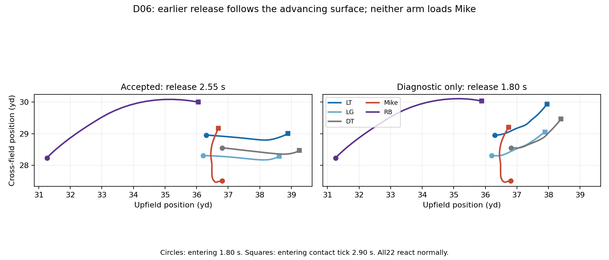

# Current Duo access: a repeated limitation, no supported release correction

**Keep the accepted controller.** Current leftward Ace Duo repeats a useful
first-level double with no timely Mike protection. Allowing the existing LT
detour .75 seconds earlier does not repair it. This rejects one admission
bypass, not every continuous route or an earlier improvement to the opening.

Accepted runtime: `bb6d4c73948d53ba841dd9338dd240146c739f8c` (#91), source
`668acb1784799c93d4704aaaa41233a11627ee0a862b41dc279cd11a0a22eeac`.
No production source, tests, settings, capacities or laws change in this branch.
The isolated rejected host has source
`9b714c2a9cf8620959b04db9dcb58ae894b7e8ec74336aca7ff3c66bd69606e9`;
it is a diagnostic intervention, not an integration candidate.

## Selection and current evidence

The latest published varied-transfer audit, `ed30b821c3aa621b129ce861e5c5a66b5d5cf23c`
([report](https://github.com/tannerthardy/football-simulation-/blob/ed30b821c3aa621b129ce861e5c5a66b5d5cf23c/docs/reviews/duo-transfer-audit.md)),
nominates repeated ordinary leftward LT/Mike misses, separately from A018.
That audit's source is historical. This pass revalidates two of its exact inputs
on accepted #91 before calling them current failures. #88 is already included;
the repaired A018 miss is not reused as current evidence or implemented again.

Measurement's new current48 was announced but not yet published at selection.
No result or ranking is inferred from that pending assessment. These leftward
inputs and the Under-front contrast are outside its unflipped Wide9 panel.
Run coordinated the bounded function boundary directly on
[#91](https://github.com/tannerthardy/football-simulation-/pull/91#issuecomment-6208753756).
Do-It-All subsequently took a separate repeated-forecast cost task; no source
file conflict or movement-policy edit is introduced here.

The [input manifest](../../data/reviews/current/current-protection-access/inputs.json)
was frozen at `2c349928aff50ad3c02ec3b7d35efef3172e90da`: same ordinary S88
roster, seed71002, Ace11, nickel/Quarters, field context and full22 natural
reactions. Native flips/fronts are football contrasts, not exact mirrors.

| Current saved input | Assignment/security/release | Actual access through runner arrival |
| --- | --- | --- |
| D06, Over left | LT/LG double DT_S; installed next job Mike. LT's existing acquired keeper test first passes1.55. At1.80/2.05/2.30 Mike remains across the down surface on LG's half; LT's route needs a detour and Duo retains the double. LT releases2.55, LG stays. | No LT/Mike load. RB crosses LOS in the2.75 before-World sample; Mike contacts2.90. LG/DT still has real force and denies that down defender's access. Native tackle ends3.50. |
| D02, Wide9 left | Same roles; LT's security history starts.80. Earlier proposals remain held on the obstructed opposite half; LT releases2.50, LG stays. | No LT/Mike load. RB reaches LOS2.65; Mike contacts2.75. LG/DT remains loaded. Native tackle ends3.45. The earlier security window differs from D06; its alternatives were not tested here. |
| DuoUnder, Under right: opposing control | RT/Y double DE_S. RT earns detour departure.85, clears it1.35 and actually loads Mike1.80; Y retains the first-level job. | Real lateral load precedes positive compression; neither is replaced by proximity. Mike subsequently gets behind RT, the block ends, and Mike contacts RB2.95. Y/DE still carries load at that contact tick. Native tackle ends4.20. Preserve both useful work and the defensive recovery. |

Times retain native clocks: a frame marked`t` executes World[t,t+.05];
`block_contact` is stamped`t+.05`, while `block_climb` and `carrier_contact`
use native`t`. Entering-frame gaps/velocities are labelled separately from
post-step movement and event positions in the
[measurements](../../data/reviews/current/current-protection-access/measurements.json).
There is no missing-ending/timeout-yardage substitution.

## D06: where the protection sequence runs out

The installed double and Mike responsibility are intact. This is not a lost
assignment or an omitted second job. LG cannot independently earn departure
under the existing keeper criteria. In D06, LT's primary hand-control values
remain below the entire possible keeper-control acceptance range during the
relevant earlier reads. That is an existing security criterion, **not proof
that leaving LG is physically impossible**. It was not relaxed here.

LT, meanwhile, earns the delayed picture of LG's support, but his acquired
Mike is on LG's side of the DT. At1.80 the actual LT is(36.304,28.957), moving
(2.007,−.148)yd/s. His normally acquired Mike picture is(36.599,27.473),
moving(−3.024,−.121), age.25s; actual Mike is(36.809,27.504), moving
(−1.385,−.155). Those are distinct positions and velocities. No future runner
path or defender private plan is supplied to the diagnostic.

The native clearance step is(36.347,29.315), carried with the observed surface
flow(1.643,−.190). Its initial outward motion is deliberate body clearance,
not a demonstrated wrong-side command. The near strike path is also obstructed;
the accepted #88 endpoint lesson does not authorize a shortcut through this pair.

By2.05 actual LT is already upfield of actual Mike; LT continues carrying the
double at roughly+2.3yd/s. At the2.55 departure he is(38.047,28.801), moving
(2.502,−.213), while Mike is(36.453,28.262). Merely renaming this work a climb
cannot cancel that momentum or create a clear strike surface. The native
departure owns movement until3.05; the backer interception planner does not
take ownership until after Mike's2.90 runner contact. D02 has the same ordering:
its departure ends3.00, after2.75 contact.

The first-level work is useful: at the entering2.90 contact tick, D06 LG/DT
normal/lateral forces are about545/+209kg·yd/s²; the DT remains upfield and
away from the runner. Mike fills the exposed route instead. More force on
the DT or a faster nominal release has not been shown to solve that route.

## One matched diagnostic: earlier admission fails the protection test

The [diagnostic plan](../../data/reviews/current/current-protection-access/diagnostic-plan.json)
was frozen at `07f1a2ae5b08b4b48bc99f355fc379ac669d3665` before execution.
For this LT/LG pair only, from1.80 onward, an isolated host skips the Duo
opposite-half veto. It retains the keeper criteria, acquired pictures/history,
cadence, native detour, runner reactions, spacing and all laws/capabilities.
This bypass is intentionally not a proposed production policy.

All22 initial bodies/jobs, every saved physical/request/contact/RNG frame and
captured cue/call state before1.80 match exactly. The entering1.80 bodies and
consumed joined-security cues also match. The first raw request difference is
LT alone, at1.80. Changes in contact ownership/execution draws follow that
decision; final yards are not an isolated value estimate.

| D06 comparison | Accepted | Rejected diagnostic |
| --- | --- | --- |
| LT departure |2.55|1.80|
| First LT/Mike loaded contact before arrival |None|None|
| First runner contact |Mike2.90|Mike2.90|
| Entering LOS sample |2.75|2.75|
| LG/DT force at entering contact tick, normal/lateral |545/+209|558/−245|
| Ending, descriptive only |Tackle3.50,3.13yd|Tackle3.70,2.35yd|



At1.80 the diagnostic requests(1.773,+1.034)yd/s; after executing that tick LT
achieves(2.105,+.220). This is a constrained change from his entering velocity,
not evidence that a newly requested velocity was ignored. At2.55 he still
requests(2.117,+1.570) and achieves(1.480,+1.017). He follows the advancing
outside clearance rather than establishing a loaded linebacker fit.

Later modifiers matter but do not establish an upstream spacing defect:
accepted LT's first pre-spacing/final difference after release is2.90;
the earlier-release diagnostic differs at2.80/2.85. At2.80 its pre-spacing
request(.093,+1.174) becomes(1.875,+.945). This collector did not capture LT's
spacing-specific peer pictures, so the exact late information trigger remains
unavailable. Spacing is retained and no new yielding/navigation correction is
inferred. D02 has no post-release pre-spacing/final difference before contact.

The diagnostic removes the reference's LT/LG torso-contact samples through
arrival, yet still misses protection. Reference peak impulses are27.09(D06)
and17.97(D02)kg·yd/s, at only.056/.053yd/s closing. Those working-double
contacts are not declared harmful collisions by decree. There is no new
offensive teammate impact through arrival in the diagnostic or Under control.
The failed protection result is retained despite getting closer to Mike.

## Decision and exact remaining limitation

**Do not promote the bypass or add another exit/timer variant.** Current actions
permit Mike an earned fill; a specific missed attainable block is not proved.
One early native route fails, which does not prove all routes impossible.
Neither a shared physical defect nor an RB decision defect is established.

The next precise question is whether **the LT/LG opening can leave the
backer-side member with a supportable keeper and an acquired, achievable
inside/backfield departure before the pair advances past Mike**. That requires
preserving the down-level job and demonstrating the continuous route with real
turning, support and teammate clearance. A straight-line distance/speed bound
or shorter center gap is insufficient. The1.80 full-context witness is portable
for Run/Do-It-All if that responsibility/movement boundary is pursued; no
solver or capability change is requested from Physics.

Transfer here is limited to the same Duo responsibility across Over/Wide9, with
Under's clear climb/keeper/defensive win as the opposing control. The general
lesson is that security, accessible strike geometry and protection through
arrival are separate requirements. No Duo half predicate is copied into zone,
Power or receiver support, and no additional concept simulation is needed to
reject this proposal.

## Reproduction, checks and cost

Node22.23.3; all44 accepted flags, `RUN_CONTACT_COMPONENTS=1`, remaining
experiments off/CF_FLOW unset; unchanged World defaults. Exact flags, source,
inputs, operator hash and timings are in the reference/diagnostic receipts and
the [3.5MB compact coupled tapes](../../data/reviews/current/current-protection-access/paired-tapes.json.gz).
The collector is byte-identical to the prior passive operator
`f28052a5d0c6160965819982327225b569d2391bddb32b7a28e809c7f28b5e21`.
It wraps native hooks without extra sensing or RNG calls.

From this branch, with dependencies installed:

```sh
npm run baseline:run -- --candidate --flag RUN_CONTACT_COMPONENTS=1 -- \
  node --import tsx scripts/diag/current-protection-capture.mjs run \
  out/current-protection-access/current D06,D02,DuoUnder 5 \
  data/reviews/current/current-protection-access/inputs.json

# Prepares an isolated source-exact host; no simulation by default.
python3 scripts/diag/current-protection-replay.py
# Add --run only when repeating the rejected D06 comparison is necessary.

# Saved-data assertions and chart; no simulation.
MPLCONFIGDIR=/tmp/run-access-mpl XDG_CACHE_HOME=/tmp/run-access-cache \
  python3 scripts/diag/current-protection-results.py
```

Do not restore positions alone or freshly initialize an observer at1.80.
Replay the frozen full setup from snap to retain perception memory, ordinary
RNG history and acquired hand attachments/private contact state. Compact tapes
are evidence, not a complete serialized PlaySim restart. The replay helper
reconstructs the exact9b714c2 diagnostic source; its default preparation and
source-hash equality were checked with zero extra World steps.

**New native work:** three current continuations plus one diagnostic; all four
reach native endings within5s. Collector total2.066s; successful launcher
commands3.501s. One failed missing-script-path launch executes zero World steps,
takes.156s and remains failed in its receipt: **3.657s total launcher cost**.
The pre-freeze input-selection typo and missing-script launch were corrected;
no failed native result or case was discarded/replaced. No games, roster
expansion, second route variant or full suite. Offline reduction/prefix/control
assertions, collector syntax and diff checks pass. Source/tests/settings equal
accepted #91, whose exact integration verification is reused; no new unit or
full-suite claim is made. Raw hashes and both successful/failed launch receipts
are preserved. Integration receives this limitation directly, with no runtime
patch to adopt and no automatic verification campaign.
