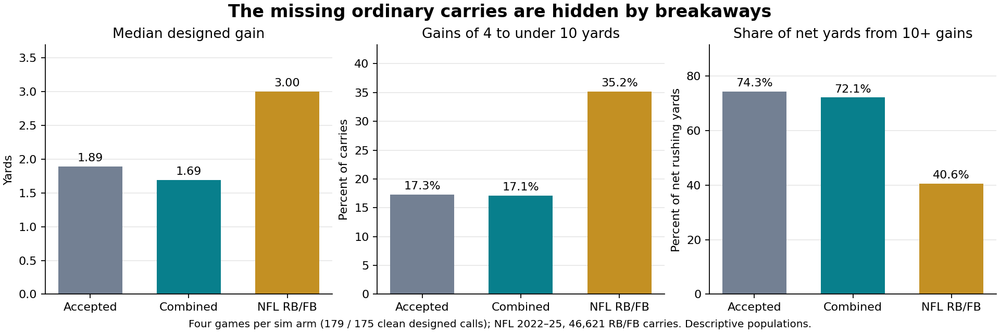
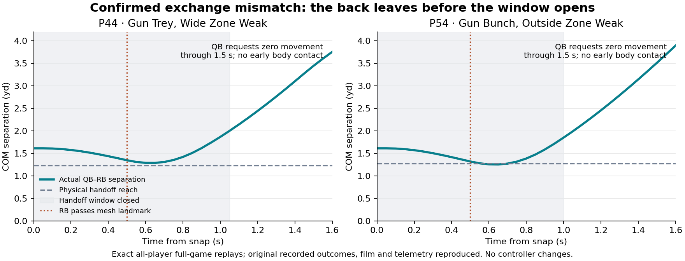

# Why the ordinary designed run still struggles

**2026-10-15 follow-up:** [one retained shotgun cadence correction and the
rejected late-QB recovery trial](../shotgun-exchange/README.md). The full-game
measurements below remain the unchanged recorded-checkpoint diagnosis.

**The largest new confirmed controller error is a missed exchange on shotgun
stretch runs. The larger, persistent deficit is useful protection and movement
through entry/collection. Raising strength or fitting average YPC would address
neither question.** This is a diagnosis, not a new engine correction or promotion
of the combined experiment.

[Measurements](summary.json) · [per-play NFL matching](nfl-matching-receipts.json.gz) · [native timeline](timeline.csv) ·
[21 KB exchange witness](exchange-witness.json.gz) · [all ten detailed witnesses](witnesses.json.gz) ·
[exchange timeline](exchange.csv)



## Current full-game totals and what was actually rerun

The exact combined recent-work checkpoint is
[PR #54](https://github.com/tannerthardy/football-simulation-/pull/54), publication
`404d3366d92449c30aedcba1957812fe5ea8b9aa`, runtime
`dd173a3ef44f22b5ee74f3cc17ef15b2137203cea58dd2fa12fbaad12c4784ba`.
It is experimental and unmerged. Accepted develop remains `a1b16e6`; historical
`4ded6b600fd3785e65034aa5623d7a9f8f3c5db1` is preserved separately. No changes
to `src`, capacities, generation, physics, calls, information or default flags
were made in this pass.

Reuse the checkpoint's **four accepted and four experimental completed games**,
with four frozen roster pairs and normal coaching, fatigue, penalties, clock and
substitutions. This pass also executed **three complete diagnostic replays**:
zone-reference701, power-zone703, then one zone-reference follow-up after the
exchange failures emerged. Every replay exactly reproduces the original complete
recorded play-by-play, positional film, telemetry, score, official team boxes and
final game state. These are diagnostic reruns of two existing inputs, not three
new independent talent samples.

New scores: zone31–30 (both executions), power51–36. Summed instrumented native
replay time **67.285s**; no full suite repeat. Node22.23.3, all44 original flags,
`RUN_CONTACT_COMPONENTS=1`, `RUN_READ=0`, center/centered/legacy/mean World defaults.
The three launcher receipts preserve exact code/settings/lock/input hashes:
[zone](receipts/zone-launcher.json), [power](receipts/power-launcher.json),
[exchange follow-up](receipts/exchange-launcher.json).

| Clean designed-call measure | Accepted,179 | Combined experiment,175 |
| --- | ---: | ---: |
| Mean gain |5.67yd|4.41yd|
| Median gain |1.89yd|1.69yd|
| Success,40/60/100% down-distance |31.3%|25.7%|
| Zero/loss,continuous native yards |27.4%|30.9%|
| Gains4 to under10yd |17.3%|17.1%|
| Gains20+yd |6.7%|6.9%|
| Share of net yards from10+ gains |74.3%|72.1%|
| No handoff / no identified rusher |10|9|
| Official rush yards per team/game,including QB runs |132.69|106.82|
| Official points per team/game |44.25|37.00|

The missing ordinary4–9-yard outcomes explain how mean YPC can look plausible
while typical carries fail. In the experimental sample,15 carries of10+ yards
provide72.1% of net designed-call yards. That is an outcome-distribution finding,
not evidence that all of those individual runs are physically wrong.

## NFL comparison: keep definitions and context honest

Reuse the committed four-season2022–25 benchmark:52,113 clean designed runs,
46,621 listed RB/FB carries,1,087 regular-season games. This is a broader and more
recent reference than the earlier two-season table. Its
[source/definition review](../../../data/reviews/rushing-benchmark/reference/findings.md)
separates kneels, spikes, scrambles, goal-line opportunities, penalties and
provider labels. NFL PBP supplies outcomes/context, not contact force or an OL's
actual intended technique. No new NFL data collection or reserved holdout use.

NFL RB/FB carries have median3yd, mean4.31yd,48.75% success and35.2% gains of4 to
under10yd. Ten-plus carries provide40.6% of net RB/FB yards. These raw populations
are not matched rosters or situations. Native failed exchanges can still be
logged as called runs although NFL realized-action labels need not identify a
normal RB carry. We preserve those failures and separately compare verified
RB/FB identities; we do not silently drop the bad plays.

For the **166 identified experimental RB/FB runs**, reuse the existing pinned
NFL context/backoff operators, weighting actual down×distance×field exposure:

| Measure on common support | Experiment | NFL at this exposure |
| --- | ---: | ---: |
| Mean gain |4.925yd|4.479yd|
| Upper-capped mean at10yd |2.475yd|3.665yd|
| Success40/60/100 |27.11%|45.88%|
| Zero/loss |27.11%|17.40%|
|20+ gains |7.23%|2.44%|
|40+ gains |3.61%|0.62%|

Median among these166 runs is **1.86yd**, versus the broad NFL RB/FB median3.
We do not average cell medians. All166 runs receive supported references:159
retain full context, six discard field and one discards field/distance under the
existing minimum100 gains/20 games/100 metric observations rule. The nine
unverified carriers stay in the all-call result and in the explicit unmatched
list; they are not reassigned a convenient NFL population. Common support still
does not match talent, exact concept, front, score/clock or coaching.

Whole-yard rounding raises the all-call native median to2yd, still below3.
The rounded zero/loss rate is36.6%, rather than30.9% continuous. Quantization
affects these rates; it does not erase the problem. A first/second-down8–10-to-go
subset outside the red zone also has median1.68yd and22.1% success (104 calls),
but omits the NFL ordinary cohort's score/clock filters and is labelled accordingly.

## Ranked mechanisms and confidence

### 1. A real exchange contradiction prevents some runs from starting

**Demonstrated controller inconsistency, not a strength/contact-law failure.**
All nine unidentified experimental cases have no recorded handoff: five reach
the25-second play cap and four are tackled around5yd behind the line. All are
shotgun outside/wide zone. The accepted arm already has ten missed exchanges,
so this is not established as a new #50 regression.

The targeted follow-up traces the first capped and first naturally tackled
failure, zone-reference **P44** and **P54**, with every other player reacting:

| Observed event |P44 Gun Trey,WZ Weak|P54 Gun Bunch,OZ Weak|
| --- | ---: | ---: |
| RB `passed` switches after reaching his mesh landmark |0.50s|0.50s|
| Earliest scheduled transfer window |1.05s|1.00s|
| Actual minimum separation once that window opens |2.002yd|1.851yd|
| Physical handoff reach |1.228yd|1.273yd|
| QB raw and final motion requests through1.50s |zero|zero|
| QB/RB body contacts before transfer window |none|none|



`RunnerToMesh` marks `passed` whenever the back comes within.7yd of his own
landmark, then requests the aiming point while still without the ball. That
check is not coupled to exchange cadence or retained proximity to the QB.
Shotgun alignment begins close enough to trigger it early. `QBHandoff` stays
at its own mesh until an acquired RB picture qualifies for recovery; its
picture must be within1.2yd of the QB landmark. When that check opens, the
consumed picture is already outside the gate. At0.90 in P44 its distance is
1.415yd; the actual RB is1.617yd away. Supplying fresher hidden information is
neither necessary nor a demonstrated cure.

P54 briefly comes within physical reach around0.65, but the declared transfer
window is closed; by its opening the RB has departed. P44 never comes within
reach on the executed paths. Raising handoff reach, moving the clock earlier
globally or shortening the cap would hide the coordination failure. The existing
successful Ace P18 exchange at1.40 supplies an opposing moving-mesh control.

Responsible locations:
[`RunnerToMesh`](../../../src/sim/assign.ts#L230),
[`QBHandoff`](../../../src/sim/behaviors/qb.ts#L672),
[`handoffReach`](../../../src/sim/ball-transfer.ts#L4).
The21KB witness retains consumed QB pictures, initial observer state, actual
requests and support/body positions. Native reproduction still uses all22
players and the frozen complete game; it is not a two-body physical restart.

### 2. Substantial block force can leave the runner's side exposed

**Observed protection failure; the defender's win may be legitimate.**
Zone-reference **P31**, Pistol Wide Zone, gains1.37yd. At the2.55s first body
contact, RG is still loaded against DT_S: normal672 and tangent360 in native
force units. RG's final request is roughly`(+1.85,-.31)` while the defender's
is`(-4.28,-1.69)`. RB enters the reachable side behind the LOS (recorded first
contact depth−.59yd). An assignment, engagement and positive force all exist;
the route is still accessible.

This does not identify wrong-side blocking solely from a position snapshot.
The protection/runner compatibility and physically attained leverage matter.
In the successful Duo **P58**, the backside LT retreats nearly4yd by3s while the
back gains5.66. Maximum retreat by any OL is therefore a poor standalone failure
test; the relevant question is access along the runner's feasible route.

### 3. First-level help and second-level collection are poorly synchronized

**Observed timing and access; no general early-release prescription.**
Ace Outside Zone **P18** meets LB_M at2.80s, while the designated LG helper does
not depart until3.00. At2.00, LT and LG both carry real load on DT_S, and the
helper is recovering his half of that surface. Earlier departure is not proved
safe. This requires understanding why the keeper needs help when the runner
arrives, not simply making the helper leave sooner.

Conversely, I-formation Outside Zone **power P8** does collect LB_W: RG has real
hand load from1.90 through2.60, but LB_W reaches RB at3.30. Nominally completing
the climb is insufficient if the resulting block controls the wrong access or
the runner arrives later than the protected window. Successful **power P115**,
Outside Zone from Heavy Wing, gains6.38 with first recorded contact depth5.51;
ordinary useful protection remains possible with existing capacities.

### 4. Runner lane selection and teammate avoidance consume different pictures

**Directly observed information/command mismatch; avoidability not yet proved.**
In P18 at2.05, the runner's legacy line picture is.05s old, while spacing uses
owned teammate pictures.30s old. The same LT has recently reversed lateral
velocity between those pictures. RB requests`(+7.81,-5.58)`; the final spacing
stage changes it to`(+1.07,-1.40)`. These are requests, not instantaneous body
velocities. The body executes finite braking/turning afterwards.

In I-formation P8, spacing changes RB's requested`(+8.32,+5.06)` to zero at2.15
and2.20. The near LG picture is.35s old and stationary; the separate legacy
picture says that LG is moving at about`(+1.14,+3.45)`. A mixture of sensing
contracts can produce incompatible lane and traffic decisions even when each
routine is individually conservative. The traces establish which stage changed
the request, not that it was safe to bypass spacing. There is genuine traffic.
P115 also gains6.38 despite multiple spacing stops and teammate contact, so
neither stops nor contact counts alone classify a bad play.

The existing owned-information system and its observer memory must be evaluated
as a system. Do not give the runner teammate future commands or replace
observation with live truth. Do not adopt the rejected global traffic/gather
experiments as a shortcut.

### 5. RB decision and execution are only coarsely coupled to the developing block

**Supported model limitation; a bad initial read is not proved in every case.**
The frozen profile has `RUN_READ=0`: the experimental scheme-specific key reader
is not active. The carrier still makes real live-gap and risk-based decisions;
it is not blind. Those generic entry scores and finite held headings do not
guarantee that the selected route matches the block's protected side throughout
the runner's turn. P31 requests a reversal while carrying transverse momentum,
then meets a still-loaded defender. That could be a reasonable option which
closes, a late choice, or inadequate execution; these need a same-cue comparison.
Turning on another experimental policy or asserting that an inside cut is
always preferable is not justified by these results.

### 6. Draw execution has a distinct exposure problem

**Strong concept-level symptom and one native mechanism witness.**
Ten of12 experimental draws lose yards; median−2.55yd and success1/12. That is
not a generic outside-zone problem. In **zone P14**, the draw's RT never develops
useful hand load on DE_S before first contact. QB is contacted at2.40, before
handoff2.50; the back finishes−4.58. At1.50 the RT is chasing an already
penetrating end while the back waits deep. Blockers' installed pass presentation
ends at1.0; actual exchange/exposure must be examined together. One traced
failure does not establish that all12 draws fail for the same reason.

### 7. The contact/tackling distribution still rewards escapes more than ordinary gains

**Current distribution is demonstrated; exact physical cause is unresolved.**
After matching observed RB/FB/down/distance/field exposure,20+ runs occur7.23%
versus2.44% expected and40+ runs3.61% versus.62%, while ordinary capped gain and
success are low. Thus a global offense strength increase or weaker tackles can
inflate an already excessive tail. Some failed ordinary carries arrive slowly
after traffic/turning and finish quickly; others produce long escapes. Preserve
legal defensive wins, acquisition failures and legitimately retained contacts
as separate mechanisms. The existing shared contact-law limitations remain;
these traces do not authorize a second solver owner or certify all loaded wins.

### 8. Situations, formations and rosters matter, but do not explain away the gap

**Measured confounding plus a residual deficit.**
The experiment contains25 Wide Zone and20 Outside Zone calls, with medians.65
and.82yd. Shotgun's77 calls have median.92 versus2.25 for75 under-center calls,
but those are different concepts, rosters and situations, not a causal shotgun
penalty. Draw and exchange failures materially depress the pooled result.
The primary Ace12 formation is not cleared by the shotgun finding: its only
two experimental Wide Zone calls also lose1.48 and1.24yd (zone P148, power P38).
That is thin exposure, not a formation failure rate or a reason to reopen a
broader game campaign; their saved films remain adverse transfer evidence.
Removing draws and unidentified carriers still leaves154 runs, median2.015 and
28.6% success. Common-context NFL success remains far higher. Four generated
roster pairs do not establish universal line weakness or NFL force calibration;
successful ordinary Duo/Counter/Outside Zone controls argue against calling all
failures a single capacity deficit.

## What should be fixed next

1. **Exchange integrity:** use P44/P54 and the successful under-center exchange
   to correct the incompatible QB/RB rendezvous using installed timing and
   acquired information. Preserve real reach and a moving exchange. Test the
   correction alone; no release, hand, strength or navigation bundle.
2. **Information/traffic compatibility:** start with P18/P8 and P115 as opposing
   evidence. Make the consumed pictures and attainable paths compatible before
   changing who yields or forcing the runner through traffic. A spacing stop is
   a finding to explain, not automatically a bug to delete.
3. **Protection through arrival and collection:** retain the keeper/helper
   windows and loaded exposed-side witnesses. Preserve successful first-level
   work and legitimate defensive wins. The repeated strong-Y escape arcs from
   #50/#53 remain separate; a first-level contact-minimizing departure rule was
   already rejected and is not resurrected here.

This ordering targets missed launches and missing ordinary progress. It does
not set a required median, force a run's former ending or promise that one
controller repair closes the NFL gap.

## Reproduction, cost and practical limits

Tested initial diagnostic commit `188903676ce68cabdfebdfd94d2f2997fc9c2d90`;
exchange follow-up `7ebb29e3a6daaa51d35acc1ea0ddda555cbe8609`. Both use the exact
PR #54 runtime and dependency lock. Frozen declarations:
[initial8 witnesses](../../../config/designed-run-game-diagnosis.json),
[exchange follow-up](../../../config/designed-run-exchange-followup.json).
The original roster/call/flag manifest remains
`data/reviews/current/experimental-game-inputs.json`. From this branch with
Node22.23.3, for example:

```sh
npm run baseline:run -- --candidate --receipt out/designed-run-games/replay.json -- node --import tsx scripts/diag/designed-run-games.mjs config/designed-run-exchange-followup.json zone-reference out/designed-run-games/exchange-replay.json.gz
```

The observer records values already consumed; it makes no extra `see`, owned
information, controller, physical-preview or RNG calls. Selected read sinks
receive existing computed values. Exact complete recorded-log parity catches
changes in native outcomes, recorded positions and standard telemetry; score, boxes and
final state are also asserted. No outcome was replaced by a scripted result.

The third replay was added only after the first pass established the failed
exchanges. It answers a new specific question, not a larger roster screen.
Its new native cost is20.40s, following21.58+25.30s for the first pair. Costs
include passive instrumentation and are not engine speed benchmarks. Reused
checkpoint games and NFL measurements cost zero new simulations. No new film
was rendered; charts are direct PNGs, and the existing PR #54 film remains
accessible there. No downloadable ZIP was generated for this report.

The compact/full diagnostic witnesses are portable evidence, not complete
mid-play native restart states: per-frame thin bodies omit some optional Body
fields; profiles and initial states are retained; duplicate per-tick observer
queues/minds and contact-controller debug logs are omitted as declared. Actual
requests, achieved support/positions, consumed cues, joints/forces, StepReports,
original full-log hashes and source/input/settings receipts remain. Reproduce
native execution from the complete frozen game, not from a coordinate reset.

No new full suite is necessary for this diagnosis-only branch. The exact
combined checkpoint's1,850 TS/145 Python/typecheck/build evidence is reused.
Nothing here clears the experimental bundle for promotion, attributes its
aggregate regression to one PR, or changes accepted develop/historical baseline.
