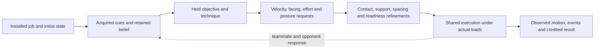

# Diagnose the broken contract before choosing the architectural layer

2026-10-20 America/Phoenix. Critique of the user's five-layer/technique notes,
built against accepted `2c98bed94adad8087c65f381d4090444ad283985`, queue
`4cc3337df24faa6d857b612ae62e3df3109a5296`, and research
`bae3fe80d189a7d792aaafbc4eea1ae2baa79573`. This is a read-only architectural
and process review: no new tests, native runs, NFL queries or implementation.
[Evidence inventory](../../data/reviews/current/diagnostic-process-critique.json).

**Assessment:** the notes are a strong guide to ownership and reuse. Their
largest immediate value is improving causal diagnosis, rather than initiating
a technique-library refactor. Among the reviewed cases, the clearest causal
progress comes from finding specific broken contracts, trying to disprove the
explanation, and preserving
useful opposing football. We have much weaker evidence for which mechanisms
dominate unrealistic football across the current simulator.

## What to keep and what to sharpen

The distinction between *what the player should attempt* and *what his body can
execute* is essential. So are avoiding play-name capability bonuses, retaining
different tactical duties, and asking where a correction should transfer.
The notes already warn against premature generalization and describe the
interface as an illustration. Those qualifications should survive adoption.

The principle “fix the level where the mistake actually exists” is sound.
The difficult work is establishing where that is. “Requested 3, achieved 0.7”
does not establish that the request was appropriate or physically attainable.
Nor does the same symptom at several positions establish a physical cause.
Several callers can share a faulty planner, information source or command
refinement. A real physical defect can also appear only at one speed/load angle.

I would make the operational rule:

> Repair the narrowest broken contract supported by evidence, at its actual
> owner. Preserve the legitimate behavior of the surrounding components, then
> check the particular transfer or interaction that remains uncertain.

“Narrowest” means causally coherent, not fewest lines. A genuine paired change
can be the smallest correction. A one-line shared multiplier can be too broad.
The source folder does not establish the architectural layer.

After a justified lower-level law or command-contract correction, a controller
adapted to the old behavior may legitimately need adjustment. That co-adaptation
needs an explicit contract and dependency; it is different from hiding an
unresolved defect with a bonus.

## The missing view: information, time and command composition

The five layers classify kinds of responsibility. Diagnosis also needs the
actual causal sequence and its feedback:

This is visible in [the accepted tick][tick]: behavior commands pass through
contact/bond refinements, teammate spacing and snap-readiness enforcement before
World execution. A correct early request can be replaced downstream. A final
intent cannot reconstruct those earlier requests. Capture a missing stage only
when it could distinguish the leading explanations; coordinate it with its
owner instead of creating another general instrumentation system.

Seven distinctions matter in addition to the five layers:

- **Initial conditions and installation:** starting alignment, facing, exchange
  deadline and installed duty may make a later opportunity impossible.
- **Information:** unknown is different from observed false. Activation and
  classification must respect the same information boundary as target selection.
- **Time and retained state:** target identity, adopted aim, mode and associated
  motion estimate must belong to the same decision. A new mode with an old aim
  can be contradictory even if each looks reasonable separately.
- **Complete action:** velocity, facing, effort, posture and contact ownership
  jointly determine the request; its vector alone is insufficient.
- **Lifecycle:** administrative rep ending, joint release, pursuit selection
  and legal re-acquisition are different events.
- **Measurement and accounting:** displayed movement, physical motion, labels,
  proximity, credited yards and known endings are different evidence.
- **Opportunity and counterplay:** a sound informed action can lose to an
  opponent. An unblocked defender can be a legitimate numerical advantage.

The earliest state difference is not necessarily the earliest mistake. Find
the earliest **demonstrated preventable violation** and, when relevant, the last
recoverable opportunity. Repairing a final missed tackle cannot grant recovery
from leverage already irretrievably lost before the catch.

## Recent cases that test the notes

These are selected investigations, not a census of causes or agent productivity.
Measurements retain their original producing sources. Adoption via #168 does
not turn their historical recordings into new current-build observations.

| Symptom | Supported finding / present disposition | What it teaches |
| --- | --- | --- |
| Late lateral LB arrival | [#159][flow] changed facing for an already selected acquired lateral insertion. Same Mike lateral speed 5.01→6.05 yd/s; fresh contact 4.05→3.60 s. Accepted. Adverse TOSS gain 3.84→4.33 yd remains. | A reasonable velocity request can still demand shuffle rather than running. Existing limits can be right while chosen technique is wrong. Earlier support is not proof of a better tackle. |
| DL fails to flow | [Original #160 review][hidden] holds acquired pictures fixed but changes hidden actual holder: target y 27.138→31.357 yd and request vy 1.447→2.841 yd/s. Sixteen passing positive tests did not cover this activation state. A narrow own-recognition gate repair is accepted. | Perceived target coordinates do not make the decision information-safe if its activation gate consults hidden reality. Test the prohibited dependency directly. |
| Slow shotgun handoff | [#156][formation] corrects seven nominal RB starts from 1.6/0.2 to 2.3/0.5 yd beside/behind QB. Three stored handoff speeds increase while reach stays unchanged; own-side exchange is 0.15 s later. Accepted with prefix/blitz-pickup limits. | Input geometry belongs in the diagnosis. The original “speed cap” claim was too strong; movement-law tuning was unnecessary for this correction. |
| Apparently unassigned LB | [#157][count] finds unowned LBs only in 8 Bear constructor cases with 9 core threats/7 blockers. A separate installed-F count bug is accepted, but audibles=false means it cannot explain the lab symptom. | A real nearby bug is not automatically the cause of the motivating symptom. Sometimes correct diagnosis means leaving a legitimate defensive advantage alone. |
| Implausible interception | [#131 helper/caller][checkpoint] aligns achieved body and ball endpoints over the same time/height interval. Historical wrong interception changes; selected current cases were already different and remain unchanged. Accepted. | Incorrect temporal comparison can mimic a coverage or capability defect. A valid correction need not improve a current headline statistic. |
| More coherent contact, worse climb | [#164 composition][composition]: bodies match through 0.45 s, diverge at 0.50 s; an earned RG release at 1.05 s becomes a pair joined through 2.65 s. Held, along with #165. | More persistent contact is not necessarily useful blocking. The responsibility includes leaving when earned and reaching the next job. Local/source acceptance was insufficient for this interaction. |

An older [defensive-flow investigation][old-flow] shows why the intermediate
stages matter: one behavior request rises 4.32→9.21 yd/s, spacing reduces those to
2.16→4.60 yd/s, achieved motion is 0.15→0.21 yd/s, and another stronger request is reduced to
zero. Its cue-classification failure also occurs exactly when a held target is
adopted. These are historical observations, not current rates; they refute the
shortcut from “stronger request did not help” to “physics must be the cause.”

## How to improve the proposed diagnostic tests

**The context-transfer test is a clue, not a locator.** Change the dimension
relevant to the hypothesis. If testing shared execution, preserve comparable
physical states/commands and change tactical labels where they should not
matter. If testing technique, preserve its objective but vary one meaningful
body, geometry or opponent response. Do not turn every fix into a position ×
front × seed matrix. Recurrence does not prove the shared layer is defective.

**The fixed-command test needs an independent attainability argument.** A
nearby geometric destination may require impossible braking from the current
speed. A constant command can fail a task needing feedback. Facing, loads,
support, effort and history must be comparable. Ask separately whether the body
can execute a justified action, whether the agent could choose it from available
cues, and whether it remains useful when other players react. Oracle future
motion may demonstrate an opportunity; it is not an admissible football policy.
Conservation accounting alone also does not establish realistic contact timing,
angular reaction, support or timestep convergence.

**Role swaps need a controlled meaning.** Freeze derived capabilities when
testing an accidental dependence on a position label. A real roster/position
change can legitimately alter installation, eligibility, learned proficiency or
body mapping. Accepted [physical profiles][profiles] already contain explicit
position-typical shuffle/backpedal priors. Those are model assumptions to explain
and validate, not equivalent to granting Counter guards extra acceleration.
Coaching can change learned decisions and motor skill; training can also change
conditioning or strength over time under the same physical law. It should not
change gravity or contact coefficients because of a preferred scheme.

**Add a useful-transition test when that is the open risk.** Can a blocker
preserve useful work and then release into his next responsibility? Can an edge
retain force and then pursue on an acquired cue? A stable isolated behavior can
still fail at entry, handoff or exit. #164 demonstrates this directly.

## Technique reuse: pursue demonstrated contracts, not a library project

Reusable kick/lead/trap roles and `RunBlocker(plan)` [already exist][blocking].
The opportunity is clearer ownership and fewer duplicated decisions, rather
than establishing reuse from nothing. Similar paths do not establish identical
techniques: a kick-out, log, force fit and open-field intercept have different
objectives and responses even when they use the same locomotion primitives.

Two actual consumers demonstrating the same contract are a strong reason for
shared extraction, rather than an arbitrary minimum-caller requirement. A
single necessary football technique can still merit a substantial implementation.
The shared contract includes authorized observations and cue age; installed
responsibility; retained target/
mode and update cadence; facing/effort/posture/contact requests; enter/exit
cleanup; failure/recovery; and legitimate opponent response. Start with one
proven common decision or geometry helper, preserve callers' semantics, and
expand only when another real consumer needs it. No new top-level interface,
training tree or generic technique framework is justified by these notes alone.

## What produced clear progress in the reviewed cases

1. **Adversarial discriminators.** The #160 hidden-holder probe took 1.730 s,
   found a prohibited dependency, and supported a one-condition repair. 262 saved
   active samples all had own run recognition, allowing bounded reuse instead
   of another game campaign. This is stronger causal evidence than additional
   favorable examples of the already-working activation state.
2. **Football-grounded opposing controls.** #164's earned departure was useful
   counterevidence to a longer-contact narrative. Conversely, [#150's old
   no-collision assertion][blocking-review] was overly restrictive: a glancing
   collision coexisted with useful assigned Will load from 1.55 s through 2 s.
   Review changed the incidental assertion while retaining assignment, actual
   load, reach/work and original shoving-failure controls. Tests need defensible
   contracts; failing them is neither automatic truth nor permission to waive.
3. **Checking the real producer-to-consumer path.** Exporting hundredths could
   not restore precision already discarded by native `recordFrame`. An
   [end-to-end recorder/packing/viewer check][precision] found the missing
   upstream correction. The same lesson applies to a helper lacking a caller
   or a good command replaced before World execution.
4. **Independent review plus scoped composition.** #168 adopted compatible work
   while holding #164/#165 and broad experiments. A 54-check overlap passed;
   the first exact combined candidate still failed 13 TS checks. Removing the
   problematic scopes and verifying the changed tree was valuable, not wasted
   duplication: 252.106 s failed candidate plus 261.757 s reduced candidate. We
   should improve early discriminator choice without eliminating integration.
5. **NFL-guided hypotheses followed by native explanation.** Formation geometry
   and second-level interposition are productive reference questions. The NFL
   data-host gap described in yesterday's plan is now [resolved in accepted
   documentation][access]; reuse the published 20-play packet/execution host.
   That packet is a small selected sample, not a league benchmark. No further
   archive acquisition is needed to repeat the access investigation.

## What creates slow or misleading progress

**Premature causal closure.** “Looks sluggish,” “blocks are short” and “the
package matches NFL better” are observations. They do not identify a motor law,
grip force or controller failure. Naming an explanation confidently can send
multiple owners toward the wrong layer. Retain at least the strongest plausible
alternative until a discriminating observation separates it.

**Outcome-led cross-layer compensation.** Latest research openly reports that
`GAIT_STEP=.5` improves selected pursuit/outcomes while its NFL acceleration-
envelope fit worsens 0.42→0.53; it says no tested value improves that fit over the
current body. The large package also changes shotgun negatives 49→103/600.
This is useful [sensitivity research][gait], not an identified/correctly calibrated
physical repair. Conversely, the conditional NFL envelope cannot prove the
current physical law correct: real observed acceleration includes chosen effort,
facing, load and selection. Preserve both limits; do not infer either verdict
from a pooled outcome histogram.

**Discovery expanding faster than delivery.** Connected research can uncover
important interactions, but an expanding package leaves reviewers disentangling
which corrections are necessary and which merely co-occurred. Periodically
finish one existing finding as a portable, independently reviewable correction
on accepted develop, with genuine dependencies stated. Keep the research host
and history intact. Integration must return the smallest concrete blocker and
advance unrelated ready work rather than demand proof that the entire game is
realistic. Newer Claude research has already reconciled accepted `2c98bed`; do not
misdiagnose its present difficulty as simply working from an obsolete base.

**Measuring a convenient proxy instead of the useful task.** Longer engagement,
earlier contact, more tackles and lower YAC can all increase while football gets
worse. Keep physical versus credited yards, first-contact-to-ending versus
continuous hold, proximity versus labeled/native engagement, known endings
versus prefixes, and frame/actor exposure versus independent plays distinct.
The narrow P045 query and isolated AMF access study remain completed evidence
with limits; neither should be reopened just to manufacture support for a story.

**Process output replacing decisions.** Long reports, more hashes, repeated
panels and broader matrices do not establish causality by volume. That applies
to Measurement's reports too: once a source/definition is settled, link it and
spend the next observation on the unresolved football decision. Evidence reuse,
source pins and failure accounting remain necessary; their purpose is reliable
decisions, not maximizing documentation. We do not have measured effort data to
rank agents' productivity or estimate a paperwork-waste percentage.

**Confusing local confidence with system priority.** A minimal reproduction can
prove a bug while telling us little about its ordinary-play frequency or
consequence. A dramatic saved failure is not proof of the game's dominant flaw.
Our current source has many accepted correctness repairs. The evidence reviewed
here does not establish a representative current diagnosis sufficient to rank
all football problems.
Do not block an obvious bounded repair until that portfolio question is solved.

## A smaller, more decisive working process

Use the existing behavior-review/PR description rather than introduce a new
mandatory worksheet. For a substantial fix, make the following explicit in a
short paragraph:

> What is the first demonstrated wrong observable, and what legitimate job was
> possible with the agent's information then? What is the strongest alternative
> cause, and the cheapest observation that separates it? Which contract/owner
> changes, what opposing behavior must survive, and what would make us stop?

Then separate three conclusions in the result: **defect demonstrated; proposed
intervention repairs that mechanism; transfer/importance established**. Passing
one does not imply the others. Native stages, a controlled counterfactual,
matched NFL reference or an interaction check are tools to answer a question,
not mandatory stages for every patch. Change one causally coherent unit; if two
pieces truly depend on each other, explain the dependency rather than force an
invalid artificial split. Retain evidence of failures and changed randomness.

For the next checkpoint, the highest-value process changes are:

1. **Use one existing unresolved witness to discriminate the layer before
   another broad feature wave.** Wide-zone/combo access and deep pursuit are
   current accepted-queue follow-ups. For either, name the still-open
   information/request/refinement/load boundary, not a preferred fix.
2. **Insert a completion checkpoint between discovery cycles.** An owner
   delivers one clear adoption/hold decision and minimal source boundary;
   Integration supplies a prompt specific disposition. Do not wait for a whole
   package or launch another campaign simply to prepare a handoff.
3. **After a meaningful accepted batch, use one separately budgeted, small varied
   accepted-build play sample to choose priorities.** Reuse frozen inputs and
   some untouched context only for a named transfer risk. Include successful
   offense and defense, count exposure/overlap, inspect useful work and
   last-recoverable opportunities. Do not relabel old panels as current or
   turn a selected panel into simulator-wide rates. No collection is launched
   by this review.

The notes' proposed philosophy should be retained. The practical improvement
is to make it harder to declare the cause before checking the complete causal
path—and easier to finish and adopt a genuine correction once that cause is
demonstrated. That serves a flexible football system without first requiring a
new architecture or another layer of process.

[tick]: https://github.com/tannerthardy/football-simulation-/blob/2c98bed94adad8087c65f381d4090444ad283985/src/sim/playsim.ts#L545
[profiles]: https://github.com/tannerthardy/football-simulation-/blob/2c98bed94adad8087c65f381d4090444ad283985/src/players/physical.ts#L91
[blocking]: https://github.com/tannerthardy/football-simulation-/blob/2c98bed94adad8087c65f381d4090444ad283985/src/sim/behaviors/blocking.ts#L656
[flow]: https://github.com/tannerthardy/football-simulation-/blob/57b05b0995d05d9c4f44a8611496c6b966e3e72f/docs/reviews/run-flow-2026-10-19.md#L61
[hidden]: https://github.com/tannerthardy/football-simulation-/blob/7035a2080a1ead3923c8ea25526cb2a47d79fee4/docs/reviews/run-support-158-160-review/README.md#L106
[formation]: https://github.com/tannerthardy/football-simulation-/blob/aacfce18865f345b59b96a192d2ed9064403853e/docs/reviews/shotgun-rb-alignment.md
[count]: https://github.com/tannerthardy/football-simulation-/blob/495a2f279984b10f7cd8c20dae9b1c18b03d502b/docs/reviews/toss-box-accounting/README.md#L29
[checkpoint]: https://github.com/tannerthardy/football-simulation-/blob/2c98bed94adad8087c65f381d4090444ad283985/docs/reviews/latest-reviewed-checkpoint.md#L33
[composition]: https://github.com/tannerthardy/football-simulation-/blob/2c98bed94adad8087c65f381d4090444ad283985/docs/reviews/latest-reviewed-checkpoint.md#L153
[old-flow]: https://github.com/tannerthardy/football-simulation-/blob/2c98bed94adad8087c65f381d4090444ad283985/docs/reviews/defensive-flow.md#L34
[blocking-review]: https://github.com/tannerthardy/football-simulation-/blob/b271549928bb1a1b76e76162dd7f14488cabb87e/docs/reviews/latest-blocking-review-2026-10-19/README.md#L163
[precision]: https://github.com/tannerthardy/football-simulation-/blob/77c28ffbbd55b29b2f0459be289bd497927d045c/docs/reviews/latest-run-game-v3-review/README.md#L13
[access]: https://github.com/tannerthardy/football-simulation-/blob/2c98bed94adad8087c65f381d4090444ad283985/docs/reviews/nfl-agent-evidence-plan.md#L142
[gait]: https://github.com/tannerthardy/football-simulation-/blob/bae3fe80d189a7d792aaafbc4eea1ae2baa79573/docs/reviews/run-game-v3.md#L1757
