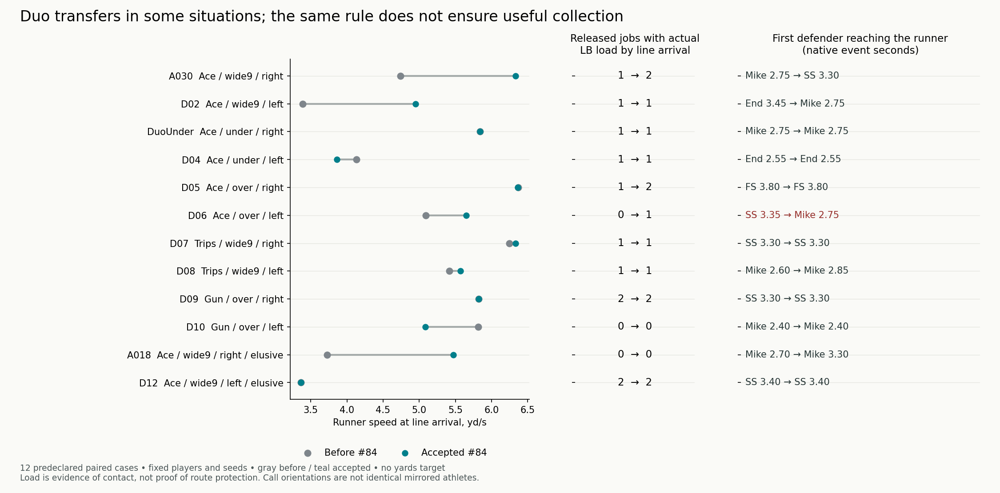
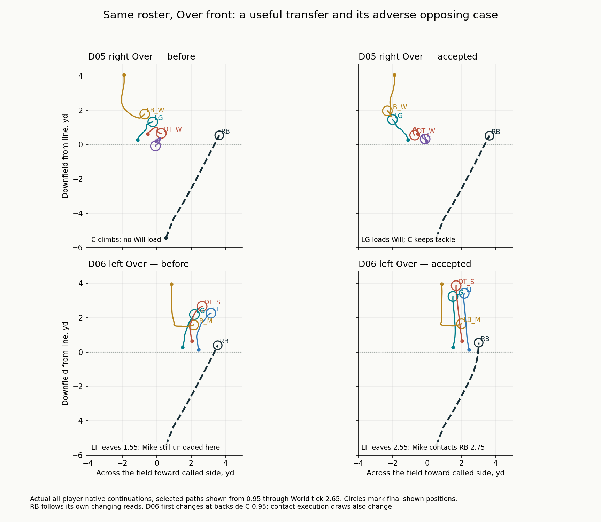

# Duo transfer: a real improvement, with an unfinished collection boundary

**Duo is improved, not solved.** The accepted member-admission correction
transfers to another front, but does not reliably produce second-level
protection across the small varied set. Do not copy its Duo-specific
opposite-half predicate into zone or gap concepts. Carry forward the underlying
contract: preserve the down-level responsibility, earn access to the next job,
then actually deny the defender's route through the runner's arrival.

This user-requested diagnostic follow-up starts on accepted
**`86250bb4f0c6f421878c204161864d523c3e30b6`**, after #85 incorporated independently
reviewed #84. The published queue `ef214373f9dd101a044b5246879c7e5007c8fb55`
and fetched develop agree. #81 was excluded for its separate forecast-cost
contract; none of its code or experimental navigation/physics is used here.
Historical `4ded6b600fd3785e65034aa5623d7a9f8f3c5db1` remains preserved; the
immediate before/after source comparison is #82's `7eb2554` versus accepted #85.

## What was tested

The [full plan and exact inputs](../../data/reviews/current/duo-transfer/inputs.json)
were committed **before execution** at `fce94b1`. Twelve paired Duo cases cover
three legal nickel fronts (Wide-9, Under, Over), both native call orientations,
Ace/trips/gun formations and two previously frozen capability lineups. Keep the
same roster, seed, coverage and player capacities within every pair. Call flips
are not exact geometric mirrors of identical athletes. The mostly ordinary
lineup is deliberately held fixed; the second existing lineup supplies a
capability contrast, not a randomized population.

Three Duo pairs (A030, A018, Under) and the WZ opposing control reuse compatible
#84 tapes. Nine additional Duo pairs plus two current-source concept contrasts
require **20 new short native executions**. All 22 players react normally.
Every arm reaches its own native ending within the declared five-second limit;
there is no forced result, removed player, frozen runner future or censoring to
hide a later adverse result. No new roster, game or full-suite run.

The [paired summary](../../data/reviews/current/duo-transfer/summary.json),
[compact all-player tapes](../../data/reviews/current/duo-transfer/paired-tapes.json.gz)
and [static comparison](../../data/reviews/current/duo-transfer/variety.png) retain
every case. Counts describe this selected set only. Neither a gain nor a hand
load is itself a passing grade.



## What transfers, and what does not

| Cases | Protection/access finding | Interpretation |
| --- | --- | --- |
| A030, ordinary Ace/Wide-9 right | RT now stays on DT; RG releases 1.05 and develops Mike load by native event 2.60, before line arrival 2.65. First runner contact changes Mike 2.75 → SS 3.30; line speed 4.74 → 6.33 yd/s. | Original concrete improvement remains. C's release and execution draws also change; the entire gain is not isolated RT value. |
| D05, same roster Ace/Over right | C's obstructed opposite-half proposal is held at .95. LG earns its own 1.00 release and actually loads Will by 2.00; C carries the tackle. RG also loads Mike. Both jobs load before line arrival. | Positive transfer to a different front and different members. Will is farther from the runner at the first FS contact (7.59 → 12.47 yd). The runner's route was already useful: first FS contact stays 3.80 and gains 12.08 → 12.17. More complete work is established; a meaningful extra yardage benefit is not. |
| Under right, Gun/Over right, elusive Ace/Wide-9 left | Entire recorded body/request/contact/RNG histories and results remain exact. Useful departures and real defensive wins survive. | Three opposing controls. Under includes a real detour, useful RT/Mike load and Mike recovering to tackle. The gate is not a blanket ban on detours. |
| A018, elusive Ace/Wide-9 right | First-level route improves and line speed rises 3.72 → 5.47 yd/s. RG never loads Mike; Mike contacts the runner 3.30. | Unfinished collection remains, despite the longer gain. Do not call this a completed second-level fix. |
| D07, ordinary Trips/Wide-9 right | RG also never loads Mike, but Mike is over six yards from the runner when SS makes first contact 3.30. Useful route and 14-yard ending survive. | A nominal unachieved job is not automatically a protection failure. This is an important opposing control for collection work. |
| D06, ordinary Ace/Over left | RG collects Will, but LT stays on the other double until 2.55 and never loads Mike before contact. First access changes SS 3.35 → Mike 2.75; gain 10.51 → 3.50. | Material adverse coupled result, visible rather than averaged away. More loaded LB jobs and faster line arrival do not guarantee better protection. |
| D02, D08, D10, ordinary leftward Wide-9/Trips/Gun | LT's Mike collection is also late/unachieved; Mike reaches the runner. D02's first contact advances, D08's delays, D10's is unchanged. | Repeated access/timing question across the ordinary lineup. D08 gains more without solving the job. Not evidence that every leftward call or every missed job is defective. |
| D04, Under left | LT loads Mike, yet DE_S reaches the runner before the line in both sources. | Upstream first-level failure; more Mike collection would not explain this ending. |

There is no league-average claim from this selected set. Two-TE/FB personnel,
odd/Bear fronts, additional rosters and execution seeds remain outside it.
`ace_12` remains the primary ordinary wide-zone reference; its three declared
controls are preserved. A027 here is a separate existing 11-personnel contrast,
not a replacement for that reference.

## The adverse Over case: what is causal, and what remains uncertain

D06 first differs at **.95**, with identical entering bodies and initial
physical/job inputs. C's original departure changes; contact ownership and
execution RNG then diverge. The LT/LG surface first changes physical execution
at 1.00 while its movement request is still unchanged. Do not attribute all
later effects solely to LT's later decision, or to a new movement capacity.

The [saved-picture predicate inspection](../../data/reviews/current/duo-transfer/admission.json)
uses the exact native `climbRoute` and `backerShows` functions, acquired pictures
and the actual own pre-step position. It runs zero World steps or new sensing.
It confirms direct LT proposal suppression at 1.80, 2.05 and 2.30: the acquired
Mike remains across the down surface on LG's half and a detour is required.
Thus the new rule really can keep this pair doubled through a critical window;
this is not just an unrelated final tackle draw.

But the old LT route also does **not** establish a successful early Mike block:
its first loaded sample is 3.55, after the old SS first contact 3.35. The runner
takes a different route in the coupled continuations. No matched-execution
causal value or missed feasible LG/LT action has been demonstrated here. The
specific remaining question is whether this surface offered a selectable,
achievable departure that preserved DT protection *and* denied Mike in time.
An earlier release or restoration of 10.51 yards is not a prescribed answer.

Four ordinary leftward cases also introduce LT/LG torso contact samples.
These are not four proven traffic defects: D02/D06 peak closing speeds are only
.053/.056 yd/s while working the double; D08's strongest sample is after first
runner contact. D10's is also after first runner contact. Keep real teammate
contact and the existing contact-law limitations; do not bypass spacing or
classify every compression as an unrealistic collision.



## A018 narrows the next implementation question

[Stage evidence](../../data/reviews/current/duo-transfer/collection-stages.json)
shows RG releases at 1.05 but stays in `leaveCombination` through 3.35. The
interception planner first runs at 3.40, **after** Mike's runner contact at 3.30.
The recurring short departure objective, rather than the linebacker
interception, owns the movement during the relevant window.

At World tick 2.50, RG's final request is `(0.04245, 0.94754)` yd/s and his
achieved post-step velocity is the same. Spacing did not replace that command.
This instant demonstrates execution of a small requested upfield component;
it does not show a locomotion engine unable to execute a fast forward request.
Earlier momentum and changing acquired pictures still matter.

That is a concrete controller-stage boundary to investigate, not yet proof of
a missed feasible route. A030 clears its departure at 2.55 and contacts Mike;
D05 clears at 2.05 and contacts Mike. D07 stays in departure until 4.00 yet the
runner has a useful route without that block. Preserve all three distinctions.
The previous first-strike-only exit trial on the historical RT witness was
rejected; do not repackage it as an already-proven universal fix.

**Next implementation remains A018 RG→Mike collection.** First demonstrate one
continuous ordinary route from the saved current source that actually protects
the runner without sacrificing RT/DT control or creating runner traffic. If
available, fix the demonstrated departure-to-collection cause. Keep D05's useful
collection, D07's useful uncollected route, the accepted Under control and D06's
adverse boundary as relevant controls. Do not start another angle/timer sweep.

## What this teaches us about other run concepts

The transferable principle is **continuity of useful protection**. A secured
keeper grants permission to change jobs; it does not establish access, arrival
or useful leverage at the next job. Conversely, force, displacement and a named
assignment do not establish that the runner's actual route is protected.

| Concept | Reusable lesson | What this evidence says to work on |
| --- | --- | --- |
| Duo | Adjacent doubles can send different members to the same installed backer. Each must earn his own release from acquired geometry and real keeper security. | Improve the departure/collection boundary only after demonstrating an attainable missed opportunity. Do not demand that the first-ready or always-inside member leave. |
| Inside zone | Responsibility must survive across both levels; completed LB work cannot compensate for an exposed down lineman. | In the new fixed-roster IZ/Under contrast, RT and RG load both LBs, yet DT_W tackles behind the line; a C/RB impact of 146 kg·yd/s occurs just before that access. Diagnose the near-level loss and compatible runner/line paths, not the Duo release predicate. |
| Wide/outside zone | Evaluate the changing lateral blocking surface and runner's observed route. Useful runoff and loaded contact must actually control the defender's access. | Accepted A027 is exactly unchanged. At Mike's runner contact, Y still transmits roughly 727 normal / −472 lateral force. This is load without route denial, not evidence that Duo's fixed half rule fixes zone. No fresh wide-zone repair is claimed. |
| Power/counter family | Kick/log/lead roles need an achievable shoulder and arrival before the runner; nominal target contact is insufficient. | In the Power/Over contrast, LG contacts DE_S at 2.25 and still carries roughly 605 normal / −282 lateral force when that end contacts the RB at 2.80. A joined-Duo departure change cannot explain that loaded kick failure. Counter itself was not simulated here. |

These contrasts identify different stages, not proven universal controller
errors. A defender can earn access, the runner can enter an exposed side,
available information can be limited and contact execution can be uncertain.
Reported contact forces use kg·yd/s².
No general strength, grip, traffic waiver, earlier-release timer or forced
runner cut follows from this audit.

Our general evaluation contract should therefore ask: which route is the
blocker's existing responsibility; what can he acquire now; what useful action
can his actual momentum/support execute; what movement survives later
modifiers; and is the defender's route denied through runner arrival? Apply
that contract broadly while keeping each concept's technique and information
limits. We do not need one universal blocking policy to share this standard.

The engine is already attempting different football techniques: Duo installs
vertical adjacent doubles without zone reach steps or pulling guards; zone
installs covered/uncovered work and lateral shoulder tracks; gap concepts
install down/hinge and kick/lead roles. The runner also has a Duo-specific
Mike-key preference in `runReadAim`, followed by shared crease-risk scoring.
The gap between a named technique and useful execution occurs in the transitions
and relative geometry. This audit did not capture the runner's later option
scores, so a changed runner route is not called a wrong read by inspection.

## Exact settings, cost and reproduction

Accepted source SHA:
`dcebbee42fbe4cd64f603740d9b20bdf521ae424ad94e084eb46b30478b297e3`.
Immediate reference source:
`78183dc79c6285939b80875b131584c18c4f0eda020c17bcfde6191823ace965`.
Node **22.23.3**, all **44 accepted flag values**,
`RUN_CONTACT_COMPONENTS=1`, unchanged World defaults, capacities, hands,
solver and roster selection. The manifest and launcher receipts preserve
every resolved value. Source, flags, inputs and paired initial bodies/jobs are
checked before the saved-data claims are made.

New native work: **20 short executions**, **7.449 seconds inside collectors**,
**12.430 launcher seconds** including capture startup and compression. No
budget exhaustion, skipped tail, retry, new roster, full game or repeated
suite. Offline source/data analysis and static plotting are additional work,
not native simulation cost. Compatible cached #84 evidence retains its original
8.115 native-launcher / 23.394 all-launcher seconds; it was not recollected.
Integration's unchanged accepted-source full passing receipt (1,760 TS,
145 Python, typecheck/build) is reused; it is not another new test run.

The executed collector/input freeze is
`fce94b11826ebe261c59451eeccf2fe3e7149f15`; collector SHA
`f28052a5d0c6160965819982327225b569d2391bddb32b7a28e809c7f28b5e21`.
It preserves the old read-only observer and captured stages; the changes are a
setup-hash assertion and stricter declared wall limits. Raw full-support captures
stay in ignored `out/`; the compact all-player tapes, causal acquired states,
full inputs, hashes and reproducible tools are published instead.

To reproduce the current nine Duo variations and two concept contrasts:

```sh
node scripts/baseline.mjs --candidate --receipt out/duo-transfer/current-launcher.json -- \
  node --import tsx scripts/diag/duo-transfer-capture.mjs run out/duo-transfer/current \
  D02,D04,D05,D06,D07,D08,D09,D10,D12,IZ,POWER 5 \
  data/reviews/current/duo-transfer/inputs.json
```

The reference uses a separate `7eb2554` worktree with the **same collector and
manifest**, selecting only the nine `D*` IDs above and writing
`out/duo-transfer/reference`. Fetch `70ed238` for the already-published cached
tapes; the reducer materializes missing reuse files from that immutable object.
Copy/reference the two fresh trace paths under one audit checkout for reduction.

```sh
python scripts/diag/duo-transfer-report.py
node --import tsx scripts/diag/duo-transfer-admission.mjs
python scripts/diag/duo-transfer-visuals.py
```

The three latter commands run **zero simulations**. The input builder is also
zero-simulation, but does not authorize or automatically launch another panel.
This branch contains diagnosis/tooling/evidence only; do not merge it as a
blocking feature or silently expand #84's production scope.
