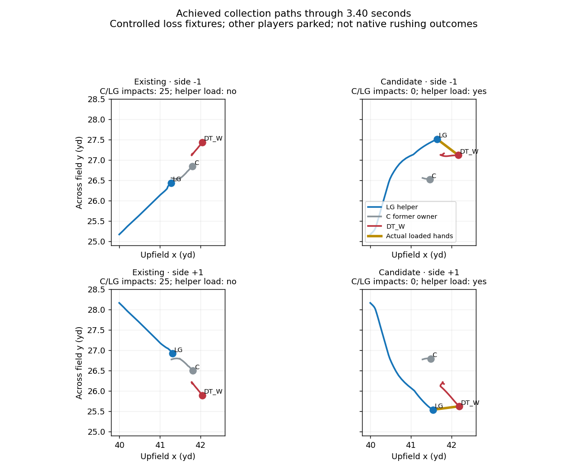

# Collect the available first-level surface

[Draft PR #69](https://github.com/tannerthardy/football-simulation-/pull/69).

**Candidate for independent controller review.** Both saved lost-contact sides
now establish loaded helper contact by2.60s and retain a reachable upright
connection through3.40s, without the former-owner collision. Both successful
center-law collection controls and all four #66-host native Under/Tite law/control
histories retain identical requests, movement and reports in their saved windows.
The physically obstructed opposing control brakes; it doesn't acquire fictitious
hands or bypass a teammate. This does not promote #66's contact law.

The controller-only extraction on accepted
`develop@8c891f4cf887b54297efbbc4c7993ba5e2f318b5` is
**`3b4ea698819074640626a215bf2f06af2735f25a`**, source
**`f22dc431da3e62d1b94a5b156835282b111c4bab2aebf9bfba10f64b4a464a67`**.
It changes two runtime files and two focused test files. #67's pass candidate,
shared physics, spacing, ratings, assignments, release/climb, RB navigation,
roster generation, capacities and all defaults are absent from the patch.
The comparison host for #66 is separately **`961415f459420dd393604eb5f5f59a62ac269f2b`**,
source **`0ca846c7b495058e65525cb4dedba0027fa6157668c396da0c7fa180b1314eac`**.
Its independently published [capture/report host](https://github.com/tannerthardy/football-simulation-/tree/4b8c6c440b4db0a0ad2d82ac539a57c67b79fb2f)
is `codex/helper-collection-correction@4b8c6c4`; use the exact Git commit to
reproduce the isolated-law commands below, not the current accepted default.
The historical baseline remains `4ded6b6`.

## Demonstrated mechanism and correction

The covered owner turns away and sheds. The free check helper keeps his original
DL responsibility, but its half-man approach points into the former owner's
body. Under the isolated law, C obstructs the helper before fresh strike becomes
possible. Requesting more movement into C cannot make the route passable.

The correction applies only to the **unjoined original check helper**, with the
original first-level target unengaged and no physical joint on the helper.
The helper must personally observe the owner beyond the existing1.1-quarter-turn
run-loss torso boundary. Before that cue, the ordinary strike is unchanged.
On the helper's existing decision cadence, compare the approach only through
its **first possible strike entry**, not through the entire half-man landmark.
An obstruction beyond first strike does not justify abandoning a viable approach.

If the owner obstructs that entry, choose a clear point on the backfield half
of the existing strike envelope. The candidate checks six local directions,
rejects paths/points occupied by acquired teammate pictures now or at the next
ordinary read, and chooses the nearest remaining point. An ordinary `goTo`
requests the feet. If none is admitted, ordinary zero-speed intent requests
braking; it does not stop the body. No body, contact, force, range or rating is
awarded. The original attack still has to acquire hands through real reach.

This is a bounded contact approach, not the diagnostic's fixed waypoint, a
release timer, a universal avoidance replacement, or a complete route planner.
The contact geometry is an approximate admission rule; World still owns
turning, acceleration, contact, collision and actual support.

## Paired evidence and actual load

Same O31/D32, strength .55, play seed11, Ace11 inside-zone/Over controlled
fixtures used by the #66 review. Positions/capabilities are unchanged at the
fork. Other players are parked/idle as in those original fixtures; the RB is
at x34. These results establish collection and a usable installed surface,
**not protection through a naturally arriving runner or native rushing gains**.

| Isolated common-point hands / legacy ground | Original, either side | Candidate, either side |
| --- | --- | --- |
| First changed request | — |1.55s, helper only; same physical state |
| New helper acquisition | None by3.40 |2.55; first completed loaded step2.60 |
| C/LG impacts through3.40 |25 each |0 each |
| Sum C/LG impulse |1171.981 /1172.142kg·yd/s |0 /0 |
| Hands at3.40 |No helper hands |Active, normal534.654kg·yd/s², lateral.547 /.382 |
| Actual helper/defender distance |1.260 /1.263yd |.65046yd both |
| Achieved torso error |No helper contact |.0863 /.0095rad, support up |
| Responsibility |DL, no climb |DL, no climb |

At1.55 the helper consumes C's .05-s-old picture and DT_W's .25-s-old picture.
The side -1 request changes `(5.482,5.269)→(1.192,3.791)`yd/s; side +1 changes
`(5.444,-5.308)→(1.188,-3.814)`. Achieved velocity is recorded after the same
World step separately from that request and the entry velocity. The correction
uses less forward demand while working onto a free surface, rather than
increasing lateral capacity or pushing C out of the way.

The collected hands initially carry lateral load with zero compression. By3.40
the achieved contact is at torso distance, facing the defender, with substantial
normal load. The original two tests' “normal >0 after exactly four steps” is
replaced with actual nonzero force, current working reach, achieved torso,
upright support and the installed first-level side. Existing arm/work/traction
budget assertions remain. No test demands a defender lose, and a joint/force
alone is not accepted as useful collection.



Impulse units here are kg·yd/s. The earlier review labeled the same raw impulse
numbers N·s; converting them requires multiplying by.9144. The raw values and
the collision diagnosis are unchanged.

## Opposing controls, adverse evidence and limits

- **First strike before obstruction:** both center-law controls remain exactly
  unchanged through their original2.40 windows: acquisition2.15, all bodies,
  requests, reports and events preserved. Their existing C/LG contacts are not
  erased by decree. A first version checked clearance through the full landmark
  and unnecessarily delayed these contacts to2.55–2.65. It is rejected; exact
  source-hash-verified reconstruction patches and traces remain in `rejected/`.
- **Ordinary opening before loss:** the initially ungated variant changed native
  Tite helper motion before a useful owner strike. The final observed-loss gate
  preserves the native Under and Tite histories in **both** center and isolated
  law modes. Each observed endpoint matches the unobserved body/command/intent/
  mind/RNG/event fingerprint. Both native plays remain live at2.00; no later
  result is claimed. Recovery-request histories are unchanged too.
- **Genuine obstruction:** nonoverlapping C and RT bodies occupy the available
  near approaches. The helper enters with nonzero velocity. Across eight real
  World steps it travels while braking, slows, has zero impacts, acquires no
  hands and does not climb. Static positions alone are not the evidence: the
  opposing test executes the command through the normal World. Hidden changes
  to peer position/velocity do not change a decision from the same acquired cues.
- **Role boundary:** only existing check installations qualify; sustained doubles,
  wide/outside-zone combination work, joined release, pull/lead, runner navigation
  and global traffic retain their existing policies. No active-hand or release
  experiment is imported. This is not a general all-concept/talent validation.
- **Unresolved physics:** #66's
  [native ground/hand force-selection sensitivity](https://github.com/tannerthardy/football-simulation-/blob/29b00905edee16f00651317364b729c1b377eb5b/docs/reviews/current-contact-yaw.md)
  remains an independent production-promotion limit. This patch does not certify
  continuous contact accuracy, all retained connections or every loaded ending.
  No new native improvement on accepted center defaults is claimed from these
  two controls, which correctly stay unchanged.

## Ownership, checks and reproduction

The user explicitly assigned this collection correction. Before runtime edits,
Run checked **Do-It-All!**'s current task: accepted-base entry-admission extraction
and its Awareness sampled/stale-motion consumer contract. Narrow ownership
notices are posted on
[#66](https://github.com/tannerthardy/football-simulation-/pull/66#issuecomment-6200868464)
and [#65](https://github.com/tannerthardy/football-simulation-/pull/65#issuecomment-6200868913).
No reply/approval is inferred from those notices. The runtime patch is a new
collection helper plus20 lines in `RunBlocker` (import, held read and attack
hook); no shared movement, Awareness interface, entry or spacing file changes.
Do-It-All's experimental blocking stack is not imported. Its owner can review
the exact narrow overlap without reconciling unrelated ancestry.

**Current accepted-base extraction:63 focused checks and typecheck pass** at
`3b4ea69`, with exact source/44 flags in the receipts. The directly affected
helper, retarget and foot-fit contracts and the two new obstruction/information
checks are included. Under the #66 law host, **19/22 helper checks pass**;
the three previously adjudicated recovery, Under and Tite expectations still
fail and remain untouched. Both new collection contracts pass. The two legacy
history hashes were not rerun/re-pinned; Integration owns that separate question.
Compatible #66 mechanical/no-contact receipts are reused, not repeated.

New launcher time totals **47.42s**, including rejected versions and failed
compression assertions, on the same saved situations plus one constructed
opposing geometry. Concurrent times overlap; this isn't a speed benchmark.
An initial collector ignored an unimplemented filter and recorded the existing
four situations; its full cost is retained. Zero games, new rosters or broad
screens. The3.40 controlled continuation checks that collection remains loaded;
it is not an RB-arrival or whole-play censor. No further experiment was launched
after the final controls passed.

```sh
# On the independent accepted-base controller commit:
node scripts/baseline.mjs --candidate -- node node_modules/vitest/vitest.mjs run --project core test/collection-approach.test.ts test/zone-helper-check.test.ts test/run-block-fit.test.ts test/run-combo-retarget.test.ts --maxWorkers=1
npm run typecheck
# On the separately pinned #66 context host961415f:
node scripts/baseline.mjs --candidate -- node --import tsx scripts/diag/zone/helper-contract-review.ts out/collection-correction/final-context.json.gz --collection-window
# Offline report on that host; consumes saved baseline and candidate records.
python3 scripts/diag/collection-correction-report.py
```

[Summary, every launcher receipt, exact patch and adverse reconstructions](../../data/reviews/current/helper-collection/summary.json).
The raw baseline is reused from review `4f90b64`; the controlled setup/step
prefix in `test/zone-helper-check.test.ts` is unchanged. Native inputs/observer
initialization are pinned in that earlier review and final recording metadata.
No #67 code, default/law switch, merge or new baseline is designated.

**Recommendation:** review the independent controller/test commit3b4ea69 on
accepted develop. It resolves the demonstrated collection dependency under the
isolated law while retaining the tested center behavior. Integration owns any
later exact combination and the full suite. Physics retains the native-accuracy
hold and its shared solver. Do not combine this with entry/navigation, #67 or
new law defaults simply because it passes the bounded controls.
