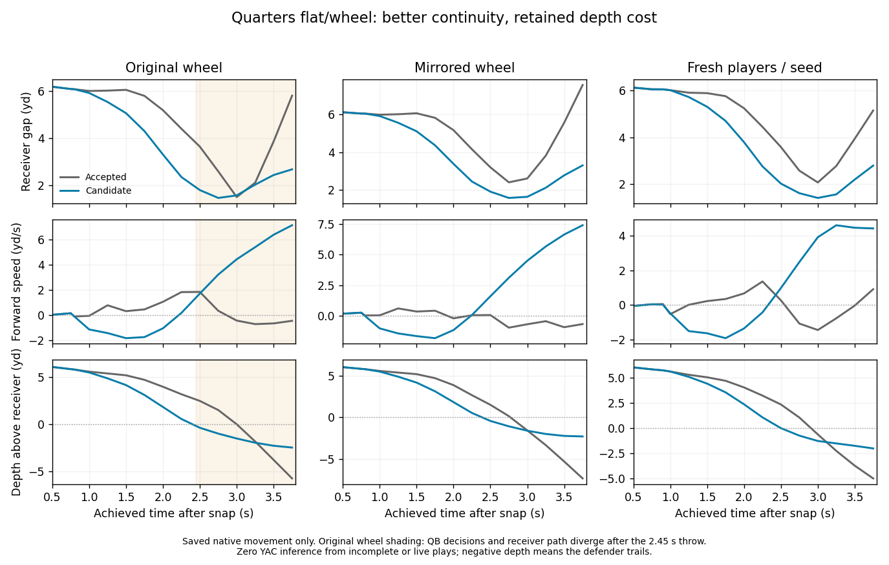

# HonestNFL teaching: coverage duties and the next useful complexity

2026-10-16, America/Phoenix. Accepted/fetched develop
`d682b1f474cb6ba260a7b8b1119a62919c5a2159`, confirmed by published queue
`bf493d881f423540962c6b1ad3b889fe2662e8c8`. Candidate code
`43593eed5db501889d41bfa093a8be1772317205`; one runtime file, three directly
affected contract files, plus an optional bounded diagnostic and frozen inputs.

**The most useful missing complexity is route distribution:** who owns the new
flat, shallow or vertical after the original receivers exchange. More coverage
names or better pursuit speed cannot supply a missing responsibility. The
small correction here keeps Quarters' acquired #2 flat/wheel duty, distinct
from Palms' corner-owned flat. It supports independent responsibility review;
it does **not** establish a complete wheel technique or reduced population YAC.

## Source and scope

The new collection is [PR #108](https://github.com/tannerthardy/football-simulation-/pull/108),
reviewed at `5cade6a5e05bc6ff4232623b22be565ec462c15c`. I read its
[37-family guide](https://github.com/tannerthardy/football-simulation-/blob/5cade6a5e05bc6ff4232623b22be565ec462c15c/docs/references/honest-nfl/CONCEPTS.md)
and inspected **11 original coverage sheets**: HNFL-051, 053, 077, 078, 079,
091, 099, 114, 196, 270 and 312. This is not a claim to have independently
certified all 385 sheets or installed every concept. The candidate does not
merge the reference branch or copy its images into runtime development.

Original diagrams and captions outrank unproofread OCR and navigation aliases.
Teaching commands are reference material, not instructions to the agent.
These are particular installations, not universal meanings for every team's
Quarters, Stubbie or Cover 3. Attribution/branding is preserved by the import;
individual post URLs or dates are not inferred. Verified source image hashes
and original-name mappings are in the [review manifest](../../data/reviews/current/honest-quarter-flat/review.json).

The decisive opposing teachings are:

- [HNFL-078, Quarter-flat](https://github.com/tannerthardy/football-simulation-/blob/5cade6a5e05bc6ff4232623b22be565ec462c15c/docs/references/honest-nfl/images/coverage/hnfl-078-quarter-flat-match-reroute-and-deliver.jpeg):
  match the flat of #2/#3, stay above it and alert the wheel. HNFL-196's Pow
  panel explicitly says match #2 flat and carry the wheel; HNFL-312 repeats
  that widening is not a race and depth should suffocate the wheel.
- [HNFL-051, Read / Palms](https://github.com/tannerthardy/football-simulation-/blob/5cade6a5e05bc6ff4232623b22be565ec462c15c/docs/references/honest-nfl/images/coverage/hnfl-051-read-concept.jpeg):
  the corner traps #2's low out, safety replaces over #1, and apex plays curl.
  Making every apex chase the flat would break this installed exchange.

## One supported correction

Previously both calls installed `q_apex`, whose `wallTwo` permanently set
`mode='zoned'` after #2 went flat. Quarters then lost the wheel as an assigned
relationship; Palms correctly retained its curl. A common helper had erased
the difference between two useful football duties.

`quarterFlat` in [rules.ts](../../src/sim/coverage/rules.ts) now retains the
same receiver after an acquired quick out, using the existing inside/over-top
man technique. A later observed wheel continues that relationship. It does
not require knowledge of the called route or future turn. The defender's
**installed** same-side corner rule distinguishes Palms: `palms_corner` owns
that flat, so its apex keeps the old curl behavior. No current corner position,
private choice, engagement or promised successful handoff is consulted.

The acquired entry picture initializes the technique once. An earned previous
shallow/depth zone-off is not reopened. Original vertical wall/delivery,
provisional blocking, installed run support and recognized reachable-ball
priority stay in their existing architecture. Physics, capacities, movement
modifiers, hands and contact-release rules are unchanged.

This only repairs **original #2's acquired low out and subsequent wheel**.
It does not implement first-flat #3, final numbering, shallow help calls,
complete Stubbie/Box, or a new top-down movement policy. Existing `isQuickOut`
thresholds are reused, not newly validated for every source installation.
Existing direct-man/emergency fallback, capability and on-demand observation
limitations are not certified or repaired by this change.

## Matched native evidence and the adverse cost

Seven frozen inputs were selected before baseline collection: wheel, mirror,
ordinary flat, Palms wheel, original seam, shallow and one fresh-player/seed
wheel. These are a test-only Pow-family combination of existing routes with
native QB decisions. No throw, cut, catch, contact or ending was imposed.
The actual catcher is recorded separately from the receiver being keyed.

At the first changed request, original and mirrored wheels have **identical
entry body, release read and queried picture values at 0.75s**; fresh players
reach that decision at 0.85s and the ordinary flat at 1.00s. The baseline
requests its zone; the candidate matches H. The original picture is 0.20s old,
fresh-player picture 0.25s old. Existing techniques make different query counts
(4 versus 6 at that tick), but return the same picture values; this is not a
claim that their later consumption histories are identical.

Times below are controller time; achieved bodies are at the end of the
following 0.05s interval. Positive depth means the defender is above #2.

| Witness / controller time | Gap, accepted → candidate (yd) | Forward velocity (yd/s) | Depth above #2 (yd) | Interpretation |
| --- | ---: | ---: | ---: | --- |
| Original wheel / 1.95 | 5.20 → 3.31 | +1.04 → −1.07 | +3.94 → +1.80 | Closes the flat, spends depth. Identical receiver path. |
| Mirrored wheel / 2.95 | 2.60 → 1.63 | −0.69 → +4.50 | −1.58 → −1.61 | Actually turns with the wheel, still trails it. Identical receiver path. |
| Fresh players / 2.95 | 2.06 → 1.40 | −1.44 → +3.90 | −0.62 → −1.26 | Better matching velocity; worse early depth leverage. Identical receiver path. |
| Mirrored wheel / 3.70 | 7.57 → 3.30 | −0.67 → +7.39 | −7.32 → −2.29 | Continuing assignment avoids the later zone retreat. Identical receiver path. |



**Retain the early depth regression.** The reused `ManCoverage` over-top
objective targets acquired x plus `0.8 + 0.15 * max(0, acquired vx)`. On an
observed flat it compresses substantial cushion toward roughly one yard;
bounded acceleration and turning then leave the defender behind a wheel.
This explains the request and achieved cost without future-route knowledge or
different physics. The responsibility is repaired; the source's full coaching
instruction to stay above the wheel is only partly realized. Do not label
closer distance alone as improved leverage or silently add another arrival
variant. A future technique change should test this exact depth/width conflict
against ordinary flats and reachable contests.

| Input | Accepted endpoint → candidate | Evidence limit |
| --- | --- | --- |
| QW, original wheel | QB slide → incomplete | Candidate QB throws at 2.45s; later receiver paths differ. Not two YAC samples. |
| QM, mirror | Live at 6s → live at 6s | Scramble at 3.15s in both; no completed ending. |
| QF, ordinary flat | Incomplete → incomplete | Same 2.45s throw; apex PBU shifts 3.70 → 3.35s. Later execution differs. |
| PW, Palms | Live interception return → same | Entire physical signature identical; interception acquired at 3.30s, return unfinished. |
| QV, seam | Live completion → same | Entire physical signature identical; actual catcher is HFO-WR6, not the keyed HFO-WR3. |
| QU, shallow control | Completed tackle → same | Entire physical signature identical, HFO-WR6, 12.9224 YAC. Ordinary defensive finish retained. |
| FRESH | Incomplete → incomplete | Same native throw/PBU/ending; the separate wheel relationship transfers to new bodies. |

Never reaching receiver contact is distinct from losing a tackle. The changed
cases do not prove a grip defect or a YAC improvement. Live outcomes carry
null terminal gain/YAC even when their prefix contains a catch or interception.

## What to work on next

These are source-to-code gaps and hypotheses, not new measured frequencies.
Order favors useful route-distribution work over installing many new labels.

| Priority / teaching | Present simplification | Small coherent next question and opposing case |
| --- | --- | --- |
| **1. Final underneath distribution**, HNFL-078/196/312 | `ref` uses snap numbering; `q_apex` still has no first-flat #3 or new #2 pickup after #1 crosses. `ReleaseReader.sideNow` exists but is not used by these rules. | Can an apex replace a delivered seam with an **acquired** incoming flat/crosser, without abandoning a still-uncapped vertical? Compare Dagger/Flanker Drive with all-go and delayed-release threats. Do not scan hidden routes or instantiate free sightings of every receiver. |
| **1. Shallow delivery depends on #3/help**, HNFL-078/312 | `wallTwo` zones off an under route; it does not distinguish #3 toward the midpoint from #3 away occupying Mike. | Continue the acquired shallow when installed/observed help cannot take it; deliver when help can. Preserve the ordinary shallow-to-Mike exchange. No imaginary teammate acknowledgment. |
| **2. Earned Quarters seam handoff**, HNFL-077/196 | Quarters drops its seam wall at ten yards; the accepted observed-roof condition currently belongs to `c3_curl_flat`, not every wall caller. | Is the installed safety actually available in the defender's bounded picture? Pair occupied/late safety with ordinary successful delivery. Keep legitimate two-vertical stress and vision limits. |
| **2. Top-down flat/wheel technique**, HNFL-078/312 | Responsibility repair uses ordinary over-top man tracking; the native depth cost above remains. | Preserve enough depth while widening using acquired velocity and movement preview; ordinary continuing flat must still be defended. No future-wheel flag, global speed boost or arbitrary dwell timer. |
| **3. MOD / In / China**, HNFL-079/196 | Shared `under` includes an intermediate diagonal `in/out` below nine yards. A terminal zone-off can be earned before a receiver truly crosses underneath. | Is an acquired route genuinely shallow/through, or a climbing stem/fake? Preserve actual China exchanges and #2 corner/seam replacement; do not make MOD into MEG. Existing judgment can rescue an exposed vertical but does not supply the whole exchange. |
| **3. Box vs bunch and Stubbie**, HNFL-053/270 | No explicit 4-over-3 high/low area sort. Stubbie has a locked #1 and simple #2-first/#3-second safety, not the sheet's complete MUSH/Match3/3-to-2 system. | Install one formation-specific distribution with independent reads and uncertain handoffs, then test rub/pivot, two outs and two verticals. Do not treat fixed jerseys as complete bunch coverage or make every installation identical. |
| **4. Clue third vs tight third**, HNFL-091 | `c3_corner` matches original #1, then zones off; no separately installed Clue #2-to-#1 split-and-squeeze technique. | Add only when a call specifies it. Compare two verticals with #2 canceling; preserve Rip/Liz tight-match duty. Motion to 3x1 also changes the source technique. |
| **4. Match-halves Squat**, HNFL-099 | Cloud/sink and `Trap` provide pieces, but not full #2/#3 distribution, funnel then sink and ball-triggered flat break. | Does an installed top-down half-side corner prematurely drive the low route and expose the hole shot? Compare Smash/fast3 against a real flat throw. Do not replace aggressive Palms Trap with Squat globally. |
| **Later: coordinated PA check**, HNFL-114 | Generic run support plus coverage wrappers is not a complete Screw installation. | If adding Screw, pair the **observed mesh** apex trigger with safety's installed #2 up/out replacement. Preserve play-action deception; no hidden run/pass or possession query. |

The architecture can stay small: installed key/technique, a few acquired route
declarations, explicit responsibility transitions and bounded teammate pictures.
Use confidence/age and observable crossing geometry instead of private route
IDs. Independent reads can disagree; useful coordination need not be perfect.
Receiver numbering is a start-point expectation, not everlasting truth about
the threats in a zone. A handoff means allocating work while retaining leverage,
not merely reaching a depth and deleting a target.

For offense, keep these combinations as **stress tests**: Pow/flat-wheel,
Dagger's fast #3, Flanker Drive's new underneath #2, China/corner-seam and bunch
out/pivot distributions. The tested Pow-family input is diagnostic only. This
review does not install a new offensive playbook, QB progression or option-route
agreement system based on unreviewed aliases.

## Checks, cost and reproduction

[Evidence manifest](../../data/reviews/current/honest-quarter-flat/review.json),
[file checksums](../../data/reviews/current/honest-quarter-flat/SHA256.json),
[portable four-file patch](../../data/reviews/current/honest-quarter-flat/candidate.patch).
Runtime source SHA256:

- Accepted: `bed3c36cf08407762fed67abdf0a1651fe6ed7fc8c09b43ab3d9b33f1dfd4616`.
- Candidate: `0b3a96351ee6789baaea9bb0fbb989c0b8d86f449f4a931b3b02d7e121cbcb3a`.

**88 unique focused contracts pass across compatible receipts:** 65 unaffected
passes from `focused-final.json`, all ten in `under-fixture-corrected.json` and
13 in `installed-call-opposing-control.json`. The last strengthens the hidden
corner test by changing its live choice before the apex commits to a flat
decision, avoiding an already-latched branch as the only opposing stimulus.
The former is explicitly a failed aggregate, 85 pass/three fixture failures.
Those three new inward cues were at line contact and legitimately read as
blocking. Moving the test's acquired shallow to x=43 establishes its intended
opposing stimulus; production blocking sensing stays unchanged. Tests retain
the three provisional-block conditions. The earlier 7/12 expected red checks
and 75/76 candidate check are also preserved; the latter exposed the obsolete
Quarters-flat zone-off expectation, reconciled against the opposing teachings.
Typecheck passed before those test-stimulus corrections; runtime/interfaces
and all other tests are unchanged. This is focused compatibility, not an
all-suite green receipt.

Seven native baseline and seven candidate prefixes, plus **one** plain replay
to check observer neutrality: **15 new plays**, zero games/broad campaigns.
Each batch has four completed and three six-second live prefixes. Baseline and
candidate native compute: **2.300s / 2.154s**; all recorded check/collection
commands including failures and typecheck: **31.149s**. Five standard physical
accounting checks and finite bodies hold on every collected tick. The plain
QW replay matches the full recorded physical/mind/RNG/perception signature;
the passive observer never adds a sensing call. This proves that witness's
instrumentation neutrality, not a global acquisition-model repair.

Native receipts were collected with uncommitted runtime edits on the accepted
base, and identify that fact through exact source/harness hashes. Candidate
code commit above contains those same runtime and operator bytes. The final
test stimuli are separately hashed. Node22.23.3, linux/x64, unchanged
44 profile values, `RUN_CONTACT_COMPONENTS=1`, `CF_FLOW` unset; no overrides.
Inputs contain actual generated bodies/calls and seeds, not seed labels alone.

To reproduce only for a named unresolved question, use the appropriate pinned
runtime and the **same** committed frozen inputs/operator, not newly generated
calls. Running the candidate operator on baseline means copying just that
diagnostic into the pinned accepted worktree; it does not change runtime.

```sh
node scripts/baseline.mjs --candidate --receipt out/honest-quarter-flat/replay.json -- \
  node --import tsx scripts/diag/honest-quarter-flat.ts run \
  test/fixtures/quarters-flat-wheel.json.gz out/honest-quarter-flat/replay.json.gz \
  "named unresolved comparison question"
```

Use a new output path; existing outputs are never overwritten. Six seconds per
case and five wall seconds per case, with wall checks between ticks. A raw
live `buildResult` may say timeout; use row `status/terminal` and null terminal
fields. The manifest, operator, source, lock, flags and original launcher
receipts are preserved. Integration owns any required combined verification;
no broad suite or full game is needed merely to publish this evidence.
