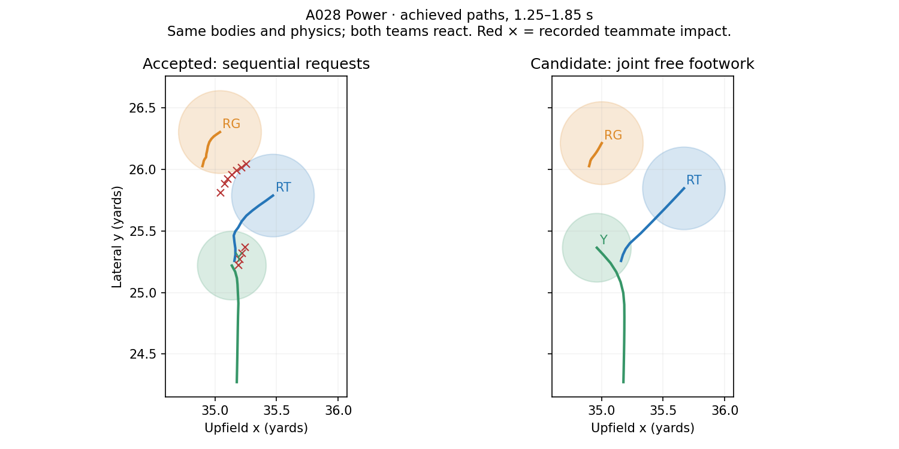

# Keep neighboring spacing corrections consistent

**Recommend independent adoption review of free footwork only.** A player's
later teammate correction can undo an earlier headway limit. The saved A028
Power opening demonstrates a useful, physically executed correction. The first
all-body trial worsens loaded A018 contact and is held; the delivered scope
preserves that loaded sequence exactly. This is neither a wide-zone completion
claim nor a tackle/runner-navigation or whole-route clearance change.

## What changed

Accepted base, fetched before work and publication:
`bb6d4c73948d53ba841dd9338dd240146c739f8c`, source
`668acb1784799c93d4704aaaa41233a11627ee0a862b41dc279cd11a0a22eeac`.
Final code/tests **`4a7eebdc70acf50b867a79dbc241019e4e6f8e46`**, branch
`codex/contact-approach-motion`, source
`cf081fb58fc54fe427a5e967e17cb283b55b7b0ac0ca5cf89b280719e65888df`.
#92 remains separate and frozen; there is no dependency on its cache or earlier
research/experimental ancestry.

`spacing.ts` retains the existing acquired pictures, proximity/path admission,
braking/headway calculation and ordinary sequential response. Only when the
result violates an already admitted limit does a small two-dimensional solve
seek the closest original requested velocity satisfying those same limits and
the existing speed cap. The optimum can lie on one boundary, a pair intersection
or the speed circle. A consistent ordinary result stays exact; inconsistent
constraints retain the ordinary response. No new obstacle, option, margin,
teammate intention or observation is invented.

This correction applies to upright, free, unloaded own footwork. Felt constraint
ownership, engagement, lean/load, held foot, strike, push, lunge, squeeze and a
scenario's own parked state exclude it. Existing contact leg drive remains
owned by its controller. Commands preserve facing/posture/skill and assignment;
the existing World supplies every achieved displacement and collision.

Portable extraction is **three files only**: `src/sim/spacing.ts`,
`test/joint-spacing.test.ts`, `test/fixtures/joint-spacing.json`.
[Exact patch](../../data/reviews/current/contact-approach-motion/runtime-and-tests.patch).
Diagnostics, old trials and reports are not runtime dependencies. The patch
applies to accepted development. Reconcile the separate #92 spacing diff in
Integration; neither candidate changes the other's selection/forecast contract.

## Evidence for and against

Measurement's current48 nominated contact conversion, but its final requests
could not attribute producers. A bounded passive stage capture copies existing
behavior outputs, existing sensing returns, pre-spacing intents, actual bodies
and World commands/contacts. It makes no extra sensing calls or random draws.
All22 initial bodies equal the saved inputs; every saved reference replay frame
matches through the capture boundaries. The N2 approaches do not establish an
incorrect movement request, so there is no chase/gather/hold correction here.

The separate modifier defect is explicit in two plays. A028 RT's correction
against Y restores closing into RG at1.25–1.40, up to **0.785 yd/s above the
already admitted limit**. A018 LG's later correction similarly undoes its C
limit at3.55–3.80, up to0.610 yd/s. These are requests actually passed to World,
not an inference from a final collision. A006 has no such violation.

| Short reacting continuation | Accepted | Delivered free-footwork candidate |
| --- | --- | --- |
| A028 Power,0–2.80s | 11 positive sampled RT/RG or RT/Y impacts; sum recorded impulse521.226kg·yd/s | No positive recorded teammate impacts; first change RT1.25 |
| A018 Duo,0–3.95s | Loaded LG/C impact3.80/3.85; SS hold3.40/break3.75 | All captured stages, all22 bodies/commands/pictures and events exact |
| A006 Duo,0–3.95s | Useful SS wrap3.20 and runner fall3.55 | All captured stages and events exact |

In A028 the first corrected request changes from `(0.064965,1.005203)` to
`(0.350844,1.010891)` yd/s. Actual next velocity is `(0.342997,0.979085)`;
the body turns/accelerates through normal physics. By1.65 the RT is about0.208yd
farther upfield, with essentially the same lateral position, avoiding the pinch.
By2.80 he is0.167yd behind/0.105yd less lateral than reference. This is useful
local passage, not faster every-tick progress or a proved Mike collection.
The installed combo duty and original first-level block contacts persist.
RG's felt support load remains substantial (at1.65,1,471→1,737 model force
units), but that is aggregate own load, not an isolated joint-load measurement.
No overall blocking-access benefit is certified from it.

**Adverse trial preserved:** all-body code `415f45db9cb8b6e6385667d5589b6c851defe88f`
/source `c8d65c4cb03ae7be769e29c103dc8020ffc95fc4a3df04aeb304dcd1b849e4f5`
also solves loaded LG's command. A018's later impact shifts3.80→3.90 but summed
recorded impulse rises46.552→66.536kg·yd/s, with changed loaded work. At first
intervention LG already has roughly1,086 units of support load, contact lean
and push. Free-velocity allocation does not establish a useful loaded alternative.
The one subsequent scope correction uses the existing free/contact ownership
distinction; it does not tune headway or a margin to an ending. Loaded A018's
original collision and broken hold remain, rather than being erased.

**Adverse final observation:** A028's runner is0.826yd farther back in x at2.80
and0.427yd changed laterally. His first raw pre-spacing request difference is
1.45, while his incoming body is still exact; reacting actors and lane pictures
then diverge. LG logs the edge and contacts it2.15 rather than2.35, and RB later
requests squeeze. These coupled changes do not establish a worse football read
or blame the runner, nor prove improved protection. Both arms are live/censored
at2.80; no ending/yardage improvement is claimed. Do not pursue that ending by
changing Run's jobs or giving the runner hidden state.

## Checks, cost and evidence compatibility

**42 focused checks and typecheck pass** on final4a7eebd. These include exact
saved free-state constraints, loaded-work preservation, latent tactile ownership,
parked own state, an inconsistent moving-peer obstruction, clear/single-peer
controls and the accepted residual-motion/traffic contracts. Test peer private
position/velocity getters throw; only supplied acquired pictures are available.
Body state is unchanged by request selection. No test assertion was weakened.

The delivered reacting runs are pinned to `07796edce0346e3e7f5823f9a60f007f8d1ba6aa`
/source `2a3e6e8edcf451f8f08ed9d37a7e57e047acd28ca936c31254efcff59ad5b2ff`.
Later changes type fixtures and add only the own parked-state guard. These
ordinary setups leave `downUntil=-1`; only lab files assign overrides, and
non-upright bodies already skipped spacing. Thus that new guard is false in
the reused native executions; the focused parked control covers its distinct
branch. This is explicit compatible reuse, not a final-source native rerun.

**Nine short native continuations,32.10 simulated seconds;15.765 native-launcher
seconds. Total native/check launcher cost65.169s**, plus offline saved-file
analysis/plotting. Maximum opening3.95s. The three references fill missing
command stages; three all-body trials preserve the adverse case; the one scoped
continuation set settles it. No panel/game/roster/new seed or contributor full
suite. All44 accepted flags/components1, Node22.23.3, unchanged World defaults.
Receipts retain the initial fixture-import failure and two typecheck failures
in diagnostic/test typing. Later typing/parked checks pass; no failures are
relabelled as passes. Source/tests are frozen for Integration's required checks.

[Machine comparison and receipts](../../data/reviews/current/contact-approach-motion/comparison.json)
· [all three arms](../../data/reviews/current/contact-approach-motion)
· [payload hashes](../../data/reviews/current/contact-approach-motion/artifacts.json).
Native input comes from Measurement's data-only96cf636 archive, never merged.
The capture script defaults to zero simulations. The summary script reads only
saved payloads; no need to rerun the plays to reproduce the reported comparison.

## Remaining risk and next decision

Adopt after independent review as a narrow free-footwork consistency correction.
It does not solve loaded LG/C traffic, prove full route clearance or certify
league/game benefit. Current path admission can itself depend on prior radial
changes; this patch only prevents undoing the admitted constraints. New pictures,
unseen acceleration and genuine obstruction can still defeat the request.
No broader constraint/avoidance rollout is proposed. Run retains blocking and
helperFit; Catching retains objectives and rat/coverage work. Integration owns
independent acceptance, reconciliation with #92 and exact combined verification.
