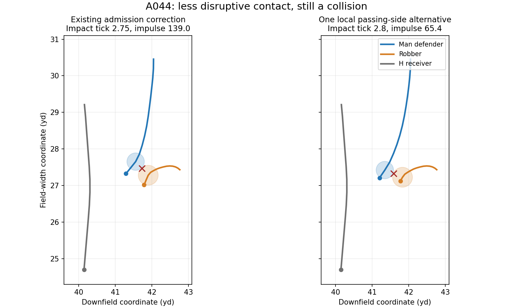

# One local lateral approach: lighter contact, no avoidance claim

Advance #81's narrow achievable-motion admission for independent review; keep
that candidate unchanged. The new research demonstrates that existing movement
can execute a useful small lateral adjustment in this encounter. It reduces the
collision's disruption to the man defender, but still collides and does not
establish overall defensive or postcatch benefit. **Hold the lateral policy
from production.** No coverage, physics, body width or blocking change.

## Pins and ownership

- Accepted develop, freshly reconciled with queue0e7af86:
  `7eb2554f5dbb497cff169f386704a5b0f4cf43fe`.
- Stable #81 admission implementation:
  `f27456b5f4cd7e5d628417662a77e4ede5b85bfc`;
  accepted-source evidence/head:
  `6e19ad2d4aac73e71ae57c1893a9b389074eeaa5`.
  Its collision avoidance benefit remains unproved. No new research is appended
  to its source/review head. [Review handoff](https://github.com/tannerthardy/football-simulation-/pull/82#issuecomment-6204046514).
- Exact executed lateral harness:
  `7f1776066786a0a6a093a306ccfc3ac4eabf653e` on separate
  `codex/mesh-lateral-approach`. This is a deliberately pinned #81 measurement
  host, not an accepted production branch.
- Earlier same-target offline check:
  `8e7bee92d9739bf42479fc9a28ba9984db455bdf`, adding `--earlier` only.
  With the flag absent, admission is equivalent to the executed harness.
  Code-only successor `bb54e65c17550d2412751ff14606e6037b8d1a41` fixes two
  TypeScript annotations/aliases and adds the reducer; it does not change the
  executed default policy or engine.
- Engine source throughout: `f9573bc3ce911dfc75dee95d56b8df3b3e8937ed8db62a97659d15baf4c3e7e8`.
  Zero production/test/settings changes relative to6e19ad2.

Do-It-All claimed only the new diagnostic/evidence/report before editing.
Run, Catching and Integration were notified on #76/#75/#82. Run's collection,
blocking and PassProtector and Catching's coverage functions remain untouched.
The research genuinely depends on #81's existing observer/admission host; do not
extract this experimental harness into production or import another old stack.

## One tested alternative

The old 30-degree bend's failure included abandoning the passing adjustment
before the encounter ended. This experiment does not repeat its angle selector.
It retains one passing side, initialized from the worst local acquired-peer
forecast, until that peer passes behind the original movement direction.

The temporary target sits beside the observed peer's projected encounter point.
Its offset is the ordinary physical touch distance plus the acting defender's
own relative lateral stopping distance, using existing `followAccel` and own
support capacity. That stopping budget shapes the requested target; it changes
no body radius. The requested speed, facing/posture and skills remain the
original command's. `previewFreeMovement` evaluates the achievable result from
the complete same own state against all ten already-consumed teammate pictures.

The option may be chosen when it improves an already-overlapping forecast by
the existing0.05-yard comparison margin while preserving forward progress; it
need not certify a clear full route. If the production option is locally clear,
the alternative must preserve that clearance and improve progress. No new
collision with a previously clear peer is admitted. This comparison margin was
not searched or adjusted for A044. There is no angle or clearance sweep.

Only SS21's free man command may change in the research witness. Robber15 and
all other players continue their ordinary decisions, acquired perception,
spacing, contacts and randomness. Own engagement/joint/contact/support gates
exclude loaded actions. Peer inputs are the existing `spacing-picture.used`
values, timestamps/age preserved; no new `see` reads, private peer velocity,
assignment, commands or future state. Unknown/nonfinite motion yields no
intervention. Passing state stores an action choice, not extended observations.

## Reacting result versus the saved compatible current arm

Exactly one A044 continuation to dead3.55 and one A008 control to3.40. The
reference is reused from6e19ad2; no baseline recollection. Four A044 commands
change, at2.35/2.40/2.45/2.50. First divergence is SS21 alone at2.35.
The predicted first50ms equals actual own position/velocity exactly for each
changed command. All physical motion outside SS21/robber15 remains exact.

| Recorded command tick / measure | Existing admission | Lateral option |
| --- | ---: | ---: |
| SS/robber contact tick | 2.75 | 2.80 |
| Impact impulse | 139.0033 | 65.3759 |
| Closing speed at impact, yd/s | 2.7161 | 1.2774 |
| SS speed after2.85 tick, yd/s | 4.3501 | 5.2751 |
| SS distance to H after2.85 tick, yd | 2.8650 | 2.7205 |
| Robber speed after2.85 tick, yd/s | 3.0558 | 2.4998 |
| Robber distance to H after2.85 tick, yd | 2.8419 | 2.9171 |

Contact impulse falls52.97%; the man defender keeps more approach speed.
The robber gets less incidental forward push and is0.0751yd farther from H at
that sample. That is a real tradeoff, not a demonstrated two-defender win.
The collision remains. Both bodies stay up. The ordinary physical contact and
all subsequent reactions remain enabled. No other new contact involving either
actor is introduced within the recorded prefix.

Tick labels name the command interval; the2.85 row is after movement to2.90,
before the2.90 drop decision. No rounded-position derivative is used for speed.
Both arms have identical event sequences: throw to H at2.25, drop2.90,
incomplete3.50/dead3.55. Main randomness/outcomes are not forced. No postcatch
pursuit or collision-caused-touchdown conclusion follows.

A008 remains exact for all22 body trajectories, final commands, physical
contacts, events and RNG through3.40: Y catches2.45 and NB wraps2.50. This is
current accepted-source useful defense, distinct from its older saved clock.

## Earlier approach check and stopping point

The same target was also inspected earlier using the saved exact states. A held
achieved-velocity forecast first warns at2.05, even while the raw-command
forecast remains clear. No extra maneuver or larger bend was added.

| Time | Current chosen clearance/progress, yd | Same lateral target clearance/progress, yd |
| --- | --- | --- |
| 2.05 | 0.5682 / 3.3812 | 0.2202 / 3.3280 |
| 2.10 | 0.3556 / 3.4941 | 0.2000 / 3.4636 |
| 2.15 | 0.0961 / 3.5729 | 0.0243 / 3.5620 |
| 2.20 | 0.2979 / 2.8892 | -0.0700 / 3.6396 |

These are same-state free-movement forecasts, not coupled outcomes. Earlier
initialization does not produce a useful earlier command: it reduces clearance
and progress before2.20, then creates forecast overlap where the half-speed
option is locally clear. No second coupled batch is justified by those results.
This does **not** prove every earlier direction is infeasible. It identifies a
limitation of this passing-point-to-command mapping. Preserving a side alone
is insufficient, and current-velocity peer forecasts do not promise the peer
will maintain that motion. Do not add a last-second maneuver to rescue it.

Next concrete correction, if continuing this bounded question: construct the
small lateral adjustment from achievable displacement at the earlier2.05–2.20
stage, rather than aiming at a geometric point and assuming that is the desired
achieved path. Prove improvement against the same-state native option before
spending another coupled continuation. Do not tune an angle/margin against this
ending or call the collision alone evidence that useful contact is forbidden.

## Limits, cost and review decision

Historical A044 caught-ball/Z→CB_S blocking/load evidence remains in the separate
#81 motion-admission report on its original90ed source. It is not reattributed
to this current-source drop. This run cannot validate that later offensive block;
no catch was forced or dead play prolonged. No production blocker/engagement
code changed. Broader coverage, A020/A032, rosters and games are not rerun.

[Machine reduction](../../data/reviews/current/mesh-lateral-approach/review.json)
links both reference/trial hashes, exact commands/stages and receipts. The raw
coupled collector is pinned above; `scripts/diag/mesh-lateral-review.ts` reduces
saved evidence with zero native continuations. All accepted source flags remain
pinned; Node22.23.3 and World defaults unchanged.

New native cost: **two short continuations,1.921 launcher seconds**
(1.549s inside the script). All launched checks/reductions, including the retained
failed typecheck: **28.659 seconds**. Corrected typecheck passes. The initial
failure was two diagnostic typing errors (closure narrowing and assignment
through a readonly alias); fixed without changing behavior. Existing compatible
#81's13 focused checks/observer neutrality receipts are reused, not repeated.

**Recommendation:** advance only #81's narrow admission correction for independent
review. Hold this lateral research from production. It establishes an achievable
less disruptive local approach and preserves A008; it has not solved avoidance,
early approach selection, two-defender positioning or live postcatch pursuit.
