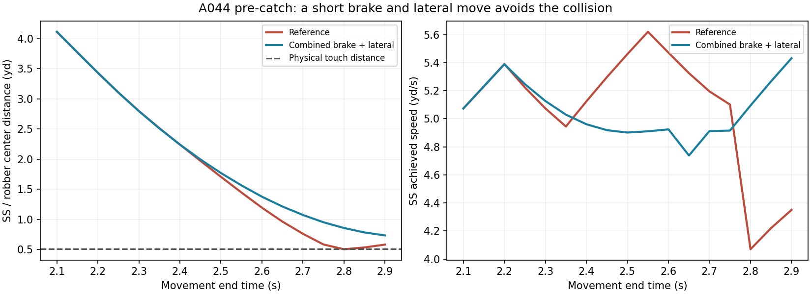

# Short movement through traffic: an achievable combined action in A044

A044 has a demonstrated local alternative under the existing movement law:
retain a short braking approach and add a small lateral adjustment to the
acquired teammate's motion. Both defenders react normally and the former2.75
SS/robber collision disappears. Useful A008 primary mesh defense is preserved.
**This is a witnessed mechanism, not a production navigation policy.** The
original #81 forecast-admission correction alone did not accomplish it.

The cost question is separate and complete: preserve the original zero-preview
contract; hold unchanged #81 and submit cost delta d80dcd3 for Run's independent
re-review. [Cost adjudication](https://github.com/tannerthardy/football-simulation-/blob/c6c8b4823acb27c13769f32305a79d5628cf19b2/docs/reviews/spacing-cost-adjudication.md).
Run consultation is recorded and its acknowledgement/new-delta acceptance is
pending. No cost assertion is waived or changed by this traffic experiment.

## Exact host, decisions and scope

- Executed short-action harness: `2219e8799254d1beec44d2118eaaee793c3ef3f8`.
- First, incomplete joint-action trial: `49352adffdb2948e2af917726e5641de04819d09`.
- Deliberately pinned measurement host: `6e19ad2d4aac73e71ae57c1893a9b389074eeaa5`,
  source `f9573bc3ce911dfc75dee95d56b8df3b3e8937ed8db62a97659d15baf4c3e7e8`.
  This is the exact existing A044/A008 matched source, with the passive observer
  and original pending motion admission. It is **not** current accepted develop.
- Current accepted develop: `86250bb4f0c6f421878c204161864d523c3e30b6`; its
  intervening Duo-only change is separate. No current-develop behavior claim.
- Cost successor `d80dcd3015358e604f91cb026f562f6f4f4781e5` and evidence
  `c6c8b4823acb27c13769f32305a79d5628cf19b2` remain frozen/separate.

Research branch `codex/mesh-short-adjustment` contains no production edit.
One named SS witness receives an opt-in command intervention in each case;
all22 bodies and decisions otherwise react naturally. No opponent is frozen,
contact disabled, catch forced, body changed or capability increased. The
matched inputs/seed, flags, World defaults and Node22.23.3 are unchanged.
Catching was notified before the diagnostic; no coverage/common/approach-control
function was edited. Its active approach-family investigation remains separate.

## Objective, modifier, momentum and geometry are different causes

**Objective:** SS retains the acquired H man/catch-window responsibility. The
robber's underneath match remains an independently reacting objective. No
role/receiver replacement or gap selection is introduced. The intervention
consumes only the original helper's already-computed own objective, own full
physical state and the ten peer pictures spacing actually acquired. Track goals
retain their observed velocity; a catch-drive point is explicitly a fixed
predicted point. Missing/unknown objective or peer motion declines intervention;
there is no private live-state fallback or additional perception/memory read.

**Modifiers:** existing spacing halves SS's request at2.20–2.30. That braking is
useful. Earlier bend research replaced it with a full-speed bent request, so
those trials mixed steering with removal of braking. The first new offline
formulation repeated that confound; its exact bytes and records are retained,
and it was corrected before a native trial. The new action preserves the
selected forward braking component and changes the transverse component only,
subject to the original raw speed cap.

**Residual momentum:** changing a request does not create immediate lateral
motion. At2.05, a different requested direction gives essentially the same
attained first step because ordinary movement is already using its available
cut. Braking and steering then share existing physical capacity. For every
executed experimental command, the one-step own World forecast matches actual
motion to numerical precision (maximum position error1.42e-14yd).

**Geometry:** the native menu misses a useful combination. At the exact same
2.35 state reached by the first new trial, use all ten acquired peer pictures
and the same complete own body/support state:

| Held command | Minimum acquired-peer clearance over0.6s, yd |
| --- | ---: |
| Full request | -0.06154 |
| Half speed alone | -0.00027 |
| Gather alone | -0.37451 |
| Half speed plus transverse match | +0.29568 |

All four forecasts remain upright. Half speed alone is therefore rejected by
the existing strict clearance rule, and gathering worsens the encounter. The
existing menu returns the original unsafe request. A modest direction change
combined with braking has a materially different achievable path. This does
not prove all congestion has a feasible exit; it proves this particular early
encounter was not geometrically unavoidable.

The experimental option matches the acquired peer velocity perpendicular to
the retained passing direction, while keeping the forward modifier. If that
combination is insufficient and the native forecast still overlaps, it tries
only the existing half-speed request with that same transverse adjustment.
There is no angle grid or margin tuning. The same0.05yd forecast-comparison
margin and normal touch radius remain. Already-clear native paths compete on
progress toward the original objective. For an overlapping native path, a safer
option need not beat the unsafe unloaded sprint's presumed endpoint: it must
make actual progress toward the same objective and improve the collision
forecast without introducing a new overlap with a previously clear peer.

This corrects a selection problem exposed by the first trial rather than
certifying a whole route. All peer predictions remain conditional observed
constant-velocity pictures. At2.05 that0.6s estimate misses the reacting robber
by about1.23yd. Those future positions are measured afterward, never fed into
the decision. New observations and ordinary20Hz replanning remain necessary;
no universal clearance bubble or perfect neighbor route is granted.

## Coupled result and opposing defense

The first new trial preserved native speed modifiers but lacked the combined
half-speed/direction fallback. It still collided at2.75, impulse131.56 versus
139.00 reference. One same-state diagnostic above identified the missing action;
one corrected pair was then run. No further variant or football campaign.

| Before-catch measure | Reference | Combined short action |
| --- | ---: | ---: |
| SS/robber impact at2.75 | impulse139.003 | none |
| SS speed after2.85 tick, yd/s | 4.3501 | 5.4318 |
| SS distance to H after2.85 tick, yd | 2.8650 | 2.8493 |
| Robber distance to H after2.85 tick, yd | 2.8419 | 2.8459 |

Tick2.85 ends movement at2.90, before the2.90 reception decision. There is a
brief speed cost before the former collision, followed by preserved movement
through the traffic. The defender neither stops for a prolonged period nor
teleports sideways. The robber is not ordered to yield. No other contact
involving either actor replaces the removed collision in the recorded prefix.
H's entire physical history before the catch decision remains exact, preserving
the offense's earned separation and route.

A008 changes a support SS action, so all22 histories are **not** exact. Its
actual receiver Y7 and primary defender NB19 retain exact bodies and final
commands throughout3.40; catch2.45, wrap2.50, all events and terminal main RNG
are exact. Other reacting actors' differences are preserved in the raw tape.
This protects the useful primary mesh defense without declaring the entire
unit unchanged or claiming a terminal tackle beyond the capped window.

## Reception, portability and recommendation

The corrected A044 arm naturally **catches at2.90**, while its reference drops.
Their terminal main RNG differs. Only terminal RNG was captured, so these tapes
cannot locate its first divergence or isolate the reception difference between
position/pressure and execution draws. The candidate remains live at the3.55
cap; the reference becomes incomplete/dead. **No postcatch pursuit, final-yardage
or touchdown-causality benefit is established.** No catch/seed was forced or
post-whistle continuation added. Historical Z→CB_S offensive-block/load evidence
remains separate; this short prefix does not revalidate that later block.

Accept this as evidence that existing movement can produce a useful local
combined action while preserving responsibility. **Hold production/general
rollout.** The next concrete integration boundary is an explicit own movement
objective carried from its producer to the movement modifier. The prototype
reads already-computed values from the passive observer for research; production
must not depend on that observer or reconstruct a goal from private live receiver
state. A moving objective with unknown velocity must stay unknown; fixed point
and moving target need distinct semantics. I retain ownership of this consumer
question and will coordinate the producer contract with Catching before touching
its active common/approach-control functions. No broad navigation layer is needed.

Four new short native prefixes across the two trials cost **3.293 launcher
seconds**. Offline checks, both changed-harness typechecks and reduction total
**23.443 launcher seconds**. Baselines and prior information/physics evidence
were reused. No new full suite, roster, full game or broad panel. Typecheck
passes at the corrected harness pin. The cost adjudication's12.811s is separate.

[Machine findings and exact same-state inputs](../../data/reviews/current/mesh-short-adjustment/review.json)
· [Saved-record reducer](../../data/reviews/current/mesh-short-adjustment/reduce.mjs).
All executed scripts, rejected first offline bytes, source-specific receipts
and both coupled trials remain fetchable. Preserve the previous failed point
and30-degree bend evidence; this result does not retrospectively validate them.
