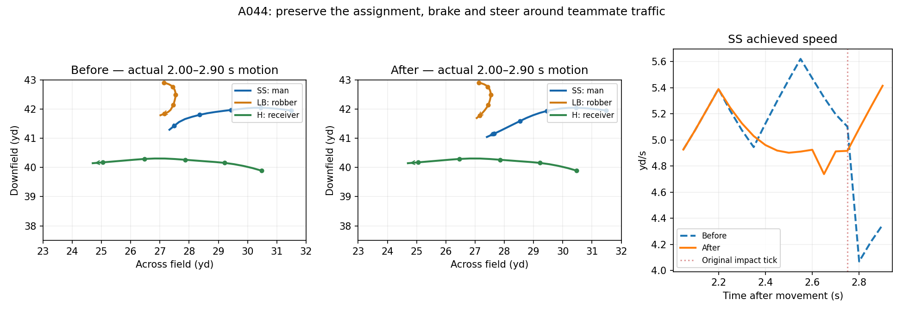

# Brake and steer through coverage traffic

The football problem is two legitimate defenders converging on crossing routes
without a useful way to share the immediate space. SS's man responsibility and
the robber's underneath match are not demonstrated wrong. Requesting a new
direction does not remove SS's momentum. Braking alone can leave the same
collision; a lateral request that discards braking can make it worse.

The missing normal response is **brake and steer together, then recover toward
the same responsibility**. The saved same-state study demonstrates that action
under existing physics. This candidate implements it in the real spacing path,
for eligible man/zone movement, without case IDs or receiver/peer truth.

Recommendation: **advance this narrow correction for independent review and
adoption**, conditional on acceptance of its separately reviewable #81 cost
dependency. It repairs the demonstrated local movement decision. It does not
establish overall coverage, postcatch pursuit, RB navigation or wide-zone quality.

## Exact portable boundary

| Item | Pin |
| --- | --- |
| Accepted base, fetched and reconciled | `86250bb4f0c6f421878c204161864d523c3e30b6` |
| Minimal #81 motion-admission extraction | `ebce0d4d1e0909ca374e7ba21c9b769717638b32` (original `f04235e`) |
| Separate cost dependency | `dbf7441471ad8eac4da6a66f292cfb5c9ba2db30` (same source as `d80dcd3`/`c6c8b48`) |
| New production implementation | `d54cc07673c70ec64e14d2bfa14f6e9d70fa1347` + `ceb27ea4c9bfd2b7f42dc14bd666cfaf2e586f18` |
| Tested candidate, including final focused control/collector/input | `52518bebea74e8668f6b3c0628f3a3a1e5253008` |
| Candidate runtime SHA256 | `8ec3ac755d1ff2ca64eb3482244c25a96c1247dee0c4aa971d950601b6baf2b3` |
| Matched reference | `7aff560589e120f78afe70a0237ae2cd0827ba40` |
| Reference runtime SHA256 | `840cd69373ef95924f60b3edebc229b77358dcb86993fe0591ae6c959636f9fd` |

Branch `codex/mesh-traffic-controller` starts accepted development and extracts
only the pending four-file motion/cost dependency. No old research ancestry,
passive production observer, #76 runner override or Catching's rejected approach
family is imported. Run has been consulted on the cost guarantee; its new-delta
approval is pending, not presumed. The old #81 remains held separately.

After that dependency, apply `traffic-controller.patch`: five production files
(`spacing.ts`, `movement-objective.ts`, `behaviors/common.ts`,
`behaviors/defense.ts`, `catch-approach.ts`) and the new focused test/fixture.
Alternatively `full-runtime-and-tests.patch` applies the full ten-file boundary
to accepted86250bb. Documentation, input bytes, collector and evidence need not
become production dependencies. Integration owns combined verification/adoption.

## Information and ownership contract

Catching released its common/approach trial after reverting it to accepted
source. Coordination before edits is recorded on #75 at
[6205761929](https://github.com/tannerthardy/football-simulation-/pull/75#issuecomment-6205761929)
and [6205823627](https://github.com/tannerthardy/football-simulation-/pull/75#issuecomment-6205823627),
following the original objective proposal6205251618. Catching's independent
semantic review of this concrete candidate is still requested.

The producer attaches optional, command-local **own-plan** metadata:

- `track`: its supplied moving goal and supplied velocity, copied immediately.
- The existing catch-drive input: an explicitly fixed predicted catch-window
  point. This is a chosen point, not an unknown receiver declared stationary.
- If `movingCatchApproach` actually selects its computed moving-window arrival,
  its already-computed goal/consumed velocity supersede the fixed input metadata.

The sim-layer symbol survives ordinary command spreads through containment,
engagement and spacing. It is not a physics API, observation, persistent memory
or additional acquisition. No timestamp is changed or renewed: the goal belongs
only to this newly produced command; it makes no claim about observation age.
The original teammate observation ages remain untouched. A missing moving
velocity stays unknown and disables new goal scoring; it never becomes zero.
Missing/nonfinite peer motion or age also declines this option. There is no
observer/private-live fallback. Peer position, velocity and age come from the
same existing spacing acquisition; only public radius/identity accompany them.

Own support, energy, posture, momentum and felt constraints are legitimate own
state. Free forecasts exclude down/engaged/loaded/gripped/contact-constrained
actors, active shoulder turning, strikes, dives and lunges. No responsibility,
recognition, perception/memory, body size, speed/strength or World law changes.

## Why this action and selection are different

The existing attainment gate and World preview remain. On an eligible imminent
conflict, also consider residual movement under the achieved current velocity.
Retain an own passing frame until the acquired peer passes behind it or the
objective turns away. Retain no peer motion between decisions.

Start with the native spacing/gather request, retaining its braking. Match only
the obstructing acquired peer's velocity transverse to that frame. Cap the
request at the original request's speed and preserve facing, posture, effort,
field containment and all other command fields. If that option is insufficient
and the native path overlaps, try the existing half-speed request composed with
the same transverse correction. There is no angle grid, new radius/margin or
forced move. Replan at ordinary20Hz; both defenders decide independently.

Evaluate actual achievable own World paths against **every** acquired teammate.
Keep upright support, positive progress toward the original responsibility and
no new predicted overlap with a previously clear peer. If native motion already
clears, improve its original goal error without contact. If native motion
overlaps, require material clearance relief using the existing.05yd comparison
and better goal access than standing still. Do not require a safer action to
beat the endpoint of an unsafe unloaded sprint as if the latter could pass
through the collision untouched. Harmless contact is not categorically banned;
the modifier may improve a still-congested path and cannot abolish real contact.

All previews hold commands for.6s against observed constant-velocity peers.
Those are conditional estimates, not guaranteed routes. The earlier saved
encounter demonstrates a peer can turn more than a yard away from such an
estimate. Nothing feeds that future truth back into this policy.

## Mechanism and controls

`test/fixtures/traffic-step.json.gz` retains exact own states, consumed pictures
and original objectives from the failed first research arm at49352ad. No speed
perturbation changes the physical state. At2.35, full, half and gather forecast
overlap; the combined request forecasts **more than.25yd clearance** (the
original study measured+.29568). The production spacing hook selects it using
the preceding acquired encounter. Its first World step exactly matches the
held-command prediction, remains upright and respects energy/work accounting.

Unknown own goal motion, unknown peer motion/age, and own loaded constraints do
not use the new option. The opposing obstruction begins outside torso touch:
a stationary acquired body one yard ahead is physically hit in the native World.
The test retains that failure rather than awarding fictitious clearance. A clear
route with an explicit own objective remains unchanged with **zero previews**.
Existing residual-momentum, mirrored turning/facing, rear conflict, grip/load,
shoulder-turn and unavoidable-contact controls pass. Existing coverage and catch
approach mechanics also pass.

There are **39 distinct passing focused checks** across the saved focused-v2/v3
receipts, plus typecheck. The first pass had one incorrect *test comparison*:
it compared the loaded candidate with an unconstrained native arm, whose gather
correctly differed. Corrected to identical constraint/picture controls; failed
receipt retained. Two typechecks cover the initial and corrected selected-moving
objective producer; both pass. No production rewrite was made to fit that test.

## Reacting production continuation

Same frozen inputs/seed71002, all22 naturally reacting. This policy applies to
all eligible man/zone defenders, not just SS21. The identical passive collector
wraps existing behavior, `see`, World and root `chance` calls only to record their
already-produced values. It neither alters commands nor adds queries/draws.
Reference is accepted86250bb plus the minimal motion/cost dependency, without
the new policy. Its commands, actual paths/contacts, events and terminal RNG are
exactly equal to the compatible saved #81 mesh reference; source hashes remain
separate. Four new short prefixes resolve the actual production/general-role
boundary and the previously missing random attribution; no panel recollection.

| A044 before reception, movement ending2.90 | Before | Candidate |
| --- | ---: | ---: |
| SS/robber contact | 2.75s,139.0033kg·yd/s | absent |
| Any replacement contact involving either, through3.55 cap | none besides above | none |
| SS achieved speed | 4.3501yd/s | 5.4145yd/s |
| SS distance to H | 2.8650yd | 2.8485yd |
| Robber distance to H | 2.8419yd | 2.8183yd |

First command divergence2.05 is SS21 only. H's **entire physical body state and
commands remain exact through the2.90 pre-resolution input**. The offense's
earned mesh separation survives; useful motion is not instant coverage recovery.
Braking briefly costs speed before the original impact, then permits recovery.



A008 first changes SS21 at2.15. Actual Y7/NB19 full bodies and commands remain
exact through the3.40 cap. Catch2.45, NB wrap2.50, all events and root RNG remain
exact. Supporting actors0/4/6/14/15/21 change; this is **not all22 identity**.
At2.90 SS is.01137yd farther from H10, who is not the actual Y7 catcher; retain
that small positioning cost. No replacement SS/robber contact occurs.

### Catch outcome and remaining limits

A044 reference drops2.90 and ends incomplete; candidate naturally catches and
is still live at3.55. The first root RNG divergence is2.70: `playBall`'s existing
near-path looking/head-turn chance occurs on a different tick as geometry
changes. At reception, **the receiver success probability is exactly identical
.782038569970415**; the shared-stream draw is.7931172286625952 before and
.6582075736951083 after. Thus the drop/catch difference is a changed draw
sequence, not improved receiver positioning, new physical disruption or an
increased catch probability. No catch is forced, no draws skipped by the test,
and no stochastic-system change is included. All22 eventually diverge after
this different possession outcome; the packet retains that adverse exposure.

This test establishes collision relief and useful pre-catch movement. It does
not establish postcatch pursuit/yardage/finish benefit. The historical caught-ball
Z→CB_S physical block/load is still separately pinned90ed evidence and was not
revalidated by this short prefix. Loaded/gripped actors retain native commands
and real forces in focused controls; the policy cannot preview through their
block. Broader postcatch interaction remains an independent review limitation.

## Runtime, reproduction and next decision

All new validation launchers: **29.086s**, including the failed control and two
different producer typechecks. Four short native prefixes: **3.110s launcher
time** (two arms×A044/A008). No full games, fresh rosters, broad panel, build or
shared suite. This is a cost receipt, not a matched runtime benchmark. The frozen
cost-only successor's previous12.811s remains a separate receipt.

Clear-path zero-preview contracts remain intact. Necessary local selection adds
up to five free previews (raw, residual, native if different, adjusted and combined)
after the cheap gate; each is12 World steps. This extra work selects a newly
demonstrated action. Duplicated native/raw previews are a possible optimization,
not grounds to restore the unsafe requested-angle shortcut or waive cost tests.

`comparison.json`, `rng-attribution.json`, `historical-compatibility.json`, both
native arms and all launcher receipts are in the evidence packet. `reduce.py`
recomputes the saved motion/outcome comparison without any native simulation.
`artifacts.json` hashes every published packet payload except itself. Exact
runtime/tests patches are included. For a necessary new reproduction only:

```sh
npm run baseline:run -- --candidate -- node --import tsx scripts/diag/mesh-traffic-controller.ts --run --out out/new-matched-prefix
```

Next decision: Run reviews the separate cost proof; Catching reviews the concrete
own-goal producer semantics; an independent reviewer checks the traffic choice
and preserved blocking boundary. Integration can then extract the portable
candidate and perform its one combined verification. Keep this candidate stable
during review. No jukes, jumps, body-width changes, new coverage assignments or
further last-second variants are needed for this demonstrated mechanism.
