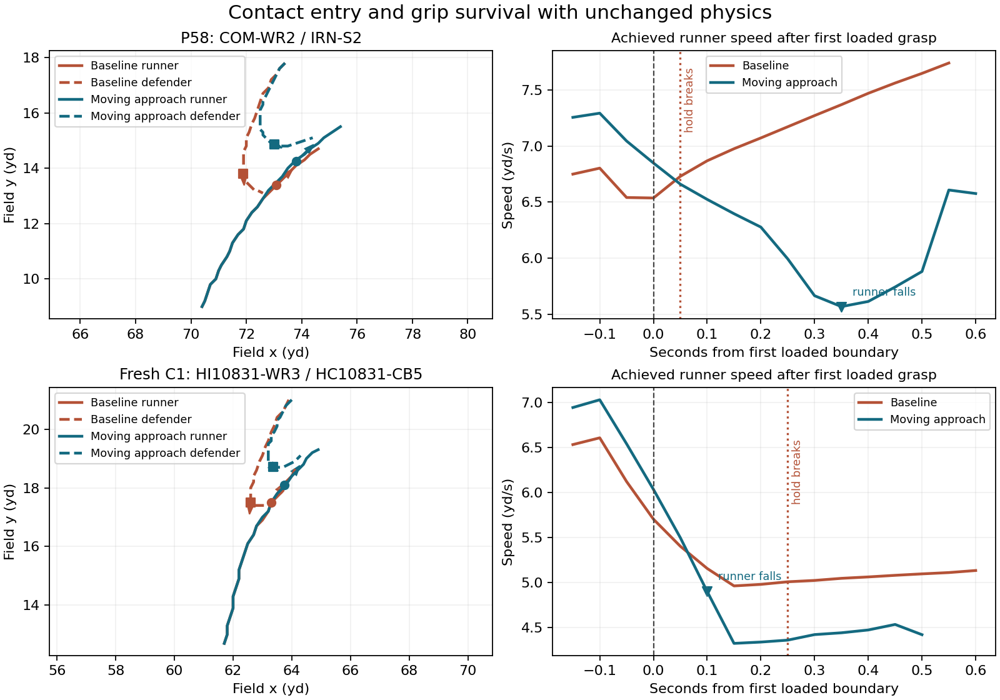

# Moving catch approach: a minimal controller improvement

There is a demonstrated approach error contributing to explosive YAC: the
flight controller drives toward a stationary catch point while the receiver
continues moving. Some defenders brake/turn into a crossing arrival, then
acquire a marginal rear hold. Native forces affect the runner, but he recovers
after that hold breaks; the remaining defense can already have lost leverage.
This is one repairable link in the chain, not a general explanation for every
explosive catch or a finding that rear grips should be stronger.

The candidate uses the existing moving interception objective for an eligible
free defender approaching an observed catch window. P58 finishes under both
retained execution draws. A new roster reproduces the first-grip improvement
with **exactly the same execution** as its baseline. The simpler moving-window
objective earns this improvement; an added hip/shading objective does not earn
its extra complexity. A separate spacing bypass does not rescue the untouched
fresh escape, so it is also rejected.

## Source, ownership and inputs

Unchanged integration was reverified on October 14 as
`4ded6b600fd3785e65034aa5623d7a9f8f3c5db1`, runtime SHA-256
`8433e88d7deb31e5c1c031e2f0cb83d1cf0e805609820c0559f6b8f25747340c`.
Production was installed at `314a6235d4432385d3fee011a05b2ebda579b960` and
tested with retained draws/focused checks at
`c0002355a6dbee610ba96e4dbf6bc9e205de13a2`. Candidate runtime SHA-256 is
`cab57308d6166cbbbef8effbc1c89f592b6a1edb2b6586968ac5ef4490cbc108`.
Later portability, incomplete-control inspection and documentation commits
preserve these runtime and test bytes. Work stays on
`codex/catch-pursuit-diagnosis`; integration is unchanged.

The entire production/test diff is the isolated helper
[`catch-approach.ts`](../../src/sim/catch-approach.ts), one `playBall` return
in [`defense.ts`](../../src/sim/behaviors/defense.ts), and one information/body
contract in [`catch-phase-control.test.ts`](../../test/catch-phase-control.test.ts).
World, kinematics, movement preview, tackle laws, generated capabilities,
common pursuit/spacing and helper coordination are byte-identical to baseline.
Shared-file coordination and the integration lead's full-suite ownership are
recorded in [the workboard](../WORKBOARD.md).

The [compact evidence](../../data/reviews/current/moving-catch-improvement.json)
pins every comparison's exact commit, runtime, model/collector/input/harness
hashes, Node 22.23.3, all **43 baseline flags**, World defaults, commands and
cost. No flags are added or overridden. Center hands, legacy support, mean
integration, bounded attachments and adaptive contact substeps remain fixed;
`CF_FLOW` is unset and parked experiments stay off. October 11 NFL review is
historical evidence, not a current measurement.

Inspected inputs retain their actual players, calls, fatigue/scouts and both
execution witnesses in the [original packet](../../data/reviews/current/catch-transition-inputs.json).
Eight new standalone inputs were declared before their outcomes: generated
roster seeds **10831/11842**, strength .55, play seeds **51001–51004 /
52001–52004**, four existing source calls, LOS 55, y 26.65, first down 65,
full energy, empty scouts, audibles off. The [fresh packet](../../data/reviews/current/moving-catch-fresh-inputs.json)
contains every player/call and unchanged-baseline final signature. These are
bounded transfers to new players/plays, not a league sample or NFL calibration.
Earlier midfield/both-sideline/one-helper encounters, route/coverage probes and
separate capability sensitivities remain in the [chain diagnosis](catch-chain-diagnosis.md);
they are reused causal context, not newly achieved candidate controls.

## What the controller now asks for

`playBall` keeps its existing reachable ball interception and near-receiver
carry branches. Only its remaining catch-point drive can use the moving
approach. Eligibility is the prior v2 eligibility, unchanged: an acquired
moving receiver window within .6 s, an upright free body without a planted
foot/load/strike, and an attainable existing movement preview. Preview closest
approach must enter the contact region plus 2.5 yd. No gate is widened to P173.

The objective follows a moving point crossing the visible ball window at its
estimated time: `goal = windowPoint - seenVelocity × timeRemaining`. That
avoids leading an already predicted future point again. It reuses
`movingArrivalVelocity`, own support availability and existing speed limits.
After catch, existing moving pursuit owns the request; there is no timer,
stored privileged catcher identity or forced post-catch delay. The helper
adds no observation or RNG call and reads the already consumed delayed picture.

For P58's actual **IRN-S2 / FS, index 20**, the first changed request is at
2.10 s. Its picture of **COM-WR2 / X, index 8** is .20 s old; velocity is
(3.043, 4.559) yd/s, and the estimated window is at 2.65. The original request
(-2.536, -8.290) becomes (-1.220, -6.021). Actual velocity changes only from
(-3.746, -3.603) to (-3.527, -3.813) over that step. This demonstrates the
difference between a requested direction and physically achieved movement.
The receipt retains the intercept, consumed picture, raw/applied requests,
achieved velocity, first grasp, first reported load and subsequent support.

## Achieved entry, physical effect and support

P58 baseline first contacts by grasp at event label **3.00**, then loads at
World boundary **3.10**: 1.260 yd separation, crossing **9.28 yd/s**, heading
difference **130.4°**, and closing **−1.716 yd/s**. It is an extended rear
reach. The first reported force is about **1345**, but the hold breaks at
3.15. Runner speed briefly falls to 6.54 yd/s, then recovers to 7.56 within
.50 s. A force was transmitted; failure to finish does not imply no physical
effect.

Production first grasps at **3.15**, loads at **3.25**, with separation .999,
crossing **6.61**, heading difference **67.7°** and closing **+1.372**. Its
achieved defender velocity is (2.350, −1.059), versus baseline
(.233, −3.470). The side/form entry survives through finish despite weaker
natural execution (**.751 versus 1.600**). CB_W/index 19 first loads its assist at 3.55;
runner fall label is 3.60 and tackle 3.95. Native physical response and earned
assistance turn the original 38.60-YAC TD into a **6.72-YAC tackle**.

Fresh **H10831/C1**, catcher **HI10831-WR3 / X, index 8**, primary
**HC10831-CB5 / FS, index 20**, supplies independent evidence. Both histories
use execution **.8280738783133311**. Crossing improves **9.43→6.05 yd/s** and
closing **2.19→4.08**; entry distance is .745→.728 yd. Baseline loads at 3.20,
breaks at 3.45 and needs NB/index 19 to finish later. Production loads at 3.35
and the runner falls at label 3.45, before the first assist at 3.75. The
original first hold survives; YAC is **6.31→3.86**. The body still slows and
recovers through native support steps; no balance or grip capability changes
were needed. Its sampled first force is about 1115. Force samples are
end-of-step reports, not exact substep impulse integrals or NFL calibration.



Solid paths are catchers and dashed paths their actual approaching defenders;
arrows are achieved entry velocities. Recorded position paths are quantized to
.1 yd; entry vectors use exact body state. Speed curves align each history at
its first loaded boundary, rather than pretending contact happened at the
same absolute time. Triangle markers use fall event labels. Contact/fall event
labels refer to the decision tick; completed load boundaries and support
`since` timestamps are separately retained in the receipt.

## Opposing and adverse evidence

| Input | Unchanged baseline | Production natural outcome | Interpretation |
| --- | --- | --- | --- |
| P58 | TD, 38.60 YAC | Tackle, 6.72 | Better entry/survival with weaker execution; both retained draws also finish |
| P4 | Tackle, 8.44 | TD, 35.67 | Material adverse ending; execution separation below |
| P16 | FS/I7204-CB1 INT at 4.40; return tackle | CB_W/I7204-CB3 INT at 3.90; touchback | Ball contest retained, actual interceptor/return legitimately change; not offensive YAC |
| Ordinary P19 / P103 | Tackles, 7.45 / 8.02 | Tackles, 4.53 / 6.20 | Assistance/first tackler can change; shorter YAC does not certify every defender's geometry |
| Ordinary P95 | Tackle, 3.58 | Tackle, 3.79 | Reachable-ball branch retained; .22-yard adverse movement, surviving rear holds |
| Fresh H10831/C1 | Tackle, 6.31 | Tackle, 3.86 | First-grip repair with identical execution |
| Fresh H10831/C3 | TD, 30.70; no hold | Tackle, 19.77 | Safety earns a nearly parallel rear approach; still concedes a large gain |
| Fresh H10831/C4 | HC10831-CB2 INT; return tackle | Same actual interceptor; return tackle | Fresh opposing turnover retained |
| Fresh H11842/C4 | OOB, −1.76 | Inbounds tackle, −.94 | .82-yard/clock tradeoff; actual first defender changes |
| P173 | TD, 76.25 | Exactly unchanged | Zero changed requests; remaining failure, not forced into scope |

P4 remains **I6103-WR3 / H, index 10**, versus **C6103-S4 / FS, index 20**.
Production preserves the original stronger execution **.992938** as a tackle
(7.72 YAC), while original weaker **.466250** still breaks at 3.85 after loading
at 3.65 and becomes a TD. Both unchanged-baseline geometries previously showed
the same strong/weak split. The new natural draw is .524521. Entry body/joint,
requested movement and RNG state are identical across the two fixed-draw
production arms. P58 finishes under both original **1.600 / 1.292323** values
(5.73 YAC in production). Thus P4's lost natural tackle is not proof of a
defective one-tick transition, while P58's gain is not favorable draw selection.
See the [prior factorial](catch-transition-diagnosis.md) for runner recovery
and already-lost helper leverage in the two weak P4 arms.

Fresh H10831/C3 is actual **comebacks versus Cover3 match**. LB_M/index 15's
one-defender change still loses; restoring only its free request after spacing
also loses, with minimum achieved separation **3.240 yd** and no grip. Applying
the same approach primitive to all eligible actors lets actual
**HC10831-CB3 / FS, index 20** acquire the actual catcher
**HI10831-WR2 / H, index 10** at 5.75. Crossing is **.225 yd/s**, achieved
heading difference **1.0°**, first force about 569, and execution .799186.
The rear reach survives; runner falls at 6.20, tackler 6.25, finish 6.60.
This is a useful safety approach, not installed helper arbitration. Coverage
still leaves a large catch cushion and the result is nearly 20 YAC.

In fresh H11842/C4, baseline FS/index 20 pulls the runner into an OOB ending
at y 53.52 while falling. Candidate CB_W/index 18 acquires first and FS assists;
the runner falls inbounds at 4.75, tackle 5.15. This is not credited as a YAC
improvement: gain rises .82 yd and the clock-ending behavior changes. It is
contained football with a different first tackle, retained as an adverse
ending tradeoff for review.

The other three fresh plays without catches match full baseline final state
exactly. Fresh H11842/C1 remains incomplete at 3.05 with **every football event,
stat, ball/carrier frame and receiver path unchanged**. Its FS path differs by
about .51 yd and CB path .10 in recorded coordinates. The initial assumption
of unchanged whole-world fingerprints failed; that failed receipt is retained.
An observed/plain actual-source recording reproduces the candidate exactly and
finds no lost ball opportunity. A changed defender path is expected under an
approach change even when the pass still falls incomplete.

## Validation, cost and integration judgment

**59 focused checks pass** across catch-phase, pursuit-contact,
defensive-awareness/contact and tackle-wait constraints. The added test ensures
moving arrival follows the consumed receiver picture without changing the
body/profile or reacting to unseen live receiver/target mutations. Typecheck
and build pass. The production port matches **11 completed neutral prototypes
exactly**, including final result, every final body, intent, RNG and perception.
Four retained-execution observed/plain pairs preserve entry states; the
incomplete-control pair separately verifies observational neutrality.
Every full play here ends naturally; none is a timeout. Earlier short shadow
prefixes remain censored and are not added to completed outcomes.

Recorded commands for this continuation total about **90.1 s** before the final
compiler check; costs include observers and concurrent checks, not comparable
performance benchmarks. No new games/full suite. Fresh declaration/collection
took 7.71 s; production parity 2.97 s, retained draws 4.10 s, focused checks
2.82 s and build 12.95 s. The first ten-case team prototype exceeded its
declared 30-s batch (**31.65 s collector / 31.94 s command**): the guard checked
only before pairs. Complete neutral scientific results are retained, overrun
annotated, and the terminal guard repaired. An initial spacing run preceded
resolution of typecheck failures and is excluded; the corrected source
`727c6b3` passes and repeats the signatures. Neither failure is erased.

The shared [testing policy](https://github.com/tannerthardy/football-simulation-/blob/f9617dde9456c0ead2d66b46d4b42608adcd3585/docs/TESTING_COSTS.md)
was used to expand only for unresolved mechanism, transfer, ball and assistance
risks. **Ready for integration-owner review and the exact combined-candidate
full suite**, not merged/promoted. No unresolved correctness blocker was found
in this bounded controller change. Remaining football uncertainty includes
earlier coverage leverage, teammate containment after a miss, shared physical
balance/load calibration, and the unchanged P173 escape. Awareness, roster
corrections, helper rules, prolonged/ground holds and physical laws stay separate.

The most useful next decision is reviewing this small controller repair on the
combined candidate, then tracing the remaining coverage/containment failure
without broadening this gate or compensating with stronger rear grips.

For reproduction on the research branch, the tracked input/expected-signature
packets do not require ignored `out` caches:

```sh
npm run baseline:run -- --candidate --receipt out/review/parity-receipt.json -- node --import tsx scripts/diag/catch-approach-parity.ts out/review/parity
npm run baseline:run -- --candidate --receipt out/review/draws-receipt.json -- node --import tsx scripts/diag/catch-production-execution.ts out/review/draws
npm run baseline:run -- --candidate --receipt out/review/focused-receipt.json -- npx vitest run --project core test/catch-phase-control.test.ts test/pursuit-contact.test.ts test/defensive-awareness-contact.test.ts test/tackle-wait-constraints.test.ts
```

Default parity checks 15 frozen final references: the original eleven
prototypes, three exact fresh baselines and the inspected incomplete candidate.
To reconstruct unchanged baselines, use an isolated checkout at `4ded6b6`,
copy only that parity collector and its three tracked input/reference JSON
files from this research branch, and run `baseline:run` without `--candidate`,
with arguments `OUTDIR all baseline`. Do not copy candidate runtime files or
repin the shared profile. The minimal integration patch is `git diff 4ded6b6
codex/catch-pursuit-diagnosis -- src/sim/catch-approach.ts
src/sim/behaviors/defense.ts test/catch-phase-control.test.ts`.
