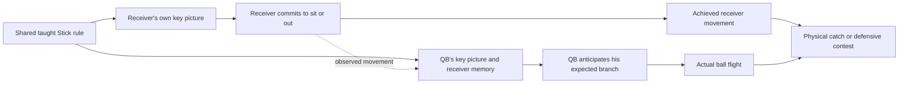

# Stick options with separate receiver and QB reads

**A first two-way Stick candidate now removes the true coverage classification
from the receiver's choice and the receiver's private branch/path from the QB's
prediction.** Both use the same taught rule with separate pictures. The QB can
anticipate a cut, retain a stale expectation, and correct it after seeing
movement. No disagreement roll, forced incompletion or automatic interception
is added. Other option families remain separate.

The bounded candidate is ready for isolated owner review, **not integrated or
promoted**. The exact combined candidate still needs the integration owner's
preserved suite. This is an information/decision improvement with limited
football transfer, not a calibrated NFL option-error model.

[Coaching sources](../../data/research/option-agreement-sources.json) pin the
actual responses, dates and reading scope. [Evidence and cost](../../data/reviews/current/option-agreement-review.json)
pin every source, all 43 flags, actual players, inputs, failed checks,
intermediate policy, ordinary/adverse outcomes and diagnostic draw controls.

## What the coaching research supports

[Kyle Richardson's Stick installation](https://www.xandolabs.com/the-lab/offense/personnel/10-00-personnel-concepts/adjusting-the-stick-to-attack-multiple-coverages/)
teaches a leverage choice at a defined route depth, with stable reads across
coverage and formations. His variant breaks at four yards and allows
inside/outside movement; it is not our existing six-yard sit/out route.
[Caleb Corrill's clinic summary](https://www.glazierclinics.com/football-coach-resources/quick-game-cheat-code-stick-concept-option)
explains how the conflict defender, complementary spacing and match coverage
change the available void. His expanded choices include inside/outside/sit.

The public [Brian Flinn option-install summary](https://footballtoolbox.net/how-to-install-option-routes-in-your-spread-offense-step-by-step)
links a decisive receiver break to the QB's reading of trigger movement.
The [Alma slot-choice preview](https://www.xandolabs.com/the-lab/offense/personnel/11-personnel-concepts/understanding-coverage-leverage-in-the-slot-choice/)
and [Lafayette choice preview](https://www.xandolabs.com/the-lab/offense/rpos/post-snap-manipulations/2025-choice-system-research-and-development-case-1-lafayettes-slot-choice-build-in/)
reinforce the importance of spacing, a defined conflict key and QB progression.
The full paid clinics/film were not accessed; the Flinn text is a secondary
transcript summary. These are coaching installations, not measurements of NFL
disagreement frequency or observer latency.

Useful common principles are: a shared installation, a local leverage read,
a physical decision region, decisive execution and observable evidence of the
choice. Knowing the called route supports anticipation. Knowing an unobserved
private conversion does not. The implementations vary; no universal Stick or
three-way choice decision table is claimed here.

## The repeated shortcut and the bounded replacement

Baseline `RouteRunner` selects `sitVsZone` from the true `coverage.man` bit,
with an awareness-related random reversal. `QBPass` evaluates and re-aims
through the runner's private path/index. A prior native P58 intervention
already demonstrated that changing only that hidden bit changes the committed
route with **zero defender observations**. That compatible evidence is reused;
it is not remeasured or counted as a completed play here.

In the new ordinary fixtures, the old Stick commits at **.80 s**, around
.33 yd beyond the LOS after the step. The replacement commits around **1.70 s**
when the receiver actually enters the decision region. Contact can delay that
arrival without an elapsed clock revealing the coverage or forcing a choice.

The first replacement retains the existing six-yard Stick's **sit/out** paths.
It reads the nearest observed upright defender within four yards of the taught
stem. Inside/head-up leverage supports the out; an outside or widening key,
or room without a nearby key, supports the sit. This geometric key rule and
its bounds are explicit model choices, not fitted NFL parameters. A receiver
commits once he reaches the final two yards before the stem, from his own
physical progress and existing delayed opponent pictures. Settled-window drift
also uses those pictures rather than the hidden current defender position.

The QB holds his own expectation and receiver memory. While looking at the
read, he acquires an existing delayed teammate picture only if it enters the
clear cone; emergency evaluation of other options does not refresh them.
He applies the same rule to his existing defensive memory and commits his
expectation when his acquired receiver picture reaches the decision region.
Visible out motion or a stop near the break can update that expectation.
Neither a new defensive picture alone nor a receiver's private choice reveals
what the receiver actually committed to earlier.



Prediction reuses the existing body movement preview on the installed branch,
starting from the QB's last observed receiver motion. It infers route-leg
progress geometrically rather than reading the receiver's private index.
`Perceived.pos` is already projected; its `age` is not added again. Time since
the QB's own acquisition can advance his nominal expectation. Future contact
and precise live fatigue remain unknown: nominal preview is not a guarantee
that the real receiver can execute the cut.

The source change is only [option-route.ts](../../src/sim/option-route.ts),
[receiver.ts](../../src/sim/behaviors/receiver.ts) and
[qb.ts](../../src/sim/behaviors/qb.ts). No playbook paths, QBMind, coverage,
protection, pressure policy, helper rule, capability or World law changes.
Existing Hook/global QB/protection information debt is not declared resolved.
QB teammate latency remains the existing 50 ms; receiver gaze/occlusion and
explicit communication remain coarse. No fixed persistence timer is introduced.

## Focused contracts and football transfer

**54 distinct focused checks pass across compatible runs**, including 19 new
option contracts. They verify hidden-flag/live-position independence, separate
views, anticipation before a cut, retained disagreement, visible correction,
unseen-route independence at actual release, gaze-limited refresh, a physically
bounded preview, and unchanged non-option prediction. A real eight-step World
press drill transmits load while the Stick remains before its decision region;
elapsed time does not force conversion. Existing memory, installation and
press contracts pass. Typecheck/build pass.

Two failures remain in the receipt. The first new anticipation test expected
too much lateral travel before its delivery horizon reached the cut; a 1.2-s
horizon preserves its distance requirement without changing physical speed.
The more consequential forecast defect appeared on a receiver already on the
out leg: resetting the forecast to waypoint zero sent him back toward the stem.
The longer preview exposed it; geometric leg inference repaired it. The final
test fixture also isolates hidden-coverage interventions from the shared catalog.
No preserved assertions were deleted or weakened.

Four initial contexts use frozen generated rosters 7/19, strength .55, seeds
62001–62004. Four fresh contexts were declared before outcomes, using roster
pairs 15071/15072 and 16081/16082, strength .55, seeds 63001–63004. They exercise
flipped Gun Doubles/off-man and flipped Gun Trips/Cover9 rotation. LOS 40,
ball y 26.65, first down 50, full initial energy and audibles off are fixed.
These are eight bounded inputs, not a league sample.

| Input | Unchanged baseline → final candidate | Interpretation |
| --- | --- | --- |
| Initial spot zone | H/OO7-WR6 tackle, 9.16 → 9.43 yd; release 1.75 both | Same actual recipient. Receiver and QB independently choose sit; slightly changed timing/gain retained. |
| Initial man | X/OO7-WR3 tackle, 13.50 → 11.71; release 1.75 both | Ordinary successful release with physical receiver jams retained; H's out is not the thrown target. |
| Initial disguise | Incomplete → 70-yd TD; intended X, actual RB/OO7-RB3 catches | Legacy draw restoration exactly restores original football events/stats and incompletion. This is not credited as option improvement. |
| Untouched Four Verticals | QB slide 1.41 → 1.41 | Exact full result/body/intent/RNG/perception signature retained. |
| Fresh 15071 off-man | H/OO15071-WR1 incomplete → 70-yd TD; release 2.55 both | Receiver's out and QB's observed-motion expectation agree. Restoring the two old option draws restores incompletion; TD is not credited as a decision gain. |
| Fresh 15071 rotation | Y/OO15071-TE1 tackle 9.83 → H/OO15071-WR1 tackle 10.23; release 2.20 → 2.15 | Genuine observed branch/target change: receiver selects out and QB independently expects it. Different recipients prevent a paired YAC claim. |
| Fresh 16081 off-man | SS/OD16082-CB3 INT/return tackle → dropped incomplete | Adverse lost turnover retained. Restored release random state still changes the subsequent competing catches; detail below. |
| Fresh 16081 rotation | Y/OO16081-TE1 OOB 7.27 → 7.65; release 2.10 both | H sits and QB expects sit, but Y is the actual thrown recipient. Small adverse offensive gain and OOB ending retained. |

The native selected option throws in this small panel agree. Deliberately
different-view staged controls prove disagreement and late correction are
possible, including actual release without a private-branch correction.
They do not establish how often a natural QB throws the wrong option in games.
The candidate does not award an interception for disagreement; possession
still requires the unchanged physical catch contest.

## Why the lost interception is not just changed randomness

The fresh 16081 off-man baseline throws to **X/OO16081-WR2, index 8** at 2.10.
**SS/OD16082-CB3, index 21** intercepts at 2.90. Candidate natural execution
ends as a drop; restoring both old option draws at their original actor/ticks
instead yields an X catch and 9.11-yd tackle. The nominal target point, release
time and release random state match baseline under that control. Thus the
turnover change cannot be attributed solely to the removed random draws.

Observe the actual post-World ball segments without extra physics, perception,
catch evaluation or random calls. Both source recordings reproduce their
saved complete final signatures exactly:

- Baseline **H/OO16081-WR1, index 10** first reaches the ball at **2.65**, with
  only **.0081 yd** of horizontal envelope margin. He fails to secure it; the
  next frame confirms a deflected ball. X has a later unsuccessful opportunity
  at 2.85. SS then secures the deflection at 2.90, inside his own reach envelope.
- The candidate's changed route timing delays H's first opportunity to **2.70**,
  with **.1325 yd** of margin. H drops/deflects it. X reaches that deflection at
  **2.75** and catches, before the former interception opportunity.

This is different offensive traffic, contact timing and subsequent execution,
not a disabled defender possession rule or an awarded offensive catch. Preserve
the defensive loss as a football tradeoff. Its narrow original margin also
makes it a sensitive competing-catch control; this does not certify NFL landing,
hand-placement or catch-order fidelity. No shared catch/physics fix is included.

## Pins, runtime and review decision

Branch `codex/option-route-agreement` begins from the prior research handoff,
whose runtime matches integration `4ded6b600fd3785e65034aa5623d7a9f8f3c5db1`.
Baseline collection is `f2fc53ff955050c3797c474d5cb889d792294ffa`, runtime
`8433e88d7deb31e5c1c031e2f0cb83d1cf0e805609820c0559f6b8f25747340c`.
Receiver-only stage is `612949b`, runtime `a77383b5…`; the intermediate QB stage
and failures are retained. Final football is measured at
`44f4a24eee6e9d5d10dec4982966287c2ebf1205`, runtime
`8a7c5c6a9bb76b3603c3c5e4cacc1750478593091d55af1181bd19f821cc8599`.
Final option contracts/typecheck/build are at `a1708d1`; later diagnostics and
documentation leave those runtime bytes unchanged. Every comparison uses Node
22.23.3, `run-game-2026-10-13`, all 43 baseline flags, no overrides and unchanged
World defaults. Every actual player/profile matches its frozen baseline input.

**33 full diagnostic runs**, eight distinct inputs, four fresh inputs, zero
games/full suites and zero censored full plays. Staged decisions and the press
drill are separate from completed outcomes. Four observed/plain native pairs
and two exact-signature ball-contest recordings establish recording neutrality.
Recorded launches total **68.67 s**, including failed checks, two necessary
typecheck stages and build. Static report generation takes about 4.1 s and
adds no simulations. This is cost accounting, not a performance benchmark.

What improves: earned information, separate player intentions, anticipatory
throwing and visible correction, with fresh observed agreement/target selection.
What does not yet improve conclusively: aggregate completion/YAC/turnover rates
or natural disagreement frequency. The adverse catches and execution changes
remain visible. The global random stream makes a removed decision draw affect
later execution; diagnostic draw restoration is not installed in production.

The next bounded football question is a naturally selected disagreement, or
a prescribed late key rotation, graded through actual receiver execution and
the ball contest. Keep the crossing slant/Stick witness as its adverse control.
Broader option families should wait for that evidence. Shared integration
remains with the designated run-game lead; coverage/YAC candidates and pressure
development stay separate and unmerged.

Reproduce final-candidate initial/fresh panels with the tracked input packet:

```sh
npm run baseline:run -- --candidate --receipt out/option-review/initial.json -- node --import tsx scripts/diag/option-agreement-panel.mjs run data/reviews/current/option-agreement-inputs.json out/option-review/initial initial
npm run baseline:run -- --candidate --receipt out/option-review/fresh.json -- node --import tsx scripts/diag/option-agreement-panel.mjs run data/reviews/current/option-agreement-inputs.json out/option-review/fresh fresh
npm run baseline:run -- --candidate --receipt out/option-review/contracts.json -- npx vitest run --project core test/option-agreement.test.ts test/qb-memory-awareness.test.ts test/pass-installation.test.ts test/press-contact.test.ts
```

Baseline panels use the same collector/input bytes on the pinned unchanged
source. `option-agreement-draw-control.mjs` takes original inputs, the baseline
summary, output directory and optional case ID; `option-contest-control.mjs`
pins the required target signature. Their precise commands/receipts are in the
handoff. Cached static reproduction is `python3 scripts/diag/option-agreement-report.py`.
