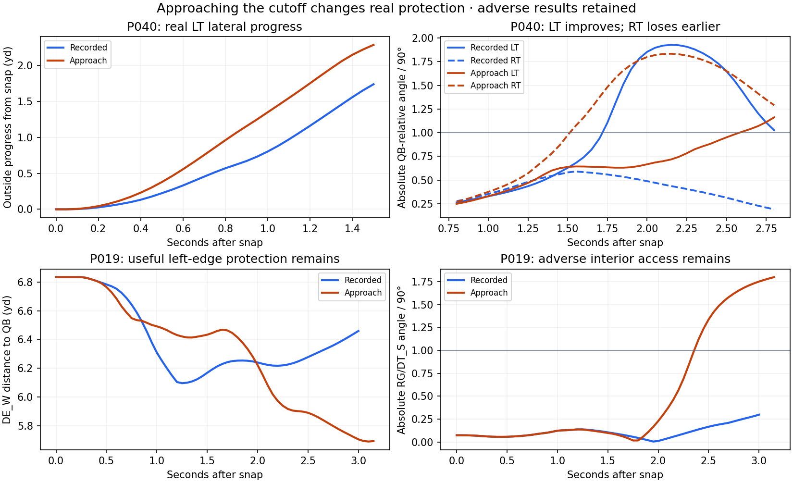

# Execute the edge cutoff as an approach

**Recommend reviewing this bounded PassProtector correction.** It fixes a
demonstrated forecast/action mismatch and improves actual opening position in
the primary, opposing and preselected transfer cases. Protection outcomes are
still sensitive to execution; the adverse RT/RG results remain part of the
handoff. This is not a new shared baseline or a general pass-protection rewrite.

Tested code: **`81b908586416070145b5b89ee9517380c4fe09fe`**, source
**`0eb4c7652f49c420c25535f4932bdc6abe24443ba05163f8ac2d999a7f6bee56`**.
The [runtime patch](../../../data/reviews/current/pass-cutoff-approach/pass-cutoff.patch)
changes only PassProtector's free edge-cutoff approach. `cutOffPoint` itself,
its return contract and its sole pass caller's assignments are otherwise
unchanged. Do-It-All! retains run blocking, carrier navigation and climb/traffic.

## Cause and correction

The existing cutoff predicts a place to intercept the rusher using a
`.75*vmax` kick-slide estimate. PassProtector then sends that future point to
`track`, a station-keeping controller with the rusher's **present** velocity.
For P040's first request, the result is only `(.152,2.783)`yd/s. The old held
request misses even the forecast's outer punching region. The previous review
already showed an ordinary stronger approach could enter it; correcting only
the predictor had lost useful protection in P019.

The candidate approaches **through the same selected point**, using ordinary
`goTo` and the **existing `.75*vmax` forecast speed**. P040's first request
becomes `(.318,5.818)`yd/s. The World's existing acceleration, facing, balance,
fatigue, contact and teammate spacing still determine execution. No velocity,
force, rating or position is awarded directly. The no-cutoff fallback and
beaten-rusher ride retain their existing commands. Loaded contact retains its
existing controller and all hand/arm/support budgets.

At1.00s P040 LT's actual outside progress from snap improves **.803→1.349yd**;
RT improves **.684→1.383yd**. LT first load arrives from a less exposed shoulder:
absolute QB-relative phi **.584→.436**. These position changes begin before the
first changed engagement draw. This is real free movement leading into useful
load, not just a larger requested velocity or a longer assigned engagement.

## Actual protection and adverse results

All cases keep22 players, native information initialization, normal QB reactions
and physical traffic. Pnnn means log.index+1, including kicks. These inputs come
from the saved experimental spread/air game, not an accepted-production audit.

| Saved case | Recorded controller | Candidate | Assessment |
| --- | --- | --- | --- |
| P040, Gun Spread Y-Cross / Wide9 nickel | LT load1.45, shed1.75; left pressure2.40; sack3.00 | LT load1.20, shed2.60; QB throws3.00; incomplete5.30, dead at5.35 | Meaningful left-edge protection through the throw window, with an adverse opposite-edge loss |
| P019, Gun Empty Y-Cross / Over nickel | Both edges remain loaded through3.00 throw; later receiver drop | LT load.45, RT.55; both remain useful through3.15 throw; catch4.50, live at6.00 censor | Opposing edge protection retained; interior DT_S wins at2.40 |
| Preselected P020, Gun Doubles Levels / Wide9 dime | LT load.95, RT1.15; no shed through2s | LT load.80, RT1.00; no shed through2s | Transfer to another alignment/personnel: both initial shoulders improve; later ending untested |

P020 was selected in the workboard from call/front metadata **before viewing
its candidate result**. Its initial loaded absolute phi improves LT
**.236→.148**, RT **.429→.328**. Teammate impacts through2s fall **6→3**,
406.17→136.12N·s. It remains a fixed-roster local transfer check, not a front or
talent panel.

P040's RT now sheds at **1.55s**, whereas the native RT remained loaded through
the original sack. At2.40 the left end is **6.249yd** from the QB versus2.481;
the right end is **3.155yd** away versus5.510. Both sides matter: improving LT
alone does not establish an intact pocket. The original sack becomes a normal
throw/incompletion with the candidate, but that ending is supporting context,
not the acceptance target.

P040 also gains a third C/LG impact through2s: **43.43→59.96N·s**. P019's
impact count through3s falls26→19 but total impulse rises **686.99→807.17N·s**.
Fewer contacts are not automatically safer or better blocking. The complete
contacts, forces, support states, commands and achieved movements are retained.



## Separate movement quality from execution randomness

Earlier engagements consume the shared native RNG at different times. The
adverse RT/RG results cannot be classified solely from their shed times.

One bounded diagnostic retains the original **initial-contact variates** for
P040 RT and P019 RG, without changing their new arrival positions. It reuses the
range uniform, three Gaussian variates and plan-choice uniform with current
weights; native calls are still consumed. It does not retain subsequent move
choices, all hand-fight drift or the rest of the play. This is a diagnostic
arm, never a production RNG change or a forced win.

- P040 RT's initial control changes .240→the original **.647752**, with rip
  preserved. Its early shed disappears through3.05. Thus its adverse result
  demonstrably depends on initial execution, not just a worse arrival: its
  arrival shoulder had actually improved .482→.348.
- In that same arm LT sheds at1.75 again. Nevertheless the left end is
  **3.900yd** from the QB at2.40 versus the old2.481, and the QB throws3.00.
  QB positions at2.40 differ by only about.06yd. The changed defender route
  buys time even without a longer LT engagement; this is not merely QB flight
  or a count of contact duration. It is not a full retained-randomness proof.
- P019 RG still loses at2.40 after its original initial swim is retained. Its
  initial positions and request at.75 are identical to the recorded case;
  its body remains within roughly.01yd through1.50. The first material later
  branch is DT_S's **bull** versus the recorded continuing **swim**. The existing
  power-rush controller takes the direct QB path; the other uses its corner
  path. Both moves fail their initial execution roll and receive the existing
  counterpunch, but their subsequent routes differ. No new RG cutoff command,
  altered strength or teammate collision causes that first branch.

The RG result is a material adverse coupled outcome with a plausible defensive
win under existing rules. This pass has not isolated every later draw or
certified its full contact realism. It does **not** demonstrate a new RG
controller error, and no center/guard fix is bundled in to erase it. The
native candidate and the inconclusive retained-initial-contact comparison
remain available for review.

## Loaded-foot lead: closed as a proposed repair

The [saved-state accounting](../../../data/reviews/current/pass-cutoff-approach/accounting.json)
independently reconstructs four P040 loaded requests with **zero residual**
against their final commands. At those ticks there is no net LT spacing
adjustment. The field-x give-ground term and contact-tangent mirror term point
in the **same** tangent direction; they do not cancel each other. The closing
normal separation dominates the worsening angle. A larger angle alone had
obscured that distinction.

One full-context diagnostic redirects the same retreat term along the current
QB/rusher axis, preserving its magnitude and all other intent fields before
ordinary spacing. It gives P040 only.05s more LT contact, with pressure2.40 and
sack3.00 unchanged. P019 retains its block but adds a teammate impact. **Park
that coordinate replacement.** No shared engagement/physics source is edited.
Missing intermediate hand-force samples are explicitly skipped in the offline
accounting; none is interpolated across contact.

## Exact evidence, verification and cost

- Parent `db77674b0e2493017d8778c5cdc5dd1420e68002`, prior evidence `eba1b61`;
  historical runtime source `1ee8610175f7f9e7ebafcbdddfe2c2aab2162e945a7668cbd54579e4d5fb6309`.
  The three new native baseline recordings reproduce original positions and
  events exactly. Two were needed for previously missing initial-punch RNG
  state; P020 is the declared fresh control. Old #64 evidence remains intact.
- Node22.23.3, all **44 flags** and World defaults are explicit in
  [the source/input manifest](../../../data/reviews/current/pass-cutoff-approach/source-manifest.json).
  Components1; active hands, hand fight, reach track, run read and experimental
  grip/turn-routing work remain absent/off. Center hands, centered integration,
  legacy support and per-solve work remain unchanged.
- Exact original game/rosters/calls/RNG/scouting/energy and normal observer
  initialization are preserved. The **9,671-byte**
  [portable input fixture](../../../test/fixtures/pass-cutoff-inputs.json.gz)
  reconstructs each snap through `PlaySim`, rather than hydrating JSON body or
  support state. The original roster/input manifest is linked in its header.
- Final source `81b9085` reproduces every prototype physical frame, event,
  contact initialization and full telemetry for all three cases;
  [exact parity checks](../../../data/reviews/current/pass-cutoff-approach/prototype-parity.json).
  No retained-initial-contact option runs in those native candidate replays.
- **17 focused checks and typecheck pass.** Four new checks cover native P040
  loaded shoulder acquisition, P019 edge protection through the actual throw,
  and ordinary finite, traction-bounded movement on both reflected local
  pictures. Existing assignment, pass installation and loaded-contact checks
  pass. Local reflections are qualified mechanical pictures, not claimed
  native mirrored football calls. No assertion prescribes positive yardage.
- **26.02s native collector commands**, including two harness failures;
  **4.45s** within successful native loops. There are15 completed short/repeated
  segments across **three** frozen inputs, not15 independent talent samples.
  Focused checks/typecheck bring measured command time to **40.75s**. The
  first failed capture compared undefined JSON keys literally; the second
  missed an import before simulation. Both receipts remain in the
  [cost record](../../../data/reviews/current/pass-cutoff-approach/cost.json).
- Zero full games, game-prefix replays, new rosters or broad screens. P040
  completes naturally; P019 is explicitly live at6.00; P020 ends at the2.00
  inspection censor. No ending is inferred for either live case. Integration
  owns the preserved full suite on the exact combined source.

The [compact summary](../../../data/reviews/current/pass-cutoff-approach/summary.json),
[opening request/execution timeline](../../../data/reviews/current/pass-cutoff-approach/opening-timeline.json),
all native/adverse/diagnostic traces and receipts are committed together.
Reuse them while their inputs/source/measurement contracts remain compatible.
To reproduce a named candidate question from the tested branch:

```sh
node scripts/baseline.mjs --candidate --receipt out/cutoff-controls.json -- node --import tsx scripts/diag/pass-set-opening.mjs out/cutoff-controls production 39,18 6
node scripts/baseline.mjs --candidate --receipt out/cutoff-transfer.json -- node --import tsx scripts/diag/pass-set-opening.mjs out/cutoff-transfer production 19 2
```

Historical diagnostic arms require the **unmodified historical source** with
the saved collector; they are not switches to run on the already-corrected
PassProtector. The original assumptions in the cutoff forecast remain rough;
this correction does not certify that each selected deadline is achievable.

## Integration recommendation and general principle

Review the minimal PassProtector patch at **81b9085**, with the native RT/RG
adverse traces attached. The supported improvement is useful opening space and
contact leverage; the three cases do not establish league-wide pressure rates
or eliminate existing contact-law limitations. Keep #57's cadence correction,
exact evidence and rejected QB chase separate. Keep4ded6b6 as the historical
comparison baseline; no merge, default or new baseline is designated here.

The transferable principle is **the interception forecast and the action used
to reach it must agree**. Acquiring useful position and mirroring a loaded
opponent are different phases. Do-It-All! can use that diagnostic question for
run approaches without copying this pass-only command into run blocking or
climb/traffic. The next decision is review/integration of this bounded patch,
with its adverse evidence, rather than another controller variant or automatic
game campaign.
