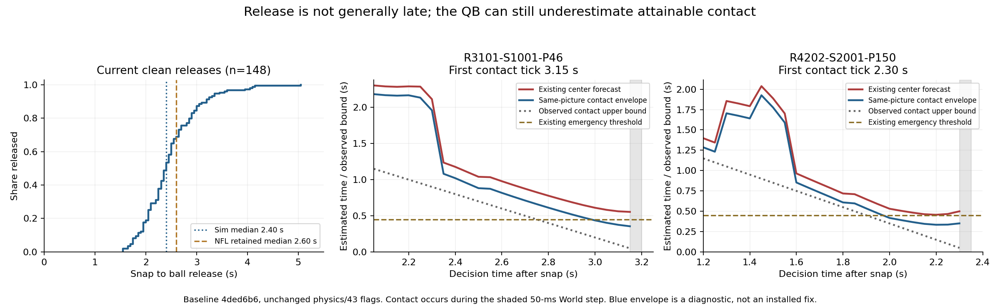

# Current pass rush, release timing and QB danger

**The quarterback is not generally getting excessive time.** On the unchanged
integration baseline, clean native releases have a **2.40-second median** and
**3.20-second p90**, against the retained NFL tracking reference's 2.60/3.90.
Pressure arrives around the ordinary NFL window, often earlier; successful
protection also earns occasional long pockets. The strongest new mechanism
question is the QB's estimate of attainable contact, followed by the shape of
free edge wins. A global rush-speed or grip-strength increase is not justified.

This is diagnosis, with **no engine change and no integration**. Coverage and
YAC candidates remain separate. [The receipt](../../data/reviews/current/pass-rush-timing.json)
pins sources, all 43 flags, inputs, operators, actual identities, adverse and
opposing controls, reproduction checks and cost.

## Current source and exposure

Baseline is `4ded6b600fd3785e65034aa5623d7a9f8f3c5db1`, remotely verified again
on October 14; runtime SHA-256
`8433e88d7deb31e5c1c031e2f0cb83d1cf0e805609820c0559f6b8f25747340c`.
Branch `codex/pass-rush-timing-audit` uses the existing baseline worktree.
Every runtime file, profile, capability and World setting remains unchanged.
Node 22.23.3, `run-game-2026-10-13`, no flag/API overrides, center hands,
legacy/mean support, bounded attachments and adaptive 12–16 substeps.

Reconstruct just the **same two native games**: generated roster seeds
3101/4202, strength .55, game seeds 1001/2001, ordinary adaptive calls,
audibles, scouting and fatigue. These are reused football contexts with new
timing measurements, not fresh independent league samples. All **181** saved
called-dropback population labels match exactly, as do the **32** saved full
result/body/intent/RNG/perception signatures. Observe only calls the controller
already makes; no extra observation, throw evaluation, random draw or physics
step is introduced. Four portable controls repeat observed/plain, with exact
full-state equality and exact restoration to their original native signature.

The primary clean cohort excludes **every foul**, including declined fouls,
and nullified plays: **165 dropbacks**. The separate common tracking cohort
excludes nullified plays and has **170**; both denominators remain visible.
The all-called cohort has 181. All measured dropbacks finish naturally; none
is counted as a completed outcome merely because recording stopped.

## Release and sack timing

| Clean native measure | Current unchanged baseline |
| --- | ---: |
| Dropbacks | 165 |
| Ordinary releases / throwaway decisions | 146 / 2 |
| Sacks / scrambles | 7 / 10 |
| Release median / p90 / maximum, all 148 releases | **2.40 / 3.20 / 5.05 s** |
| Quick-family release median, 32 releases | 1.95 s |
| Dropback-family release median, 98 releases | 2.45 s |
| Play-action release median, 18 releases | 2.40 s |
| Sack median, seven sacks | **3.25 s** |

Four actual QB medians range from **2.35 to 2.50**. Separately reuse all **288**
complete route-lab inputs at the same runtime: 268 releases, median **2.30**,
p90 **3.20**. Lab calls are deliberately selected concept/coverage cells, so
they corroborate ordinary timing rather than replace the native distribution.

The previously examined NFL 2022 weeks 1–9 tracking reference has release
median **2.60**, p90 **3.90**; its charted sack reference has **608** sacks,
median **4.25**. These are descriptive comparisons with different talent,
scheme and game contexts, not acceptance bands. The October 11 sim result
of 2.35 is historical and is not relabeled as this current measurement.

Only **five of 148** clean releases last at least 3.70 s. Two are throwaway
decisions; the other three complete for 33.84, 40.17 and 5.01 yards. One
throwaway is actually caught by a TE for −.27 yards, so retain both its decision
label and actual result rather than calling every throwaway incomplete.
At 3.0 s only **29/165** dropbacks remain in the pocket; at 3.5, **12**.
Late-pocket pictures are selected survivors, not a measure of every rush.

## Pressure: keep the definitions separate

| Operator | Current clean cohort | Retained NFL evidence |
| --- | ---: | ---: |
| Native sim `pressured` flag | 30/165, **18.2%** | No equivalent native flag |
| Exact 50-ms bodies, <=2 yd strictly before pocket exit | 41/165, **24.8%**, first median **2.45 s** | Not directly available |
| Existing shared 10-Hz tracking operator, release labels normalized | 60/165, **36.4%**, first median **2.40 s** | **30.5%**, first median **2.70 s** |
| Same shared operator, non-nullified cohort | 63/170, **37.1%** | Different foul exposure |

The retained charted NFL pressure reference separately reports **33.54%** and
median **2.50**. That label is not the two-yard geometry or the sim's native
flag. Do not combine those rates or claim that their central times identify
an isolated rushing-speed error.

The shared operator is the unchanged `commonPlay` adapter and
`metrics.pass_metrics`: .1-yard quantized post-World frames, resampled at
10 Hz, inclusive nearest release frame; nonthrows scan through min(end,4),
including QB movement after a scramble. Native decision-boundary analysis uses
unquantized 50-ms bodies and stops strictly before the first release, sack,
scramble or fumble. **Nineteen** additional clean shared-pressure cases are
retained: **13** first appear at/beyond the actual pocket endpoint; the other
six differ through frame timing/resampling/quantization. That explains the
apparent rate disagreement; it is not a numerical physics change.

The old shared adapter also omitted `throwaway` from `pass_forward`. Preserve
its exact legacy output (**59/165** pressure, 146 release times) beside an
explicit event-label normalization (**60/165**, 148). The normalization changes
measurement only, includes a throwaway later than the old four-second window,
and does not change a physical play or silently overwrite historical evidence.

All 41 strict first threats are actual installed rush/blitz defenders. **39**
are no longer actively engaged; of those, **38** have earlier block contact.
Only one has no earlier block contact. Weak edge DE_W supplies 29 first
threats; DE_S four, DT six and LB two. This warrants examining corner losses
and reacquisition, not concluding that free rushers were universally unassigned
or that every turn past a tackle is a defect. Active engagement also differs
from the NFL's labeled-blocker proximity proxy; no 39/41-to-PFF comparison is
made. The four-rusher clean group has all seven sacks; five/six-rusher calls
release earlier and may supply hot reads. That is calling/coverage exposure,
not proof that blitzing makes the rush worse.

## Repeated QB danger mismatch

`QBPass.pressure` estimates travel to **.8 yd from the QB's center**, plus
the existing held-block penalty. It uses an acquired rusher picture and the
general reach estimate, which charges for lateral redirection. Physical hand
contact can begin farther out while that rusher continues across the QB.
The estimate can become less urgent as actual contact approaches.

All **seven** clean sacks have no consumed pressure estimate below the
existing **.45-s** emergency threshold. That does not establish that panic
would save every sack, but it identifies a repeated mismatch worth testing.
Two independently generated QB/rusher encounters make it concrete:

| Encounter | Actual sequence | Existing consumed danger estimate |
| --- | --- | --- |
| R3101-S1001-P46 | COM-QB1; IRN-EDGE1/DE_S (12) turns corner at 2.30, first grasp tick **3.15**, sack 3.55 | Never below **.554 s**; .554 at grasp tick despite 1.85-yd before-step distance |
| R4202-S2001-P150 | IRN-QB1; COM-EDGE4/DE_W (11) turns corner at 1.55, first grasp tick **2.30**, sack 2.65 | Minimum **.457 s**; .499 at grasp tick despite 1.60-yd before-step distance |

Those distances are before World movement. Contact occurs during the next
50-ms World step, not exactly at the recorded event's decision tick. Both
retained pictures already extrapolate observed position; adding their full
`age` again would double-count delay. At first grasp the estimates' lateral
penalties alone are .288/.333 s. Later contact changes achieved velocity and
the delay-limited picture, so these are controller-estimate witnesses rather
than a claim that a free forecast models a loaded tackle.

An offline same-picture diagnostic keeps the **actual chosen pressure actor,
observation, profile and held penalty**. Replace only the .8 radius passed to
the pure estimate with QB radius + defender radius + defender reach. It exposes
an imminent-contact estimate in **five of seven** clean sacks, including P46
at 3.00 and P150 at 2.00. Two sacks remain unresolved. Thirteen total diagnostic
encounters include the five long-release controls and the windup control;
there are **zero** new simulations or observations in this decomposition.

This envelope is a diagnostic bound, **not an installed fix or a guaranteed
wrap**. It does not strengthen reach, modify a capability, remove held time,
reselect another pressure actor or simulate the QB's changed response.
A coherent danger forecast still needs movement/approach geometry and available
cues. Increasing a radius constant globally is not the proposed repair.



## Opposing football and information limits

**R3101-S1001-P39:** COM-QB1 has genuine sustained protection. At 3.0 all four
original rushers remain engaged, roughly 5.9–7.3 yd away. It ends in a 5.05-s
throwaway decision, with the actual TE catching for −.27. The same-picture
envelope never crosses the emergency threshold. Do not turn this protected
long pocket into a mandatory defensive win.

**R4202-S2001-P67:** COM-QB3 releases at 3.45 to actual COM-WR2; IRN-CB1 makes
the ordinary tackle, 14.88 total yards. The two-yard threat first occurs during windup;
the release already uses its pressure estimate for throw error. Earlier entry
into the panic branch is not automatically a better football decision, and a
reachable throw must survive a future candidate's controls.

Fifteen strict pressures begin during windup. The native logging guard is
skipped there, even though pressure is evaluated at release for accuracy.
This is partly a reporting gap, not evidence that the QB ignores all windup
pressure. Other unlogged two-yard threats remain, with radius/forecast and
native 2.5-yard guard differences preserved. No incompletion is causally
attributed to pressure from a flag alone.

Privileged information remains outside this diagnosis: protection uses live
rusher/QB positions, velocity and behavioral rush roles; QB pressure uses live
engagement/base and blind-side geometry alongside its delayed pictures. The
coverage candidate removes its private QB read, but these are separate
information contracts. Remove them with earned-observation/assignment controls
and owner coordination, not by silently claiming the whole pass game is clean.
Shared contact/angular/recovery work and roster corrections stay separate.

## Decision and reproducible handoff

**Next useful experiment: one QB contact-danger forecast** consistent with the
motion actually observed, attainable hand contact and current held protection.
Begin with P46/P150 against P39/P67, physics and execution fixed. Judge the
first available cue, forecast, achieved feet, throw opportunity, first load and
ending. Preserve sacks that are earned, protected long pockets and legitimate
pressure throws; transfer to fresh players/plays before promotion. Keep pass
protection's observation migration and any shed-law investigation separate.

No controller fix is proposed for integration by this audit. Coverage/YAC
candidates remain unmerged; the run-game lead retains combined-suite ownership.
The [subsequent primary research and same-picture motion check](qb-pressure-research.md)
supports that experiment, retains the successful pressure throw and separates
an interception-grid rounding artifact. It adds no changed football outcome.
No new full suite, build or code tests are justified by an observation-only
measurement task on unchanged runtime. Meaningful checks are the 181 labels,
32 full signatures and four observed/plain restoration pairs. The first
static common adapter failed because the required snap ball-y was absent;
that failure is retained. Supply only known snap y, keep x/z unknown and
rerun the adapter without repeating a simulation. The later static source-hash
guard initially sorted Python path components instead of the documented global
POSIX path strings. Its failure is retained; correcting that operator agrees
exactly with `sourceVersion()` at the same unchanged runtime.

Six recorded launcher commands total **45.75 s**, including the failed static
adapter. Native collectors take **19.50/20.30 s**, below their declared 60-s
budgets; eight standalone control plays take 1.81 s. Static report generation
takes about .8 s. Two reconstructed games contain 358 native log entries,
181 measured dropbacks; eight standalone replays and 288 reused lab inputs are
counted separately. No new random game context, reserved NFL data or censored
outcome experiment is added. These timings include tracing/gzip, not a speed
benchmark. Neither two rosters nor seven sacks establish league-wide accuracy.

Portable control reproduction requires only tracked inputs at this source:

```sh
npm run baseline:run -- --receipt out/pass-rush-review/replay-receipt.json -- node --import tsx scripts/diag/pass-rush-timing.mjs replay data/reviews/current/pass-rush-timing-inputs.json out/pass-rush-review/replay
```

To reconstruct the same two native games with the portable original population
and full-signature references (projection, not film), run:

```sh
npm run baseline:run -- --receipt out/pass-rush-review/native3101-receipt.json -- node --import tsx scripts/diag/pass-rush-timing.mjs native out/pass-rush-review/native3101 3101 1001 data/reviews/current/pass-rush-reference-cache
npm run baseline:run -- --receipt out/pass-rush-review/native4202-receipt.json -- node --import tsx scripts/diag/pass-rush-timing.mjs native out/pass-rush-review/native4202 4202 2001 data/reviews/current/pass-rush-reference-cache
```

Native measurements/controls were collected at `fe97018` / `1c01a03`;
the corrected static adapter is `bf7bee7`, forecast `9819fd1`. Full commits and
collector/input/analysis hashes are in the receipt. Later report/figure/reference
projections do not change runtime or already-collected evidence. The static
report explicitly reuses the compatible 288-play route cache, whose original
collector/provenance/hash are retained; those lab results are not new rush films.
