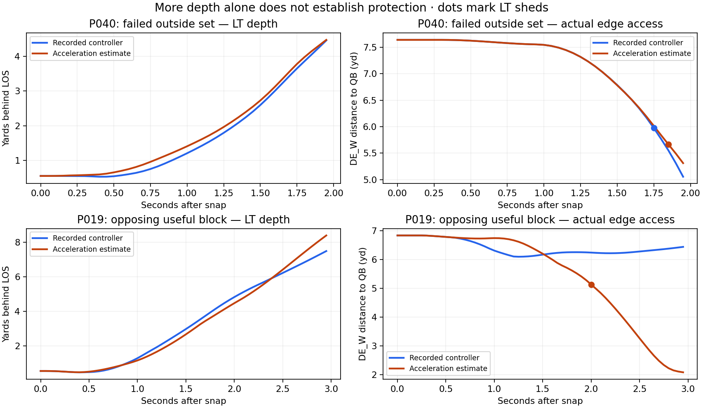

# P040/P019 pass-set forecast review

**Do not promote a pass-protection runtime change from this pass.** The cutoff
model makes an overconfident opening prediction, but correcting its timing or
speed input alone does not preserve P019's useful block. The saved alternatives
are rejected candidates, not improvements awaiting a larger screen.

This is a diagnostic branch off [PR #57](https://github.com/tannerthardy/football-simulation-/pull/57).
It changes no `src`, defaults, ratings, contact, awareness or spacing. #57's
[cadence evidence and rejected late-QB chase](../shotgun-exchange/README.md)
remain separate and byte-identical. Do-It-All! retains run blocking, lane/climb,
carrier navigation and traffic. `cutOffPoint` has **one caller, PassProtector**;
there are no run callers. No shared function contract was changed.

## What the first set establishes

Coordinates increase downfield in x; increasing y is LT's outside direction in
these two saved cases. Commands are yd/s. Entry velocity, requested velocity
and velocity after the step are different measurements.

| Native P040 time | Internal target / decision | Raw = final free request | Achieved result |
| --- | --- | --- | --- |
| .05 | Cutoff at absolute .45; target `(80.911,31.114)`, from LT `(80.850,30.001)` | `(+.152,+2.783)` | After this step `(+.007,+.120)`; no traffic adjustment |
| .35 | Updated cutoff, .35s ahead | `(+.116,+2.962)` | After step `(+.101,+.780)` |
| .50 | Cutoff now behind LT, .50s ahead | `(−2.186,+4.094)` | After step `(−.661,+1.039)` |
| 1.00 | No cutoff; beaten-rusher ride | `(−5.503,+5.176)` | After step `(−2.158,+1.683)` |
| 1.40 | Engagement technique owns movement; behavior returns stand | Final `(−5.427,+1.727)` | After step `(−3.558,+1.803)`; still up |
| 1.45 | First physical-load event, at end of preceding step | Existing loaded technique | Already on a losing shoulder; geometric phi about −.58 at this tick's entry |
| 1.75 | Geometric corner threshold crossed | Rep ends | Native shed; original pressure2.40 / sack3.00 are reused, not resimulated here |

The first forecast assigns the **stationary** end a minimum2yd/s and points
his low-speed heading toward the QB. It then bends that path. At .45 the real
end is **.987216yd** from the originally predicted rusher point. This is a
prediction assumption, not observed rusher motion or access to his future plan.

The blocker-side estimator claims **.364s** to the interior target, selecting a
.40s deadline. The existing acceleration-aware `timeToReach` estimate is
**.729s**. An unloaded production-World probe holding the actual request still
misses that target by **.9475yd** at .40s and remains **1.5780yd** from the
forecast rusher, outside the **1.4404yd** outer punching gate.

However, an ordinary stronger direct-through command ends **1.4209yd** from
that predicted rusher, just inside that gate, while still missing the shaded
interior target by .7776yd. **Do not label the entire interception impossible.**
The forecast, exact interior objective, punching range and delivered request
are not equivalent. Both probes hold one command in empty space; neither is
an optimal reachable set or a prediction of the live end, contact or later
controller resampling. The native source body and RNG are unchanged by them.

The first free request is not canceled by teammate spacing. Its modest achieved
movement follows the ordinary acceleration/facing law. P040 later does request
an urgent recovery; it is not simply forgetting to set or recover. There is no
evidence here for a capacity increase, stronger hands or a solver repair.

## Alternatives and opposing evidence

All22 players, current information initialization, ordinary runner/QB reactions,
contact and spacing remain active. Each intervention changes only the named
pass prediction/set mechanism, from the same native snap and RNG. No player is
parked and no recorded future path is prescribed.

| Diagnostic alternative | P040 LT load / shed | Other material evidence / decision |
| --- | --- | --- |
| Recorded controller | 1.45 / 1.75 | RT load1.25, no RT shed through2s |
| Acceleration-aware own reach time | 1.50 / 1.85 | New RT shed1.70; **P019 loses both edges**. Reject |
| Same reach change, LT only | 1.50 / 1.85 | RT retains native result; identifies the right-edge adverse effect as its own changed set. No established protection improvement |
| No low-speed forecast; existing nominal fit | 1.55 / 1.85 | Initial request goes inside; no useful rescue established |
| Existing unassigned coached set for low-speed edge | 1.45 / 1.80 | New RT shed1.65; reject |
| Acceleration estimate with contact-sized arrival region | 1.45 / 1.75 | New RT shed1.65; reject |
| Low-speed heading starts downfield instead of toward QB | 1.45 / 1.75 | Opening request gains depth, same early LT loss; no opposing expansion |
| Start forecast at measured speed, remove2yd/s floor | 1.40 / 1.70 | First forecast error improves to **.4145yd**, but **P019 loses useful LT block at2.60** and RG at2.10; reject |
| Remove floor only in existing low-motion branch | 1.40 / 1.70 | New P040 RT shed1.70; P019 LT shed2.55 and RG2.10. The low-motion distinction does not retain the control; reject |

These are opening comparisons, **censored at2.00s for P040 and3.00s for P019**.
No candidate sack time or ending is inferred. Some P040 variants increase
DE/QB separation at2s by a few tenths; that is not proof of useful protection
through the pass. Their control losses or unchanged early shedding are already
sufficient to reject promotion without buying full continuations.

P019 is Gun Empty Y-Cross, **index18**, not P018 Drive. Its native LT load
begins .60s and stays useful through the original3.00s throw; the later result
is a receiver drop. Under acceleration-aware reach, at **.35s** the forecast
finds no cutoff. It falls back to `(30.795,28.450)` and asks for
`(−3.885,−1.248)`, instead of native `(32.799,29.893)` /
`(+.201,+1.895)`. The physical recording first differs at .40. LT contact is
delayed to1.00, followed by LT shed2.00 and RT shed2.15. At3s DE_W/QB
separation falls **6.459→2.065yd**. This is a specific forecast/fallback
interaction, not evidence that P019's original block was a universal defect.

That adverse arm eliminates the native26 teammate impacts (686.99N·s), yet
protects worse. The measured-speed arm reduces them to18 (561.20N·s), but
also loses protection. Collision reduction, depth and better point prediction
are individually insufficient acceptance criteria. P040's two C/LG impacts
(43.43N·s total) remain across these arms; no new teammate impact explains its
LT loss. Downstream engagement timing and RNG draws can differ; this pass does
not assert that every later change is deterministic technique quality.



## Prediction, execution and defensive win

- **Demonstrated mismatch:** the old forecast's target/deadline is more
  optimistic than its actual held request, and its stationary-rusher seed
  predicts inward movement that has not occurred. Better prediction alone
  is not a demonstrated protection fix.
- **Execution:** free movement responds to the request with finite acceleration.
  A stronger ordinary request can reach the forecast's outer punching region;
  nothing here proves the movement law failed a feasible final command.
- **Defensive win:** P040 reaches loaded contact on a losing shoulder, then the
  end crosses the QB-relative corner threshold. The pass shed does not apply
  the run-only strike/velocity boost. This is a geometric rush win under the
  current engine, not proof of a missing assignment or automatically unlawful
  strength. Its full physical realism remains subject to the shared contact
  limitations. Do not restore the old ending as a target.

One independent **unresolved contract**, outside PassProtector, is retained in
the [loaded-foot witness](../../../data/reviews/current/pass-set-opening/loaded-foot-witness.json).
`stepPassRep` combines a contact-tangent mirror term with field-x give-ground:
`lat*vLat + (−kick,0)`. Thus the kick also contributes `kick*axis.y` to
contact-tangent motion. At P0401.40 the final request projects to about
**−5.394yd/s tangent**, versus the inferred mirror term **−2.913**; the
field-x contribution is **−2.481**. This algebra by itself does **not** establish
an incorrect controller: giving depth in field x may be intentional, and the
recorded final request includes technique plus spacing. There is no captured
intermediate technique-only request in this collector. Do not call this a
confirmed mirror-budget violation or fix it by silently rotating the kick.
The [existing loaded interval](../../../data/reviews/current/pass-set-opening/recorded-loaded-interval.json)
preserves force, support and move observations without another continuation.

**Next decision:** review that loaded foot-objective contract with its owner
before any engagement edit. If the objective is intentional, retain the lawful
loss and investigate a coherent pass-only forecast/fallback contract separately;
the rejected substitutions here are not a reason to broaden protection policy.
No new run-controller, QB chase, spacing, strength or solver change is proposed.

## Reproducible pins, information and cost

- Collection base: **`1f11e4546bc75ed6c5d139d3ac75fd09d214eb51`**; runtime
  **`1ee8610175f7f9e7ebafcbdddfe2c2aab2162e945a7668cbd54579e4d5fb6309`**.
  Diagnostics are on `codex/pass-set-opening-diagnosis`. All source changes
  from that base are zero; #57's cadence does not execute in these pass cases.
- Native recorded runtime: `f62511a513f2187884d74ae3b94435835e43309c`, source
  `dd173a3ef44f22b5ee74f3cc17ef15b2137203cea58dd2fa12fbaad12c4784ba`.
  Historical4ded6b6 and accepted developa1b16e6 are **not** relabeled as this
  experimental pass comparison. No new production baseline is designated.
- Exact inputs: [original manifest](../../../data/reviews/current/experimental-game-inputs.json),
  spread/air game702, roster seeds27101/27102, indices39/18. Pnnn includes kicks.
  Native game SHA256 `15e553e26449ff44806293f1611bffd3362cbf2e4dd80d3f1447f0264681057f`;
  manifest SHA256 `c1c7cef835d143da40c62e6572e6e1d024dff281058a98215ecb78c93e6b5870`.
- Node22.23.3, baseline launcher's **44 exact flags and World defaults** in
  every receipt. Components1; active hands / hand fight / reach track / run
  read0. Center hands, centered integration, legacy support, per-solve work.
- Initialization reconstructs normal `PlaySim` staging, exact roster/call/front,
  snap RNG, learned scouting from recorded preceding calls, shadow preferences,
  full-precision ballY from C's installed pass-set lane, and initial energy.
  It inverts deterministic staging fatigue (here zero extra iterations) rather
  than applying it twice. Awareness initializes normally from staged bodies;
  no invented observer memory or unrestricted future lookups. Recorded
  low-speed rusher plan is trace metadata only, never a candidate cue.
- Both **uninfluenced native** instrumented openings match every recorded
  film position and event exactly through their censor. This is stronger than
  a rounded-position start; P019's old recording does not provide full hidden
  body state, so film/event parity is not mislabeled full-state identity.
- The helper extracts/transpiles the actual PassProtector method and cutoff,
  wrapping steering to observe targets without extra controller/RNG calls.
  Per-arm receipts preserve method and cutoff hashes. Collection instrumentation
  evolved; the final portable scripts implement every published completed arm.
  The evidence is not a serialized restart: JSON turns the initial support
  timestamp `−Infinity` into null; the probe compares serialization and keeps
  the real native body intact.
- **13 completed2–3s openings**, plus one completed opening rejected by a
  serialization assertion, two tiny probe attempts, and early failed harness
  starts. **39.64s total measured launcher-command wall time** including
  failures; **3.21s** in the successful native loops. Zero games, prefix
  replays, fresh rosters, broad panels or full-suite runs. The withdrawn
  contact-frame command failed before its case ran; it is not evidence of a
  tested contact-controller candidate. All failures remain in
  [cost/attempt accounting](../../../data/reviews/current/pass-set-opening/cost.json).
- Compatible #57 focused32-check/typecheck evidence is reused for its unchanged
  runtime; it is **not** labeled new pass-candidate validation. Direct checks
  here are two native parity assertions, source/RNG-preserving movement probes,
  per-case time limits, script syntax and evidence hashes. Integration alone
  owns the preserved combined suite.

The [summary](../../../data/reviews/current/pass-set-opening/summary.json),
[16KB first-request witness](../../../data/reviews/current/pass-set-opening/first-request-witness.json),
full per-arm traces/receipts and chart are committed together. To reconstruct
only a case needed for a new decision, from this diagnostic branch and Node22:

```sh
node scripts/baseline.mjs --candidate --receipt out/pass-p040-repro.json -- node --import tsx scripts/diag/pass-set-opening.mjs out/pass-p040 baseline 39
node scripts/baseline.mjs --candidate --receipt out/pass-p019-repro.json -- node --import tsx scripts/diag/pass-set-opening.mjs out/pass-p019 baseline 18
node scripts/baseline.mjs --candidate --receipt out/pass-probe-repro.json -- node --import tsx scripts/diag/pass-cutoff-probe.mjs data/reviews/current/pass-set-opening/baseline/trace.json.gz out/pass-probe.json
```

Offline report regeneration runs zero simulations:

```sh
python scripts/diag/pass-set-report.py data/reviews/current/pass-set-opening
```

## Integration handoff

Retain **#57's reviewed cadence patch only** for its own adoption decision.
There is **no new pass runtime patch to cherry-pick** from this diagnostic
branch. Preserve P040's forecast witness, P019's useful block and all rejected
arms. Do not run another game campaign or merge these diagnostic substitutions
as production. The next bounded question is the loaded foot-objective contract
above; a later pass-only fix must retain P019 before transfer testing.

Do-It-All!'s separate B-gap correction is user-reported code `73b9441`, evidence
`badddf4`. Neither object is available here; no combined verification or import
is claimed. Its run-lane behavior is outside this work.
