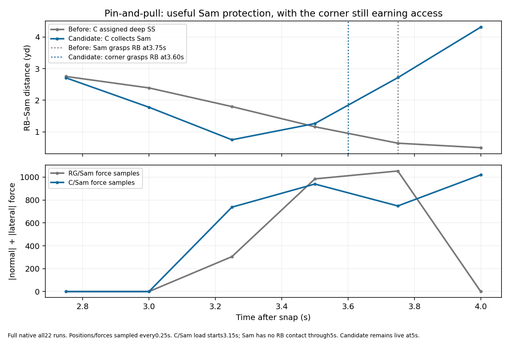

# Puller responsibilities, access and useful protection

**The useful gain is a real PinPull C/Sam block, plus a smaller cleared-kick correction that can be reviewed independently. The perimeter package and joint Counter count remain held.** Wrappers are still late, and several first-level blocks still lose. No gain, block or defensive failure is awarded.

Accepted reference: `0000e560e0dbe31905151465152d412ba838803d`, fetched queue `aa9ed35272cc334ce0a7c79eec709970e5c628fc`. Research host `4241945` explicitly extracts #140's acquired wrapper contract and held #99's perimeter installations/corner milestone; `525fba0` checkpoints the investigated count/pin/inside-fit changes. This is not current production and must not be merged wholesale. Historical `4ded6b6` remains a historical comparison, not the host. #140 stays frozen for its own review.

## What is demonstrated

**A puller must block the threat he can protect against, through the runner's arrival.** Assignment, loaded hands, closest distance and eventual gain are insufficient individually.

1. **Perimeter count:** PinPull's only puller was assigned the deep safety while Sam remained unassigned. Buck's first puller physically met Sam while trying to reach the safety, with its wrapper nominally owning Sam. The investigated ledger counts immediate free/corner jobs together from installed approach entries before using a spare first puller on deep support. It preserves CrackToss's useful Y/Sam responsibility when that is the better entry; another independent pin correction can change that installation.
2. **Inside support fit:** A personally acquired near backer inside the snap corner does not require crossing an irrelevant outside waypoint first. The candidate admits only the existing near-fit request after actual rear-wall clearance and an acquired body-clear corridor. All bodies, normal spacing, physical reach and natural reactions remain. Obstructed and deep-support opposing controls retain the route; no path is guaranteed.
3. **Pin surface:** In strong CrackToss the inside RG was being told to pin an outside tackle inward, while the TE outside that tackle climbed. Reusing the existing on/inside pin boundary gives Y that pin and moves the free guard to Sam. Y actually loads DT_S at 0.75s; the receiver reaches its original end strike at 1.25 rather than 1.70s because the TE no longer crosses its approach. The end can still win outside the receiver.
4. **Kick transition:** After clearing the wall and the flat step, a guard can fit an acquired upfield end rather than continue braking toward a fixed depth. A separate accepted-host extraction contains only that one runtime condition. [Exact source, evidence, costs and limitations](../cleared-kick/README.md).



## Native outcomes and costs that stay visible

| Saved case | Work/protection demonstrated | Adverse or unresolved evidence |
| --- | --- | --- |
| P01 PinPull strong Over | C/Sam load begins 3.15s. Sam's former 3.75s grasp disappears through the 5s prefix; RB passes the block. At 3.4s Sam is still close, then falls behind the runner. | Corner earns contact at 3.60s; candidate remains live at 5s, so no terminal gain claim. New LG/H and later Y/H traffic; free-climber protection is not preserved automatically. |
| P02 PinPull Under, short-kick control | First guard retains its near-level job; load advances 1.75→1.65s. | RT/C traffic appears in the changed native continuation. No collision bypass or assertion of an unconditionally better ending. |
| C01 CrackToss strong Over | Correctly sided Y/DT_S pin, earlier receiver/end contact. | Former DT_S runner contact is replaced by end access at 2.55s; WR still loses. Clearer first-level assignments do not certify a clean toss. |
| C02 CrackToss weak | Original near backer work and early end win remain; exact recorded result is 0.11yd. | RT/C and later runner/receiver or runner/puller impacts remain. |
| B01 Buck strong Over | Immediate first-puller/Sam job is coherent; no new teammate impact in the near-fit arm. | First puller never develops useful Sam hands before DE_S reaches RB at 2.55s. Earlier end access than the original 4.00s safety contact is a material adverse result. |
| B02 Buck weak | Outside H pins DE_W; LT pins the inside tackle instead of trying the pin from inside the end. | DE_W beats H and reaches RB at 2.30 rather than 3.05s. Earlier exit tweaks do not explain or repair this first-level failure. |
| B03 Buck strong Under, declared before outcome | First guard delivers real Sam kick work at 1.65s, no teammate impacts. | Mike reaches RB at 2.90s before the wrapper collects; changed ending 4.00 vs 7.67yd is retained. |
| C03 CrackToss strong Under, declared before outcome | Named receiver/Sam crack and TE/end responsibilities remain. | Same −1.16yd native ending and end access at 2.65s; the current TE pin does not hold. |

New fronts were chosen before results, with the same frozen roster, seed, direction and formations. Strong/weak cases are different placements, not exact geometric mirrors. Mirrored information/obstruction/technique contracts are separate focused checks. End wins remain **plausible defensive counters under the current engine**, not certified NFL realism; no new force-law defect was demonstrated.

## Why the broader count is held

The joint Counter ledger gives an immediate wrapper/free climber a job before a conditional double-team climb. K01 gains real H/Will and helper/Sam work. However the exact accepted-host strong control changes the RG helper's request/release at 0.90s, delays the end strike to 3.40s and creates LG/RB impact at 3.10s. The first recorded RNG difference is also in the 0.90s interval; subsequent endings include changed geometry and execution draws. We did not declare preserving old gain necessary, but the new traffic is not a demonstrated improvement. The ledger is withdrawn from the production extraction; code/tests at `05da690` and research `525fba0` preserve it.

The accepted-host **kick-only** candidate is `0e52b95`, source `5734bb3f2f8d702e1e8a93ff0d1f1c19eca1cdba3a2406e72de7ae9c5197ccee`. It preserves the strong control's first CB contact, removes K01's prior RT/RG impacts, and retains late K02 RT/RG traffic as an explicit cost. No #140/perimeter dependency is imported.

## Rejected approaches

- Reactive short escape arcs repeatedly reverse the wrapper's request before his body executes the prior turn. Closest distance or favorable gain did not yield useful Mike protection. No such route code remains in the candidate.
- Two continuous full-context K02 routes from 2.20s—inside turn-up and outside clearance—also failed useful Mike protection. Inside caused RB traffic; outside arrived late. They demonstrate rejected alternatives, **not proof that every route is impossible**. Everyone, including RB, reacted normally; no recorded future path was frozen.
- Open-pull-step diagnostic `PULL_STEP=1` and lead/force forecast-only trials did not demonstrate sufficient protection transfer. The flag stays off and the forecast extensions are out.
- Removing the prototype force-as-kick RB adapter left Buck/PinPull unchanged alone. It changed CrackToss requests without rescuing it, and the combined arm lost ground. That adapter change is parked and `assign.ts` restored. Boundary was posted to [Do-It-All](https://github.com/tannerthardy/football-simulation-/pull/137#issuecomment-6243088346); no carrier/navigation/shared movement code changed.
- A proposed crack through-speed trial was **not run**: existing requests already carried positive motion; spacing near the TE explains material trimming. The pin correction clears that approach sooner. There is no demonstrated reason here to add strike speed or strength.

## Defensive flow and the next football question

Sam and Mike are reacting to acquired pulling/runner cues through the unchanged run-fit controllers. The tapes preserve their consumed pictures, full movement requests, achieved movement and real contact. No new defensive leak, artificial hesitation or capability deficit is established. Improving the first puller can expose a second fitter; that is expected football interaction, not permission to slow the defense.

The recurring remaining collection problem is **time and access from the developing first-level surface**, not simply an omitted block command. In Buck Under, the wrapper's deep opening/long outer track does not deliver Mike protection before arrival. In the K02 release state, two later routes also failed. Next implementation work must establish an earlier attainable entry or a defensible responsibility change from acquired information; it should not add another exit arc, release timer, grip bonus or automatic RB delay. First-level TE/WR losses and post-arrival retained-block traffic remain distinct owner questions.

## Evidence, exact reproduction and cost

[Arm/source/input/flag index](../../../data/reviews/current/puller-coordination/index.json), [compact line/puller timelines and all adverse outcomes](../../../data/reviews/current/puller-coordination/summary.json.gz), [original validation receipts](../../../data/reviews/current/puller-coordination/receipts/), [source patches](../../../data/reviews/current/puller-coordination/sources/index.json), [input revisions](../../../data/reviews/current/puller-coordination/inputs/). Each saved row includes its selected-input hash, requested/final/achieved states, load samples, positive teammate impulses, all runner contacts and explicit censoring. Raw original tapes remain locally under `out/puller-coordination`; hashes in the index identify them. The portable patches plus frozen inputs regenerate the native runs; do not restore observer history from a body snapshot alone.

Apply a selected zero-context source patch to the pinned `bdb1216` research host with `git apply --unidiff-zero`; a comment-only patch means that base source is unchanged. Adapter arms also require the separately parked adapter patch. Exact flags come from that arm's receipt—especially the isolated `PULL_STEP=1` trial. Default mode executes zero snaps:

```sh
node scripts/diag/puller-access.mjs
node scripts/baseline.mjs --candidate --receipt out/puller-check.json -- node --import tsx scripts/diag/puller-access.mjs run out/puller-check P01 5
python scripts/diag/puller-coordination-report.py --stream-hash
```

Node 22.23.3 throughout. The launcher clears ambient experiments and records all accepted flags and World defaults. No shared law/capacity/roster-generation change. Full22 normal initialization, legitimate observer memory, ordinary RNG and natural runner reactions. Diagnostic command overrides are labeled and cannot be promoted as a selection policy.

Final research runtime source `6e1954bf218f484683b7cc225a32b0bfff4efa62d4db59bc8afdc4584d2e89f1` matches both final receipts: **59 focused research contracts and typecheck pass**, including reflected true obstruction, private-state invariance through the real force hook, valid pin accounting, and retained true kick/deep-support controls. Final production extraction has its own **34 tests/typecheck**; Integration owns one final combined full suite. Research native collectors: **66 continuations, 35.136s**. Separate accepted-host extraction: **10 new continuations, 5.320s**, plus **2 cached baselines reused**. Total new native collector time **40.456s**, zero games. These are successive small mechanism tests on the frozen set, not a roster census. Launcher/validation overhead and failed checks are recorded separately in receipts. Research final focused wall time 1.824s and typecheck 9.731s. The initial two failed new tests lacked snap route memory; actual-hook initialization corrected the fixture without changing a production hook or old outcome requirement.

**Recommendation:** review the cleared-kick condition independently. Keep the perimeter package and joint count out of production promotion. PinPull's demonstrated near-support block and CrackToss's valid pin surfaces are useful mechanisms to carry forward, with the retained first-level and traffic failures as opposing evidence. The next bounded blocker is an attainable earlier second-puller entry, plus lifecycle-owner review of the late K02 RT/RG witness.
