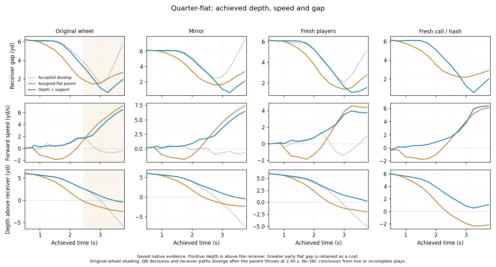

# Quarter-flat depth, coverage and installed run support

2026-10-17 UTC. **Historical research checkpoint**, originally dependent on
[#124](https://github.com/tannerthardy/football-simulation-/pull/124).
Code freeze `0a566d21578df1e50ad98b2dba9ec6ea67fb8d6b`. Accepted develop remains
`d682b1f474cb6ba260a7b8b1119a62919c5a2159` (published queue `bf493d8`).
At collection, parent #124 was `9f2206a3fd22aab83b19a0431346c7569ed19f7b`,
not accepted development. It supplied the flat relationship being refined.
**Later #125 accepted that duty at `70b4db6a3ef53acc1a0e90cd055f1087205daa30`
alongside run/accounting changes.** This report preserves its actual earlier
runtime; it is not current-develop verification or integration readiness.

The repeated football problem is spending depth to close a low flat before
the throw, then chasing its wheel from behind. Merely retaining the receiver
does not fix that approach. The correction keeps the quarter-flat defender's
earned entry depth while widening, and keeps his installed force duty available
when he acquires run evidence. The body still has to turn, accelerate and tackle.

## What changed and why

The [source teaching audit](https://github.com/tannerthardy/football-simulation-/blob/9f2206a3fd22aab83b19a0431346c7569ed19f7b/docs/reviews/honest-nfl-coverage-teaching.md) inspected original
HNFL-078/196/312 at reference pin `5cade6a5e05bc6ff4232623b22be565ec462c15c`.
They explicitly teach matching the flat from above, alerting the wheel and
avoiding an early race downhill. These are particular Quarters installations;
Palms' corner-trap / safety-replacement / apex-curl exchange remains distinct.

The parent matches the right receiver with ordinary over-top man movement.
That technique targets acquired receiver x plus `0.8 + 0.15 * positive vx`.
While the receiver runs low and laterally, it compresses five-plus yards of
depth toward roughly one yard. Native original, mirror and fresh-player
witnesses repeatedly acquire negative defender x velocity, then enter the
wheel behind. This is a movement objective error, not proof that braking,
player balance or grip strength is inadequate.

The new `topDownFlat` option is installed **only** by the non-Palms `q_apex`
flat branch. It stores the defender's **own current x at technique entry**.
Ordinary observed man tracking supplies width and feed-forward motion; its x
target stays at least that entry plane. A newly acquired climbing route can
consume and exceed it. Recognized flight and ordinary live pursuit retain
their existing priority. There is no new timer, future-wheel flag, speed,
braking or cut-skill change. Normal man, safety over-top and trail techniques
have no new floor. `recordedMan.flatDepth` exposes the own depth without sensing.

The second boundary matters for run defense. #124's new man match can erase
the force player's action while his `RunFitJob` still says force. Existing
wrapper continuity only covers insert/alley. The new condition adds **only
`q_apex` + `topDownFlat` + installed force** to that existing keyed-fit path.
It still requires current run belief and a personally acquired backfield
RB/FB carrying picture on each decision. The existing fit decides whether its
inside option or outside force is appropriate; allocation, side, gap, partner,
alley, insertion and execution algorithms remain unchanged. Other man/force
and cutback contracts remain outside this correction.

| Available information / installed duty | Action |
| --- | --- |
| Acquired flat, no acquired carrying-run evidence | Widen with the flat while retaining entry depth; a wheel must be observed. |
| Current run belief + positive acquired backfield carrying + eligible installed support | Use the existing keyed fit, retaining the same force/inside contract. |
| Negative/unknown carrying or changed run belief | This support override expires; continue the legitimate coverage action. |
| Unrecognized flight with surviving acquired run evidence | Preserve the same keyed support; hidden flight does not transfer ownership. |
| Recognized reachable flight | Existing ball contest takes priority, including receiver windows. |
| Acquired live runner after the catch | Existing pursuit/contact logic; this patch does not prescribe a finish. |

This small separation is the useful architecture: a player has concurrent
**installed coverage and run-support duties**. Changing his movement technique
must not silently erase either duty. Acquired evidence chooses the current
action. A role remains on the same body; this does not add a second fitter.
The bounded carrying rule does not certify all pre-mesh triggers or concealment.

## Native approach: position, velocity and leverage together

The unchanged operator and frozen seven #124 inputs are reused. Six additional
reference inputs address run/PA, early-flat concession, later out entry and a
fresh route combination/hash. Thirteen exact matched cases; no imposed throws,
paths, catches, contacts or outcomes. Inputs include actual generated players.
The [machine review](../../data/reviews/current/quarter-flat-depth-support/review.json)
retains IDs, first changed requests, achieved movement and acquisitions.

At 2.95 controller time (bodies achieved at 3.00s):

| Wheel witness | Depth above receiver, #124 → candidate (yd) | Gap (yd) | Forward velocity (yd/s) | Comparison limit |
| --- | ---: | ---: | ---: | --- |
| Original | −1.54 → +0.96 | 1.57 → 1.05 | 4.42 → 3.53 | Parent throws at2.45; receiver paths later differ. |
| Mirror | −1.61 → +0.96 | 1.63 → 1.05 | 4.50 → 3.54 | Receiver body exactly identical at this time. |
| Fresh players/seed | −1.26 → +1.45 | 1.40 → 1.63 | 3.90 → 3.53 | Identical receiver; **gap worsens .24yd** while leverage improves. |
| Fresh call, players and other hash | −1.97 → +0.85 | 2.17 → 1.24 | 4.03 → 3.82 | Identical receiver; native QB throw is later, at3.05. |

Against **literal accepted develop**, using its already recorded identical
inputs, original/mirror/fresh also improve joint approach at that time. The
original improves gap **1.50→1.05yd**, forward velocity **−0.45→+3.53yd/s** and
depth **−0.04→+0.96yd**, with an identical receiver body. The mirrored case
improves **2.60→1.05yd**, **−0.69→+3.54yd/s**, **−1.58→+0.96yd**. This keeps
the useful relationship from #124 while correcting its downhill cost; a higher
single speed measurement is not the objective.



**Preserve the costs.** Early flat gaps are larger: original at1.95 is
3.31→4.94yd, fresh 3.79→5.27yd. At3.70 the original and mirrored markers can
still trail the receiver. Ordinary QF changes from a PBU/incompletion to an
interception, with the return tackled; that is not a new offensive YAC sample.
First-entry body/read equality is saved where available. Later receiver,
target and execution changes are not represented as isolated geometry effects.

| Control / transfer | Native result |
| --- | --- |
| Palms wheel | Entire six-second physical signature identical; interception return still live. |
| Original seam | Entire signature identical; completion still live at cutoff. Actual catcher HFO-WR6 differs from keyed HFO-WR3. |
| Ordinary shallow tackle | Entire signature identical, completed tackle and12.9224 YAC. |
| Play action | Entire six-second signature identical, still live. No perfect hidden-call recognition was added. |
| Inside and outside zone | Entire signatures identical, native tackles at3.40/3.85s. Also identical to the completed literal-accepted pilot runs. |
| Early flat, first-read quick game | Same receiver,1.55s throw/2.45s catch, **5.3068 YAC and out of bounds** in both. Full off-ball signatures differ. |
| Later-breaking quick out | Both incomplete, same2.55s throw; full signatures differ. Not certified as a perfect late-out technique. |
| Fresh route combination / other hash | Both incomplete with same3.05s throw. Improved wheel approach, no claimed YAC endpoint benefit. |

Six controls are exactly identical. Reference and candidate each have nine
completed plays and four live prefixes; unfinished catches/returns carry null
terminal gain/YAC. A first physical contact, loaded grasp and a completed
tackle remain different events. This correction does not establish a grip
repair or population-wide YAC reduction. Native run controls preserve finishes;
the new force boundary itself is proved by direct controller/World controls,
not by claiming a newly won native force tackle.

## Why no blanket shallow-handoff change

The initial **eleven-prefix** probe used accepted develop before implementation,
with its own frozen back-side/route variants, mirror, fresh players and run/PA
controls. At1.95, the installed midpoint is **LB_W running `mike_3`**, while
LB_M is a force/apex player walling Y. In several Drive witnesses the midpoint
already matches H; in Mesh it matches Y. A jersey label or missing direct
apex edge cannot establish an unowned receiver or unusable zone influence.
The probe did not establish a useful blanket retention correction. No such
policy, final-numbering rewrite or teammate acknowledgment was added.

Its source/operator is preserved at research pin `7efa6a1` on
`codex/quarters-underneath-support`; the [raw probe](../../data/reviews/current/quarter-flat-depth-support/handoff-probe.json.gz)
and receipt retain the exact accepted runtime, inputs and actual role inventory.
It remains evidence against the shortcut, not proof that all exchanges work.

The next handoff investigation should select an acquired shallow that actually
exits useful apex influence while the **actual installed midpoint** has an
established competing threat. Trace both requests and achieved access, rather
than assuming #3 always makes help unavailable. Current teammate `see()` still
returns a global .05s snapshot; new helper-availability rules must not extend
that information shortcut. An observer-owned acquired/memory/expectation API
is the proper foundation. This candidate uses no new peer positions, jobs or
engagement states. Opponent observation remains the engine's inherited delayed
picture model, without a complete gaze/occlusion simulation.

## Checks, isolated mechanisms and reproducibility

**76 unique focused checks pass**, covering ten new contracts, thirteen parent
flat/wheel controls, fifteen support controls and38 back-man controls. Typecheck
passes. The initial five expected red failures on #124 and the first typecheck
failure are retained. The latter was the test's optional numbered-slot type;
it was fixed before native collection. A control time was aligned and only that
test file rerun; a later test-title correction changes no assertions or behavior.

Two bounded local ablations then isolate the mechanisms: depth-only passes
four existing selected checks (six not run); support-only passes six (four not
run). These are the same ten checks, not additional unique coverage. Their
exact source patches/receipts are included. The combined source is restored
byte-for-byte; no native ablation campaign or physics/capability change.

This turn executes **30 new native plays**: eleven diagnostic prefixes, six
new reference cases and thirteen candidate cases; seven compatible reference
plays are reused. Native compute is **9.103s**. Recorded commands including
failed checks, repeated corrected checks, typechecks, plans and ablations are
listed with their summed cost in the manifest. Zero games/full-suite campaigns.
Five standard physical accounting checks and finite bodies hold on all collected
ticks. The native operator is unchanged from #124's published observer-neutrality
proof; that earlier proof remains qualified by its actual source. Opening cue
retention is capped at512 (pilot4096); saturated logs are flagged in the review,
and no claim of complete late-query retention is made.

Exact runtime SHA256:

- Accepted: `bed3c36cf08407762fed67abdf0a1651fe6ed7fc8c09b43ab3d9b33f1dfd4616`.
- Unchanged #124 reference: `0b3a96351ee6789baaea9bb0fbb989c0b8d86f449f4a931b3b02d7e121cbcb3a`.
- Candidate: `26d8882d6b2912fde83cd86a632bf57dbaa7639ae0633bb96995b567afbdd177`.

Node22.23.3, linux/x64, unchanged44 profile values, components1, CF_FLOW unset;
same dependency lock/operator bytes and exact per-case input hashes. Temporary
reference/ablation source substitutions were guarded and restored; their actual
source hashes remain in the receipts. Simulation receipts identify uncommitted
edits on the recorded checkout; the code freeze contains those same runtime bytes.

[Portable five-file delta after #124](../../data/reviews/current/quarter-flat-depth-support/after-124.patch),
[eight-file composition on accepted develop](../../data/reviews/current/quarter-flat-depth-support/combined.patch),
[checksums](../../data/reviews/current/quarter-flat-depth-support/SHA256.json).
Use only the reviewed code/contracts for promotion; diagnostic ancestry and the
reference import are not required. Integration owns independent-review intake
and any exact combined verification. Neither this report nor the passing local
checks grants merge authority or declares every coverage/run-fit interaction
finished.

Replay only to answer a named unresolved question, with a fresh output path:

```sh
node scripts/baseline.mjs --candidate --receipt out/quarter-depth/replay.json -- \
  node --import tsx scripts/diag/honest-quarter-flat.ts run \
  data/reviews/current/quarter-flat-depth-support/inputs.json.gz \
  out/quarter-depth/replay.json.gz "named unresolved question"
```

`transfer-inputs.json.gz` supplies the three later adverse/transfer inputs.
Both manifests freeze actual players and calls. Six seconds per case/five wall
seconds between ticks; completed and live outcomes are separate. Publication
alone does not call for another native batch or a full suite.
