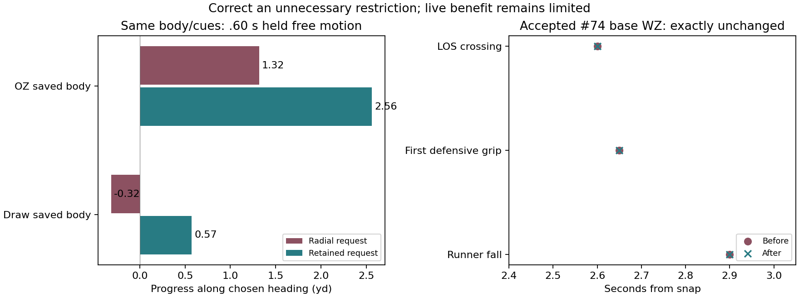

# Retain achievable runner motion before radial spacing cuts

**Recommendation: adopt this narrow movement-request correction for Integration
review. Broad jam reduction/live-run benefit is still unproved.** The repeated
fixable mechanism in this small saved set is unnecessary radial braking before
contact. It does not demonstrate a need for another gap chooser, jumping or
smaller collision bodies.

Candidate **`2e1dfa343a77f142b02a3a23fa49a88c0b40ef13`** includes accepted
#74 merge **`8ca8deebe4afa91c3021bdd119bed8976cf00e47`**. Runtime SHA256
**`5dfb0d73d0d5d12a471af45b9aac61112a24983e31a553e11b997d488682d493`**.
Relative to that accepted base, only `spacing.ts` and its existing `PlaySim`
call change in production. The exact [runtime patch](runtime.patch) is portable.
All ancestry is accepted development plus this investigation; no old zone/Duo,
entry-admission, #69 collection or experimental physics is imported. #74's
accepted opponent-risk correction and #72's PassProtector remain intact.

## Saved review and first demonstrated causes

Reused PR57 witness evidence at
`e8a76a7f7cdc19dece85288f93a8d1e1273be0db`: four previously selected first-45
plays, P015 Draw, P019 OZ, P032 Pistol WZ and P045 Gun Trey WZ weak. Five exact
local states, initial calls/players/physical bodies/RNG and consumed delayed
`see` cues are preserved in `test/fixtures/rb-local-traffic.json.gz`.
This is a bounded mechanism sample, not a league-frequency estimate.

| Saved encounter | First useful distinction / cause |
| --- | --- |
| P015 Draw,2.60s | Radial spacing restricts the requested straight ray although the physically achieved curve clears the acquired QB picture. Its restricted request moves backward and forecasts an overlap; retain the existing forward request. |
| P019 OZ,2.05s | Same mismatch around LT. Original achieved clearance+.639yd. This saved-body defect does not reproduce in the current native reenactment, which is already unimpeded and remains exact. |
| P032 WZ,1.70s | Genuine congestion: original achieved path overlaps RG by.198yd; the ordinary half-speed gather clears by.493yd. Preserve that useful yield. A15-degree probe leaves only.032yd forecast clearance; no steering change is shipped. |
| P032 WZ,2.70s | Original and all tested small full-speed bends still intersect the acquired RT picture. Preserve gathering; this is not proof that every imaginable maneuver is impossible. |
| P045 historical long ending | RB is still in `mesh`, not `carrier`. Local carrier avoidance cannot complete an exchange. Accepted-base reenactment already hands off at1.05s and remains unchanged through3s. Do not treat the old mesh ending as a current navigation failure. |

Unnecessary requests occur before collision resolution and improve using the
same available evidence and existing movement. Missing perception is therefore
not required to explain these instances. Loaded recovery, occupied openings and
an uncompleted mesh are separate causes. No supported stepping/jumping action
or body-shape change is demonstrated necessary by this set. Existing own-contact,
load and shoulder-technique exclusions remain; this is not a post-bump recovery
or comprehensive collision-law repair.

## Small correction and information contract

Radial headway uses intended relative velocity. The existing turning gather
previews the *already restricted* request and never asks whether the original
carrier request was physically suitable in the first place.

Only for a possessing carrier during an installed run, after a radial cut,
preview the original football request using the existing12x50ms free World law.
Keep it if samples stay upright and its achieved swept path clears all acquired
teammates at the existing physical touch distance. Otherwise keep the old
spacing/gather decision. Each physical tick reassesses; this chooses no new
gap, installs no route commitment and demands no guarantee through the play.
The existing2yd/s turning cutoff, .60s horizon, posture/facing/skill, physics,
capacities and collision geometry are unchanged.

`SpacingContext.runCarrierPictures` holds the existing `sim.see` snapshots
**before** legacy `calledMotion()` substitution. The same existing queries fill
this per-call map; there is no additional perception query/sensing pass, retained
memory or live-body fallback. Identity keys reveal no peer state. Missing any
snapshot disables only this override rather than making that peer stationary
or absent. A successful acquired-motion check is not then replaced with the
legacy called-track gather. Only own possession, installed run and own contact
state select the scope; no peer's private engagement/job is consumed here.

These are the accepted base's delayed `Perceived` values. **Do not populate this
map with an expired Awareness zero-velocity sentinel.** That future consumer
would need to preserve unknown motion and withhold unsupported entries. No
Awareness schema/policy/TTL or transport package is promoted. Existing legacy
spacing outside this override remains outside the information correction.

Existing workboard assigns carrier/spacing navigation to Do-It-All. Boundary
notices precede edits: #65 comments6202226861/6202437073, #69 comment6202285219,
#36 comment6202489872. Shared movement/World APIs, PassProtector and collection
are untouched. Integration owns exact combined verification and adoption.

## Before/after evidence

Same-state ordinary free movement over.60s, held requests, identical saved body
and acquired cues; these numbers are not reacting-play yardage:

| Saved body / chosen direction | Radial request progress | Original request retained |
| --- | ---: | ---: |
| Draw2.60 |−.318yd |+.573yd |
| OZ2.05 |1.317yd |2.564yd |

Both improved paths stay up; original acquired-picture clearance+.143/.639yd.
The real opposing control uses two upright, nonoverlapping OL bodies whose
opening is narrower than the runner. It retains ordinary yielding, takes less
actual impulse than charging and does not pass through the wall. A brush is
permitted. A separate real grazing-contact control stays upright and gains
ground with contact enabled. Zero teammate contact is not an objective.

**Current accepted #74-base reacting pairs:** all22 players react after snap;
saved post-constructor physical bodies/RNG are restored once at snap, with
current constructor recognition/scouting equal in both arms. No future command
or mid-play frame is injected. These are saved-input reenactments, not exact
original game replays. Stop at3.5s/whistle, Gun Trey3s.

| Play | Current before → after | Decision |
| --- | --- | --- |
| Draw | First change2.55s, RB only, same physical fork. Spacing slowdown.35→.30s. DE_W grips2.60, fall2.80, tackle3.20 both. | Unnecessary diversion removed; defense still wins. No run-success improvement demonstrated. |
| OZ | All frames/requests/reports exact through3.50; LOS2.50 both. | Clear-route opposing control preserved. |
| Pistol WZ | All frames exact through3.35 whistle; LOS2.60, first grip2.65, fall2.90, tackle3.30 both. | Useful existing navigation/defensive win preserved; no WZ benefit claimed. |
| Gun Trey WZ weak | All frames exact through3.00; handoff1.05, LOS2.80 both. | No mesh improvement attributed to this patch. |

No new RB/teammate impacts; **all four actual blocking-load histories/integrals
are unchanged**. Draw's ending shifts about.02yd back/.06yd across and its
terminal speed1.174→1.043yd/s; tackle timing is unchanged. This is a retained
minor ending difference, not an established rushing gain. A nominal engagement
label alone was not used as evidence of preserved useful blocking.

**Historical result retained:** on the preceding #72 base, WZ LOS and its later
fall both advanced by one tick. LB_S contact3.10→3.05 explained the earlier
fall; positive normal blocking impulse4670.07→4630.49kg·yd/s. These are not
current candidate effects: accepted #74 changes the gap-risk decision and WZ
is now exact between arms. [The complete historical report/tapes](https://github.com/tannerthardy/football-simulation-/blob/70759178181accb97f96f5b057b2214b843b470a/docs/reviews/rb-local-traffic/README.md)
and [historical adverse attribution](pr72-adverse.json) remain fetchable. No
compensating timing, strength or margin tuning followed that result.

## Verification, cost and next decision

Exact freeze2e1dfa3: **29 focused checks and typecheck pass** (the27 traffic/
spacing checks plus #74's two information contracts). Includes same-state
progress, WZ moving-yield/stop, a real blocked opening, real glancing contact,
hidden-state and called-track poisoning, missing-picture/no-opt-in controls and
constrained/non-carrier preservation. No contributor full suite/build or games;
Integration retains exact combined verification.

Current-base focused/typecheck/eight short openings: **19.112s**. All launchers
including earlier scopes, failed test setup/assertions, prior-base collections
and typechecks: **89.573s**. Total28 newly executed short openings across the
investigation; zero completed games, prefixes or fresh rosters. A prior four
accepted tapes were reused where compatible. #74 materially changes active
risk reads, so its eight exact paired continuations could not reuse #72 tapes.
The intermediate #72 opt-in baseline rerun was redundant and remains counted.
Concurrent checks overlap; the sums are not a speed benchmark.

Two failed test receipts remain: an initially overstrict zero-touch blocked
assertion, corrected to lower actual impulse/no passage/upright support; and an
unrelated-observer stub in a no-opt-in test, corrected to leave that body
inertial. Neither correction changes production behavior. Original historical
physical tapes and every launcher receipt remain pinned; [summary.json](summary.json)
records sources, costs, compatibility and omissions explicitly.

Residual risk: the short free forecast assumes constant observed peer velocity,
not future clearance or contact motion. Recovery under load and actual small
steering around genuinely closing traffic remain unproved. Requiring a clear
full route or changing gap selection would not establish those mechanisms.

**Next decision: adopt the narrow request correction for integration review.**
It is independently justified despite the defense winning; it does not certify
that recurring jams are solved. The next local steering question starts at
the retained first WZ genuine yield, compare an achievable small bend against
that useful gather with the same acquired cues, and preserve the blocked wall
and defensive exposure. The existing15-degree sliver is not sufficient shipping
evidence. No roster sweep or new NFL measurement is needed first.

Reproduction uses Node22.23.3/accepted44-flag launcher. Source/fixtures/tests are
portable from this branch; [runtime.patch](runtime.patch) applies to accepted8ca8dee.
For a needed continuation, export that pin's src/package.json to
`out/rb-local-traffic/accepted-engine`. Existing evidence review needs no run.
The collector can reuse this published `native.json.gz` as its explicit cache;
stage it and the `pr74-native.receipt.json` under the collector's expected
`out/rb-local-traffic/native.receipt.json`. It validates baseline source, fixture,
flags, Node and completeness before new simulation. The old packet's separate
owned-information research is not a dependency.
