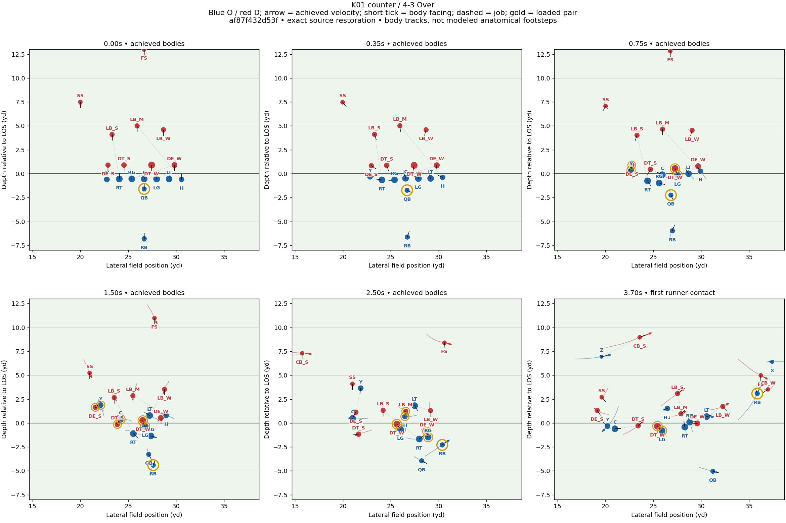
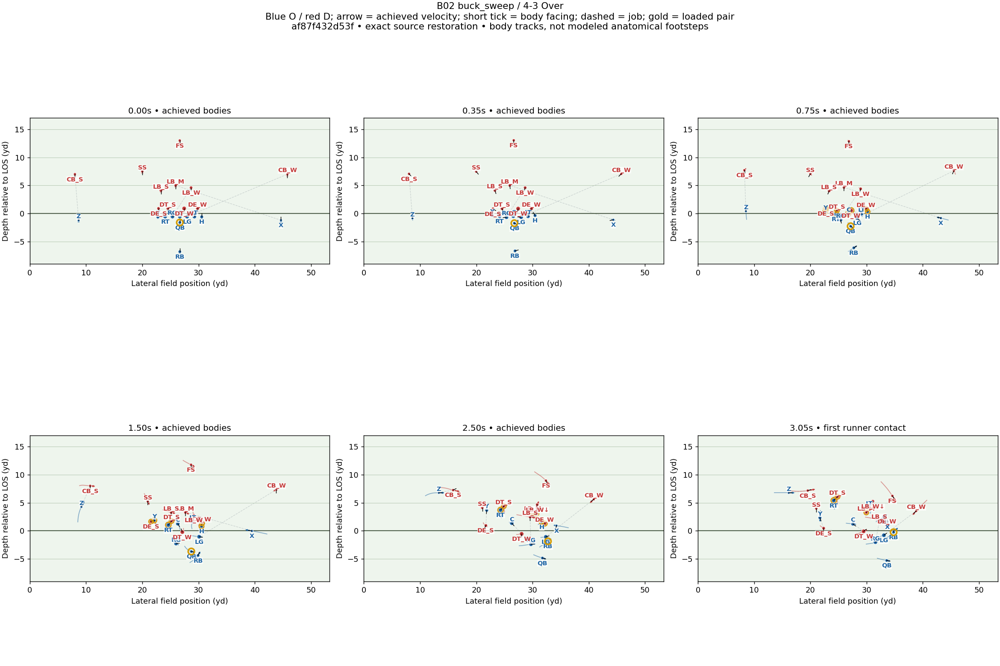

# Do these run blocks look like football?

**October18 follow-up:** [The causal probes and corrected owner handoff](causal-followup.md)
supersede the allocation-first recommendation below. Run's isolated cleared-kick
gate removes K01's traffic without changing assignments; the joint count remains
held. Two B03 earlier-entry diagnostics fail useful wrapper collection. The
original18-snap picture audit and its source qualifications remain evidence.

**The first-level down blocks and short kicks often do. The least convincing part is the coordinated route from initial blocking into useful second-level protection.** This supports Run's current Counter coordination work. It also exposes a perimeter installation conflict and a suspicious opening-turn cost worth preserving for the next decision. No behavior is changed here.

I inspected 18 selected snaps at six phases: eight exact frozen #140 inputs spanning Counter, Buck, pin-pull and crack toss, plus ten existing G1 Inside/Outside/Wide Zone, Duo, Power and Trap films. The output includes 36 box/full-field plates, 162 blocker ledgers and all eleven defenders at four phases. Those are review coverage counts, not independent trials or football grades. [Case judgments and individual prototype notes](observations.json); [pins, settings and limits](reproduction.md).

The evidence receipt links the downloadable picture book and the individual plates. Box views crop wide players; full-field companions preserve all22. Arrow = achieved velocity, short tick = body facing, dashed line = named job, gold ring/link = loaded pair, possession ring = recorded carrier. A line between centers does not establish obstruction. Body tracks do not model literal anatomical footsteps; facing is not gaze.

[Download the picture book, every blocker review and raw tapes](https://raw.githubusercontent.com/tannerthardy/football-simulation-/902fa3f9d8608aaf295c7561d6b5c85e7d9b8813/evidence.tar.gz)
(28.3MB). Extract and open `out/run-movement-audit/pictures/index.html`.
[Archive checksum and selected direct pictures](../../../data/reviews/current/run-movement-audit/bundle.json).

## 1. Highest priority: a job must make sense after the pull

Counter K01 sends RT through the playside exit at roughly(40.5,28.6), then asks him to collect far-side Sam. The nearby Will work has already been reserved for the combo/climber. The wrapper's job makes more sense from his original position than from where his installed route actually puts him.

The bad picture becomes real execution: RT has no loaded defender fit before the runner's first contact and has **eleven positive-impulse RT/RG intervals from2.70 to3.50s**. RG is doing real DE_W kick work. At2.40s RT requests approximately(3.35,3.36)yd/s, receives a final(1.68,1.68) request and achieves only(.11,2.33) after the interval. Spacing, body dynamics and later actual impacts must remain distinct; a drawn crossing alone would not have established this traffic.

K02 has a different manifestation: RT starts without a linebacker job, then selects DT_S→none→DE_W→Will. LG is already travelling toward Will. **There is no RT/RG teammate impulse in K02.** Both examples question second-level job allocation; K01's collision cannot explain every failure. RG's actual kick and H's Mike block must survive a repair.

K01: six snapshots of the wrapper, kick and runner

The original audit supported joint allocation from installed approach origins.
Run's later #143 evidence separates that hypothesis from the traffic cause:
the kick gate alone removes K01's collisions, while the count combination loses
its strong control. Keep that count held. Avoid stealing the kick, duplicating
H's Mike responsibility or exposing a near gap. Do not use private engagement
flags to coordinate ownership.

Both Counter endings also preserve legitimate secondary access: CB_W first contacts the runner. K01 ends in a5.59yd tackle; K02 is **still live at5s**, after a broken corner grasp. Improving the wrapper does not promise a different ending.

## 2. New perimeter warning: the guard and WR exchange their useful regions

Weak Buck B02 assigns:

| Blocker | Installed target | Initial straight-line distance |
| --- | --- | ---: |
| LG / O-OT4 / Tavon Clark | CB_W / D-CB1 / Chris Scott |19.37yd |
| X / O-WR1 / Omar Parker | Mike / D-LB3 / Daniel Johnson |19.74yd |

The wide receiver moves inward while the guard travels toward the distant perimeter. Their two initial job distances total39.11yd. The illustrative opposite pairing totals14.19yd using exactly the same snap positions. **That calculation is an installation/access hypothesis, not an executed improvement or a collision-free route proof.** Different coaching duties, a new force owner and real access all need review.

B02: all22, including the wide receiver and corner

The important boundary is upstream of the WR pool: the force puller reserves the remote corner before receiver allocation. A receiver-only optimizer must honor that reservation, so #137's bounded pool/allocation repair cannot by itself resolve it. This is a Run perimeter installation question, not a request to undo receiver ownership protection.

B02 also has later job churn as other blockers acquire work. That continuation is measured on the prototype baseline preceding #140's information correction; it must not be relabeled as the corrected candidate. The **initial assignments** are unchanged by that information-only extraction.

Crucially, H really blocks DE_W, and DE_W wins first runner contact3.05s. The assignment conflict does not establish that changing the guard/WR jobs rescues that upstream defeat. Preserve the end's earned win. Bunch P056's useful H→Mike insert and P117's cross-formation wing work oppose any blanket ban on long or receiver-to-LB jobs.

## 3. Opening movement deserves its own inspection

The existing pull route first requests a straight depth drop with automatic facing. **Eleven of twelve pullers briefly face more than about135° away from the offense's forward direction before1.5s.** This is a descriptive screen, not a tuning target. K01 RG travels about296° of cumulative body heading in its first second; RT about281°. These figures sum wrapped tick-to-tick angle changes, not a misleading unwrapped endpoint. P02's useful kick also shows the turn pattern, so orientation alone cannot grade a block as failed.

The deeper Buck wrappers are more visibly delayed: B01 LG has essentially zero lateral velocity until1.10s; B02 RG until1.05s. They spend the opening gaining depth and turning before travelling across the line. The depth has a real wall-clearance purpose, so eliminating it indiscriminately would also be wrong.

This looks less convincing than an open/bucket or skip-style pull that preserves access to the intended surface. It is **not yet a proved football correction**: body facing does not reveal eyes, literal steps are absent, and changing facing can legitimately change achievable drop/lateral speed. Run's prior shallower-depth trial already failed its useful-protection question. The parked PULL_STEP experiment stays off.

After the allocation contract is coherent, use one existing kick and one wrapper to compare achieved wall clearance, heading travel, corner arrival and useful strike under unchanged movement limits. Coordinate any movement-interface changes with Flex. Do not improve the animation by quietly supplying backward speed the body does not have.

## 4. Loaded contact and useful protection are different

In these eight selected inputs, the three short kick jobs load their defenders before first runner contact. None of the nine wrapper/deep-force jobs does. That is a reason to inspect access, not a general failure rate or proof that each missed block was necessary: some linebackers are already outflanked, and an unowned safety can legitimately make the tackle.

- **Useful control P02:** RG loads walked-up Sam1.80s. Keep the actual kick surface and clearance. Other C/RT traffic and the later corner tackle remain; this is not a flawless whole-line control.
- **P01:** RG eventually loads Sam, yet Sam reaches the runner3.75s. A contact tag or positive force alone does not show that the runner's path was secured.
- **C01:** Z acquires a real crack, C/Y/H obtain real linebacker work, but DT_S reaches RB2.85s. RT's known corner restart begins2.95s, too late to initiate that failure.
- **C02:** X loads a real crack1.45s; DE_W nevertheless wins contact2.65s before LT reaches the deep corner. Do not infer a universal grip/strength problem from that ending.

[P02: six snapshots of the successful short kick](https://raw.githubusercontent.com/tannerthardy/football-simulation-/902fa3f9d8608aaf295c7561d6b5c85e7d9b8813/P02-box.png).

## 5. Zone needs a local recovery decision, with controls

The historical P021/P032 tackles visibly continue the called lateral track while their acquired end lies the other way. P021 LT's1.00s final request is(-1.00,-3.27)yd/s with the end about3.8yd toward the opposite lateral side. That is a real responsibility/track conflict. It is not yet a demonstrated beneficial chase: the end is a backside threat and is not first to the runner.

P030 RG and P175 LG join their partners very late. Existing paired geometry does not establish that a free useful shoulder was available earlier; teammate spacing, acquisition and strike eligibility remain distinguishable. These pictures support Run's existing narrow access question, not another broad exit rule.

**Keep the normal football that works:** P002 has actual combination/help and a climb; P164 Duo produces useful C→Mike collection; P056/P117 produce useful inserts. Power P015 has recognizable initial down/hinge/kick work. Its later obsolete Y–SS continuation is the separately owned #138 question. None is certified by yardage alone.

## Handoff and boundary

This is the original October17 handoff; use the [October18 causal handoff](causal-followup.md#5-owner-handoff-and-smallest-next-action)
for the current decision. In particular, joint count and additional opening
variants are not approved by this earlier recommendation.

1. Finish Counter's joint responsibility/approach-origin allocation on K01/K02 plus Run's declared opposite-direction control. Preserve edge/keeper work and examine actual useful protection; do not require a touchdown/tackle reversal.
2. Carry B02's force-versus-WR installation conflict into the perimeter transfer decision. Establish the installed force owner before tuning collection toward a possibly wrong target.
3. Keep the first-depth-drop/automatic-facing cost as a separate, bounded footwork question after responsibilities are stable. No flag activation or controller variant is proposed by this audit.
4. Keep zone recovery/late joins local and opposing controls visible. #126 surface consistency, #140 information, #137 receivers, #138 continuation and Flex movement remain independently reviewable.

Accepted develop at handoff remains0000e560; the ten historical films remain70b4db6, and the eight restored tapes use the explicitly pinned prototype sourceaf87f432. Run's unpublished coordination candidate was unavailable and is **not reviewed here**. No games, new players/seeds, physics/capability/default changes, full-suite repeat or permanent behavior edits. Eight tape restorations take4.903 timed collector seconds /8.315 launch-command seconds; plotting and saved-data inspection are separate offline work. Six restorations finish; B01/K02 remain explicit5s censors.
