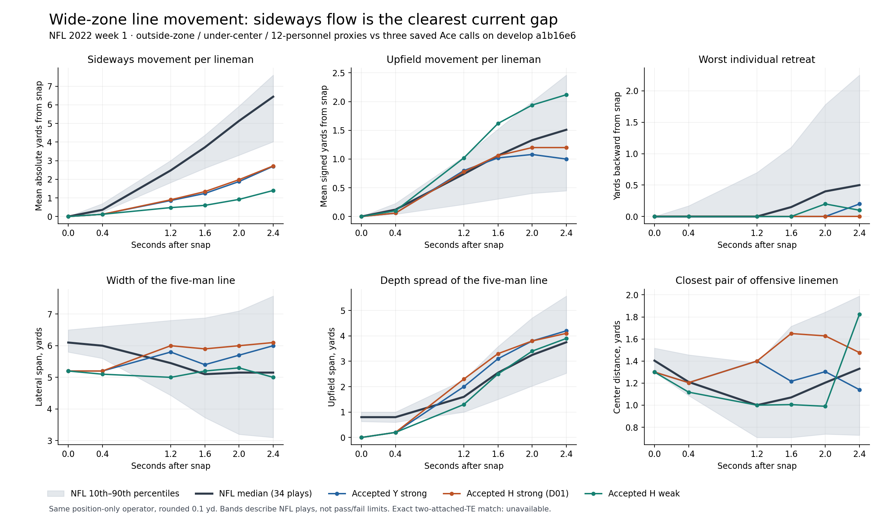

# NFL comparison of the current wide-zone line

The clearest mismatch in the saved accepted Ace runs is **too little lateral
flow**, rather than a line uniformly being driven backward. The initial line
is also narrower and much flatter in depth than the NFL reference. These are
measured positioning differences worth investigating; they do not establish
which controller or physical capability should change.

This audit answers the user's offensive-line positioning question while the
Pass/Pursuit awareness repair is pending. It adds no engine feature and runs
**zero new simulation plays, World steps or games**. Further RT recovery
variants remain paused, and PR #32's rejected alternatives remain preserved.

## Comparison and provenance

- Accepted engine: `develop` **a1b16e666a9ee7d1bc1d2aecba141fc535863b24**;
  runtime source SHA256 **e5c318a1082c3738b9782107fa9faec67ada38b02245d1a529af4adaf6825c54**.
  Historical comparison **4ded6b600fd3785e65034aa5623d7a9f8f3c5db1** remains unchanged.
- Three saved under-center `ace_12` inputs from [PR #26](https://github.com/tannerthardy/football-simulation-/pull/26):
  `uc12-wz-s3` (Y strong), `uc12-wz-s3-mirror` (H strong/D01),
  `uc12-wz-weak-s3` (H weak). They share seed3, offense31/defense32, strength.55,
  Over/Cover3, LOS40 and ballY26.666666666666668. The strong H input changes TE
  placement; its name does **not** make it a geometrically mirrored play.
- Original packet SHA256 **ad462904b23c6864d902107f6a0aa3a876b4e35d3247db8dfaebb835276ae10b**;
  producer `ac6f663f958f4d59cb0f3e0e9d25c84e1c06dd79`. All44 resolved flags,
  World defaults, input manifests, Node22.23.3 and dependency lock are retained
  in [audit.json](audit.json). `RUN_CONTACT_COMPONENTS=1`; reach-track, active
  hands and RB read experiments remain off. No source/default/capacity change.
- NFL: **2022 week1**, from the [Big Data Bowl 2025 provider archive](https://drive.google.com/file/d/1gL9sbsrRPvrR21alUB83fcsvWRbgohk7/view)
  recorded in `data/sources.json`. Four original members were selectively
  downloaded, then verified against independently saved SHA256/size pins and
  ZIP CRCs. [Acquisition receipt](acquisition.json) records all hashes.
  The full archive was **not** downloaded or checksum-verified; provider
  tracking remains local and ignored, and only reference aggregates are published.

The NFL selection contains **556 nonnullified RB handoffs**, **174 PFF-primary
outside-zone runs**, **122 outside-zone runs with an under-center alignment
proxy**, and **34 with the additional 12-personnel roster proxy**. The last
group supplies the main comparison; the larger groups check whether its result
depends on the personnel filter. QB/C identification is ambiguous in109 of the
556 plays, so their under-center status remains unknown.

This is not an exact Ace formation match. A stringent two-attached-TE geometry
proxy produces **zero matches** in the34-play group:13 have the TEs on opposite
OL sides,12 put both within2yd outside the OL ends, and5 satisfy both absolute
TE line-depth bounds, with no intersection. The group contains32 official
SINGLEBACK and2 I_FORM labels. These classification limits are visible rather
than relaxing the proxy until it matches. They do not imply that NFL Ace
formations do not exist.

Both sources use the [same measurement operator](../../../scripts/diag/zone/run_line_geometry.py):
offense-oriented coordinates, positions rounded0.1yd, and exactly five OL per
play. We compare snap,0.4,1.2,1.6,2.0 and2.4s, plus each play's actual handoff.
Snapshots must contain all five OL and occur strictly before the terminal
event or recording boundary. There is no interpolation, missing-position
imputation or continuation. All34 primary NFL plays survive through2.4s.

## What looks different

Values below are yards unless labeled seconds. NFL bands are descriptive
play percentiles, not confidence intervals or desired per-play limits.

| Measurement | NFL under-center/12 outside zone, median [p10–p90] | Y strong | H strong/D01 | H weak |
| --- | --- | --- | --- | --- |
| Mean absolute sideways movement,2.0s | **5.14 [3.30–5.93]** | **1.88** | **1.98** | **0.92** |
| Mean absolute sideways movement,2.4s | **6.44 [4.02–7.60]** | **2.70** | **2.72** | **1.40** |
| Mean upfield movement,2.0s | 1.33 [0.40–2.00] | 1.08 | 1.20 | 1.94 |
| Worst individual retreat from snap,2.0s | 0.40 [0–1.78] | 0 | 0 | 0.20 |
| Closest OL pair center distance,2.0s | 1.20 [0.74–1.84] | 1.30 | 1.63 | 0.99 |
| Snap lateral span | 6.10 [5.80–6.50] | 5.40 | 5.40 | 5.40 |
| Snap depth spread | 0.80 [0.63–1.00] | 0 | 0 | 0 |
| Actual handoff time,seconds | 1.35 [1.20–1.50] | 1.60 | 1.60 | 1.60 |



The flow gap persists against the larger references: at2s outside-zone median
sideways movement is5.02yd across174 plays and5.06yd across122 under-center
plays. All three current values are below the primary group's10th percentile
at every positive fixed-time slice tested. At each play's own handoff, the NFL
median is2.85yd [2.09–3.58], versus1.24/1.34/0.60yd. A later native handoff
therefore does not explain away the small lateral movement.

The initial five native OL occupy one longitudinal plane. NFL tracking shows
a staggered plane, and a wider line. Tracking tags and simulated body centers
are not identical anatomical landmarks; snap-ball coordinates can also affect
absolute LOS depth. The depth-spread and width results identify an alignment
question, not a claim of illegal NFL stance or a prescribed0.8yd stagger.
The from-snap movement comparison is less dependent on those absolute landmarks.

The nearest-pair distances and developed depth spans do not show a universal
spacing discrepancy of similar size. That does not validate the existing
avoidance behavior: D01 already shows a consequential local conflict despite
ordinary aggregate spacing. NFL tracking cannot reveal private observations,
commands, attachment loads or the reason a player yielded.

## Are they getting pushed too far back?

**That is not supported for these current controls.** Through2.4s their worst
retreat is at most0.2yd at the common slices. There is later individual retreat:
the captured live Y trace has RT1.307yd backward from his snap position at3.55s,
and the H trace has LG0.657yd backward at3.20s. Those are maxima over captured
snapshots, not full trajectories or matched late NFL percentiles.

Y's RT is1.857yd behind the LOS in that late snapshot, but started0.55yd behind
it: **LOS depth is not the amount of pushback**. Nor does NFL backward movement
prove that a defender physically pushed the blocker; recovery can be voluntary.

Older broad cohorts mostly measured **defenders driven backward**. The old
`ff6e993` 265-run pilot had a3s DL-retreat p90 of4.1yd versus2.5yd in the NFL
reference. A later historical two-game-cohort audit reported3.0yd versus2.5yd.
Those results remain in their original receipts. Neither is the accepted e5
runtime, neither measures offensive retreat, and neither establishes today's
population frequency. We have not substituted them for a current census.

## Guards and center: intentions versus achieved technique

The assignments are not a uniform five-man drive. In the strong calls C reaches
DT_W with LG helping; RG reaches DT_S; LT climbs from the snap; RT is assigned
the end combination. In the weak call LG directly climbs and the combinations
change. The [prior technique audit](../rt-recovery/README.md) preserves the
installed reach/combination/climb intentions and their information limits.

At2s the strong-call LG has moved only0.5yd sideways; C1.5/1.7yd and RG2.3yd.
The weak-call C has moved1.5yd sideways, while RG has moved0.2yd. Upfield
averages include LT's3.8/3.9yd climb in the strong calls and LG's3.2yd climb in
the weak call. Those climbers can make the overall forward average look ordinary
while first-level blockers produce a different surface. NFL block assignments
are unavailable here, so we cannot declare every individual path incorrect.

The early0.4s saved frame narrows the investigation. There is no OL engagement,
helper ownership or torso-contact report in that frame; the existing TE/end
contact is retained. Yet the original Y RT behavior asks for lateral velocity
**−7.58yd/s**, its final World target is **−2.68yd/s**, and its actual entry
velocity is **−0.76yd/s**. C asks for−3.39, receives−2.43 and achieves−0.67.
These are three different quantities, not delivered contact force. Weak LT/RT/C
also have changed final targets; LG/RG often request mainly upfield movement.
[early-commands.json](early-commands.json) preserves all15 OL rows and their
actually consumed source records, including personally acquired held observations.

That establishes that contact strength alone cannot explain the observed
movement gap. It does **not** establish that spacing should be bypassed or that
the original high lateral request was attainable. The pending awareness repair,
turning, movement response, assignment geometry and legitimate traffic must be
separated before attributing the gap. The earlier loaded-contact law limitation
also remains visible; this audit supplies no angular or contact-validity certificate.

## Next decision and reproduction

The practical football contract is a moving protection surface: get to useful
leverage with attainable feet, carry that position through the runner's arrival,
and allow earned defensive wins. Transmitted load, final gain and a line-average
advance are insufficient evidence of a good block.

1. Keep D01 and successful Y prepared. Evaluate the Pass/Pursuit owner's exact
   awareness commit/settings/observer initialization before changing yielding or
   RB navigation. This audit has not evaluated or duplicated that candidate.
2. Use the saved early OL rows to trace where a cue-supported wide-zone request
   is changed, and where the final request differs from achieved movement. This
   is the smallest next technique question; it requires no new RT recovery variant.
3. If that isolates a defect, propose one correction and preserve Y/weak success
   and H adverse evidence. Treat initial alignment and task-specific OL movement
   response as separate hypotheses, with acquired information and traffic intact.
   Do not tune toward5.14yd, an earlier handoff or restored yardage.

No controller, solver, physical capacity, grip, release timer or roster change
is proposed by this audit. Three selected plays on one roster and one NFL week
cannot certify the whole run game or quantify current league-wide defect frequency.

```sh
# Reacquire only the four verified NFL members if not present.
python3 scripts/data/fetch_bdb2025_line_audit.py
# Collector tested at a15352119b6ff52ab7a10cb6fd98152d57f3d62c; source e5 required.
python3 scripts/diag/zone/run-nfl-line-audit.py
python3 -m unittest discover -s test -p test_run_line_geometry_audit.py
```

The5 directly affected tests pass. Offline publication checks verify cohort
counts/censoring, percentile ordering, unchanged earlier common-time results,
and exact native snapshots. Verified acquisition took21.33s; final collector
11.08s. An intervening snap-extension collector failed on a Python variable
lookup; it produced no accepted output or simulation. [receipt.json](receipt.json)
retains that failure, all revisions, hashes, settings and tool versions. No full
suite/typecheck or game campaign was needed for this Python/data-only audit.

Downloadable packaging contains this report, PNG/SVG/PDF, aggregate JSON/CSV,
command evidence and reproducible tools. It contains no raw NFL tracking.
