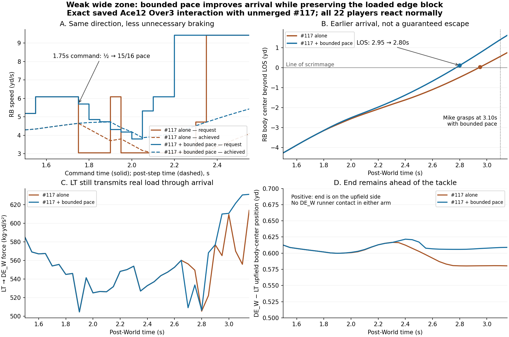

# Bounded pace through acquired teammate traffic

Recommend this narrow pacing correction for Integration review. It removes
unnecessary braking when ordinary movement can carry more of the same request
through the acquired teammate picture. It does not repair every weak-zone block.

The question is: after half speed is already forecast safe, can a player retain
more useful motion without sacrificing support or another teammate's clearance?
This changes one spacing decision, not the runner's lane, assignments or physics.

## Exact comparison

- Accepted base: `d682b1f474cb6ba260a7b8b1119a62919c5a2159`.
- Runtime/tests: `13dfe18a8214879f24034e3c4732a844a2664cb4`.
- Standalone engine source: `96cff1c708a8c063c4394ea123b4c018443de1113963907d2f67544250c174b5`.
- Isolated interaction with unmerged #117: source
  `048be756a6ecda65d10c8f77f6de15ac214d82191746e16657cd5a3d715aeab1`.
- Node 22.23.3; accepted 44 flags, `RUN_CONTACT_COMPONENTS=1`, `CF_FLOW` unset.
- World defaults, capacities, acquired observations and other controllers unchanged.
- #116 runoff floor and #119 moving-blocker runner assessment are **not included**.

The [input manifest](../../../data/reviews/current/run-pace-gather/input-manifest.json)
declares the unchanged Ace12 cases, saved Duo control and fresh transfer before
the transfer result. Ace12 uses the same pair11 roster: offense seed 11, defense
12, strength .55, play seed 77, LOS 40, ball Y 26.67, under center, both TEs attached.
Over3 is base43/over/cover3 with box edges and stack LBs. The fresh weak case
uses base43/under/cover3 with spill edges and stack LBs; the roster stays fixed.

Accepted source `bed3c36cf08407762fed67abdf0a1651fe6ed7fc8c09b43ab3d9b33f1dfd4616`
is reused from compatible saved native traces, not rerun for each candidate.
The [summary and receipt index](../../../data/reviews/current/run-pace-gather/summary.json)
records source/output hashes, exact commands, adverse outcomes and aggregate cost.
The #117-only comparison uses its saved source
`353a28ce8ee34f911e9013f854dff8a4cf024e9a07cf4e52bec660945ffff8e9`.
That source matches #117's final executable behavior; its final change was comments.

## Demonstrated mechanism

The existing gather forecast correctly identifies a potential teammate conflict.
Its response jumps directly to half the final request when that forecast is safe.
This can discard attainable progress even when a gentler pace clears the same peer.

In weak WZ with #117 at controller time 1.75s, the runner has an acquired LT picture
aged .05s, with no declared future motion. Full pace forecasts −.0402 yd minimum
torso clearance. Half pace forecasts +.8590 yd **to LT**; its all-peer minimum is
+.58455 yd, set by QB. The 15/16 pace all-peer minimum is +.00267 yd, set by LT.
Those are diagnostic held-command forecasts against observed peer velocity,
not actual future contact positions or a guarantee about LT's next action.

The correction keeps half speed as the verified fallback, then evaluates at most
three intermediate scales between half and full. Every admitted alternative must
keep the runner up and clear **all** acquired peers under the existing preview.
The selected request cannot reduce forecast achieved progress relative to that
fallback. The algorithm does not assume clearance is monotonic or claim an
optimal pace; a failed refinement merely bounds this small search.

Heading, facing, posture, skills, squeeze and the information picture are retained.
There is no new release rule, grip, strength, speed cap, privileged peer intent or
permission to pass through traffic. Existing stop/failed-half behavior remains.

## Actual weak-side protection and arrival



Solid requests in panel A are plotted at their **controller command time**.
Dashed achieved speed and panels B–D use the later **post-World body state**.
A frame at 1.80s contains the command issued at 1.75s; these are not simultaneous
request and execution. Positions are body centers, not individual foot placements.

The weak #117 interaction changes the 1.75s request from half to 15/16 pace.
At post-step 1.80s, achieved RB speed is 4.692 instead of 4.334 yd/s; it does not
instantaneously adopt the requested speed. At 2.50s RB is .333 yd farther upfield.
LOS crossing advances from 2.95 to 2.80s, while LT maintains actual DE_W load.
At 3.10s the end remains .609 yd ahead of LT versus .581 yd without this change.
Neither arm has DE_W runner contact; the improved arrival does not lose that edge.

It also does not erase Mike's access. With pace, Mike grasps at 3.10s; #117 alone
has a Mike miss at 3.15s followed by CB_W first contact at 3.50s. Endings change
2.93 → 3.08 yd. This is improved traffic passage with a remaining second-level
protection failure, not proof of a successful weak-zone repair by final yardage.

The unchanged weak-side LG sequence is the next distinct issue: between 1.10 and
2.15s LG retreats .445 yd while gaining only .224 yd laterally, and never supplies
useful Mike protection through arrival. The pacing change neither invents that
failure nor repairs it. Determine the reachable route and consumed modifiers
before changing a block assignment or declaring that a faster release was needed.

## Opposing controls and transfer

| Exact native case | Accepted → pace alone | #117 alone → #117 + pace | Interpretation |
| --- | ---: | ---: | --- |
| Ace12 OZ strong Over3 | 7.14 → 7.84 yd | 8.66 → 7.99 yd | Contact/ending changes remain visible; no required old gain. |
| Ace12 WZ strong Over3 | 2.53 → 7.59 yd | 6.86 → 6.68 yd | Standalone LOS improves only .05s; the large gain is mainly a changed tackle attempt. |
| Ace12 WZ weak Over3 | 5.34 → 5.21 yd | 2.93 → 3.08 yd | Standalone first change is Mike at 2.35s, not a new RB read. |
| Useful Duo climb | RB identical through 3.50s | RB identical through 3.50s | RT/Mike work retained; SS contact still occurs at 3.25s. |
| Predeclared weak WZ Under3 | 6.45 → 6.76 yd | Not combined | Same 2.50s LOS and 3.35s first contact; one front transfer, not population proof. |

In standalone strong WZ, CB_S's attempt at 3.30s changes from grasp to miss;
the runner's first later contact is FS at 3.95s. This is not five yards of new
blocking. In the #117 strong interaction, LOS stays 2.60s and first contact 3.20s;
later defensive contact changes explain the slightly lower gain. Preserve both
facts rather than selecting only favorable endings.

All saved native arms have zero offensive teammate impacts. Force/work/support
accounting remains governed by the unchanged World; the new forecast is not an
extra contact solver. Useful load alone is not a protection verdict: the edge
route, runner's arrival and surviving Mike access are assessed separately above.

## Checks, limitations and handoff

49 directly affected focused checks pass, including eight new pace controls and
forecast-cache coverage. Typecheck passes at the runtime/test commit above.
The tests exercise the real spacing hook, all-peer obstruction, fallback and
support behavior, bounded evaluation and unchanged fields. The legacy reference
is preserved; an explicit new reference records the intended changed decision.
An independent saved-state cache review found seven distinct command forecasts
at the changed 2.20–2.30s requests, no duplicate command evaluations, and preserved
clearance/progress. Its output is `out/run-pace-gather/golden-review.json`.

Native collectors retain all 22 players and ordinary reactions through endings;
Duo is explicitly censored at 3.50s. They do not freeze the runner's future route.
Rejected fixture attempts and expected failing checks remain in the receipts.
No games, broad roster census, full suite or new NFL scan were run. Integration
owns verification of the exact accepted combination; local evidence is not that run.

Recorded command runtime is **23.502409913 seconds**, including expected red
checks, rejected fixtures and the failed golden-reference check. Chart rendering
took a separate **1.823 seconds**. The static [plot script](plot.py) reads only
the small committed [plot data](plot-data.json), which records original compressed
file SHA256 and engine source for both arms. It needs Python/matplotlib and runs
zero simulations: `python docs/reviews/run-pace-gather/plot.py`.
No film or zip is generated. This chart is an isolated #117 interaction, clearly
separate from accepted-production results and from #119's runner-read candidate.

Recommendation: review the bounded pacing patch independently, then verify its
interaction with whichever loaded-footwork candidate Integration accepts. Keep
the weak LG/Mike protection problem as the next bounded investigation; do not
increase contact force or add an early-release timer to restore an old ending.

## Portable extraction and reproduction

Production extraction is exactly five files: `src/sim/spacing.ts`,
`test/run-pace-gather.test.ts`, `test/fixtures/run-pace-gather.json.gz`,
`test/spacing-forecast-reuse.test.ts`, and
`test/fixtures/spacing-forecast-paced-reference.json`. Diagnostic scripts and
docs are optional evidence tooling. The old forecast reference remains unchanged.

At the runtime/test pin, using Node 22.23.3 from the repository root:

```sh
npm run baseline:run -- --candidate -- npx vitest run --project core test/run-pace-gather.test.ts test/spacing-yield.test.ts test/spacing-residual-motion.test.ts test/traffic-turning.test.ts test/traffic-step.test.ts test/joint-spacing.test.ts test/spacing-forecast-reuse.test.ts
npm run baseline:run -- --candidate -- node --import tsx scripts/diag/box-defense-review/protection.ts out/run-pace-gather/reproduced-native.json.gz
npm run baseline:run -- --candidate -- node --import tsx scripts/diag/box-defense-review/runner-motion.ts out/run-pace-gather/reproduced-weak-under3.json.gz --direction=weak --look=under3 --until=20
```

These commands reproduce the standalone arm; the #117 interaction requires its
explicit separate runtime patch and must match the interaction source above.
