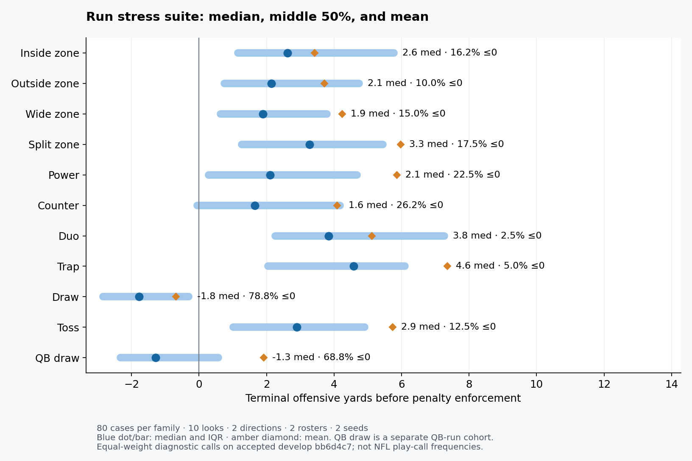
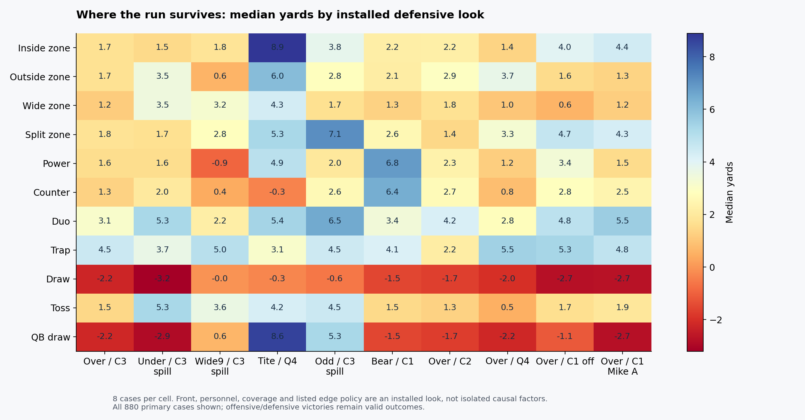
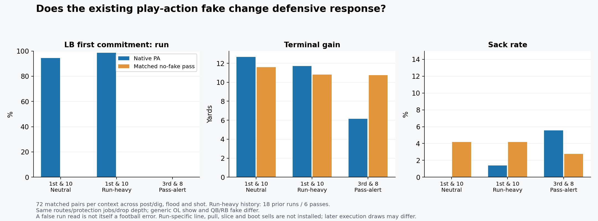

# Extensive run / play-action stress checkpoint

Ongoing development uses the [focused/checkpoint workflow](../../RUN_SUITE.md)
and [ranked mechanism triage](TRIAGE.md). This report, frozen plan, catalog and
saved results remain the original completed checkpoint. No repeat census is
required for small edits; PA pairs are shared with the pass suite.

[Quick zone diagnosis](ZONE_ANALYSIS.md) reuses320 zone primary cases,80 transfers
and80 Duo contrasts, plus eight focused full-context traces; zero new plays or
fixes. It separates the demonstrated inline-role omission from incomplete
protection, runner-read limits, package geometry and legitimate defensive wins.

2026-10-16. **All 1,848 planned native cases executed: 1,608 on accepted develop
and 240 on the separate #99 perimeter host. 1,846 native endings; 2 explicit20s
censors; 0 skipped or numerical/budget failures. 0 games.**

The result supports a targeted next investigation, not a strength increase or
slower universal defensive response. Ordinary wide-zone gains remain weak despite
a respectable mean; draw protection is a repeated technique concern. A shared
mesh failure strands QB and RB in two I-formation variants. Current play action
changes defensive reads strongly but does not consistently improve the pass.

## What was actually tested

The [frozen plan](PLAN.md) covers all11 implemented accepted run schemes, including
explicit lab QB draw, both actual directions, ten installed defensive looks, two
fixed ordinary generated team pairs, two seeds and19 additional compatible
formation installs. The13 stock strong/weak call IDs are represented without
counting the same geometry twice. Ordinary under-center Ace12 remains the main
zone/Duo/toss reference. Secondary gun/pistol/I/13-personnel results remain
separate. Native post/dig, flood and shot have216 matched PA/no-fake pairs across
six looks and three situations, with run counterparts. Buck/pin-pull/crack add240
separate prototype cases. This is complete coverage of the declared implemented
families and matrix, not every possible football concept or NFL call frequency.

**Important correction to the initial description:** native PA uses a generic
OL run show: low pads for.35s and a forward interior set during that interval,
then ordinary pass protection. QB/RB fake for.7s. It does not install the named
run's zone track, pullers, double teams, slice, fake pitch or true boot. Changing
`fake` from outsideZone to counter preserves all bodies/requests/RNG in the1.1s
real-hook probe; production consumers only test its truthiness. The comparisons
therefore change the entire existing generic OL/QB/RB fake, with the same pass
protection responsibilities, route assignments, drop depth/clock and athletes.
They do not isolate only the backfield or validate each proposed run-specific PA.

The manifest's `design` field records concrete complements for all14 accepted/
prototype families: zone post/dig/glance, outside-zone over/flood, wide-zone
flood/boot, split slice/leak, Power/Counter pull-action shots, Duo post/dig, trap
pop, delayed-draw seam, toss flood/throwback, QB-draw pop, Buck waggle, pin/pull
flood and crack-toss release. **Missing physical installs remain missing**, rather
than being counted as new tests by relabeling the generic fake.

## Run results

Primary calls are all1st&10. Success below means≥4 credited offensive yards and
no turnover, before penalty enforcement. QB draw is a separate QB-run cohort;
it is not pooled into RB rushing. Every row has80 native terminal plays.

| Family | N | Median yd | Mean yd | ≤0 yd | 4+ yd success | 20+ yd |
| --- | ---: | ---: | ---: | ---: | ---: | ---: |
| Inside zone | 80 | 2.62 | 3.42 | 16.2% | 38.8% | 0.0% |
| Outside zone | 80 | 2.15 | 3.72 | 10.0% | 30.0% | 1.2% |
| Wide zone | 80 | 1.90 | 4.25 | 15.0% | 21.2% | 2.5% |
| Split zone | 80 | 3.28 | 5.97 | 17.5% | 40.0% | 5.0% |
| Power | 80 | 2.10 | 5.86 | 22.5% | 30.0% | 5.0% |
| Counter | 80 | 1.65 | 4.09 | 26.2% | 27.5% | 2.5% |
| Duo | 80 | 3.85 | 5.12 | 2.5% | 47.5% | 1.2% |
| Trap | 80 | 4.58 | 7.36 | 5.0% | 52.5% | 7.5% |
| RB draw | 80 | -1.77 | -0.69 | 78.8% | 10.0% | 0.0% |
| Toss | 80 | 2.90 | 5.73 | 12.5% | 37.5% | 5.0% |
| QB draw | 80 | -1.29 | 1.92 | 68.8% | 17.5% | 3.8% |



The main warning is distribution shape: wide zone's4.25 mean accompanies a1.90
median and only21.25%4+ gains. Power's5.86 mean accompanies a2.11 median and
22.5% stuffs. Rare long gains do not establish reliable ordinary protection.
Duo is stronger across this matrix, with a3.85 approximate median and2.5% stuffs;
that does not certify it across every package.



Each heatmap cell has8 cases. Looks intentionally combine front, personnel,
coverage and declared box/spill policy: differences are not isolated front-only
causal estimates. Wide zone's median ranges0.60–4.32 across looks; Counter has
an adverse Tite median−0.34. Defender wins and difficult calls remain legitimate.
Full formation/roster breakdowns are in the saved summary, not discarded tails.

## What the traces establish about protection

- **No universal backward-OL collapse.** In wide zone, median across plays of
  the mean OL playside displacement is+.59yd at1s and+1.29yd at2s. Among loaded
  first-level OL, median mean forward displacement at2s is+.99yd (Duo+2.13yd).
  These are native displacement observations, not a claim of NFL-calibrated
  technique. Pullers and pass-presenting draws have different legitimate jobs.
- **Contact still does not imply protection.** The lower-quartile WZ example
  `primary/wideZone/ace_12/over3/pair11/77/weak/neutral/run/` gains.63yd. LT loads
  DE_W from.60s; at the runner's2.85s contact, that block still carries roughly
  585 normal/−293 lateral force units. The end nevertheless has access to the
  outside runner. H/Will and RG/Sam also achieve actual load. This does not
  establish a missed feasible correction, an RB error or a lawful defensive
  win by itself; useful position through arrival remains the question.
- **Draw is a specific technique concern.** In78/80 RB draws, and78/80 QB draws,
  first OL hand load is1.05s; only two in each cohort load earlier at.95s. All80
  primary IZ cases load an OL by.55s. The draw controller backs into a pass-set
  landmark during its1s presentation; normal attack/contact is delayed until
  that phase ends, with an exception for perceived penetration. RB-draw first
  contact is interior DT/NT in65/80. All draw LBs initially read pass: these
  failures cannot be explained as instant correct linebacker recognition.
  The next physical question is whether a legitimate pass-style hand fit could
  maintain the interior route while retaining the draw's presentation, rather
  than spending the opening on arrival steering alone. No stronger hands or
  slower defenders were tried.
- **Installed second-level jobs are exposure flags.** Recorded load before
  first contact occurs in70/196 WZ installed LB jobs,84/200 Duo and68/184 Power.
  A job may require a safe takeover, change through exchange, become irrelevant
  to the runner, or legitimately lose. The remaining jobs are not all defects.
- **Formation transfer matters.** On the eight matched transfer inputs, WZ's
  primary Ace median3.42 becomes−.67 in gun and3.76 in pistol. Duo's Ace4.33
  becomes1.44 in I21. These are fixed-roster/front/seed package comparisons;
  formation changes also change responsibilities/paths and cannot be reduced
  to QB depth alone. No case was replaced to improve transfer.

## One concrete exchange blocker

Both censored cases are pair11/77, I21/Wide9, strong outside or wide zone. No
handoff, throw or carrier contact occurs before20s. The QB's raw backfield mesh
request is substantially changed by teammate traffic; at sampled.95→1.00s its
raw x request−4.60 becomes−.52, while F crosses the mesh area. The RB passes the
mesh without possession. By3s, QB is stationary near(35.58,24.54), while RB is
several yards upfield. QB chases the riding back only while he remains within
1.2yd of the installed mesh; RB's riding phase continues toward the aim. They
never re-establish an exchange.

This is a demonstrated **coordination/recovery hole**, not permission to bypass
F, force a distant handoff or blame the defensive front for predicting a run.
The paired variants share an opening mechanism, so they are not two independent
proofs. Full inputs, requested/achieved bodies and20s censoring are preserved.
Run owns the next bounded recovery test, coordinating any spacing boundary with
Do-It-All. Ordinary Ace reachable-mesh success is the relevant opposing control.

## Does play action expose excessive defensive aggression?

| Package / context | Pairs | LB run-first: PA / plain | Mean yd: PA / plain | Completion: PA / plain |
| --- | ---: | ---: | ---: | ---: |
| postdig / neutral | 24 | 88.9% / 0.0% | 17.24 / 14.66 | 41.7% / 41.7% |
| postdig / runheavy | 24 | 95.8% / 0.0% | 16.27 / 13.11 | 37.5% / 37.5% |
| postdig / passalert | 24 | 0.0% / 0.0% | 11.19 / 11.61 | 37.5% / 29.2% |
| flood / neutral | 24 | 94.4% / 0.0% | 10.22 / 15.40 | 54.2% / 62.5% |
| flood / runheavy | 24 | 100.0% / 0.0% | 13.41 / 15.96 | 66.7% / 66.7% |
| flood / passalert | 24 | 0.0% / 0.0% | 3.82 / 16.14 | 41.7% / 62.5% |
| shot / neutral | 24 | 100.0% / 0.0% | 10.52 / 4.70 | 25.0% / 16.7% |
| shot / runheavy | 24 | 100.0% / 0.0% | 5.43 / 3.37 | 16.7% / 16.7% |
| shot / passalert | 24 | 0.0% / 0.0% | 3.45 / 4.46 | 8.3% / 16.7% |



Across the neutral first-down packages, mean within-play LB run-first share is
94.4% for PA versus0 for plain; with the declared run-heavy history it is98.6%.
Safeties commit run first in100% of those PA cases versus0 in plain. Third&8
has0 run-first commitments in either arm. PA moves LBs about.64–.83yd farther
back toward the LOS at1s on early downs, depending on package. Recognition has
strong situational sensitivity; it is not simply revealing the called run.

For run-first PA linebackers who later switch, median run→pass delay is1.60s
neutral /1.65s run-heavy. On thrown plays,144/160 neutral and146/165 run-first
LBs commit pass by the actual throw. These denominators are defenders, not plays;
sack/scramble/no-throw plays remain elsewhere in the complete outcome table.

This establishes a substantial response to the **represented generic run cue**,
not that every commitment is unrealistic. Generic low hats genuinely precede the
read; acquired cues, attention and later feasibility still need review. The
native QB/RB path is not a matched physical opening to each associated run, and
sampled early QB/RB gaps are over3yd in these under-center installs. Thus this
campaign cannot certify realistic deception or calibrate the correct bite rate.

Crucially, fooled reads do not guarantee pass benefit. Flood is worse than its
no-fake counterpart in all three contexts, especially third&8 (3.82 vs16.14yd,
with four PA sacks versus zero). Early post/dig and shot benefit in means, but
some paired deltas are dominated by a70yd touchdown. Same inputs/seed do not
preserve later execution draws after changed approaches/contact. The preserved
paired film shows gains, failures and pressure; no defender responsiveness was
retuned toward these numbers.

## Separate #99 prototype results

| Prototype family | N | Median yd | Mean yd | Any offensive peer impulse |
| --- | ---: | ---: | ---: | ---: |
| Buck sweep | 80 | 2.20 | 3.31 | 25.0% |
| Pin-and-pull | 80 | 2.36 | 3.84 | 30.0% |
| Crack toss | 80 | 3.21 | 9.57 | 47.5% |

All80 per family end natively. Crack toss's9.57 mean is lifted by long gains;
its3.22 median and47.5% cases with a positive offensive teammate impulse do not
establish readiness. Neither an impact nor an unachieved job is automatically
an error. #99 remains a development prototype with deep-force access unresolved;
these runs do not promote it or change the automatic play caller.

## Exact provenance, validation and cost

- Accepted runtime source: `668acb1784799c93d4704aaaa41233a11627ee0a862b41dc279cd11a0a22eeac`,
  develop`bb6d4c73948d53ba841dd9338dd240146c739f8c`; collector freeze
  **`579a20e2062d0a159c3a4e88b10e21819f88b7c1`**.
- Prototype source: `ca40378fb18a3285c02031228e0e87190b2b0cb4aeeb70c48b51926816c19a0b`,
  original99 hostd212b41; exact separate collector/input freeze
  **`9163ef542af3c1ced10657043b3c803073ed8ca9`**, published branch
  `codex/run-action-stress-perimeter`. No prototype ancestry in this tooling PR.
- Operator SHA `373519763bb486614009cc723160578fe8ad32f9a25de0b128a1d798e9b03476`;
  accepted manifest content SHA `9a8d0adf97319b55b629653b0c9dea553549b9a5a071589b3e87febf65f8663e`;
  prototype `16b981724a934e27443b16bc7dabe3c3af93259b8f18fd9b1b794fcde90207f5`.
- Node22.23.3;44 accepted flags, components1, CF_FLOW unset. Every resolved flag,
  World default, lock/helper hash and full selected player input is preserved.
  No physics, ratings/capacities, roster generation, spacing, carrier policy,
  hand/release policy, automatic calling or accepted baseline/default changed.
- **8 meaningful collector/input/observer tests and typecheck pass.** An initial
  test used the wrong literal controller-kind name, and an initial typecheck
  found three local typing/access issues; original failed receipts remain
  failed. No existing football assertion was changed or suite removed.
- Accepted collector266.502s, prototype45.477s; native-case loop total287.704s.
  All seven launch/check commands total**350.612s**, including failed checks.
  Offline parsing/rendering/inspection is additional.0 full games or full suites.
- Across all cases, max momentum residual1.21e−11, work6.27e−11, arm-impulse
  excess4.27e−14, arm-work excess2.85e−14 and motor-work excess0. These close
  recorded budgets; they do not validate every contact law, angular assumption
  or football ending. Existing law limitations remain.

[Compact all-case rows](../../../data/reviews/current/run-action-suite/rows.json.gz),
[complete summary / paired effects](../../../data/reviews/current/run-action-suite/summary.json),
[40-case witness packet](../../../data/reviews/current/run-action-suite/witness-packet.json.gz),
[original receipts](../../../data/reviews/current/run-action-suite/receipts/),
[accepted input manifest](../../../data/reviews/current/run-action-suite/accepted-manifest.json.gz),
[prototype input manifest](../../../data/reviews/current/run-action-suite/perimeter-manifest.json.gz).
The full1848 per-case5Hz all22/request/load caches remain in ignored `out/`
(~130MB compressed). Committed indices retain exact keys/paths/input IDs and
signatures; rerun from the frozen manifest to reconstruct them without guessing.

### Measurement limits

Two fixed ordinary generated pairs and two execution seeds support descriptive
stress coverage, not league estimates or independent NFL confidence intervals.
Cases are correlated across repeated athletes/fronts. Uniform call frequencies
are deliberate. Terminal yards are before game-level penalty acceptance; censors
have no terminal gain/success. First-contact native events can occur after a
turnover; derived offensive-contact protection flags filter carrier/defender
sides. A loaded contact is not compression alone. Requests are sampled before
World; achieved bodies after the corresponding50ms step.1/2s states are exact
saved clocks; the planned.5s sample is bracketed by.4/.6s and is not interpolated.
Consumed cue terms/rejected controller options are not all present, so statistical
association is not a demonstrated decision cause. No outcome guarantees were used.

## Reproduce without another broad campaign

Use an isolated checkout of the appropriate tested pin and Node22.23.3. Default
`plan` simulates zero snaps; do not overwrite the frozen manifests during review.
The broad `run` command requires an explicit checkpoint and validates cache/source/
settings keys. A completed invocation does not certify every ending as realistic.

```sh
# Only if deliberately repeating/resuming the full accepted checkpoint:
npm run baseline:run -- --candidate --flag RUN_CONTACT_COMPONENTS=1 -- \
  node --import tsx scripts/diag/run-action-suite.ts run \
  data/reviews/current/run-action-suite/accepted-manifest.json.gz \
  out/run-action-accepted --checkpoint "Explicit accepted run/PA checkpoint"

# One portable saved-input diagnosis, all22 with normal reactions:
npm run baseline:run -- --candidate --flag RUN_CONTACT_COMPONENTS=1 -- \
  node --import tsx scripts/diag/run-action-suite.ts inspect \
  data/reviews/current/run-action-suite/accepted-manifest.json.gz \
  'transfer/wideZone/i_pro_21/wide9/pair11/77/strong/neutral/run/' \
  out/run-action-mesh-witness.json.gz 20
```

The prototype run uses its separate pin/manifest. The three Python analysis,
plot and film scripts consume saved evidence and execute **zero new simulations**.
No unchanged baseline or broad retry is needed merely to review this handoff.

[Download the offline paired film](https://github.com/tannerthardy/football-simulation-/raw/refs/heads/codex/run-playaction-stress/docs/reviews/run-playaction-stress/film.html).
Save HTML and open locally; no ZIP/server/network is needed.20 paired views cover
all14 families, PA effects/adverse controls, draw/IZ and both mesh censors, using40
cached cases and no extra replays. Labels disclose retrospective selection,
accepted/prototype source, raw/final/achieved movement and5Hz sampling. A native
ending may be≤.15s after its last body sample; the film reports the ending event
without inventing a final pose. JavaScript syntax, all22 states and ending bounds
were checked; no browser screenshot test was available.

## Recommendation

**Keep the reusable suite; do not tune global defensive aggression or strength
from these averages.** Run's immediate concrete correction candidate is the
stranded mesh, preserving physical reach and teammate traffic. Then test actual
pass-style hand protection during draw presentation, using its pass-first defense
and a useful ordinary block as controls. A real Ace wide-zone/flood opening is
the first PA installation gap to close before extrapolating to pull/slice/toss
complements. Catching receives the exact generic-PA response/recovery evidence;
Do-It-All retains shared spacing. Integration receives exact pins, failures,
cost and source-qualified evidence. No production repair or new baseline is
proposed by this diagnostic PR, and no second broad campaign is needed now.
