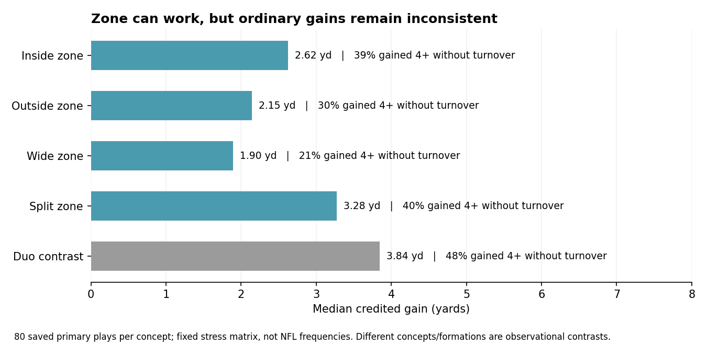

# Quick zone-running diagnosis

2026-10-16. **Analysis only; no fixes, flag changes or new simulated plays.**
My assessment: the main remaining football problem is turning a developing
stretch into a protected route at the runner's arrival. The line has zone
assignments and does move laterally; a missing response at the attached end,
uneven first-to-second-level access and imperfect blocker/runner compatibility
remain. More sideways speed or stronger hands would not establish a solution.

This reuses320 primary zone cases,80 formation transfers and80 Duo contrasts
from #101. The new focused suite reuses eight full-context Over3/pair11/seed77
failure/control traces, both directions in all four zone families;8/8 compatible,
zero new execution. All480 detailed caches pass the frozen source/input/operator/
runtime/hash preflight. The eight reserved inputs remain unopened.

Accepted developbb6d4c73948d53ba841dd9338dd240146c739f8c still matches fetched
canonical queuebb1c44dcdfdd6f767b9750d1d1724f7914df1175. Source
`668acb1784799c93d4704aaaa41233a11627ee0a862b41dc279cd11a0a22eeac`,
Node22.23.3,44 accepted flags/components1, RUN_READ0, CF_FLOW unset;
original frozen measurement operator unchanged. Analysis hostd87387d3872822613111d53253b1b9bef24734d8.
These are descriptive stress inputs, not NFL call-weighted outcomes or an NFL
technique certification. Primary IZ/OZ/WZ use attached-end Ace12; split uses
gun-wing12. Prototype runs and unaccepted candidates are excluded.

## What is failing most often?

| Primary concept | Cases | Median gain |4+ yd/no turnover | Median first-contact gain |
| --- | ---: | ---: | ---: | ---: |
| Inside zone |80 |2.62 |38.8% |0.92 |
| Outside zone |80 |2.15 |30.0% |0.79 |
| Wide zone |80 |1.90 |21.2% |0.53 |
| Split zone |80 |3.28 |40.0% |1.30 |

Wide zone's4.25 mean is lifted by long runs while ordinary access remains poor.
The runner is generally encountering a defender close to the line, not simply
losing a large amount after a clean entry. That identifies where to inspect;
it does not identify the guilty player or prove tackle behavior is calibrated.

**1. A demonstrated role omission at an important edge.** The accepted installer
includes inline ends in covered/uncovered ownership. But `RunBlocker.zoneEligible`
requires an OL roster role, so an attached TE assigned a solo reach does not get
the existing reach/seal/runoff read and its contact-fit updates. At installation,
37/80 OZ and37/80 WZ cases contain at least one such TE solo reach. This is an
exposure count, not74 proven bad endings; combinations have separate guards.
For outside runs the end is part of the blocking surface, so this role mismatch
can leave the most important edge using a less responsive generic action.
[PR104](https://github.com/tannerthardy/football-simulation-/pull/104) is the
separate owner's narrow correction; it is **unaccepted and absent here**. Its
different native comparator includes other pending context, so its results
cannot be substituted for a corrected replay of these320 cases.

**2. First-level movement is real; leverage through arrival is unreliable.**
WZ median across plays of the five-OL mean playside displacement is+.59yd at1s
and+1.29yd at2s. Loaded first-level OL have median mean forward displacement
of+.99yd at2s (OZ+.74yd). Across all four zone families,0/1,600 sampled OL body
positions at1s are more than.1yd behind their own snap position; WZ has16/400
at2s. This rules out universal backward collapse, not individual losses or
unrealistic technique. Means include climbs/cutoffs with different jobs.

Yet DEs make first carrier contact in30/80 OZ and27/80 WZ; LBs in36/80 and31/80.
The first-contact defender still transmits blocking load in25/80 OZ and21/80 WZ.
In the saved WZ weak Over3 case, LT moves3.41yd playside by2.80s, with the end
still loaded. The end is outside LT, turns toward the approaching RB and makes
contact at2.85s,0.06yd behind the line; the run ends at+.63. The same install's
strong-direction control gains9.22 and first contact is4.97yd beyond the line.
Opposite directions are not exact mirrors. The failed play is not explained
by stationary feet or absence of hands; the remaining question is whether a
cue-supported, attainable alternative could control that exposed route.

**3. Combinations do not reliably become useful second-level protection.**
Installed LB jobs achieve recorded load before first carrier contact in
103/198 IZ,68/196 OZ,70/196 WZ and77/188 split jobs. WZ's70/196 is a signal of
incomplete access, **not126 demonstrated missed blocks**. A keeper may be
unsafe to leave, a backer may become irrelevant, or a real block may be beaten.
This is not evidence for an earlier release timer.

The WZ weak trace releases LG toward Mike at1.10s, but LG never develops a
recorded Mike load. By2.80s LG is about3.2yd from Mike and C has lost ground
while retaining the DT load; the DE reaches the runner first. The successful
strong trace instead gets C–Mike load at1.40 and RT–Sam at1.75. Conversely, the
IZ strong failure loads all three installed backers and still loses: Will
contacts the runner after the LT–Will load ends. Counted assignment and even
completed collection are insufficient to establish protection through arrival.

**4. Runner and block decisions are not a fully unified zone read.** Production
presses a live gap, then uses acquired surface openings and threat scoring.
The dedicated defender/block relationship sequence—press, read the key,
bounce/bang/bend—is experimental `RUN_READ` and remains off. That is a known
model boundary, not proof that enabling the parked implementation helps or that
the runner made the wrong choice in these failures.

The accepted source also retains two assessment concerns: early-abandonment
scoring uses the original aim while movement uses `liveAim`; the general heading
forecast credits a defender with extra delay from its live engagement/win state
(.25 or.7s), while the near-line crease reader does not. A load flag cannot by
itself promise that protection. These are source-level inconsistencies, not new
matched decision experiments; the caches lack the full candidate scores needed
to attribute particular cuts. The earlier aim-reference candidate did not change
executed decisions in its Ace controls. Preserve that negative result and do not
blame the RB or enable an experimental read by assumption.

**5. Package geometry is a material limit; the mesh is a separate concrete hole.**
On the eight matched formation-transfer inputs, WZ Ace median3.42 becomes−.67
in gun and3.76 in pistol. IZ Ace3.82 becomes.42 in gun and5.87 in pistol; OZ
Ace1.86 becomes.38 in gun and2.93 in pistol. These vary the entire package,
not QB depth alone. They support keeping under-center Ace as the ordinary WZ
reference rather than claiming one footwork fix transfers everywhere.

The I21/Wide9 OZ/WZ transfers retain the two known20s live censors: QB traffic
disrupts the exchange while the riding RB leaves toward the run aim without
possession. That is a demonstrated coordination/recovery hole. It is two
correlated inputs and does not explain the80/80 completed primary Ace WZ runs.

## What this does not establish

Early positive teammate impacts occur in3/80 IZ,3/80 OZ,1/80 WZ and0/80 split
cases before1s. They cannot explain a universal stalled opening. Before first
carrier contact, those counts rise to23/19/16/16: traffic matters later, but
contact can be a consequence rather than the initiating mistake. Raw/final
request changes also include engagement control; they are not all avoidance.
For example WZ weak LT's.35–.40 interval asks7.54yd/s lateral and finishes with
a1.02yd/s request, but this trace does not isolate every intermediate modifier
or establish that the larger request was safe. Achieved motion includes real
acceleration and loads; entry velocity is not execution of that new request.

Loaded defensive wins are not all certified physically sound. The separate
[PR102](https://github.com/tannerthardy/football-simulation-/pull/102) identifies
retained tangential force beyond full arm separation in isolated run contact;
that correction is not accepted here and helper lifecycle remains unresolved.
The current loaded-contact indicators cannot settle that law question. Nor does
this sample establish excessive defensive speed or globally overaggressive fits.

## Recommendation

Keep the diagnosis centered on **who controls the defender's route when the RB
arrives**, not a lateral-distance target. The strongest demonstrated ordinary
zone controller omission is the inline-role eligibility issue already owned in
104. The next broader question is safe takeover → attainable LB collection →
runner entry compatibility, preserving useful runoff and legitimate counters.
The rare stranded mesh is independently actionable. No new correction is
implemented or tried in this pass; evaluate accepted changes on these same
saved opposing controls before deciding whether another experiment is needed.

Source locations: [installation/technique](../../../src/sim/behaviors/blocking.ts),
[carrier assessment](../../../src/sim/behaviors/carrier.ts),
[parked zone read](../../../src/sim/run-read.ts),
[physical exchange controller](../../../src/sim/assign.ts).
[Offline analysis code](../../../scripts/diag/zone-suite-analysis.py) and
[numbers/provenance/traces](../../../data/reviews/current/zone-suite-analysis/summary.json)
preserve this analysis. Reproduce from the original detailed caches with
`MPLCONFIGDIR=/tmp/football-zone-mpl XDG_CACHE_HOME=/tmp/football-zone-cache python3 -I scripts/diag/zone-suite-analysis.py`.
The receipts record480 read-only cache validations and8 focused reused cases;
new simulations, games, held-out reveals, production edits and test campaigns:0.
Cache integrity validation takes2.95s, the final offline analysis/plot4.31s;
the focused cache-only launcher command takes.91s. These are scoped costs,
not a claim that exploratory reading and report writing took that long.
The [receipt/hash index](../../../data/reviews/current/zone-suite-analysis/evidence.json)
and [portable eight-case index](../../../data/reviews/current/zone-suite-analysis/focused-index.json)
include the original raw caches with path-only relocation; both transfer censors
remain visible in the aggregate results.
