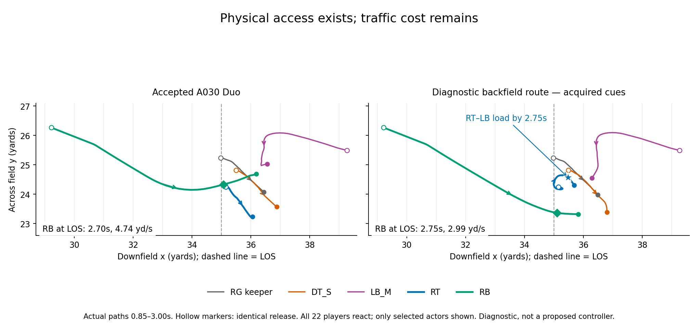

# Continuous reachability from the A030 release

**RT can physically reach and load LB_M from this release, using legitimate
acquired pictures. We have not demonstrated a clean protection improvement.**
The successful contact route congests the runner's approach, changes his lane
and reduces speed at the line. LB_M stays off him, but DT_S tackles him through
a different exposed first-level route. Stop this route search and investigate
the combo's opening takeover geometry; do not promote the diagnostic follower.

This is a **Duo** witness, not new wide-zone transfer evidence. The findings
bound this selected sequence, not all unachieved jobs or every possible route.

## Question, pins and predeclared search

From unchanged A030 RT release.85, can a continuous route around RG/DT_S
establish useful LB_M protection during the runner's actual arrival?
Accepted `develop@90edc52530caa71efdebf257f17d954a8a629ea0`, source
`7ea3e00e2504271133a4384fbdbf1931e8ac8bf352861ee9e812f1372a0bf42b`.
Historical `4ded6b6` remains separate. Accepted #69 is already included and is
not reimplemented. [Previous accepted/control evidence](second-level-access.md)
and [parked exit tweaks](second-level-departure-route.md) are reused.

The [two-route plan](../../data/reviews/current/second-level-reachability/search-plan.json)
and executable diagnostic were committed **before either result**, at
`206f2280aa7f48900147ee9caf1c4a76dd026337`:

1. Fixed winding around DT_S's outboard/upfield shoulder.
2. Fixed winding behind RG, then up his inside shoulder.

These are continuous commitments from the release, not one changed exit or a
frozen runner trajectory. Tangential steering follows the chosen moving body
with ordinary radial clearance; requested cornering speed uses the existing
lateral envelope and summed radii. World supplies actual acceleration, facing,
support, contact and collisions. The same native teammate spacing remains.
After a first-strike corridor clears the pair, the original LB interceptor and
native strike/contact take over. No body position, impulse or velocity is set.

The first two continuations deliberately receive privileged current geometry
at RT's native decision cadence. This supplies information for a diagnostic
search; it is not an optimal physical bound or a production selection rule.
A conditional third continuation follows the *same backfield route* using
only ordinary `sim.see` pictures, at
`e05ab4ed38b58371fd87d0dcfefbbb1331e0e830`. That distinguishes physical access
from privileged information after the route produces real contact. Winding
was still chosen retrospectively: following with acquired cues does not prove
RT could select that route appropriately.

All22 players initialize normally from the exact saved setup and react normally.
The full prefix through.80, all22 bodies entering.85, original releases and
input/profile/settings hashes match accepted exactly. Only RT's post-release
free route/diagnostic LB picture changes. No physics, strength, capacities,
roster generation, hand policy, release rule, timer, runner or shared movement
code changes. [Exact settings and comparison](../../data/reviews/current/second-level-reachability/summary.json):
Node22.23.3, all44 accepted settings, `RUN_CONTACT_COMPONENTS=1`, no overrides.

## Actual arrival and protection

Native events label contact at the end of the tick. `Rep acquired` below is
the controller/World frame time; `first recorded load` is the next frame.
Do not confuse the different labels or credit a request as achieved movement.

| A030 continuation | Actual RT/LB work | Actual runner arrival and consequence |
| --- | --- | --- |
| Accepted | No RT/LB rep or load. Departure still owns the request; no ordinary LB interception before arrival. | RB crosses LOS2.70 at4.74yd/s; LB_M carrier contact/wrap event2.75;2.01yd. |
| Upfield DL route, privileged | First clear interceptor handoff2.85; no RT/LB block through the native ending. | RB crosses2.65 at5.23yd/s; LB_M wraps2.70. Faster/outward transit is too late to protect;2.17yd is not success. |
| Behind RG, privileged | Interceptor handoff2.60; rep acquired2.75, native event2.80; first recorded load2.80 includes456.5 lateral force. LB_M never contacts or wraps RB. | RB crosses2.70 at3.30yd/s, shifts toward the DT-side route; DT_S first contact3.20, wrap3.65;1.62yd. |
| Same backfield route, acquired pictures | Handoff2.35; rep acquired2.70, event2.75; first recorded load2.75: normal0, lateral401.85. Native contact/control remains real through arrival. LB_M never contacts or wraps RB. | RB crosses2.75 at2.99yd/s; DT_S contacts/wraps3.00;1.33yd. |



[Download/view the chart](../../data/reviews/current/second-level-reachability/paths.png).
All22 react; only the five relevant actors are plotted. No film or ZIP generated.

The acquired route demonstrates **physical access during the arrival window**,
including useful actual load. It does not require compression: zero-normal,
nonzero lateral force remains real under the unchanged contact contract. Nor
is this merely a nearer unblocked tackle: a native acquired rep transmits
load and LB_M stays off the carrier through the ending.

But this is **not a clean before-arrival protection witness**. It loads LB_M
only as the runner reaches the line, after native traffic responses have
already altered his approach. Compared with accepted, line arrival is.05s
later and speed is4.74→2.99yd/s. At2.35 the acquired-route RB raw/pre-spacing
request `(5.751,7.492)` becomes final `(0,0)`; at2.75 `(5.985,7.306)` becomes
`(2.703,-.395)`. The body does not stop instantaneously: achieved motion is
recorded independently. These are spacing-stage changes in the native tick
pipeline, with snap gating inactive. Peer-specific cue attribution was not
collected, so this does **not** establish that a particular avoidance command
was wrong. Do-It-All owns that investigation; no bypass is tested here.

No offensive teammate impacts occur in any of these continuations. Avoiding
impact alone does not establish compatible paths. The backfield route creates
real first-level/runner costs without an actual teammate collision. At3.00 the
acquired route still has RG/DT hands carrying normal783.4 and lateral383.8
kg·yd/s², while its fixed-frame phi is.700 and DT_S reaches the exposed runner.
Loaded hands therefore do not certify protection. This may include a lawful
DT win; stronger contact or requiring the former ending is not supported.
The exact final-yardage changes are not isolated decision-quality effects.

## Why native routing does not reproduce this access

The original earned release installs RT→LB_M, but its departure helper returns
the first clear *short* arc around the DL/keeper and tracks that moving exit.
It does not represent a committed full route around the keeper. At.85 native
requests `(-.435,-.873)`yd/s toward the outboard DL step; the acquired backfield
diagnostic requests `(-1.358,+.084)`, using RG's acquired moving reference and
fixed winding. Actual turn/braking is subject to the same body's momentum.
Native repeats local exits and never invokes its ordinary LB interceptor
before the stop. The acquired diagnostic gets to that interceptor at2.35.

That is an explained **navigation capability gap**, not proof the native
choice is a controller error. This alternative costs runner space and first-level
protection, and its commitment was chosen after reviewing the play. No
production rule for when to prefer it has been established. Neither a general
keeper-first policy nor a universal orbit controller should follow from it.

## Earlier opportunity: opening keeper acquisition and member choice

One read-only native prefix through.90 at
`eddfb0488f56d198131e2d93b8ef5ab61d07b260` inspects the exact original
physical keeper-eligibility ingredients without extra sensing, draws or World
steps inside the observer. Its full physical/request/RNG prefix is **exactly
identical** to the saved accepted trace. This answers the missing upstream
question: why does the outside tackle become the available climber first?

- RG's.55 own security read cannot authorize his departure. RT's potential
  keeper contact is not yet working/reliably controlled; actual eligibility
  fails working reach/useful support/contact control. A teammate having just
  joined is not a secured takeover.
- The first sampled state where RT passes all unchanged physical keeper
  conditions is.70. RG's next scheduled own read is.80; it then starts his
  acquired security history. Next read is1.033..., so his existing proposal
  cannot be ready at.85. That schedule is evidence, not a new timer proposal.
- RT already established that RG can keep at.60. His next ordinary read at.85
  completes the existing security requirement and releases him. This is not
  a simultaneous choice between two ready proposals or a demonstrated
  wrong-member ranking. The guard is still finishing his own security read.
- At release, RT is `(35.148,24.244)`, RG `(34.979,25.238)`, DT_S
  `(35.497,24.814)`, LB_M `(39.264,25.490)`. The first-ready climber starts
  outboard of the pair, with the backer inside and the runner approaching
  that same region. His real detour behind the keeper consumes runner space.

**Next question:** can the combo's opening fit establish useful RT takeover
for the inside guard's personally acquired departure opportunity while keeping
the DT surface protected? Inspect the initial RT collection/fit and its first
useful contact, rather than add a release delay or keep optimizing this outside
climber's detour. A later/inside departure is not automatically better; none
was simulated here, and an opening/controller defect remains unproved.

[97KB portable access/traffic/opening witness](../../data/reviews/current/second-level-reachability/A030-access-and-traffic-witness.json.gz)
contains the frozen setup, original full22 release, acquired load/arrival frames
and exact guard eligibility reads. Reproduce the native prefix to preserve
observer history; frames are not a complete hydration format. Physics and
Do-It-All can inspect their owned dependencies without duplicating this search.

## Reproduction, cost and decision

On206f228 with Node22.23.3 and the frozen input:

```sh
node scripts/baseline.mjs --candidate -- node --import tsx scripts/diag/second-level-reachability.mjs dl-upfield out/reach-front
node scripts/baseline.mjs --candidate -- node --import tsx scripts/diag/second-level-reachability.mjs keeper-backfield out/reach-back
```

One conditional information comparison, one read-only opening prefix:

```sh
# e05ab4e
node scripts/baseline.mjs --candidate -- node --import tsx scripts/diag/second-level-reachability.mjs keeper-backfield out/reach-acquired acquired
# eddfb04
node scripts/baseline.mjs --candidate -- node --import tsx scripts/diag/second-level-opening.mjs out/reach-opening
```

`python scripts/diag/second-level-reachability-report.py` adjudicates/plots the
saved packet with zero new simulation steps. Assertions verify exact inputs,
all44 flags, prefixes and observer neutrality, real reps/load, supported
zero-normal lateral force, native contact actors, traffic costs and takeover
sequence. `src`, tests and baseline settings are byte-identical to accepted.
No production patch or code-suite rerun is justified by this diagnostic.

Three native continuations to actual endings plus one.90s opening prefix:
**4.774264 launcher seconds**, including diagnostic serialization; offline
analysis/plotting additional. The opening's generic `buildResult` timeout is
explicit censoring while still live, not a new failed ending or game timeout.
No baseline/control reruns, new rosters, games or full suites. Exact commits,
measurement/intervention hashes,44 flags, inputs and
[artifact hashes](../../data/reviews/current/second-level-reachability/artifacts.json)
are preserved. Integration retains final verification ownership.

**Recommendation: retain accepted controllers, stop exit-route trials and move
upstream to the opening takeover opportunity.** Physical contact access is
possible, but the bounded search has not produced a clean protection
improvement or a justified production selection rule. That conclusion neither
declares every route impossible nor requires reproducing the old ending.
