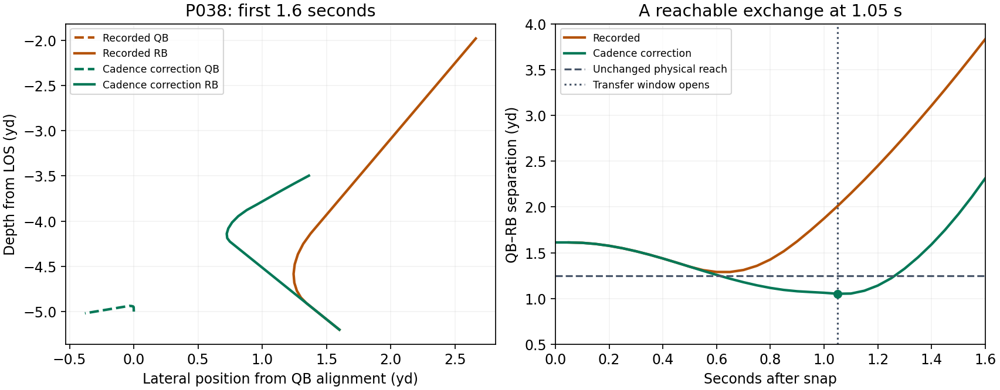

# Shotgun exchange cadence: one retained correction

**Recommend reviewing the cadence correction. Reject the late-QB-chase trial.**
The final runtime changes one condition in `RunnerToMesh`: proximity to the
back's landmark cannot start his riding departure before the existing transfer
window opens. No new clock, transfer permission or movement capacity is added.

| Saved native case | Recorded checkpoint | Cadence correction |
| --- | --- | --- |
| Experimental spread/air P038, Gun Wing Wide Zone Weak | No exchange; QB holds through 25s cap, −5yd | Physical handoff1.05s; tackle4.25s, +4.64yd |
| Experimental west/spread P069, Gun Doubles Wide Zone | Handoff1.05s; tackle3.95s, +5.13yd | Every recorded position and event identical |

Film numbering is **log.index+1, including kicks**: these are indices37/68.
The first game is the experimental26–38 game, not the accepted38–21 comparison.
The additional accepted failure in the newer audit is a flagged play:11 total,
10 clean. This agrees with PR #57's earlier clean-play operator.



## First causal difference and actual execution

P038's back is .7yd from his own mesh by.50s. The old controller immediately
aims downfield despite transfer remaining closed until1.05s. At.50s its raw
request is `(4.692,2.433)`yd/s. The correction continues approaching the mesh,
requesting `(2.539,−2.222)` with the same speed/capability law. This changes a
target selection, not the body's instantaneous velocity.

By.90s the QB's acquired picture is now inside the existing landmark gate, so
his **unchanged** controller requests movement toward the back. At1.05s the
actual separation is **1.051731yd**, inside **1.250480yd** physical reach;
the ordinary physical handoff succeeds. The old actual separation was2.009267yd
at that instant. No early QB/RB body impact explains the missed exchange.
The new back then runs naturally; neither his future path nor defenders are
frozen. The play finishes in a tackle, not a prescribed gain.

The back's proximity threshold, timing-speed calculation, riding speed,
through-speed, aiming point, QB behavior and all contact/spacing execution
remain the same. The condition uses the already-installed `meshTime−.15`,
the QB's existing first eligible transfer time. Being eligible still does
not confer possession. An interrupted or downed exchange cannot transfer
outside real reach.

P038 retains the existing Y/H impact182.42N·s at.75s and RT/Y impact9.31N·s
at1.25s. RT/H at1.70s changes139.29→131.35N·s. There are also later defensive
LB_M/LB_W and LB_W/CB_W impacts90.06/174.62N·s in the changed continuation;
these adverse contact observations remain in the trace. No QB/RB impact is
introduced. P069 preserves all its native contacts along with film/events.
This is an exchange repair, not proof of sound blocking or traffic everywhere.

## Rejected recovery-only experiment

At `0c4f77b4a3f9c2febd97b44761bcb7ea8b61175e`, a separate trial permitted the
QB to pursue an acquired RB picture outside the old landmark gate once the
mesh time elapsed. The recovery-only arm restored the original early RB
departure; every other controller, player and contact law remained native.

The QB starts moving at1.20s, but the actual gap grows2.45→4.16yd by2.50s.
It never returns inside1.25048yd reach. The QB also hits LG at3.20s for
**107.99N·s**, with further contact afterward, and is tackled at3.65s without
an exchange. At2.50s spacing changes his requested `(7.081,4.879)` to
`(2.927,.877)`yd/s; at3.20s it changes `(5.158,5.677)` to`(6.226,2.944)`.
These are requested movements; his achieved velocity at3.20s is only
`(.961,.885)`yd/s amid traffic. A local two-body stationary-back control
could recover, but that does not establish useful recovery toward this
moving back in the native traffic.

**Do not import that QB change.** The final QB file is byte-identical to
PR #57's recorded runtime. The trial's code/tests remain at0c4f77b; its
[receipt](../../../data/reviews/current/shotgun-exchange/rejected-recovery-receipt.json)
and [portable full-context trace](../../../data/reviews/current/shotgun-exchange/rejected-recovery-trace.json.gz)
preserve the adverse result. The combined trial's P038 success used the
cadence correction and never activated late recovery; it cannot validate
the rejected branch.

The remaining recovery blocker is specific: **a missed handoff cannot assume
that pursuing the now-departing back is an attainable, traffic-compatible
exchange.** Defensive premesh-key recovery needs its own acquired-possession
contract. Integration still owns missing rushing credit; the rejected trial
has no credited rusher. Neither is silently repaired here.

## Separate wide-edge investigation: saved evidence only

The [reduced timeline](../../../data/reviews/current/shotgun-exchange/edge-screen.json)
uses the new full prefix telemetry where present, plus P019's existing
standard recording. No additional pass snap is simulated.

| Case | LT's first identified target | First LT load event | Edge result before throw/end |
| --- | --- | --- | --- |
| P005 Drive | DE_W |1.50s|LT shed1.70; throw1.90; completion masks exposure |
| P018 Drive | DE_S |1.85s|RT shed1.70; LT shed2.15; throw2.30 |
| P019 actual Y-Cross | DE_W |.60s|No recorded shed; throw3.00; later receiver drop/incompletion |
| P040 Y-Cross | DE_W |1.45s|LT shed1.75; pressure2.40; sack3.00 |
| P012 Levels, adverse control | DE_S |1.85s|RT shed1.70; LT shed2.10; pressure2.40; hit/fumble2.60 |

P018's first failure is the opposite tackle; do not misattribute both shed
events to LT. P019 is neither P018 nor another universal edge failure.

P040's first sampled final request at.10s is `(.15,2.78)`yd/s, almost purely
lateral, with facing1.00rad. At.40 it requests`(−1.81,3.74)`; at.80,
`(−6.91,2.63)`. Recorded LT positions are approximately.55,.55,.95yd behind
the LOS at.10/.40/.80s. By1.20s the rusher is level in x; the first sampled
engagement has phi−.54 at1.40s. Phi reaches−.97 by1.70; crossing the geometric
threshold1 triggers the1.75s shed. The sampled hands carry actual lateral
load. This is not a missing assignment or evidence that a stronger grip is
needed. P005 shows the same shallow-then-late pattern. The body velocities
in full telemetry are **after the recorded step**, not proof that a fresh
request should already have been attained at entry.

The controller already selects ordered targets, projects an arc, shades an
inside shoulder and switches to a beaten-rusher ride. `cutOffPoint` estimates
reach time with scalar current speed and a .75*vmax ceiling, without the
turning/acceleration/body-clearance execution used by the World. That is a
concrete model mismatch to inspect, **not yet a demonstrated wrong meeting
point**. Its chosen point/branch and raw request are absent from these saved
recordings; `passSet.depth` is nominal state, not the final internal target.

Next pass-protection decision: capture those internal values for P040's first
set and compare the proposed intercept with its achieved approach, using
P019's useful edge block and P012's adverse outcome as existing controls.
Do not apply a universal depth/strength/speed boost or send this to Physics
as an execution defect before demonstrating a coherent attainable request.
`blocking.ts`, RunBlocker/puller/climber and carrier/spacing remain untouched;
Do-It-All!'s proposed routing has not been treated as acknowledgment.

## Exact inputs, initialization and verification

- Recorded comparator: `f62511a513f2187884d74ae3b94435835e43309c`, source
  `dd173a3ef44f22b5ee74f3cc17ef15b2137203cea58dd2fa12fbaad12c4784ba`.
- Read-only user-note evidence: `4ae667e29b3ce085f43c5cb911b294349cda2b8f`.
  The existing45-entry/35-scrimmage prefix was **not replayed**.
- Final tested candidate: **`21d7763882b71028e4d257241b3ea45511a70293`**, source
  **`1ee8610175f7f9e7ebafcbdddfe2c2aab2162e945a7668cbd54579e4d5fb6309`**.
- Rejected late-chase source: `5c02a431d668a29c28a183260ec405d505205e7b1df9434d75f4a5f67da8fa46`.
- Node22.23.3; all44 flags and world defaults are explicit in the
  [final receipt](../../../data/reviews/current/shotgun-exchange/receipt.json).
  Components=1; active hands/hand fight/reach track/run read remain0;
  accepted center-hand/legacy-support laws remain unchanged.
- [Original manifest](../../../data/reviews/current/experimental-game-inputs.json):
  P038 roster27101/27102, game702; P069 roster29101/29102, game704.
  [16KB native fixture](../../../test/fixtures/shotgun-exchange.json.gz) includes
  all22 players, exact calls/seed/energy and legitimate learned scouting state.
- Initialization uses the normal constructor and normal awareness installation,
  not a restart from sampled positions. Scouting is reconstructed from prior
  recorded calls. Saved energy is after pre-snap staging; constructor-input
  energy is recovered by deterministic staging inversion, residual<1e−14.
  An initial double-staging fatigue error failed P069 frame parity and was
  corrected before collecting candidate evidence. Native initial RNG matches;
  corrected unchanged P038 film matches through the inspected0–3.9s opening,
  and P069's entire native film/events match. No observer memory is fabricated.
- Final **32 focused checks** pass, including both-direction physical meshes,
  unreachable/downed/interrupted transfer, pitch behavior, owned-picture
  contracts, keeper and the saved native pair. Typecheck passes. PA keeps its
  separate QBPass/PlayActionFake path. No final full suite or full game is
  claimed; integration owns combined verification.
- Final two native plays:1.85s physics/run time,1.99s collector,2.50s launcher.
  Final test/typecheck launchers4.25/12.35s. All recorded launchers sum64.49s
  (parallel wall times overlap), including calibration, intermediate checks,
  a mistaken new-test label and two collector API/event-order failures.
  [All costs and failed receipts](../../../data/reviews/current/shotgun-exchange/costs.json)
  remain visible. No full games, roster expansion or NFL resampling.

## Integration handoff and next decision

Review the **net final runtime diff from e8a76a7 to21d7763**, which changes only
the riding-departure condition in `src/sim/assign.ts`. The historical0c4f77b
QB trial is not an independent candidate to import. Reuse the fixtures/tests
and [native trace](../../../data/reviews/current/shotgun-exchange/trace.json.gz).
No reference/default adoption is requested. Accepted develop remainsa1b16e6;
historical4ded6b6 stays separate. There is no claim that all nine missed
exchanges, current production, median run gains or pass protection are fixed.

Reproduce final focused evidence with Node22.23.3:

```sh
node scripts/baseline.mjs --candidate -- npx vitest run --project core test/shotgun-exchange.test.ts test/wide-zone-mesh.test.ts test/snap-mesh-and-pull.test.ts
node scripts/baseline.mjs --candidate -- node --import tsx scripts/diag/exchange-repair.mjs out/shotgun-exchange
```

**Recommendation:** review the cadence-only correction for experimental
integration, retain the failed recovery witness for its joint owner, then
instrument P040's first cutoff decision before another protection change.
