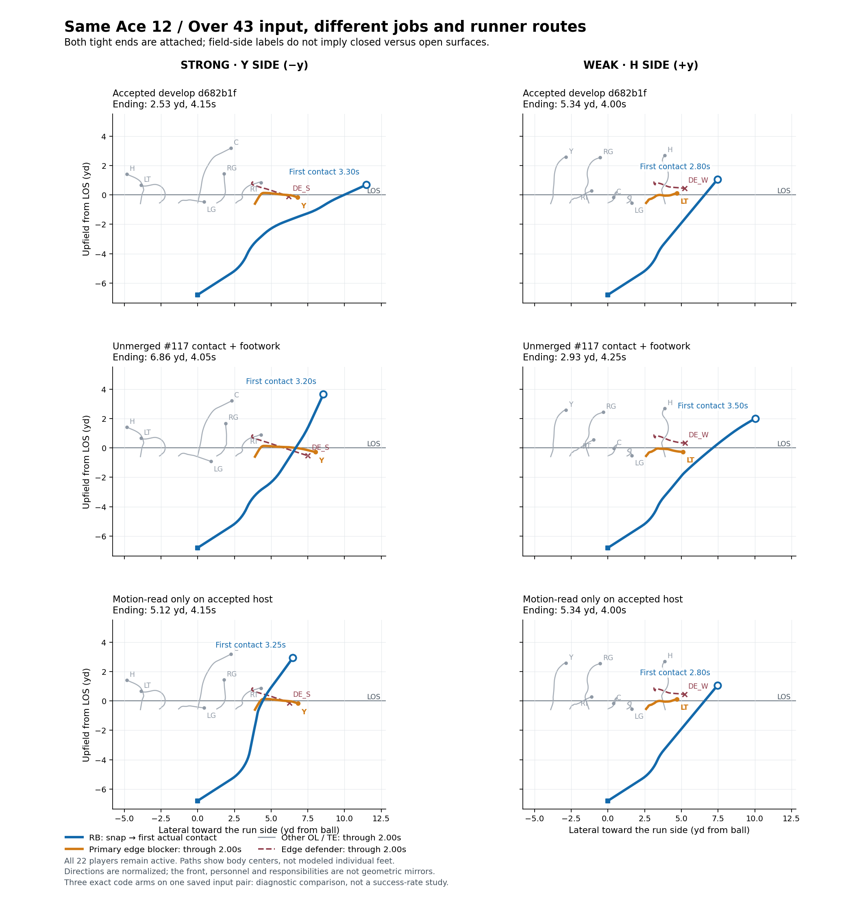

# Strong/weak wide zone: surface jobs and moving protection

**Keep #117 separate. Hold promotion of the new runner assessment until the
loaded-blocker/runner traffic interaction is independently reviewed.** We found
an actual information-use inconsistency and a feasible strong-WZ improvement,
but not a weak-side rescue or a general zone-run solution. Do not change strength,
release timers or weak-side footwork to reproduce a desired ending.

## Football answer

The basic reach/help/overtake/cutoff family is shared. The appropriate step and
continuation depend on the local shade, support relationship and available
surface. A widening end can be usefully run outside; the runner must be able to
enter inside that work. An unattainable hook is not required. A helper cannot
leave merely because the pair is nominally engaged, and a backside cutoff need
not copy the playside lateral displacement.

The source code has no special weak-side footwork multiplier. Both WZ calls
install `norm(1, side*1.8)` and use acquired reach/seal/runoff decisions. Free OL
receive the existing lateral opening track; attached TEs use ordinary approach
and fit before their solo-zone contact read. That role difference is real, but
this pass does not establish a TE-base defect or reopen the parked TE experiment.

Ace12 has an attached end on **both** sides. Its balanced formation's strength
is a field-side tiebreak, not an open/closed-surface distinction. The exact same
initial bodies face an asymmetric Over43 front:

| Installed job | Strong, toward −y | Weak, toward +y |
| --- | --- | --- |
| Playside end | Y reaches DE_S | LT reaches DE_W; H climbs Will |
| Interior | RT/RG combine DT_S; LG owns DT_W | LG/C combine DT_W; RT owns DT_S |
| Other second level | C climbs Mike; combo reserves Sam | RG climbs Sam; combo reserves Mike |
| Backside | LT/H combine DE_W | Y cuts off DE_S |

DE_S starts just0.119yd inside Y. DE_W is0.558yd outside LT and0.742yd inside H;
nearest complete down ownership therefore chooses LT there. This does not
prove a bad assignment. Both initial worlds hash to
`32ee9eb481089bb67aa8fcc194ec70a20077155068ccb3cdca29ace53382c6ce`.

### What Zorro and Wanda do—and do not—tell us

[Shawn Syed's Shanahan scheme account](https://sumersports.com/the-zone/shanahan-schemes/)
describes **Wanda** as outside zone weak. Some installations tighten its runner
track/read for a quicker downhill entry while the tackle widens the end. This
is not a universal requirement for every weak call. Its illustrated open tackle
edge is different from this double-attached Ace surface.

**Zorro** adds a specific TE/FB relationship through the end toward support:
the FB protects the TE's inside hip, permitting an aggressive reach while
accounting for an inside counter. Ordinary no-FB Ace strong zone does not contain
that help contract. Adding invisible FB help or labeling its current jobs
“Zorro” would be wrong. The [Kolste preview](https://rileykolstefootball.com/wp-content/uploads/2022/01/shanahan-wide-zone-preview.pdf),
pp2–4, treats front/surface checks and a singleback Box contract separately.

[George Penree's clinic](https://www.xandolabs.com/the-lab/position-groups/offensive-line/run-game-mechanics-offensive-line/pod-teaching-the-inside-and-outside-zone-schemes/)
teaches width/depth on the reach step, then a response to whether the defender
is even or widening. Those are local football decisions, not strength-label
speed bonuses. These are public coaching/analysis sources; prose and diagrams
were inspected, not a new frame-by-frame review of their embedded films.
[Source receipt](../../../data/reviews/current/strong-weak-zone/source-manifest-football.json).

## What the current comparisons actually show

All22 players remain active with ordinary reactions. Same pair11 offense11 /
defense12, strength.55, Ace12 under center, Over43 Cover3 box/stack, seed77,
LOS40/ballY26.67, no audible/hurry. Gains describe endings, not acceptance targets.
Contact times use native event labels; their post-World endpoint is0.05s later.
LOS crossings use the actual post-World body sample.

| Situation | Accepted d682b1f | #117 only | New read only on accepted | New read + #117 |
| --- | ---: | ---: | ---: | ---: |
| WZ strong | 2.53 | 6.86 | 5.12 | 6.49 |
| WZ weak | 5.34 | 2.93 | **5.34, unchanged histories** | 2.85 |
| OZ strong opposing call | 7.14 | 8.66 | **4.85** | Not run |
| Useful Duo climb | 3.50s censor | Exact to accepted | Useful RT/Mike work retained; changed RB path | Not run |

Accepted strong/weak ranking is the reverse of #117's ranking. Neither small
set estimates league frequencies or establishes a universal weak-zone penalty.
Historical4ded6b6 stays a historical law comparator; it was not relabeled current.

### Demonstrated error and isolated correction

`runReadAim` read teammate positions but discarded their already-acquired
velocities when assessing whether a route was obstructed. Ordinary carrier
assessment and later spacing use that motion. Six mirrored production-hook
checks demonstrate the mismatch: an entering and a clearing blocker previously
produce identical obstruction risk. Static obstruction/clear routes and
frozen-observation private-body/engagement perturbations are opposing controls.

The new assessment carries offensive `seen.vel` into a timed relative corridor,
bounded by the existing0.6s horizon. It retains candidate entries, route options,
arrival estimator, scoring weights, cadence and threat information. Static and
defender occupancy remain unchanged. No teammate command/engagement is exposed;
loaded footwork is not advertised as a rehearsed `calledMotion`.

This is an **approximate assessment**, not a turning/contact feasibility solver.
The time-to-reach estimate does not certify the linearly interpolated route.
World's achieved motion and native protection decide what the request delivered.
[Minimal two-file extraction](runner-motion-only.patch).

### Strong improvement, weak limitation

On accepted code, strong WZ first changes the RB request at1.55s; all22 body
histories match through that instant. The runner takes a more vertical route,
crosses LOS **3.10→2.60s**, and at2.65 reaches(40.312,22.068) instead of
(38.856,18.893). There is no first-level contact; SS first grasps him at3.25s.
This is an achieved usable path with existing momentum/capabilities, not only
an attractive command. Later C/RB impact at3.90 occurs after the tackle bond
and RB fall; preserve that execution risk rather than call it an entry collision.

The standalone weak case retains all22 positions, velocities, facing and events
through its actual ending. In #117's weak interaction the revised read chooses
a wider path at1.75 and avoids the first half-speed gather, but gathers again
later. LOS advances2.95→2.85; Mike now grasps at3.00 rather than missing at3.15.
Final gain2.93→2.85 does not establish improved protection. No inside cut was
prescribed. This candidate does **not** solve the weak traffic compatibility issue.

### Adverse OZ protection cost and portable blocker

The OZ first read changes from a waypoint at(38.8,22.195) to(38.8,22.67).
On the same acquired state, the new entry's score is10.381 versus the old
chosen entry's11.536. Under the old static assessment that entry scored12.110.
All choices are costly; this is not a claim that the lane was safe. At2.15,
both assessment versions choose(40.5,22.67) from the new physical state.

At controller2.30, RG's raw contact request is still identical to accepted:
(1.111,−1.612). The approaching runner causes spacing to emit(1.888,−1.097).
By2.60 it changes raw(0.697,−2.567) to(2.810,+0.185). DT gains access and body
contacts RB at2.65 while RG still transmits load. The first relevant cost is
therefore compatibility between a defensible acquired runner route and the
blocker's traffic response, not an initially different defensive execution draw.
It remains unresolved whether priority/yielding or the route estimate needs the
next correction. Do not declare the initial RB choice wrong from final yards.

The **17,531-byte** [native acquired decision](../../../data/reviews/current/strong-weak-zone/input-manifest-loaded-traffic.json)
reproduces RG's exact emitted adjustment with zero World ticks. It includes own
loaded body state, original/final commands and actually consumed teammate images
with legitimate called-track substitution. Peer private state is unnecessary.

```sh
npm run baseline:run -- --candidate -- node --import tsx scripts/diag/box-defense-review/loaded-traffic-repro.ts data/reviews/current/strong-weak-zone/input-manifest-loaded-traffic.json out/loaded-traffic.json
```

This proves the adjustment occurred. It does not prove that ignoring the runner
would be safe or supply a production priority rule. Keep teammate spacing,
physical impacts and legitimate defensive access. The late OZ RG/RB impacts
begin4.05, after FS's3.70 grasp; they remain visible in the receipt/summary.

Duo's first RB difference is1.70–1.75; RT's loaded Mike collection remains useful,
SS first contact stays3.25, no offensive teammate impacts occur through the
explicit3.50 censor. Its RB endpoint shifts+0.159yd upfield; it is not exact.

## Pins, cost and decision

- Accepted base d682b1f474cb6ba260a7b8b1119a62919c5a2159, sourcebed3c36.
- Research host #117 fae0a3585419704f385de02e6bfbf8b69ac4cfb1, source905ac9d;
  #117 itself is frozen and not promoted by this report. #116 stays separate.
- Runner runtime/tests b19f0ac0df31183eda9f1f9df959df6ad11f5506;
  final tooling type annotation9dae9f29fbd861a24243b9d4795b7651931b277e.
  New-read-only sourceb674258; new read+#117 sourcece13b11.
- Node22.23.3, all44 accepted settings unchanged, RUN_CONTACT_COMPONENTS=1,
  CF_FLOW unset, no experimental activation; exact flags/defaults in summary.
- **39 unique focused checks pass** (six new), final typecheck passes. Original
  tests are preserved. Independent code review finds no private-information or
  corridor-algebra defect, but is not production adoption of the football cost.
- Compatible accepted full tapes are reused. Ten valid native executions across
  four situations include short instrumented prefixes; no new roster/front
  panel, game, full suite or NFL scan. Two rejected observer prefixes dropped
  the optional perception delay; fixed forwarding matches cached histories.
  Type-only diagnostic fixes and a plain-JSON reader correction retain failed
  receipts. The summary records all command costs, not just successful runs.
  Total new test/collector/replay/typecheck command cost: **54.217s**, including
  expected reds, rejected observer runs and failed diagnostic typechecks.



**Recommendation:** keep the motion-aware candidate unpromoted and hand the
loaded-traffic witness to Do-It-All/Integration. Resolve which player should
adjust when a runner approaches a loaded block without sacrificing first-level
protection or creating a collision. Then test the smallest informed correction
on this OZ state and the useful WZ opposing route. No additional recovery arcs,
weak-only speed/track bonus, strength or release timer. A fresh front is deferred
because this specific interaction can still change the adoption decision.
Integration retains its single exact combined verification; this report does
not advance develop or hold #117 for a newly invented outcome requirement.

[Exact settings, receipts, native output hashes and adverse evidence](../../../data/reviews/current/strong-weak-zone/summary.json).
