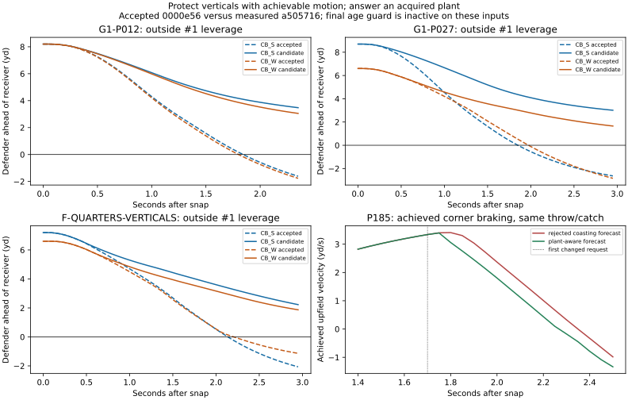

# Vertical coverage: preserve an achievable relationship

**The repeated defect was a movement objective, not insufficient DB speed.**
Deep defenders voluntarily spent their roof while receivers accelerated, then
requested recovery from behind. The correction preserves the installed duty
through a physically achievable speed pedal/turn/run sequence, and answers a
plant from acquired movement. It improves C3, Quarters and split-field examples;
it does not make Four Verticals automatically covered or solve all YAC.

Base: accepted `0000e560e0dbe31905151465152d412ba838803d`, queue
`aa9ed35272cc334ce0a7c79eec709970e5c628fc`, checked again before publication.
Code: `61bf22e2f3684064c90d73d013cfc23b35f05741`, source
`c9614df969c8bef376a50747b14ad57ed0aa186374093a40d6910998ea455090`.
Measurements execute `a5057166f23f9f4df1334d8f3560f8b7838319fd`, source
`690db3ead3b065d7df3a22df930eb0c6e6052f586b282dbed8d45deac1a649d4`.
The final age-expiry correction is inactive on every measured input; its
predicate coverage and exact patch are retained. See
[reproduction and receipts](reproduction.md) and
[the complete numerical evidence](../../../data/reviews/current/vertical-coverage-recovery/summary.json).

## What actually changes on verticals

All figures below are **achieved longitudinal lead over the same assigned
receiver**, before either arm throws or scrambles. Positive means above the
receiver; it does not certify lateral access, gaze or a catch contest.

| Native witness / responsibility | Time | Accepted | Candidate |
| --- | ---: | ---: | ---: |
| P012 C3 CB_S→X / CB_W→Z | 2.35 s | −1.61 / −1.77 yd | +3.48 / +3.05 yd |
| P027 Mable CB_S→Z / solo CB_W→X | 2.95 s | −2.64 / −2.84 | +3.01 / +1.65 |
| P187 Cover 8 quarter corner→X | 2.95 s | −1.77 | +1.89 |
| P187 weak quarter safety→H / strong half→Z | 2.95 s | +.29 / approximately 0 | +5.06 / +5.11 |
| Fresh Quarters corners→Z/X | 2.95 s | −2.07 / −1.14 | +2.23 / +1.87 |
| Fresh Quarters safeties→H/Y | 2.95 s | −.19 / +3.25 | +4.46 / +5.93 |

P012's nullified status stays explicit. P012/P027/P187 are prefixes, not newly
won games, stops or interceptions. P187's cloud corner stays underneath; his
large negative lead is intentional because SS supplies the half roof.

P027 makes the causal chain clear. The first strong-corner request at .15 s
changes from approximately **−8.02 to −.32 x yd/s** with an undeclared receiver.
At 1.00, achieved vx changes **−1.70→+2.08**. The final hip-open flag actually
occurs **1.20 rather than 1.15**: merely turning a flag on earlier was not the
solution. Positive movement before and through the turn preserves an executable
relationship. Capacities, starting bodies and receiver separation opportunities
are not edited.

## The controller correction

`DeepCoverage` tries the existing receiver-relative close first. If its forecast
spends the roof, it compares matching the stem while square, opening with it,
and running with it. The requested command is the command actually previewed
through the production free-movement machinery. The .8-second unloaded forecast
also checks remaining closure, orientation/acceleration cost and end-line space.
It is an estimate, not a guaranteed interception or future-contact solver.

Two acquired samples estimate a bounded burst or plant. A quarter-second
continuation is clipped by existing physical limits; a plant can reach zero,
never an invented reverse route. Acquisition timestamps prevent repeated reads
from manufacturing acceleration. Image age above .4 s expires the transient
forecast; fresh contrary evidence replaces it. These are prediction bounds,
not assignment persistence timers. No new `see` call, randomness, online
learning or head model is added. Existing exact opponent-profile bounds and
the engine's broad perception API remain modeling limitations.

Deep zones and their man replacements share this movement principle. The
Mable/Poach/Stubbie solo #1 locks explicitly receive the same independent
vertical duty: a nominal man lock cannot assume a post safety already occupied
elsewhere will cap him. Installed targets and distribution do not change.
Underneath over-top shoulders, including the held #127 flat/wheel experiment,
retain their original policy. Acquired run-fit and recognized-flight priority
remain ahead of this technique. Physics, speed/braking, hands, grips, capacities,
release rules and all 44 flags remain unchanged.

## The hitch revealed the missing opposing mechanism

An early conservative reserve overcounted turning and acceleration. It was
discarded after comparison with production free motion. The first preview
version then exposed another error: it recognized a lower current velocity
but discarded the acquired deceleration from its future picture.

P185 preserves the same **H1-WR3 catch**, body motion through the 2.85 catch,
throw timing, trajectory and catch location between that rejected forecast and
the correction. A1-CB1's first changed request is **1.70**, from the acquired
plant. In the exact saved local encounter he requests **2.01 rather than 3.63
x yd/s**, while actually moving +3.40: he now starts real braking before a
complete stop is visible. A regression fixture proves both request and achieved
braking without altering perception or the body.

First physical contact improves **3.70→3.65**. The rejected version's grasp
breaks at 4.05 and allows **38.60 YAC**; the corrected version finishes the tackle
at 4.45 with **2.67 YAC**. The unchanged accepted play was an incompletion;
the candidate still allows a legitimate hitch completion and 8.18 total yards.
Post-catch offensive choices and tackle execution draws are not held equal, so
the entire yardage difference is not attributed to geometry. No grip-force
defect or global tackling improvement is claimed.

## Controls, costs and limits

- **Real comeback cost remains.** P192's SS→Z separation at 2.95 worsens
  **3.12→4.49 yd**, before either throw. He honors the vertical longer and has
  more forward momentum to shed. The correction responds to the observed plant;
  it does not erase that physical cost. The actual throw goes to X, and the
  five-second measurement is still live.
- **A useful defensive finish survives.** G3-P089 retains A3-TE2's same throw
  and catch. H3-S2's first contact arrives **3.75→3.65**, the completion remains,
  and the defense finishes with **3.99 versus 4.68 YAC**.
- **Changed opportunities stay distinct.** G2-P067 changes a contested TD
  into a QB scramble; G4-P156 changes the intended deep WR catch into an RB
  checkdown under pressure. That RB still breaks a tackle and gains **9.31 YAC**,
  ending at 14.01 total yards. These are not matched tackle or YAC comparisons.
  Tight Cover-1 P043/P049 preserve their incompletion/interception and target
  separation; the ordinary man technique is untouched.
- **Fresh inputs:** one frozen generated player pair, seeds 6201/6202, with
  Quarters/Four Verticals and C2 Match/Smash, play seeds 6203/6204. No outcome
  filtering or roster sweep. Quarters transfers the leverage mechanism. Smash
  has different QB endings before a comparable catch, so its outcome control
  is inconclusive and is not resampled.
- **P105 remains held** for missing original pre-stem constructor state.
  Historical rounded film is not substituted for an exact checkpoint.

**107 distinct focused contracts and typecheck pass**, with compatible receipts
reused and failure dispositions retained. Twelve paired inputs include two
cached baselines. Total diagnostic work, including rejected estimates, adverse
continuations and four contract traces: 44 snap/prefix executions; approximately
20.49 timed case seconds plus recorded contract/check commands. No games, full
suite, roster matrix or parameter tuning. The [provenance ledger](../../../data/reviews/current/vertical-coverage-recovery/provenance.json)
records the full command cost, flags and input identities.

**Ready for independent controller/football review.** Review the three justified
contract reconciliations in the reproduction note and the P192/short-space
tradeoffs explicitly. Integration owns combined verification and adoption.
This is a supported vertical-coverage correction, not certification of every
handoff or the whole passing game. The six-yard help-cap cutoff, depth-based seam
handoffs, post-catch gather/containment and separate QB-information corrections
remain distinct follow-up work.
