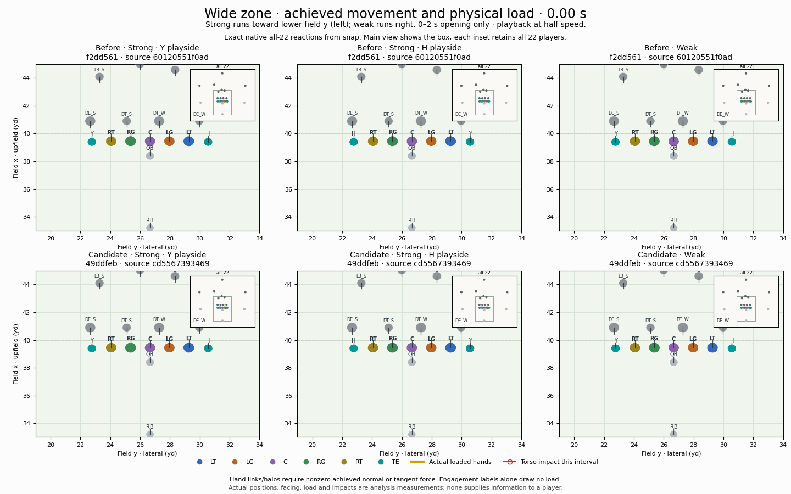

# Wide-zone execution: corrected mechanisms, failed promotion

**Recommendation: reject promotion of this full candidate.** The opening forecast now separates called tempo from achievable motion, strong-side RT avoids his teammate and can earn useful hands from an exposed approach, and RG produces more lateral movement under load. The coupled weak opening introduces a hard RT–Y collision, while LT loses real access to a flowing linebacker. This is not a completed NFL-looking wide-zone correction. The frozen fresh Under front was not run because the original three-opening gate failed. No historical yardage is required or claimed.

## Exact pins and scope

| Comparison | Commit | Runtime source SHA256 |
|---|---|---|
| PR #42 before | `f2dd5611bff80ff7e4415ea9777848218f4c01e0` | `60120551f0ad09415b47150f5edd9cdbd179955010a33d557af817fec31a01f1` |
| Final tested candidate | `49ddfeb49d699c43c87584fe1976c65f3e9a5907` | `cd5567393469815339dd1db159dae5c71ab76ec3b07e9180cdc4c0fbd398e0f4` |

PR #42 is diagnostic work on experimental PR #36 candidate `68284671d062dfd4e7e879bcd037bc21dad3e3ac`; it is not a claim that #36 became the accepted shared baseline. The accepted develop pin in the reference manifest remains separate. This candidate is experimental and unmerged.

Root owns the runtime changes, test disposition and recommendation. File ownership was recorded in WORKBOARD and PR #42 before editing; the prior RB investigation did not duplicate this work. Helpers owned assigned tests, evidence reduction and read-only diagnosis. No World/contact law, force capacity, collision switch, player strength or installed assignment is changed. The movement-preview helper uses scratch copies and the existing World. No failed post-mesh track or RT-only bypass is included.

The full [before capture](before.json.gz), [candidate capture](candidate.json.gz), [per-OL timeline](timeline.csv), [machine comparison](comparison.json) and [hash manifest](manifest.json) are saved here. Every coupled arm starts natively at the original snap with all 22 naturally reacting players; no body-only observer restoration. Before exactly reproduces all 300 published aligned opening OL rows, the full first-action all22 bodies/information/RNG/requests and installed initialization fingerprints. Candidate all22 physical/behavior initialization matches; its installed achieved-motion forecasts intentionally differ.

## What changed and why

1. **Installed intent is not COM velocity.** The old RG call used the requested lateral tempo from rest as his current/future translation. The copied zone installation now previews that same ordinary call through the existing movement law from public alignment, roster profile, nominal rest/support and energy. Desired tempo remains a request; the copied trajectory describes achieved nominal motion. No live job, body, fatigue, engagement or subsequent decision enters the install.
2. **The observer's requested ray is not his achieved path.** A free actor previews his complete own body for a .30 s request prefix followed by ordinary braking. All acquired neighboring routes are evaluated together. Raw, half and stop requests must remain upright and actually stop; a correction cannot fix one known neighbor by hitting another. If none clears, only a demonstrated improvement in worst clearance/contact approach can replace raw. No minimum lateral progress is imposed.
3. **A delayed moving peer may already be braking.** An acquired coast estimate is checked alongside an ordinary-stop possibility reconstructed from the same acquired sample and public profile. Neutral support, sampled-travel facing and full energy are declared nominal proxy assumptions, not private observations. This is a possibility, not a safety certificate for every contact or turn.
4. **Own residual lean is still predictable after release.** Actual load/constraints, engagement, push, squeeze, strike and down states keep their guards. Decaying own lean alone no longer sends an unconstrained actor back to the requested-ray forecast. The entire own support state remains in the World preview. At the saved weak 1.40 s state this repairs coverage but does not justify a new command: raw still clears both acquired coast/brake hypotheses.
5. **A stretch helper must approach exposed space.** H 1.35 s and Y 1.50 s fixed world-y half-man goals land .374/.245 yd inside the acquired owner's clearance. When this occurs on a mandatory stretch double, the helper selects a clear backfield fit point and requests an arrival on the seen defender's velocity. Existing spacing then checks achieved movement against every acquired neighbor. Ordinary reach and actual hand force still decide whether he can work. Installed helper side comes from the explicit declaration, then public formation, never the partner's private current position.

Vision, sensing opportunities, latency, 1.00 s memory, .30 s velocity prediction, .60 s installed zone deadline and source priority are unchanged. Called forecasts make no claim past their installed deadline. No hidden teammate data is restored. Older memory is not treated as evidence of a recent physical stop.

## Same-state mechanism and obstruction controls

- Both saved .05 s strong openings keep their useful raw RT command with every installed neighbor present. Reversing neighbor order changes nothing. Mutating a hidden teammate's body/job/support after installation changes neither picture nor command; the .60 s call is unavailable at the .65 s query.
- The genuine stationary obstruction control runs the unchanged two-body World for 30 steps: the lateral mover yields, stays upright, makes some safe progress and transmits no torso-impact impulse. The separate continuing-peer lane keeps its ordinary acceleration request. Achieved high-speed turning controls gather and resume without impact; they do not prescribe that the first request must already be half/zero.
- At saved H/Y approach states, the same own body and acquired pictures produce achieved .60 s paths with owner clearance **−.184 → +.245 yd (H)** and **−.116 → +.229 yd (Y)**. Candidate paths remain upright, travel 1.232/1.228 yd laterally and enter the unchanged 1.020 yd working reach. This establishes approach feasibility, not awarded block load. Clear opposite-shoulder and unavailable-owner controls preserve raw requests; queries do not mutate bodies/pictures or draw RNG.
- At weak 1.40 s, acquired raw/half/stop worst gaps are **+.07656/+.24544/+.26564 yd**. Every path is upright and stops. The original request is therefore a defensible result of this limited picture; demanding a gather would encode the ending. See [exact gaps](recovery-gaps.json).

## Three native Ace openings through 2.00 s

Signed playside yards are achieved COM displacement. Loaded lateral yards count intervals with nonzero **own transmitted hand force**, retaining negative motion. Normal impulse is the own-hand absolute force integral in kg·yd/s (multiply .9144 for N·s). A nominal engagement or zero-load joint receives no blocking credit. Direct climbs need not resemble first-level lateral tracks. No metric below alone proves a successful block.

| Case | OL | Lateral @.5 s, yd | Lateral @2 s, yd | Loaded lateral, yd | Normal impulse, kg·yd/s | First own load, s |
|---|---|---:|---:|---:|---:|---|
| Strong Y | LT | 0.129 → 0.129 | 2.514 → 2.789 | 1.399 → 0.000 | 288.2 → 0.0 | 1.45 → — |
| Strong Y | LG | 0.169 → 0.211 | 0.448 → 0.469 | 0.253 → 0.225 | 794.7 → 804.0 | 0.55 → 0.55 |
| Strong Y | C | 0.170 → 0.217 | 1.654 → 1.060 | 0.000 → -0.063 | 0.0 → 13.6 | — → 1.1 |
| Strong Y | RG | 0.287 → 0.235 | 1.251 → 1.676 | 0.963 → 1.440 | 589.4 → 573.5 | 0.5 → 0.5 |
| Strong Y | RT | 0.159 → 0.306 | 2.321 → 2.198 | 0.608 → 0.472 | 209.1 → 174.8 | 1.5 → 1.75 |
| Strong H | LT | 0.129 → 0.129 | 2.536 → 2.808 | 1.536 → 0.000 | 206.5 → 0.0 | 1.4 → — |
| Strong H | LG | 0.169 → 0.211 | 0.442 → 0.497 | 0.247 → 0.253 | 739.8 → 751.1 | 0.55 → 0.55 |
| Strong H | C | 0.170 → 0.217 | 1.811 → 1.122 | 0.000 → -0.031 | 0.0 → 0.0 | — → 1.1 |
| Strong H | RG | 0.287 → 0.235 | 1.261 → 1.531 | 0.974 → 1.296 | 681.7 → 684.0 | 0.5 → 0.5 |
| Strong H | RT | 0.156 → 0.306 | 2.987 → 2.251 | 1.252 → 0.642 | 447.8 → 220.8 | 1.35 → 1.6 |
| Weak | LT | 0.205 → 0.225 | 1.013 → 0.778 | 0.808 → 0.553 | 364.8 → 338.0 | 0.5 → 0.5 |
| Weak | LG | -0.035 → -0.117 | 0.909 → 1.089 | 0.833 → 0.281 | 154.7 → 107.3 | 1.6 → 1.85 |
| Weak | C | 0.147 → 0.221 | 1.577 → 1.603 | 1.398 → 1.326 | 930.7 → 483.0 | 0.55 → 0.6 |
| Weak | RG | 0.186 → 0.193 | 0.390 → 0.516 | 0.204 → 0.323 | 1237.6 → 913.0 | 0.5 → 0.5 |
| Weak | RT | 0.264 → 0.309 | 1.089 → 0.685 | 0.209 → 0.113 | 49.3 → 159.6 | 0.7 → 0.75 |

| Case | OL/TE impacts before → candidate | Total impulse before → candidate, kg·yd/s |
|---|---:|---:|
| Strong Y | 3 → 0 | 125.813 → 0 |
| Strong H | 2 → 0 | 94.816 → 0 |
| Weak | 0 → 3 | 0 → 205.523 |

Strong RT's first-half-second lateral travel nearly doubles; RG's loaded lateral travel grows about .48/.32 yd. Exposed fitting improves strong RT versus the preceding coast/brake candidate: loaded travel .225 → .472 yd (Y), .438 → .642 yd (H); actual normal impulse 49.8 → 174.8 (Y), while H remains about 221. At 2 s RT is on the RB side of the defender in both strong cases (x offsets −.022/−.279 yd), carries real hands and is not credited merely for joining. It still earns load later and travels less under load than the before arm. C's strong nominal involvement produces only tiny actual hand impulse, not a useful double by label.

LT's lost load is an adverse football result, not a spacing restriction on LT: his own requested/final free approach agrees, while the naturally reacting LB no longer takes the old traffic pause. At Y 1.45 s, before LT is 1.194 yd away inside the unchanged 1.206 yd strike reach; candidate is 1.484 yd away and separation subsequently grows. Do not stop the defender, extend hands or boost LT to recover that block. Weak LG also meets a genuine DT obstruction before his climb; his later backer load is not an OL/TE collision falsely counted as blocking.



The replay uses actual diagnostic positions/facing/load/impacts, with all22 overview insets; these measurements supply no information to a decision. Playback is half speed. [Static final frame](replay-2.00s.png), [lateral/load chart](comparison.png).

## First remaining demonstrated cause; next concrete correction

The weak hard interval begins at 1.45 s and delivers **201.226 kg·yd/s** RT–Y impulse; two later small contacts bring the total to 205.523. RT released DT_S at .95 s. By 1.40 s his own constraints/current load have cleared, but his .30 s-old acquired Y picture still clears under both coast and ordinary braking. Y's naturally reacting post-contact turn enters a route neither hypothesis represents. Repairing residual-own-lean eligibility does not reveal that turn.

A diagnostic adds two ordinary ±90° requests since the **same acquired sample**, using the same nominal proxy and public profile. It exposes a plausible overlap: raw/half/stop worst gaps **−.56055/−.56181/−.55817 yd**; none is clear. This detects the uncertainty but does not demonstrate an avoidance maneuver. It also labels the genuinely continuing parallel lane conflicted, although the existing choice retains raw. Therefore these broad turn possibilities are **not installed in production**. A global age² clearance disk is likewise not promoted: own ground traction does not bound unknown contact impulses, and the disk may deny ordinary neighboring routes.

The next concrete correction must test a **selective acquired-turn/uncertainty policy plus one achievable backfield escape route**, from this same weak state. Compare that route with raw/half/stop against every legitimate neighbor; retain the clear parallel lane and genuine obstruction controls before another coupled continuation. Merely adding more remembered seconds, lowering a speed threshold, adjusting the installed nominal track or choosing stop cannot supply the missing clear route. No claim is made that avoiding every hidden turn is possible from the current information. This is the demonstrated limit and falsifier, not a request for a broad new audit or RT recovery search.

## Regression disposition and final verification

An initial broader helper override broke two existing controls. The mirrored loaded-loss fixture explicitly declares its helper side opposite the formation fallback; the correction now honors that declaration. The Tite optional helper was rerouted away from its acquired work window; a causal ablation restored its earned 1.25 s check-climb with all new traffic/sensing retained. The exposed approach is now scoped to the demonstrated mandatory **stretch** track, preserving inside/split-zone check and downhill-double contracts even when optional coaching is removed. Existing thresholds, read clocks, earned release and physical hand-load assertions remain. The later Bear joined-read identity control also passes. The new controls were not relaxed to accept those regressions.

**Final pin: 224/224 focused checks pass across 18 files; typecheck passes.** See [test receipt](checks.json), [results](checks-results.json) and [typecheck receipt](typecheck.json). These cover teammate information/loop, traffic, turning/yield, new mechanisms, physical preview, first/second-level fit, helper checks, zone track/reach and combo transfer/attention/retargeting. This is not a full-suite claim. Legacy first-tick and zero-preview-cost prescriptions were replaced only where achieved same-World safety/progress controls establish the new receding-prefix contract; squeeze/constrained movement, actual work and capacity checks remain.

The final [native receipt](candidate-validation.json) has stable inputs and exit 0. Its 40 World hashes, information hashes and full aligned frames per case exactly match the preceding `16911cc` exposure candidate; subsequent fixes affect the non-stretch controls. All44 flags and World defaults match before. Maximum absolute World work residual in this panel is below 8e−12. No physics default or collision behavior is changed.

## Runtime and reproducibility

- Before collector: **3.995479 s**, 3 short plays/120 native steps; launcher child **5.747161 s**.
- Final collector: **5.157844 s**, 3 short plays/120 native steps; launcher child **6.497681 s**. About 29% higher collector runtime on this tiny instrumented sample; not a production performance benchmark.
- Final focused tests: **12.748625 s**; typecheck **13.438529 s**, run concurrently and separately from final native timing.
- The complete five-arm three-opening collection (before, exploratory first, second, exposed third, final) totals **15 short plays/600 native steps, 28.545230 collector seconds**. No full games. Focused tests and bounded helper causal controls are separate costs.
- Ordinary-turn diagnostic: **549 scratch World steps, .038537 s CPU**; exact recovery gap diagnostic: **180 scratch steps, .01605 s CPU**. A source-matched repeat of the portable turn script gives the same gaps in .031228 s CPU / 549 scratch steps; both receipts are saved. These are physical forecasts, not extra native plays. Test scratch previews are included in their test timings rather than misreported as zero work.
- Final plotting/report uses no World steps. The replay's final render is about 12.8 s. Fresh Under remains frozen and **unrun** after the failed original gate.

The first exploratory collector kept the same runtime hash internally but its wrapper failed unchanged-input verification when HEAD/validation inputs changed during collection. Its [failed receipt](first-exploratory-validation.json) is preserved; it is not a clean pass. Later second/final runs have stable-input receipts. Saved same-state witnesses document which exploratory source produced them.

Reproduce the final three openings at the code pin (Node v22.23.3, pinned dependencies/profile):

```sh
npm run baseline:run -- --candidate --receipt out/wz-execution/repeat.json -- \
  node --import tsx scripts/diag/wide-zone-opening.ts --arm repeat --stop 2 \
  --expected-source cd5567393469815339dd1db159dae5c71ab76ec3b07e9180cdc4c0fbd398e0f4 \
  --out out/wz-execution/repeat.json.gz
```

Reduce saved evidence without simulation:

```sh
python3 scripts/diag/wz-execution-report.py \
  --input before=docs/reviews/wide-zone-execution/before.json.gz \
  --input candidate=docs/reviews/wide-zone-execution/candidate.json.gz \
  --check-baseline before --out out/wz-execution/repeated-report --plot
```

The failed turn possibility is reproducible with `node --import tsx scripts/diag/wz-ordinary-turn-probe.ts` (create `out/wz-execution` first). This script is diagnostic only; it does not install the rejected prediction policy. Its [source-matched repeat receipt](turn-probe-validation.json) passes; [artifact typecheck](typecheck-artifacts.json) also passes. Replay generation accepts the same two saved packets; see `scripts/diag/wz-execution-replay.py --help`.
