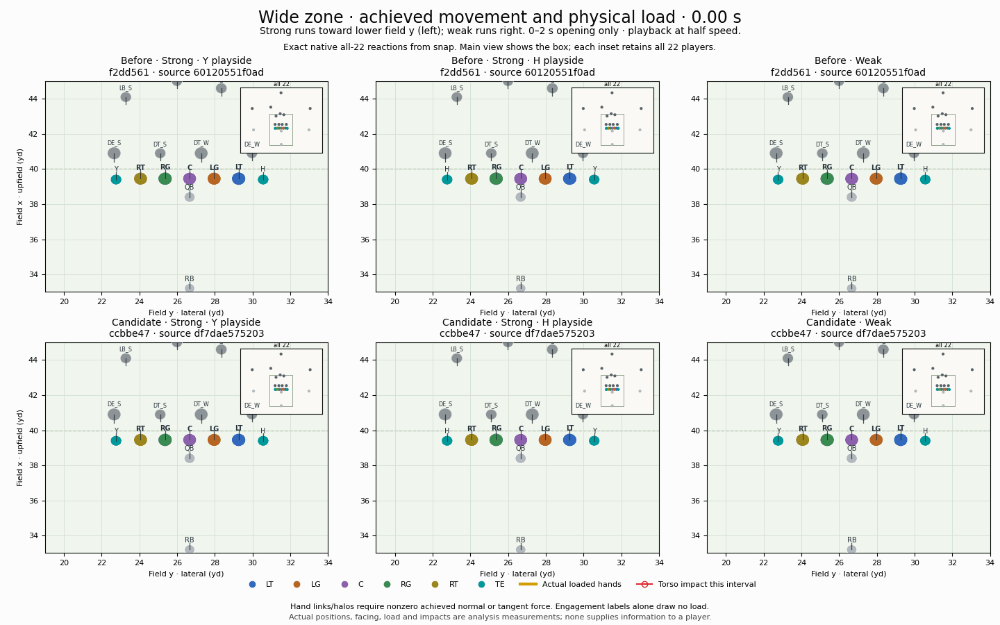

# Wide-zone football correction

**Recommendation: adopt the bounded controller/interface correction.** It
produces useful lateral loaded work on the three Ace openings and the frozen
Under front, with no teammate impacts. Remaining second-level misses and
uncertainty about later edge control are retained below. This does not certify
NFL visual calibration or promote an experimental branch to shared baseline.

This experiment starts from PR #42 `f2dd561`, runtime `60120551…`, rather
than promoting the rejected PR #45 traffic replacement. PR #36 `6828467`
is an experimental reference, not the accepted shared baseline. Physics,
ratings, collisions, sensing and memory durations stay unchanged.

## Football evidence and the actual mismatch

- [Mark Staten's outside-zone clinic](https://coachesinsider.com/football/the-ins-and-outs-of-michigan-states-outside-zone-play-article/)
  explicitly gives a covered TE the frontside technique used by the covered
  guard/tackle. An uncovered player reads the near knee: help an inward
  threat, or climb when the surface flows away. The implementation instead
  excluded attached TEs from zone technique and required the stretch helper
  to complete a double before climbing.
- [Pat Ruel's stretch interview](https://myemail.constantcontact.com/O-Line--Blocking-the-Stretch-Outside-Zone-Scheme.html?aid=v0EARWuEDnQ&soid=1104030277664)
  describes an uncovered playside-number track that can produce engagement
  or a climb. A completed double is not universally required. The covered
  blocker retains his down-man work until an actual takeover is felt.
- [Ken Wilmesherr's three-person teaching progression](https://coachesinsider.com/football/teaching-the-inside-and-outside-zone-using-3-person-groups-article/)
  supports the near-knee help/climb distinction. [Other installations](https://www.xandolabs.com/the-lab/offense/run-game/wide-zone-run-concepts/mid-outside-zone-case-4-uncovered-linemen-technique-double-teams-backside-blocking/)
  read a hip or teammate replacement instead. This is one defensible
  installation, not a claim that every NFL club uses one anatomical cue.
- [Chris Foerster's 49ers press conference](https://49ers.1rmg.com/transcripts/offensive-line-coach-run-game-coordinator-chris-foerster-press-conference-2/)
  explains why the runner's press influences defensive flow and blocking
  opportunity. [Brandon Thorn's backside drag-hand discussion](https://blogs.usafootball.com/blog/6227/how-the-backside-drag-hand-in-outside-zone-benefits-offensive-linemen)
  also distinguishes reaching from running/widening a defender. Useful
  lateral leverage does not mean every lineman wins an outside hook.

These written coaching sources support responsibilities and read structure.
They do not calibrate this model's yard-per-second tempo or prove visual
equivalence to NFL film. Embedded videos were not directly reviewed.

## Bounded changes

An original, unjoined stretch helper can climb after actual own lateral
progress when his acquired down-man picture flows away, his fresh acquired
covered teammate still appears able to account for it, and an existing
backer picture supplies a reachable departure. The exact first command is
previewed through the unchanged World against every acquired teammate and
the down man. An inward slant, blocked route, stale/missing owner, or own
loaded/held body rejects that branch. Only the helper changes jobs; the
covered teammate receives no invented takeover or hidden hand certificate.

An attached first-level outside/wide-zone blocker receives the same run
technique gates as an OL. The initial TE posture remains `.3`; a `.7` request
lowers him at the ordinary finite physical rate. Detached routes, slices,
pulls, climbs and pass protection retain their controls. Solo zone fits keep
their existing active-combo and joint exclusions. Stretch combination halves
come from installed formation positions, not hidden current partner bodies.

Installed nominal zone tracks distinguish requested tempo from achievable
COM motion. They are copied once from public alignment, profile, ordinary
rest and initial role posture using the existing free World. They do not
poll live fatigue, snap reaction, support, jobs or future decisions. Their
existing `.60s` validity and information priority remain unchanged.

A bounded opening spacing check compares the original achievable motion
against every acquired route for a fixed `.30s`. It may restore an original
request only when each radial restriction being excused came from a valid
multi-sample installed zone route. Observed stopping-distance restrictions
remain binding, and insufficient remaining call validity rejects the check.
This chooses between the original and existing restricted request; it does
not search new directions, peer braking policies or hidden future actions.

The first TE-role native comparison exposed another actual error: weak H
kept requesting `+3.989 yd/s` after the assigned half-man shoulder was already
inside him. He moved `3.912 yd` laterally with zero own hand load. After the
ordinary first step, attained/inside acquired shoulder geometry now ends
the minimum-tempo track branch and returns to the existing fit/attack
controller. This is a geometry transition, not a tempo tuned to the result.

## Validation protocol

Mechanism tests use saved acquired pictures and complete own physical state.
They are controller fixtures, not body-only native late restarts. Native
comparisons start all 22 players from snap with empty observation maps and
normal acquisition/reaction. Reuse the PR #42 baseline, run the three frozen
Ace openings to `2s`, and run the previously declared same-roster Under
front only after a supported mechanism candidate. No full ending or yardage
target is required.

Grade actual post-World lateral/forward movement, target-relative and
runner-relative position, each blocker's own normal/tangent force integral,
loaded displacement, falls and teammate impulses. A nominal engagement,
positive force integral or fewer contacts alone does not certify a useful
block. A center can legitimately climb without lateral gain; a loaded OL
can still finish on the wrong side of a defender.

The first helper-only capture at `b00d97b` is exploratory: review caught a
second projection of an already query-time DL estimate. Corrected source
removes that duplicate. The capture remains preserved as diagnostic history,
not the final adoption evidence. Its weak control has identical all-22
bodies, requests, executed commands, RNG, observer state and World reports;
full hashes differ because the policy adds installed/read bookkeeping.

## Final pins and checks

- Tested code: **`ccbbe47b217333dd7800c65890fa87a26a9877c7`**.
- Runtime SHA-256: **`df7dae5752038a5b4b73651cf06eecee6fd1a02aa13d0e4f2fa9f12fe6d56e96`**.
- Reused three-opening before: `f2dd5611bff80ff7e4415ea9777848218f4c01e0`,
  runtime `60120551f0ad09415b47150f5edd9cdbd179955010a33d557af817fec31a01f1`.
  Fresh-before artifact HEAD `76224ddeb6cca69f8924f99152d7e993fcf1e775`
  has that identical runtime. All 44 flags, World defaults, ratings and
  initial all-22 physical states match. Declared installation differences
  are the stretch-helper policy, inline cutoff frame, and copied nominal
  information tracks. No diagnostic request override is enabled.
  Captures retain the original collector's static `productionCorrection:false`
  label; the exact runtime hash identifies the applied source correction.
- [199 affected tests](receipts/checks-final.json) and
  [typecheck](receipts/typecheck-final.json) pass at the tested pin with
  unchanged inputs. Source and all test/script/config inputs were frozen
  during each receipt. The report reducer later gained per-opponent load
  attribution; that offline publication change adds no runtime behavior.
- Mechanism controls retain inward-slant collection, an actually crossing
  called route, another acquired conflicting neighbor, stale/expired/truncated
  information, own hand/foot/load constraints and hidden-body/job invariance.
  Both exact strong `.05s` states earn clear achieved motion against every
  legitimately available neighbor together. An attained-shoulder test still
  has initial outward velocity: changing the request does not erase momentum.
- The genuine six-yard observed obstruction retains exactly the old commands,
  bodies and contact history. Impact occurs at absolute `1.00s`, impulse
  `163.543 kg·yd/s`, closing speed `2.833 yd/s`. An immediate full-stop request
  from the identical state also impacts with that impulse: existing movement
  cannot stop in time. This control is not labeled collision-free.

## Before and after, through 2 seconds



The [1s](replay-1.00s.png) and [2s](replay-2.00s.png) snapshots show actual
bodies and facing. Gold hand links require nonzero transmitted force;
engagement membership alone draws no load. Red marks all torso contacts,
including normal opponent collisions, not only teammate collisions.

| Case / responsibility | Before | Candidate |
| --- | --- | --- |
| Strong Y / teammate impacts | 3, impulse 125.8 | 0 |
| Strong H / teammate impacts | 2, impulse 94.8 | 0 |
| Weak and fresh Under / teammate impacts | 0 | 0 |
| Strong Y / RT actual work | DE_S, normal impulse 209.1 | LB_S, 334.1 |
| Strong H / RT actual work | DE_S, 447.8 | LB_S, 340.9 |
| Both strong / C actual work | nominal join, zero own hand load | DT_W, normal 643.8 / tangent 267.4 |
| Strong Y / RG loaded playside displacement | .963 yd | 1.474 yd |
| Strong H / RG loaded playside displacement | .974 yd | 1.476 yd |
| Strong Y / front TE loaded playside displacement | .638 yd | 3.180 yd |
| Strong H / front TE loaded playside displacement | .510 yd | 2.791 yd |
| Fresh Under / C loaded playside displacement | 1.055 yd | 1.316 yd |
| Fresh Under / RT loaded playside displacement | 1.067 yd | 1.429 yd |
| Fresh Under / RG actual work | DE_S helper, normal 59.3 from 1.90s | LB_M, 124.8 from 1.80s |
| Fresh Under / Y actual LB_S work | normal 544.6 | normal 687.3 |

Impulse units in this table are `kg·yd/s`; multiply by `.9144` for N·s.
The [opening summary](opening-summary.json) and [fresh summary](fresh-summary.json)
contain all five OL and both TEs, both force components, early/late achieved
movement, nominal zero-load joins, loaded opponents, support states and final
defender/RB-relative geometry. Their compressed timelines retain every tick.

Useful positioning differs by responsibility. The front TE runs and widens
DE_S; outside/upfield position relative to the defender can be useful runoff
even when the current defender-to-RB line does not cross the blocker. It is
not an established seal: front-TE normal load ends late (Y by 1.40s, H by
1.80s) while tangential work continues. At 2s DE_S remains about 2.82/2.79yd
from the actual strong-case RB. Fresh RT still transmits normal/tangent force
in the final interval; DE_S is 2.53yd from RB versus 2.03yd before. These
measurements describe this censored opening, not later protection or yardage.

LT retains actual LB_W load in both final strong openings (normal 211.9).
C's nearly zero lateral total is actual DT_W collection alongside LG; it
does not mean C has achieved LB_M access. Forcing these two blockers farther
sideways would misgrade their acquired first-level responsibility.

## Retained misses and next concrete question

| Case / player | Actual work earned | Incomplete work at 2s |
| --- | --- | --- |
| Weak RT | DT_S, .75–.90s, normal 150.0 | No LB_S load, 3.31yd from current target |
| Weak H | DE_W at .95s, normal 20.0 | No LB_W load, 1.48yd from current target |
| Fresh LT | DT_W, normal 683.2 | No LB_W load after departure, 5.54yd from current target |

The next correction question is whether second-level departure and the fit
planner account for **acquired** nearby obstructions and the backer's changing
motion. Test the exact pre-departure own states and acquired pictures in the
saved captures before changing a rule. A faster request, earlier release or
larger reach has not been demonstrated to solve those misses. The current
climb planner forecasts unloaded motion toward one acquired backer and does
not certify a collision-free route through future reactive defenders.

An earlier TE-only candidate lost strong LT's contact: changed legitimate
DE_W/H interaction produced a larger LT obstruction at .60s, then LT missed
unchanged strike range by .024yd. Its acquired DE picture did not predict
that collision. The final candidate restores LT contact through its separate
supported opening correction; no actual DE truth or reach boost was inserted.
The intermediate captures remain preserved instead of being called successes.

## Cost, artifacts and reproduction

Final candidate's three openings took **4.199s / 120 native steps**;
the fresh candidate **1.585s / 40 steps**. Fresh-before took 1.351s / 40
steps. Including both exploratory three-opening candidates, this branch's
new native collectors total **14.916s / 440 steps / 11 short play instances**.
The original before capture is reused, not counted as new. No full games or
completed endings were run. All four final inputs are explicitly censored at
2s. Test command wall time is 10.532s and typecheck 12.674s, run concurrently;
the replay reducer adds 13.123s and zero World steps. Exploratory/final
receipts retain their own pins, failures and costs.

Portable captures: [before](before.json.gz), [candidate](candidate.json.gz),
[fresh before](fresh-before.json.gz), [fresh candidate](fresh-candidate.json.gz).
The [bundle manifest](bundle-manifest.json) hashes every published artifact.
Compact summaries are readable JSON; full tick reports/timelines are gzipped.
Raw captures retain exact consumed pictures and own physical state for the
remaining mechanism questions. They are diagnostic histories, not serialized
late native restarts.

From the tested code pin with Node 22.23.3:

```sh
npm run baseline:run -- --candidate --receipt out/repeat.json -- \
  node --import tsx scripts/diag/wide-zone-opening.ts \
  --arm achieved-stretch --stop 2 \
  --expected-source df7dae5752038a5b4b73651cf06eecee6fd1a02aa13d0e4f2fa9f12fe6d56e96 \
  --out out/repeat.json.gz
```

Add `--fresh` only to reproduce the already frozen Under input. To inspect
saved results without simulating, use `scripts/diag/wz-execution-report.py`
and `scripts/diag/wz-execution-replay.py` with the captures above. The failed
post-mesh trial and rejected broad traffic replacement remain excluded.
