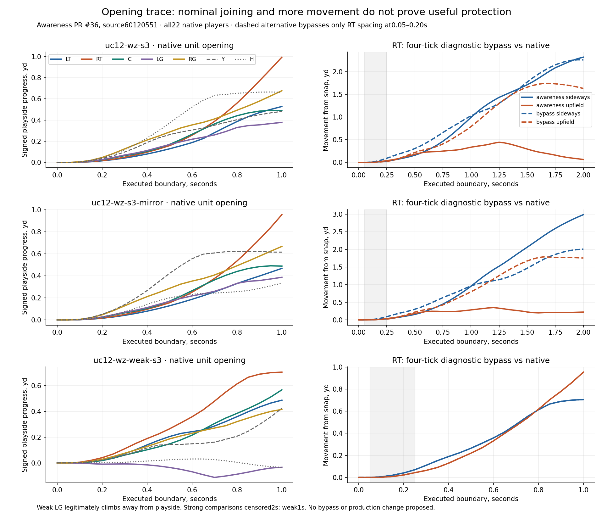

# Wide-zone opening: the first loss and the forecast blocker

**The first consequential loss is an RT spacing adjustment at0.05s, before
contact. Its forecast mixes requested self motion and nominal teammate tempo
with achieved COM motion.** The evidence isolates that mechanism, but does not
yet support a production correction that respects every acquired teammate
constraint. The four-tick bypass is rejected. The precise next owner question
is the physical interpretation of installed nominal tracks in the opening
traffic forecast, with achievable self movement retained.

This closes the late Y-collision investigation and preserves its completed
[a6bf3cf review](https://github.com/tannerthardy/football-simulation-/blob/a6bf3cf47af738298c67ec45301d17c1d06b4cd3/docs/reviews/y-coordination-review.md).
No RT-owned RB sighting expired; the post-mesh trial failed both controls.
Neither that ending nor the old successful Y gain is a repair target. Gather
release remains with its owner, separate from this diagnosis.

## Pins, scope and initialization

- Accepted develop **a1b16e666a9ee7d1bc1d2aecba141fc535863b24**, runtime
  **e5c318a1082c3738b9782107fa9faec67ada38b02245d1a529af4adaf6825c54**.
- Completed Awareness [PR #36](https://github.com/tannerthardy/football-simulation-/pull/36)
  **68284671d062dfd4e7e879bcd037bc21dad3e3ac**, engine98411ef, runtime
  **60120551f0ad09415b47150f5edd9cdbd179955010a33d557af817fec31a01f1**.
  Its information interface, acquisition, yielding, physics and capacities
  are reused unchanged. No production file is changed on this branch.
- Historical **4ded6b600fd3785e65034aa5623d7a9f8f3c5db1** stays separate.
  All44 flags/components1 and center/centered, legacy/mean World settings
  appear in [receipt.json](receipt.json). Active hands and reach-track remain off.
- Same `uc12-wz-s3` Y, `uc12-wz-s3-mirror` H and `uc12-wz-weak-s3` H;
  offense31/defense32, strength.55, seed3, ace12, Over/Cover3, singleback
  under center. These are placement/call contrasts, not geometric mirrors.
  [Manifest](../../../config/wide-zone-opening.json) freezes a same-roster
  Under-front fresh input **before results**. It remains unrun because no
  supported production correction passed the mechanism comparison.

Every native arm starts from snap, including the owner's copied installed
expectations, empty observer sighting/pending/touch maps and legitimate
once-per-tick sensing after mind updates. No observer is seeded from recorded
future bodies, and there is no body-only late restart. All22 players react
normally. We reused accepted H/Y0–.45 evidence, captured the missing weak
opening and accepted tail, then captured the three Awareness openings.
Only the two changed strong comparisons extend to2s, explicitly censored.

## Compact opening timeline

[timeline.csv](timeline.csv) contains900 aligned OL rows: three cases ×20
ticks ×five OL ×accepted/Awareness/bypass. Each row records assignment,
target identity, free/owner/helper status, raw and final request, entry and
**post-execution** velocity/facing, and actual displacement. Full captures
also retain method transitions, each intent write's caller, actual consumed
pictures, observer state, joint/pending inputs and after-World reports.

| Entry | Unit behavior and first relevant change | What it establishes |
| --- | --- | --- |
| .05 | Strong RT's zone request `(1.823,−7.584)` becomes approximately `(2.049,−1.689)` after spacing; RG also yields to its RT picture. Five OL are free. Weak C yields toward a different neighboring surface. | Earliest loss is upstream of contact/locomotion, not proof that every restriction is wrong. |
| .05→.10 | Strong RT executes about `(+.00245,−.00202)`yd and ends at `(+.098,−.081)`yd/s. | The new request must be compared with this after-state, not entry velocity0. |
| .30 | Strong RG leaves the track for a near first-level fit. | Inspect the fit/contact transition rather than force a lateral minimum. |
| .35–.40 | C's request is shaped by teammate spacing. LG leaves the track for its combination half-man approach, almost entirely upfield. | Independent legitimate fit geometry can reduce lateral work. |
| .40 | Playside attached TE owns the end block, with near-vertical loaded foot request; RT is still approaching. | Assigned combination and actual compatible loaded joining are distinct. |
| .55–.90 | Interior combinations acquire contact; weak RT helps RG/DT_S, then climbs on its existing release. LT or LG direct climbs differ by call. | Do not require identical lateral trajectories from every OL. |

Strong LG is an opposing geometry control. At accepted .40, DT_W's actual
y27.2794 is essentially its snap y27.2813. The helper half-man aim is27.8313;
LG is27.8266, only0.0047yd away laterally. Its track-to-fit discontinuity is
real, but forcing more negative-y movement could cross its assigned half.
The current evidence does **not** establish a wrong LG technique.

Local approach landmarks/placement errors were not directly instrumented.
The packet retains actual method/cue lineage and exact raw commands, and the
report labels nominal technique separately. This limitation prevents a claim
that every internal aim was reconstructed exactly; it does not affect the
first spacing write or the aligned executed displacement.



## The demonstrated forecast inconsistency

RT's first restriction concerns the attached playside TE: Y is actor7; H is
actor10. In the accepted feed the TE's initial position is accurately known.
In Awareness it is a legitimate installed alignment prior, not a current
visual sighting or another controller's future request. Nominal torso
clearance is about0.700yd.

The existing radial test evaluates **requested** closure around7.51yd/s,
then limits it to approximately1.61yd/s. It treats the requested ray as
immediate travel even though RT starts from rest. The existing World movement
law, using that exact own body/facing/posture/request, keeps the held-raw path
**0.494yd clear of the consumed stationary TE through0.30s**. Raw for0.30s
then an ordinary stop remains upright and stops about0.302yd clear of the TE.
There is a TE-local feasible opportunity; no increased acceleration is needed.

But this does not establish an all-peer-safe command. RT also consumes RG's
installed nominal zone picture at `(39.45,25.203545)`, velocity
`(0,−3.262442)`, sample/availability0, age.05. It describes the nominal tempo
as already-achieved motion from snap, while the declared starting body is at
rest. RT cannot substitute RG's private actual state or future command.

Against that **actually acquired** picture, the physically executed held-raw
RT path predicts RG touch0.163186s later. The TE-restricted path predicts it
**earlier**,0.149746s later. Their RG clearances at the0.30s forecast boundary
are respectively−0.297 and−0.427yd. The single-peer restriction therefore
does not establish a coherent safety forecast for the unit.

These are held-command, free-body forecasts against constant-velocity acquired
peer estimates; they are not native collisions or proof that RG will do that.
The RG conflict falls inside the installed prior's lifetime. The predicted TE
touch for sustained raw motion occurs at absolute.6227s, **after** its.60s
prior expires, so that longer forecast is explicitly an extrapolation.

The general issue is a forecast contract: **a movement request, a nominal
called tempo and an achieved velocity are different quantities**. A physically
achievable self forecast alone cannot certify the route while an incoming
nominal peer picture implies an incompatible opening. This is a specific
information/spacing interface limitation, not a demonstrated sensing failure
or shared-solver defect.

## Matched-state alternative and adverse evidence

The diagnostic changes only RT's final velocity back to its own raw request
at entries.05/.10/.15/.20 while he is free. Every other intent property,
controller, player, information acquisition, contact law and capacity stays
native. Before the first changed action, all22 bodies, observer state and RNG
match exactly. After.20 normal spacing resumes. This bypass is not a proposed
production policy.

| Strong case at2s | Native Awareness | Diagnostic bypass |
| --- | --- | --- |
| Y: RT upfield movement from snap | .065yd | 1.631yd |
| Y: RT playside movement | 2.321yd | 2.261yd |
| H: RT upfield movement from snap | .222yd | 1.756yd |
| H: RT playside movement | 2.987yd | 2.009yd |
| First nonzero RT normal/tangent load, Y |1.55/1.50s | None through2s |
| First nonzero RT normal/tangent load, H |1.35/1.35s | None through2s |

Both bypass cases nominally join by.95, yet RT's hand load remains zero
through2s. Native RT–TE impacts in the1.20s interval disappear, but H loses
almost a yard of RT lateral progress and both trials sacrifice that loaded
joining. More upfield movement and fewer teammate impacts do not establish
protection. At2s bypass RT is about1.7yd **upfield of DE_S**, with RB still
on the defender's backfield side; RT remains assigned to that end combination.
Native RT is on the backfield side of DE_S by.09yd in Y and.65yd in H.
The bypass therefore does not put RT between that defender and the approaching
runner. This is a positional access check, not a feasible-interception planner
or proof that the other TE has lost his block.
Runner and defender trajectories are allowed to change naturally;
their later access through arrival is not certified at this censoring boundary.
The bypass is rejected without spending complete endings to chase yardage.

Weak's raw and final RT commands already agree during the intervention beat:
its complete body/RNG/information opening is identical through1s, including
useful loaded help and the existing climb. The unchanged source also retains
Awareness's published obstructed-route/yielding contracts. Neither the weak
call nor LG's defensible half-man fit is a license to bypass traffic elsewhere.

## Owner handoff and recommendation

Hand [first-breakdown.json.gz](first-breakdown.json.gz) and
[forecast-probe.json](forecast-probe.json) to the Awareness/spacing owner.
They include the all22 physical inputs, exact consumed sources, raw/final
requests, initialized-history fingerprint, flags and actual first-action
provenance. They are diagnostic World inputs, **not a serialized PlaySim**.

**Resolve how an installed nominal opening track supplies an attainable,
bounded peer-motion estimate before testing a general closure correction.**
Keep acquisition, remembered information and public called intentions distinct.
Then use this same state to evaluate achievable self motion/braking against
every acquired peer; preserve a genuinely obstructed-route control and ensure
a correction for one neighbor does not worsen another. No widening vision,
memory extension, live-world substitute, release timer, grip or capacity change.

Awareness owns this information boundary and PlaySim overlap; the separate
gather-release owner owns its spacing change and promotion. This run branch
does not edit their files or duplicate their layers. A blocking-only change
is not justified by LG's fit or the rejected RT alternative. The next decision
is this single forecast-contract review, not another recovery variant, broad
census or full-game campaign.

## Checks, costs and portable reproduction

Accepted60 prefix hashes and40 existing Awareness body/RNG/observer hashes
match exactly. The two contact-transition tails repeat their20-tick prefixes.
All900 OL rows align requests with the executed interval. Across634 unloaded
intervals, velocity change minus recorded ground impulse/mass is below
**2.56×10⁻¹⁵**. This accounts for free execution; it is not NFL capacity
calibration or an angular/contact-law certificate.

Native collectors total **10.27s,350 World steps**, all on the original three
inputs, with explicit1s/2s censoring; no full games or new completed endings.
Preview work totals720 scratch World steps/~.053s CPU including the corrected
wrong-H-TE first pass and portable check. Portable inputs reproduce every
original World path and clearance exactly; extra touch/horizon annotations
in the published results are derived from those paths. Initial diagnostic
typecheck failures were corrected; typecheck passes at3cf5699. Its wall time
was not separately recorded. The final source is unchanged, so PR #36's37
focused information/traffic checks are reused rather than rerun. No full suite.
The receipt retains intermediate failures and source/tool/input hashes.

```sh
# At this diagnostic branch, Node22.23.3. No native replay needed for this witness.
npm run baseline:run -- --candidate -- node --import tsx scripts/diag/rt-opening-clearance.ts docs/reviews/wide-zone-opening/first-breakdown.json.gz out/wide-zone-opening/forecast-reproduction.json
# Native collectors use original all22 initialization from snap, not saved bodies.
npm run baseline:run -- --candidate -- node --import tsx scripts/diag/wide-zone-opening.ts
```

The chart is available directly as PNG/SVG. No film or viewer was generated,
and no ZIP is necessary for this handoff. Raw full-prefix packets remain local
and hashed; the compact witness, frozen recipe and collector are published.
