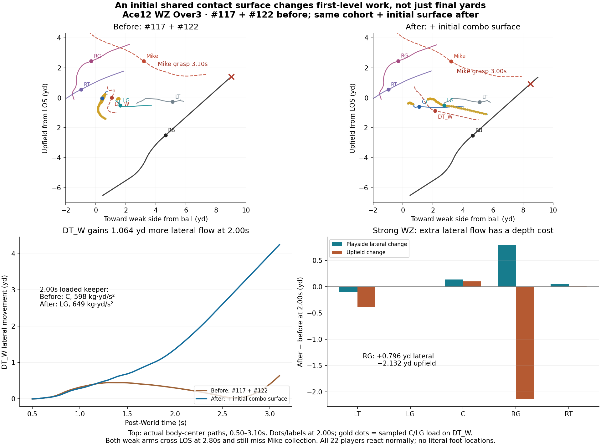

# Initial stretch-combination surface

Independent review supports conditional adoption in the exact tested cohort,
**not standalone promotion**. The patch repairs incompatible combination technique:
it makes the combination's first approach and acquired contact frame
describe the same installed half-man job. The useful cohort includes #117's
contact-following/loaded-footwork correction and #122's bounded traffic pace.
Those two prerequisites are now accepted through #125. The current-source check below includes them and the other newly accepted repairs. The historical isolated patch on `d682b1f` is not the proposed adoption target.

Weak WZ now produces sustained lateral first-level work from the combination.
It still fails to collect Mike before the runner arrives. That remaining miss
is explicit; final gain is not the adoption criterion.

## Current accepted-build check

Integration accepted #125 during this investigation. The branch preserves the
historical experiment commits, then reconciles accepted `develop`
`70b4db6a3ef53acc1a0e90cd055f1087205daa30` at runtime/test commit
`78a2574557d957d81a1c2bd255aff13420aad8fa`. Accepted source is
`9513511efacc10721f8ed2cc8553ef96d7b95a5b51217b8f4c6339533b504941`;
this candidate is
`4dbe2201f31fc0b114c8aa9f35705fb4fce7350503e97d0770b4a737b5dd97a4`.
Only `blocking.ts` differs in the production source. #117/#122 are already in
that accepted build; the other owners' #118/#120/#121/#123/#124 repairs are
preserved exactly.

The bounded current-source comparison repeats the same inputs because those
accepted accounting and defensive changes could affect loaded execution. It
adds no roster, front or concept beyond the declared screen and fresh transfer.

| Current production → this patch | Gain | Protection finding |
| --- | ---: | --- |
| Strong wide zone | 6.68 → 7.23 yd | End/DT stay off runner; RG depth cost remains |
| Weak wide zone | 3.08 → 3.11 yd | Coherent LG keeper work, C still misses Mike; wrap .10s earlier |
| Strong outside zone | 7.99 → 7.11 yd | Defensive win and shorter ending retained |
| Preselected fresh weak outside zone | 3.12 → 3.31 yd | C climb still misses Mike; wrap 3.00 → 2.95s |
| Useful Duo climb | Both explicitly censored at 3.50s | Opposing prefix retained; patch excludes Duo |

All ten native continuations retain all 22 ordinary reactions and have zero
offensive teammate impacts. The useful Duo frames/events are exactly unchanged
through its 3.50s censor. Current-source contact accounting changes some later
facing histories relative to the old cohort; neither chart nor report claims
all-body historical equality. Four current native commands cost **5.781s**.
**68 focused checks and typecheck pass** on this exact source; these repeat
relevant earlier checks rather than adding 68 unique cases. The current accepted
build's 1,980 TS/145 Python/typecheck/build receipt belongs to Integration and is
not represented as a full-suite pass for this candidate.

The chart below remains explicitly source-qualified to the earlier #117+#122
mechanism comparison. It is not relabeled as an exact current-build trace.
Current native results and receipts are separately preserved in the summary.
The original accepted `d682b1f` comparisons and isolated adverse endings remain
below; fresh weak OZ's old 5.59 yd baseline must not be confused with current
production's 3.12 yd.

## Historical pins, settings and responsibility

- Accepted base: `d682b1f474cb6ba260a7b8b1119a62919c5a2159`.
- Candidate runtime/tests: `45106c1b3c0f30cc35bed722931207cbaf9d676d`.
- Candidate alone: source
  `ff45493f3f44b5f49fc3f9c71e676739ab4b9fcda9d6fe97a3292e15450c153a`.
- Tested cohort: accepted + #117 engagement from `fae0a358` + #122 spacing from
  `cf827df` + this candidate, source
  `0ac630a214a03fc9a96077e2c0d9e8dbab918b35d7f9356ff98cf30293907f0e`.
- Prior #117+#122 cohort: source
  `048be756a6ecda65d10c8f77f6de15ac214d82191746e16657cd5a3d715aeab1`.
- Node 22.23.3, accepted 44 flags, `RUN_CONTACT_COMPONENTS=1`, `CF_FLOW` unset.
- Physics, World defaults, capabilities, roster and experimental policies unchanged.

The portable production scope is `RunBlocker.attack`, one private
`combinationFit` helper in `src/sim/behaviors/blocking.ts`, and
`test/zone-combo-surface.test.ts`. Diagnostic collectors are evidence tooling.
No helper-fit/security rule, assignment, release cue/timer, runner read, spacing
policy or shared solver is changed by this patch. #119 and #116 remain separate.

Exact inputs, source/output hashes and receipts accompany the
[input manifest](../../../data/reviews/current/zone-combo-surface/input-manifest.json)
and [summary](../../../data/reviews/current/zone-combo-surface/summary.json).
The Ace cases keep pair11: offense seed 11, defense 12, strength .55, play seed
77, LOS 40, ball Y 26.67, `ace_12`, under center with two attached TEs. Over3
means base43/over/cover3, box edge policy and stack linebackers. These are distinct
strong/weak responsibilities and front shades, not perfect geometric mirrors.

## Demonstrated mismatch and correction

An installed combination gave its members opposing half-man approach landmarks,
but the first acquisition could use the diagonal drive as its contact normal.
The same first-level job then entered an execution frame inconsistent with its
intended approach. It also did not enable the existing acquired-surface stretch
movement branch. Treating the resulting helper departure as merely a release
timing failure would miss that earlier change in the block's geometry.

The candidate derives each half from the offense's installed alignment order,
known before contact: the existing authored offset is −.35 yd in depth and
±.55 yd across the defender. Both halves share the bisecting depth normal;
each member retains its own installed half-man angle. The same offset supplies
the approach aim and the surface passed at initial acquisition.

The rule applies only to an active OZ/WZ combination, its installed defender
and members. It does not query a defender's private live engagement flag.
An existing contact fit takes precedence. A physical join keeps already acquired
hands and their real frame; the patch does not silently rotate an old attachment.
Turn, support, traffic, reach and contact execution still limit the result.

These are shared technique rules applied to the actual blocking surface. They
do not give the weak side extra force or command identical lateral movement
from every lineman. A different keeper/climber can emerge from changed geometry
under the unchanged takeover and release contracts.

## Native first-level movement and surviving failures

The chart compares the **same #117+#122 cohort**, then adds this patch. It reads
committed [plot data](plot-data.json), including original file SHA256 and engine
source provenance. Coordinates are post-World body centers, not literal feet.
Gold dots denote actual sampled C/LG force on DT_W; load is not itself protection.
All 22 players retain ordinary reactions; the runner's future path is not frozen.

At 2.00s in weak WZ:

| Measurement | Prior cohort | With initial surface |
| --- | ---: | ---: |
| Actual DT_W keeper | C | LG |
| Keeper force on DT_W | 598 | 649 kg·yd/s² |
| DT_W lateral position | 27.744 | 28.808 yd |
| DT_W upfield position | 40.006 | 39.136 yd |
| Runner upfield position | 37.500 | 37.493 yd |

The DT flows 1.064 yd farther laterally, while being .870 yd farther into the
backfield. This is real work under load with a depth cost, not a universal block
win. The old C keeper also excluded DT_W from the runner; the added lateral flow
alone does not demonstrate extra runner protection. C becomes the climber under
existing logic but still cannot protect Mike's
route. Both weak arms cross LOS at 2.80s. Mike grasps at 3.00s with the candidate
versus 3.10s before; gains 3.11 versus 3.08 yd do not establish better collection.

Strong WZ also changes materially. RG is .796 yd farther playside but 2.132 yd
less upfield at 2.00s. The correction trades some vertical displacement for the
intended lateral work. Its useful consequence must be judged against defender
access and the runner's route, not a larger sideways-distance statistic.

| Cohort case | Prior gain → new gain | New LOS | New first runner contact |
| --- | ---: | ---: | --- |
| WZ strong Over3 | 6.68 → 7.23 yd | 2.60s | FS, 3.30s |
| WZ weak Over3 | 3.08 → 3.11 yd | 2.80s | Mike, 3.00s |
| OZ strong Over3 | 7.99 → 7.11 yd | 2.50s | CB_S, 3.50s |
| Predeclared fresh OZ weak Over3 | New cohort: 3.31 yd | 2.80s | Mike, 2.95s |

The fresh concept transfer was selected before candidate results, with the same
roster and front. LG becomes keeper and C climbs there too; Mike protection still
fails. Unlike the standalone fresh arm below, this cohort loses LG's Mike
acquisition because the keeper/climber sequence changes. This repetition supports
the first-level mechanism and preserves the
second-level limitation, rather than replacing the adverse case with a nicer run.
All native arms have zero offensive teammate impacts.

## Why this is not a standalone promotion

The candidate activates existing stretch execution, so its interaction with
#117's normal-following and loaded-footwork correction is material. Spacing also
matters: standalone strong WZ ends −.27 yd with DE_S first contact at 2.45s.
Adding only #122 restores an actual outside entry, LOS at 3.00s and first CB_S
contact at 3.35s, ending 3.83 yd. The full tested cohort has the different sequence
reported above. Do not collapse those arms into one claim of general readiness.

Standalone fresh OZ weak also remains adverse: accepted 5.59 → candidate 1.15 yd.
LG does load Mike at 2.25s and disrupt his flow, but the edge grasps at 2.50s;
that contact interrupts the open-run protection evaluation. It is not proof that
second-level collection was rescued.

Passive execution tracing reproduced both native histories without overriding
draws. At the edge attempt, accepted miss probability is .340649935 with native
variate .334205006 (miss); candidate probability is .319492831 with native variate
.712909844 (grasp). The old variate would also grasp at the new probability.
Both geometry and changed execution draws matter. The adverse ending cannot be
explained away as random, nor does it alone establish a controller defect.

## Focused checks and next decision

130 unique focused checks pass on the historical standalone candidate, plus typecheck.
The exact cohort passes 68 focused checks: 48 repeated candidate/contracts and
20 #117 checks. This is **not 198 unique tests** and is not the full integration
suite. Initial surface, mirrored installation, existing-hand frames and supported
combination contracts are checked without requiring compression or an old gain.
Expected reds, rejected fixtures and adverse native evidence remain in receipts.

Most native baselines are reused compatible saved results; only the declared
fresh input needed a new accepted continuation. No broad roster panel, game
campaign or shared full suite was run. Integration owns exact combined verification.
All measured commands including chart generation cost **58.535s**, including
failed fixtures, repeated checks and passive captures; cached earlier work is
excluded. The summary records individual command costs. Rendering this static chart took 1.696298038
command seconds (0.505772191s within the renderer). No film or zip was generated.

To regenerate the chart without ignored traces or simulations:
`python docs/reviews/zone-combo-surface/plot.py` (Python and matplotlib).

Recommendation: conditionally adopt the narrow technique repair only in its
explicit #117+#122 cohort, subject to Integration's exact combined verification.
Preserve the initial-frame contract, visible depth tradeoffs, keeper/climber sequence and
the still-unprotected Mike route as the next bounded diagnostic; do not infer a
need for more force, another release timer or a universal weak-side bonus.

[Portable two-file extraction](promotion.patch) · [Reproduction instructions](reproduce/README.md).
