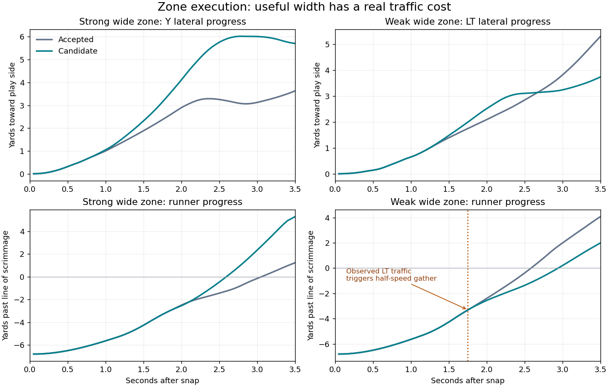

# Zone contact execution: normal following and loaded shoulder work

**Recommend the bounded controller correction for Integration review.** It
creates useful inside passage in strong wide zone, preserves the useful Duo
climb and a fresh Under-front defensive stop. The weak call loses yards through
an explained teammate-traffic response. Neither NFL averages nor restoration of
an old ending were adoption targets.

## What changed, and the general football principle

Depth security and shoulder position are separate jobs. A blocker should request
both from his acquired contact geometry; the same physical effort budget decides
how much he achieves. A loaded engagement is not protection until the defender's
route to the naturally moving runner is controlled through arrival.

Two small corrections in `stepRunRep` apply that principle:

1. **Follow normal motion in the normal frame.** The old stretch controller
   projected defender velocity onto a diagonal drive, then removed that drive's
   tangent during composition. Pure3yd/s lateral motion could therefore create
   1.44yd/s of unintended normal drive. Real normal motion was attenuated twice.
   The correction uses the existing acquired unit normal, retains signed
   connection closure and the original projected request bounds, and introduces
   no division by a near-zero angle. Mirrored production-hook witnesses fail on
   accepted code and pass on the correction. Native guards and tackles exercise
   the affected branch from0.60–0.70s, not just a synthetic geometry.
2. **Keep shoulder footwork during a stretch anchor.** The existing own-body
   lost-depth cue still adds the same upfield request, with the same push and
   posture. Outside/wide zone retains the already computed lateral request
   rather than reducing it to30%. Vertical blocks keep their old response.
   This adds no force, strength, grip or independent effort budget. The physical
   penetration controls explicitly show the depth cost of spending that effort.

No assignment, release rule, runner read, spacing/YAC file, defensive controller,
contact law, capacity, roster generation or flag/default changes. This is not a
claim that every zone blocker should move laterally by the same amount, nor a
general instruction to climb earlier. Backside cutoff and Duo responsibilities
remain different.

## Exact source, settings and ownership

- Accepted base: `d682b1f474cb6ba260a7b8b1119a62919c5a2159`, freshly fetched and
  checked against queue `bf493d881f423540962c6b1ad3b889fe2662e8c8`.
  Accepted engine `bed3c36cf08407762fed67abdf0a1651fe6ed7fc8c09b43ab3d9b33f1dfd4616`.
- Normal-only commit: `d0d69f080487de40e8cd382cc1574f67b85ff9c9`, source
  `6439c1d5d8e10be221565142d29fd2ecc119c212c2885ad8fcffc1d810719edd`.
- Final runtime/test commit: `15fcbcdc1e7b03a635a3a5ff14f96fdab0c42ffc` on `codex/zone-anchor-protection`, source
  `905ac9d64c0a3a57be168f0a592f325693adb49b8c272d2c2abeb5e56a595340`.
  Native combined measurement source was `353a28ce8ee34f911e9013f854dff8a4cf024e9a07cf4e52bec660945ffff8e9`.
  Only three comment lines changed afterward; emitted JavaScript hashes match.
  The passing focused test's subsequent type annotation also emits identical JS.
  [Machine-checked compatibility](../../../data/reviews/current/zone-contact-execution/compatibility.json).
- Node22.23.3; all44 accepted settings unchanged, RUN_CONTACT_COMPONENTS=1,
  CF_FLOW unset; no DL_ESCAPE/LB_SHED/DEEP_CAP/RUN_LANE/CLIMB_EXIT activation.
- #113's review/tooling-only ancestor remains in this research branch. Minimal
  production extraction is **engagement.ts and the two new test files only**;
  it needs none of that report/collector ancestry. Root alone changed the shared
  contact controller; three parallel readers examined technique, execution and
  saved protection. Integration's #112 boundary is released. Shared movement
  and physics owners' files are unchanged. Historical4ded6b6 stays untouched.

## Each correction alone, then together

Same generated bodies, inputs and seeds; all22 players and their ordinary
reactions. Recorded endings are descriptive, not pass/fail assertions.

| Saved situation | Accepted | Normal only | Shoulder work only | Combined |
| --- | ---: | ---: | ---: | ---: |
| Ace12 OZ strong, Over3 | 7.14 | 6.95 | 8.66 | 8.66 |
| Ace12 WZ strong, Over3 | 2.53 | 1.67 | 5.42 | 6.86 |
| Ace12 WZ weak, Over3 | 5.34 | 4.25 | 6.97 | **2.93** |
| Saved Ace11 Duo useful climb | 3.50s censor | Identical | Identical | Identical |
| Preselected Ace12 OZ strong, Under3 | 0.30 | Not run | 0.81 | 0.67 |

All use pair11: generated offense11/defense12, strength.55, play seed77, except
Duo's published saved setup. Under3 keeps the base43 roster but changes shade and
spill; selected before viewing candidate transfer, unused in this local review.
It is not claimed globally untouched by the historical census. Three compatible
accepted WZ/Duo continuations were reused. Fresh collection fills missing contact
commands through the opening2s; the named OZ witness and transfer continue to
actual endings. Duo remains explicitly censored, never assigned a final gain.

### What improved in actual protection

Strong WZ Y's loaded lateral progress at2s is **2.90→4.12yd**. At2.5s the runner
is **0.98yd farther upfield and0.59yd farther inside**, while Y/DE still transmit
real hand load. The end requests recovery toward the runner and spends its real
outward momentum turning back. The runner crosses the line **3.10→2.60s** and is
1.73yd farther upfield at2.75s. This is useful runoff opening an attainable inside
route, not improvement achieved by stopping the runner or freezing a defender.

Line-wide2s snapshot, strong WZ (yd toward play side / upfield from initial):

| Actor and work | Accepted | Combined |
| --- | --- | --- |
| LT, backside end cutoff | −1.27 / +1.21 | −1.27 / +1.21 |
| LG, DT_W | +1.73 / +0.07 | +2.20 / −0.37 |
| C, collected Mike | +2.27 / +3.73 | +2.31 / +3.76 |
| RG, DT_S | +0.48 / +2.00 | +0.60 / +2.23 |
| RT, collected strong LB | +1.72 / +1.40 | +1.72 / +1.43 |
| Y, playside end | +2.90 / +0.42 | +4.12 / +0.32 |

Every listed actor transmits positive hand load at this snapshot. Neither LT's
opposite flow nor C's greater vertical progress is categorized as failure.
Duo retains all70 frames,22 body histories, existing loads/impacts and27 events
exactly; RT/Mike work and the SS contact at3.25s remain.

### What regressed, and why

Weak normal-only really loses earlier end access: removing artificial upfield
feed-forward lets DE_W penetrate while still loaded. Shoulder work in the
combined candidate restores useful LT protection: no DE contact/miss occurs,
and the end remains at least0.58yd ahead of LT through1.8–3.0s under positive load.
First contact shifts from Mike2.80s to CB_W3.50s, yet final gain falls to2.93.

The first consequential cost is an unchanged spacing response at1.75s. RB
consumes LT's age0.05s picture at(39.785,31.259), moving(−0.466,+2.084), with no
called-motion substitute. The raw request(4.681,3.886) predicts **−0.040yd** torso
clearance; the existing half request(2.341,1.943) predicts **+0.859yd**. Other peers
are clear. The runner gathers, leaving perimeter pursuit time. An observation-only
wrapper records the real production calls and verifies all22 physical histories
still match the uninstrumented continuation through2s.

That is a defensible action from the acquired picture. It does not establish
optimal caution or perfectly predict a loaded teammate. It is not a newly proved
RB read defect, nor a reason to bypass traffic. Preserve this adverse interaction
for the spacing/navigation owner instead of tuning the block to restore yards.
[Consumed cues and forecasts](../../../data/reviews/current/zone-contact-execution/traffic.json).

### Opposing physical control and remaining limits

Four reduced2s contact drills compare mirrored straight bulls and inward
cross-face requests with continuously recomputed production blocker responses.
The same acquired hands, incoming velocities and fixture capacities are retained;
only the defender's bounded drill action is prescribed. No fabricated felt load.

| Opposing action | OL lost depth, accepted→shoulder work | DL penetration |
| --- | ---: | ---: |
| Straight bull, both mirrors | 0.463→0.793yd | 0.650→0.974yd |
| Inward cross-face, both mirrors | 0.400→0.514yd | 0.587→0.691yd |

All40 ticks remain loaded; both bodies stay upright and the defender does not
pass behind the blocker. Extra lateral effort costs depth under the unchanged
World budget. These reduced controls diagnose resistance, not runner protection;
the native Under3 stop supplies the football opposing outcome.

The first drill initialization was rejected: parking the carrier downfield
triggered "runner passed defender" and ended the rep early. Original output and
receipt remain identified as invalid evidence. The corrected carrier stays far
behind the island, and the collector explicitly errors on that invalid ending.

OZ's extra runoff partly exposes the existing end's outward-fit/threat-radius
policy: the end continues following the TE outside while the runner is inside
but outside the shed threshold. Strong WZ is the clearer protection witness
because the end actually reverses toward the runner. Do not sell this as a
complete defensive correction, lawful-hand-retention certification or league
productivity result. Existing shared contact limitations remain visible.

The [independent NFL-claims audit](https://github.com/tannerthardy/football-simulation-/blob/f8dbdcb03ee2c79c6ae10251103560c04710dada/docs/reviews/open-field-nfl-claims-review.md)
is adopted as a qualification: no mass calibration, reaction-time fitting,
immediate-LB-shed assertion, disputed lateral target or post-whistle NFL comparison
is used to justify these changes. All native comparisons stop at actual endings
or named censoring; requested and achieved velocities have separate tick labels.

## Evidence, cost and next decision

**65 focused checks pass; final typecheck passes.** Expected red tests establish
the prior coordinate/footwork behaviors. A test-array type-inference failure was
fixed with a type-only annotation; the failed receipt remains. No accepted test
was removed, rewritten to require an old ending or relaxed. Two independent
subsystem reviews support this bounded patch with the adverse costs above.

New test/simulation commands total **41.196s**, including both typechecks, expected
red runs, the rejected fixture, targeted adversity trace and opposing drills.
Three accepted full continuations are cached;20 native collector executions cover
five distinct situations across isolated/composed arms, including short prefixes.
There are no games, broad census/roster panels, NFL scans/downloads or contributor
full-suite repeats. Integration owns exact combined verification.



[Download paired strong-WZ film](strong-paired.gif?raw=1) (0.05–3.50s, native1×,
accepted above/candidate below; cropped trench camera, all22 players active).
Full terminal times and gains remain in the table and saved summary.

[Manifest, first changes, controls, raw-output hashes and receipts](../../../data/reviews/current/zone-contact-execution/summary.json).
Portable isolated patches: [normal frame](normal-only.patch),
[shoulder work](anchor-only.patch). No old experimental parent is required.

```sh
# Node22.23.3, exact published candidate and accepted44 settings.
npm run baseline:run -- --candidate -- npx vitest run --project core test/stretch-normal-follow.test.ts test/stretch-anchor-footwork.test.ts test/contact-motion.test.ts test/stretch-closure.test.ts test/run-anchor.test.ts test/run-contact-flow.test.ts
npm run baseline:run -- --candidate -- node --import tsx scripts/diag/box-defense-review/protection.ts out/zone-anchor/combined-native.json.gz
npm run baseline:run -- --candidate -- node --import tsx scripts/diag/box-defense-review/protection.ts out/zone-anchor/combined-transfer.json.gz --transfer
npm run baseline:run -- --candidate -- node --import tsx scripts/diag/box-defense-review/penetration.ts out/zone-anchor/penetration.json
npm run baseline:run -- --candidate -- node --import tsx scripts/diag/box-defense-review/traffic.ts out/zone-anchor/traffic.json
```

**Next decision:** Integration independently reviews the minimal three-file
production extraction and runs its one exact combined verification. Preserve the
weak traffic witness and OZ defensive-follow question as separate owner handoffs.
After adoption, return to the shared run-suite checkpoint at the existing budget;
do not recollect it merely for this report or calibrate toward an NFL ending.
