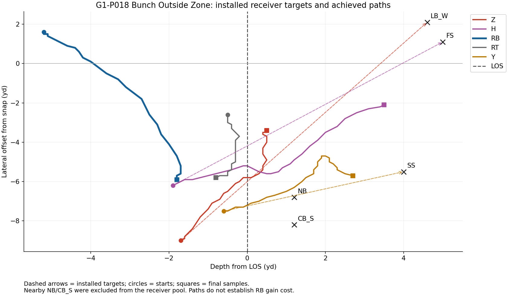
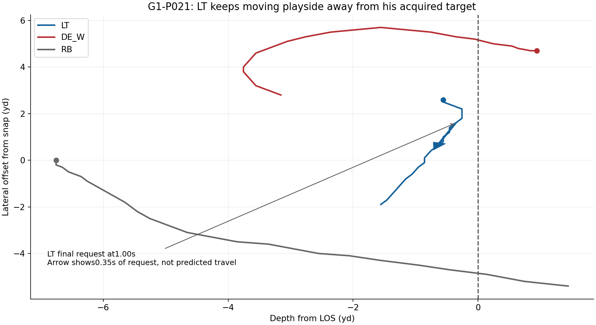
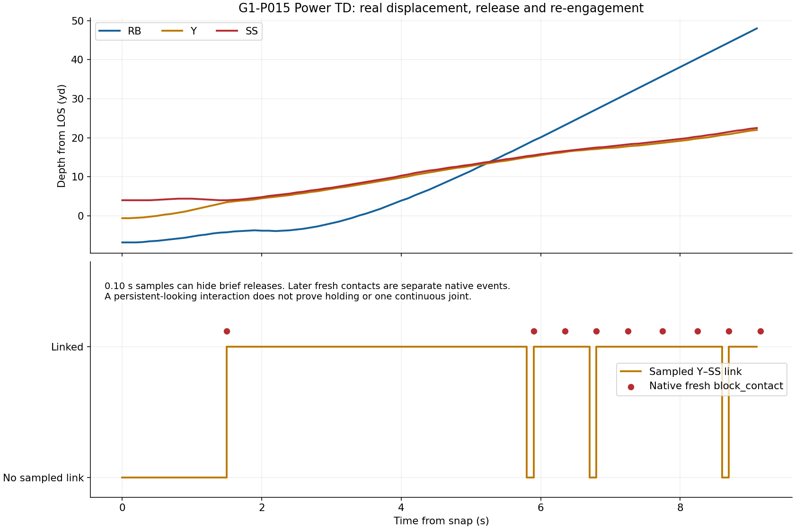

# Zone-reference follow-up: assignments, blocks, vertical roofs and catches

**The user's clip review exposed several concrete problems that the broad outcome summaries did not resolve.** The strongest new fixes concern which threats receivers may account for and how an outside deep defender preserves his roof before a release. Called zone footwork versus recovery is a further decision to adjudicate. The long Power block exposes a separate release/reacquisition and defensive work-off problem. Catch failures require an explicit distinction between a reachable opportunity, a missed grasp and a real ball touch.

Five specialist lanes traced the saved clips; a sixth reviewer independently challenged counts, units and causal claims. This continues [the full audit](accepted-game-deep-audit-2026-10-16/README.md), not another collection campaign. No engine, games, tests, runtime/config changes, merge or baseline designation occurred.

## Scope and current development

Primary data is **G1 zone-reference, seed 701**: 199 logs, 147 filmed scrimmages / 7,212 paired frames, 50 called runs and 97 dropbacks. The 135 nonnullified physical scrimmages comprise 50 runs / 85 dropbacks; 12 nullified dropbacks remain separate. Named opposing controls occasionally reuse other games from the same immutable cohort; they are identified as unmatched context.

The measured engine remains **`70b4db6a3ef53acc1a0e90cd055f1087205daa30`**, runtime digest `9513511efacc10721f8ed2cc8553ef96d7b95a5b51217b8f4c6339533b504941`, original evidence [`b9b9c175`](https://github.com/tannerthardy/football-simulation-/tree/b9b9c17597970ddc87aa4a4e271fc4cfeef71909).

At this follow-up, fetched accepted development is **`0000e560e0dbe31905151465152d412ba838803d`**, canonical queue `aa9ed35272cc334ce0a7c79eec709970e5c628fc`. #130 adopted **#128 only**. Its five-line runtime delta preserves acquired quarter-flat force duty; the Run, engagement, catch and C3 aim functions discussed here are unchanged. That is a source-scope comparison, not proof that a later whole game's calls/RNG/outcomes would match. **#126 is now held by a planned-double command contract failure; #127 remains held.** The earlier broad audit's ready-queue paragraph was its then-current snapshot.

**[Download the complete follow-up evidence](https://github.com/tannerthardy/football-simulation-/tree/0b43b456290fc6eed90d2560ab0e2e4817c41416)**: five detailed reports, all saved-data methods/ledgers/traces, independent review, figures and targeted standalone witness/control films. Open the extracted `out/zone-reference-followup-2026-10-16/witness-film/index.html` locally. GitHub renders HTML source rather than playing the films. [Compact receipt](../../data/reviews/current/zone-reference-followup-2026-10-16.json).

## 1. Bunch receiver assignments: a real hole in the threat pool

**Source-supported defect; RB obstruction cost unproved.** The clearest match is **G1-P018, Gun Bunch Outside Zone**. Z/A1-WR2 starts at(43.3,17.7) but receives Will at(49.6,28.8), a **12.76 yd** job crossing11.1 yd laterally. H/A1-WR6 gets a safety10.04 yd away. Meanwhile local CB_S and NB are roughly 2–3 yd from the bunch and have no offensive blocking owner.

The [classifier](https://github.com/tannerthardy/football-simulation-/blob/70b4db6a3ef53acc1a0e90cd055f1087205daa30/src/sim/behaviors/blocking.ts#L423) puts shallow defenders within 9 yd of the ball into `dl`, regardless of their perimeter role. The later [receiver candidate pool](https://github.com/tannerthardy/football-simulation-/blob/70b4db6a3ef53acc1a0e90cd055f1087205daa30/src/sim/behaviors/blocking.ts#L664) admits only `db` plus unclaimed `lb`. **A local perimeter defender omitted by the front can therefore disappear from receiver responsibility entirely.** P018's remaining pool reproduces X→CB_W, Y→SS, H→FS and Z→opposite Will. The same omission repeats in **P046/P173**.

The approach then uses a generic stalk fit toward the remote target. H passes within .95 yd of RT at 1.20 s, Z within .80 yd at 2.20 s, and opponent contact occurs around the occupied edge surface. However, the full-step observer has **no positive offensive teammate impulse in P018**, minimum Z–RB separation is2.24 yd, and the RB is not observed being stopped by that receiver. DE_S grasps the runner 2.55 s. Spacing/request interference remains possible because the recording omits individual premodifier stages. This clip establishes a bad candidate boundary and concerning traffic, not a proven receiver-caused rushing loss.

**Smallest action — Run:** preserve existing OL/inline ownership and admit unowned **local perimeter edge/apex responsibilities** at the receiver stage. Do not simply admit all unclaimed DL or make every receiver take the nearest man. Keep **P056**'s useful Bunch Mike insert, **P117**'s useful cross-formation wing block and **P039**'s local LB stalk/inline owner. These controls demonstrate why WR→LB and cross-formation blocking cannot be banned categorically. First verify the installation ledger; then evaluate the actual route and runner continuation. A new universal keep-clear lane is not justified.

P096 Bunch Duo separately contains H–RB teammate impulses after 3.40 s, following first runner contact2.85 s. Keep that genuine traffic witness distinct from the two Bunch OZ clips. The stalk route's direct live target-position read is also separate information debt; do not silently combine a perception migration with the first candidate-pool correction.

## 2. Stranded tackles: called footwork can preempt recovery

**Source-supported controller conflict; better alternative work still needs a legitimate acquired threat.** In **G1-P021**, LT personally consumes DE_W at(78.13,35.16) while standing near(78.2,31.4) at 1.00 s. The final request is **`[-1.00,-3.27]`**, continuing away laterally. Related examples are **P032/P081/P124**.

The [update order](https://github.com/tannerthardy/football-simulation-/blob/70b4db6a3ef53acc1a0e90cd055f1087205daa30/src/sim/behaviors/blocking.ts#L801) lets `zoneFlow` return before ordinary `attack`/lost-shoulder recovery. Its [lateral floor](https://github.com/tannerthardy/football-simulation-/blob/70b4db6a3ef53acc1a0e90cd055f1087205daa30/src/sim/behaviors/blocking.ts#L936) keeps demanding the called playside tempo while the target remains first-level and outside reach, even when the acquired geometry puts the target the other way. `availableTarget` does not retire a live, unengaged target merely because the current track cannot collect him.

**Smallest action — Run, with Flex available for the narrow boundary:** decide when the acquired shoulder/track contradiction should hand control to the existing recovery technique. Preserve the initial stretch step and a genuinely reachable moving shoulder. First distinguish recovering the original responsibility from finding another job. This evidence does not justify allowing a tackle to abandon his live threat and select a convenient defender from hidden global state. The body largely follows the emitted track; decide the cutoff/recovery handoff before proposing a Physics change. A correctly assigned achievable alternative is not yet demonstrated.

## 3. Combo access: late joins are real; a general path repair is not yet proved

**Observed access/traffic limitation, with important counterevidence.** **P030** RG approaches a DE already contacted by RT; **P175** LG approaches the LT's DE. The joins are late, and sampled paths can bend around the partner. That merits the user's concern. It does not establish that the entire body route to the defender's center was the required strike route or that a faster collision-free alternative existed.

P030 at 1.00 s illustrates the distinction: the acquired defender picture is nominally1.260 yd away against1.265 yd strike range, but the paired achieved postphysics separation is1.581 yd. The short route to first strike entry is clear then, partly obstructed later and almost clear again. **P002's successful join also trips the naive center-ray obstruction flag.** A generic obstacle flag would therefore misdiagnose useful combinations.

**Smallest action — Run + Integration:** adjudicate the existing **#126 planned-half/contact-surface contract** before authoring another overlapping combo approach. The held patch addresses acquisition surface/half-man aim; it does not repair persistent `zoneFlow` priority. Preserve the actual failed contract; do not relax it merely to clear promotion. If a route question remains, capture only the first unjoined approach's acquired partner/defender pictures, ordinary request, spacing result and actual strike eligibility. Useful first-level work and successful joins must survive. No new global router or extra contact strength follows from this screen.

## 4. The long Power TD: retention, resistance and repeated rejoining

**G1-P015** is the **47.90 yd Power TD**,9.15 s long. Y/Evan Hill is249 lb; SS/Trent Ellis197 lb. The initial sampled link runs **1.50–5.70 s**, a4.20 s sampled span. The link disappears at 5.80; fresh loaded contacts occur at**5.90,6.35,6.80,7.25,7.75,8.25,8.70,9.15**. Later brief releases can fall between.10 s film samples.

The safety is actually displaced about**18.5 yd forward and7.9 yd laterally** while upright. Sampled separation and force do not establish an out-of-reach connection or illegal holding. A defender can be run out of useful pursuit while remaining on his feet; a pancake is not a mandatory ending to every long lost block. Hand placement and cloth grip are insufficiently recorded to certify officiating either way.

There are two stronger football questions:

- **Limited visible work-off:** all 43 initial linked samples match the legacy defensive contact commands, not the full work-off vector. The closest sampled acquired runner picture is3.805 yd away, just outside the existing3.5 yd shed trigger. This supports examining the decision to initiate escape; it does not establish an absent attempt on every unrecorded tick.
- **Completed job immediately restarts:** the [release after the runner passes](https://github.com/tannerthardy/football-simulation-/blob/70b4db6a3ef53acc1a0e90cd055f1087205daa30/src/sim/engagement.ts#L681) works once the defender observes the runner 2.5 yd past him. But the blocker retains the same available target and re-engages within reach. Every new rep earns a fresh .4 s age grace. Thus free pursuit at 5.80 is replaced by the old contact request at 5.90, and the cycle repeats. Physical reach validity and useful job selection are distinct questions.

**Smallest action — Run/contact controller owner, with Physics reviewing actual execution:** inspect P015 **5.70–5.90** and agree what personally acquired evidence retires the old block rather than immediately restarting it. Preserve a legitimate cutback where the defender becomes relevant again. Then examine force-role work-off urgency outside the fixed3.5 yd circle. **P173**, with the same TE against a different smaller safety, produces a real work-off request and upright separation escape without a named shed event. This proves the distinction between event labels and actual release, and supplies a physical opposing control. No automatic shed timer, forced fall, mandatory holding flag or solver rewrite is indicated.

## 5. Four Verticals: an outside roof can be spent before the release is seen

All **six G1 Four Verticals calls** were inspected: **P012/P105 nullified; P027/P043/P049/P187 official**. The official outcomes are two scrambles, one incompletion and one INT. Those results do not clear a bad prethrow coverage decision.

The clearest repeated error is in **C3 P012/P027**:

| Defender | Start roof | Final request at 0.20 s | Acquired receiver picture | First sampled trail |
| --- | ---: | --- | --- | --- |
| P012 CB_S |+8.2 yd|`[-8.04,+.09]`|Stationary, release none, age .20 s|1.80 s|
| P012 CB_W |+8.2 yd|`[-7.78,-.10]`|Stationary, release none, age .20 s|1.80 s|
| P027 CB_S |+8.7 yd|`[-8.02,+.12]`|Stationary, release none, age .20 s|1.90 s|

These are deep-third corners charging toward the QB before their consumed picture earns cushion compression. At1.50 s the receivers move roughly 6.6 yd/s upfield while the markers have achieved only 1.5–1.8 yd/s in that direction. One corner is faster than his receiver at maximum speed. The mistake occurs before a speed-capacity explanation is needed.

[C3 corner rules](https://github.com/tannerthardy/football-simulation-/blob/70b4db6a3ef53acc1a0e90cd055f1087205daa30/src/sim/coverage/rules.ts#L89) immediately assign an over-top man technique. In [the technique](https://github.com/tannerthardy/football-simulation-/blob/70b4db6a3ef53acc1a0e90cd055f1087205daa30/src/sim/behaviors/defense.ts#L294), an unreleased cushion floor is calculated, then the over-top aim overwrites it with observed receiver x plus`.8+.15·positive_vx`. That creates the near-full-speed downhill request from an eight-yard lead. A middle safety cannot silently become personal roof help on four separated verticals.

Other coverages differ. Quarters **P105**'s outside #1 corners turn late, while its #2 safeties retain3.5/6.3 yd longitudinal lead at 2.30 s. **P187**'s strong corner is cloud/flat; SS owns that half roof and faces real width/depth stress. **P043/P049** are tight Cover1 underneath a middle safety, so a receiver temporarily above his man is not automatically a broken roof responsibility.

**Smallest action — Pass/Awareness:** repair the **C3 undeclared #1 → over-top aim** contract first. Preserve an executable release/turn budget until acquired evidence supports compression; oppose it with legitimate hitch/comeback breaks and actual close vertical arrivals. Then consider Quarters #1 separately. Use the saved six-call slice before a broad stress campaign; add a new vertical case only for a named transfer risk. The held **#127 flat/wheel approach** is a different scope with adverse swing evidence, and is not revived here. Always staying far away would damage other coverage jobs; the requirement is a feasible roof and timely turn for the installed responsibility.

## 6. Catching: separate opportunity, touch and possession

G1 has **72 official attempts: 38 completions / 23 incompletions / 11 INT**, including one throwaway. Among 71 targeted throws, source-classified initial stages are:

| Initial stage | Count |
| --- | ---: |
| Clean first collection |36|
| Difficult receiver failure, no PBU/drop event |17|
| Explicit drop |5|
| Defensive PBU / line bat |5 /2|
| Direct or unsampled INT |3|
| No observed receiver collection/touch |3|

The **58 = 36 + 17 + 5** grouping is source-inferred initial receiver possession-roll-stage exposure, not every geometric opportunity/contest, an exact native roll counter or an NFL drop-rate denominator. Two silent-failure throws later become completions. Exact native opportunity inputs/draws are not recorded.

The source [receiver contest](https://github.com/tannerthardy/football-simulation-/blob/70b4db6a3ef53acc1a0e90cd055f1087205daa30/src/sim/catching.ts#L166) labels only difficulty<.35 failures as drops, but **every initial failed receiver collection calls `deflect`, clears the target and excludes that receiver for.6 s**. There is no separate executed-touch result. A possible reach does not prove the hands actually touched the ball. This is a source-confirmed conflation, not proof that 17 particular touches were physically impossible or 22 hands rolls were wrong.

**P020** is the shared witness: Y/A1-TE2 has4.1 yd native collection separation, brakes from 2.80 s, reverses his lateral request later, loses the target marker by 3.70 at sampled height3.23 yd without a drop/PBU event, then a defender intercepts4.55. **P098** repeats an open difficult failed collection. High-point preference alone does not explain the set: eight silent-failure marker heights are above chest, nine at/below. The same P020 receiver makes high/braking catches in **P009/P136** and a lower running catch in **P076**.

The other incompletions also matter: **P064** is a gross pressured/contacted throw miss; **P066** combines a smaller miss with unresolved tracking/redirection; **P072**'s target falls before release and remains ineligible. None establishes poor hands. Genuine PBU/drop and successful recollection controls remain intact.

**Smallest action — Catching + Physics:** share one exact **P020 first-opportunity trace**, including chosen tracking spot/time, held movement request, simultaneous ball/body query, difficulty terms, draw and reason for changing flight. Retain the later 4.55 s defender query in that same clip record. This serves both the earlier same-time geometry question and the new missed-grasp-versus-touch question; their effects must remain distinguishable. Preserve a high catch, a genuine PBU and an untouched miss. Inspect early catch-window/braking policy only after those inputs expose a wrong choice. Do not inflate hands ratings, suppress INTs, invent a guaranteed chest window or promote the parked in-stride experiment.

## What changes in the next assignments

These findings make several smaller controller fixes more concrete. They do not authorize implementing every idea at once.

| Owner | Next useful boundary | Keep separate / acceptance evidence |
| --- | --- | --- |
| Run | Receiver local-threat eligibility first; then called zone track versus lost-shoulder recovery | Preserve owned fronts, useful LB/wing inserts and ordinary stretch. RUN-006 exchange continuation stays open; do not bury it or create another census. |
| Flex | Help with the narrow Run/contact job-retirement boundary if Run delegates it; otherwise continue the QB forecast information boundary | Claim exact functions. No simultaneous authors editing Run's pool/flow gates; no universal coordinator. |
| Pass/Awareness | C3 unreleased roof preservation and turn budget | First request + achieved turn against hitch/comeback and close-arrival controls. Quarters/half-field duties are subsequent distinct questions. |
| Physics + Catching | Local same-time query and one shared exact first-collection/touch trace | Preserve legal heights, retry/difficulty/order. Block-contact lifecycle is controller work unless a valid requested escape fails execution. |
| Measurement | Maintain stage/operator meanings and independent evidence review | Named shed is not physical release; no drop event is not no failed collection; no contact impulse is not proof of no spacing effect. |
| Integration | Process reviewed small patches in compatible batches; keep126/127 holds explicit | Reuse focused receipts and one exact combined verification. No suite or game repeat for these audit documents. |

The small architectural improvement is to make **an installed job, its achievable approach and its contact lifetime agree** through the existing local interfaces. These clips do not require a global assignment optimizer, traffic coordinator, richer anatomy or World rewrite. Keep physical and information limits, real cutbacks and legitimate defensive/offensive wins. The next useful evidence is a few exact first-decision/first-opportunity contracts, followed by directly affected saved-snap continuations; a new full-game run is not the immediate discriminant.

## Evidence access and limits

The bundle's five lane reports retain source trails, complete G1 screens, detailed traces and opposing examples beyond this synthesis. `cohort.json` and `clip-catalog.json` preserve exact IDs and declared coverage. The original native data is unchanged; the new bundle reuses prior `auditlib.py`/split-native files, with restoration instructions. All evidence histories are data-only and must remain outside `develop` ancestry.

Replay cadence is.10 s, positions.10 yd, numeric telemetry mostly.01. Final requests can include later modifiers; gaze, exact touch, RNG, complete impulse history and some controller state are absent. Raw forces usekg·yd/s² and impulseskg·yd/s. Source proofs, observed sequences, hypotheses and candidate fixes are labeled separately. A changed yardage or ending is not itself acceptance evidence.
